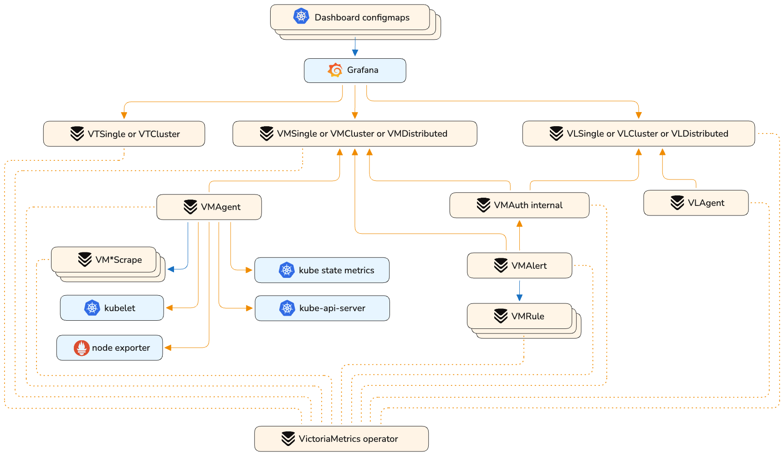

---
weight: 12
title: VictoriaMetrics K8s Stack
description: "Full Kubernetes monitoring stack with Operator, Grafana dashboards, ServiceScrapes, and VMRules."
menu:
  docs:
    parent: helm
    weight: 12
    identifier: helm-victoria-metrics-k8s-stack
url: /helm/victoria-metrics-k8s-stack/
aliases:
  - /helm/victoriametrics-k8s-stack/
tags:
  - metrics
  - kubernetes
---


Kubernetes monitoring on VictoriaMetrics stack. Includes VictoriaMetrics Operator, Grafana dashboards, ServiceScrapes and VMRules

* [Overview](https://docs.victoriametrics.com/helm/victoria-metrics-k8s-stack/#overview)
* [Configuration](https://docs.victoriametrics.com/helm/victoria-metrics-k8s-stack/#configuration)
* [Prerequisites](https://docs.victoriametrics.com/helm/victoria-metrics-k8s-stack/#prerequisites)
* [Dependencies](https://docs.victoriametrics.com/helm/victoria-metrics-k8s-stack/#dependencies)
* [Quick Start](https://docs.victoriametrics.com/helm/victoria-metrics-k8s-stack/#how-to-install)
* [Uninstall](https://docs.victoriametrics.com/helm/victoria-metrics-k8s-stack/#how-to-uninstall)
* [Version Upgrade](https://docs.victoriametrics.com/helm/victoria-metrics-k8s-stack/#upgrade-guide)
* [Troubleshooting](https://docs.victoriametrics.com/helm/victoria-metrics-k8s-stack/#troubleshooting)
* [Logs storage and collection](https://docs.victoriametrics.com/helm/victoria-metrics-k8s-stack/#logs-storage-and-collection)
* [Traces storage](https://docs.victoriametrics.com/helm/victoria-metrics-k8s-stack/#traces-storage)
* [Values](https://docs.victoriametrics.com/helm/victoria-metrics-k8s-stack/#parameters)

## Overview

This chart is an All-in-one solution to start monitoring and logging in a Kubernetes cluster.
It installs multiple dependency charts like [grafana](https://github.com/grafana/helm-charts/tree/main/charts/grafana), [node-exporter](https://github.com/prometheus-community/helm-charts/tree/main/charts/prometheus-node-exporter), [kube-state-metrics](https://github.com/prometheus-community/helm-charts/tree/main/charts/kube-state-metrics) and [victoria-metrics-operator](https://github.com/VictoriaMetrics/helm-charts/tree/master/charts/victoria-metrics-operator).
Also it installs Custom Resources like [VMSingle](https://docs.victoriametrics.com/operator/resources/vmsingle/), [VMCluster](https://docs.victoriametrics.com/operator/resources/vmcluster/), [VMAgent](https://docs.victoriametrics.com/operator/resources/vmagent/), [VMAlert](https://docs.victoriametrics.com/operator/resources/vmalert/) for metrics, optionally [VLSingle](https://docs.victoriametrics.com/operator/resources/vlsingle/), [VLCluster](https://docs.victoriametrics.com/operator/resources/vlcluster/), [VLAgent](https://docs.victoriametrics.com/operator/resources/vlagent/) for logs, and [VTSingle](https://docs.victoriametrics.com/operator/resources/vtsingle/), [VTCluster](https://docs.victoriametrics.com/operator/resources/vtcluster/) for traces.

By default, the operator [converts all existing prometheus-operator API objects](https://docs.victoriametrics.com/operator/integrations/prometheus/#objects-conversion) into corresponding VictoriaMetrics Operator objects.

To enable metrics collection for kubernetes this chart installs multiple scrape configurations for kubernetes components like kubelet and kube-proxy, etc. Metrics collection is done by [VMAgent](https://docs.victoriametrics.com/operator/resources/vmagent/). So if want to ship metrics to external VictoriaMetrics database you can disable VMSingle installation by setting `vmsingle.enabled` to `false` and setting `vmagent.vmagentSpec.remoteWrite.url` to your external VictoriaMetrics database.

This chart also installs bunch of dashboards and recording rules from [kube-prometheus](https://github.com/prometheus-operator/kube-prometheus) project.



## Configuration

Configuration of this chart is done through helm values.

### Dependencies

Dependencies can be enabled or disabled by setting `enabled` to `true` or `false` in `values.yaml` file.

**!Important:** for dependency charts anything that you can find in values.yaml of dependency chart can be configured in this chart under key for that dependency. For example if you want to configure `grafana` you can find all possible configuration options in the [Grafana chart README](https://github.com/grafana-community/helm-charts/tree/main/charts/grafana#configuration) and you should set them in values for this chart under grafana: key. For example if you want to configure `grafana.persistence.enabled` you should set it in values.yaml like this:
```yaml
#################################################
###              dependencies               #####
#################################################
# Grafana dependency chart configuration. For possible values refer to https://github.com/grafana-community/helm-charts/tree/main/charts/grafana#configuration
grafana:
  enabled: true
  persistence:
    type: pvc
    enabled: false
```

### VictoriaMetrics components

This chart installs multiple VictoriaMetrics components using Custom Resources that are managed by [victoria-metrics-operator](https://docs.victoriametrics.com/operator/resources/)
Each resource can be configured using `spec` of that resource from API docs of [victoria-metrics-operator](https://docs.victoriametrics.com/operator/api/). For example if you want to configure `VMAgent` you can find all possible configuration options in [API docs](https://docs.victoriametrics.com/operator/api/#vmagent) and you should set them in values for this chart under `vmagent.spec` key. For example if you want to configure `remoteWrite.url` you should set it in values.yaml like this:
```yaml
vmagent:
  spec:
    remoteWrite:
      - url: "https://insert.vmcluster.domain.com/insert/0/prometheus/api/v1/write"
```

### ArgoCD issues

#### Operator self signed certificates
When deploying K8s stack using ArgoCD without Cert Manager (`.Values.victoria-metrics-operator.admissionWebhooks.certManager.enabled: false`)
it will rerender operator's webhook certificates on each sync since Helm `lookup` function is not respected by ArgoCD.
To prevent this please update you K8s stack Application `spec.syncPolicy` and `spec.ignoreDifferences` with a following:

```yaml
apiVersion: argoproj.io/v1alpha1
kind: Application
...
spec:
  ...
  destination:
    ...
    namespace: <k8s-stack-namespace>
  ...
  syncPolicy:
    syncOptions:
    # https://argo-cd.readthedocs.io/en/stable/user-guide/sync-options/#respect-ignore-difference-configs
    # argocd must also ignore difference during apply stage
    # otherwise it ll silently override changes and cause a problem
    - RespectIgnoreDifferences=true
  ignoreDifferences:
    - group: ""
      kind: Secret
      name: <fullname>-validation
      namespace: <k8s-stack-namespace>
      jsonPointers:
        - /data
    - group: admissionregistration.k8s.io
      kind: ValidatingWebhookConfiguration
      name: <fullname>-admission
      jqPathExpressions:
      - '.webhooks[]?.clientConfig.caBundle'
```
where `<fullname>` is output of `{{ include "vm-operator.fullname" }}` for your setup

#### Grafana password changes constantly

When deploying K8s stack using ArgoCD with Grafana subchart enabled it will update Grafana password on each sync since Helm `lookup` function is not respected by ArgoCD.
To prevent this please update you K8s stack Application `spec.syncPolicy` and `spec.ignoreDifferences` with a following:

```yaml
apiVersion: argoproj.io/v1alpha1
kind: Application
...
spec:
  ...
  destination:
    ...
    namespace: <k8s-stack-namespace>
  ...
  syncPolicy:
    syncOptions:
    # https://argo-cd.readthedocs.io/en/stable/user-guide/sync-options/#respect-ignore-difference-configs
    # argocd must also ignore difference during apply stage
    # otherwise it ll silently override changes and cause a problem
    - RespectIgnoreDifferences=true
  ignoreDifferences:
    - kind: "Secret"
      jsonPointers:
        - /data/admin-password
    - group: apps
      kind: Deployment
      jsonPointers:
        - /spec/template/metadata/annotations/checksum~1secret
```

#### `metadata.annotations: Too long: must have at most 262144 bytes` on dashboards

If one of dashboards ConfigMap is failing with error `Too long: must have at most 262144 bytes`, please make sure you've added `argocd.argoproj.io/sync-options: ServerSideApply=true` annotation to your dashboards:

```yaml
defaultDashboards:
  annotations:
    argocd.argoproj.io/sync-options: ServerSideApply=true
```

#### Resources are not completely removed after chart uninstallation

This chart uses `pre-delete` Helm hook to cleanup resources managed by operator, but it's not supported in ArgoCD and this hook is ignored.
To have a control over resources removal please consider using either [ArgoCD sync phases and waves](https://argo-cd.readthedocs.io/en/stable/user-guide/sync-waves/) or [installing operator chart separately](https://docs.victoriametrics.com/helm/victoria-metrics-k8s-stack/#install-operator-separately)

### Rules and dashboards

This chart by default install multiple dashboards and recording rules from [kube-prometheus](https://github.com/prometheus-operator/kube-prometheus)
you can disable dashboards with `defaultDashboards.enabled: false` and `experimentalDashboardsEnabled: false`
and rules can be configured under `defaultRules`

### Adding external dashboards

By default, this chart uses sidecar in order to provision default dashboards. If you want to add you own dashboards there are two ways to do it:

- Add dashboards by creating a ConfigMap. An example ConfigMap:
```yaml
apiVersion: v1
kind: ConfigMap
metadata:
  labels:
    grafana_dashboard: "1"
  name: grafana-dashboard
data:
  dashboard.json: |-
      {...}
```

- Use init container provisioning. Note that this option requires disabling sidecar and will remove all default dashboards provided with this chart. An example configuration:
```yaml
grafana:
  sidecar:
    dashboards:
      enabled: false
  dashboards:
    default:
      vmcluster:
        gnetId: 11176
        revision: 45
        datasource: VictoriaMetrics
```
When using this approach, you can find dashboards for VictoriaMetrics components published [here](https://grafana.com/orgs/victoriametrics).

### Dashboards and rules in air-gapped environments

By default the sync-job downloads dashboards and rules from public URLs (GitHub raw content) at deploy time.
In environments without internet access there are several options.

#### Option 1: Pre-generate manifests and commit to source control

Run the sync-job binary locally against your `values.yaml` before deploying to the air-gapped cluster.
The binary is distributed as a container image.

**Step 1.** Render the sync-job config from your chart values:

```shell
helm template <RELEASE_NAME> vm/victoria-metrics-k8s-stack -f values.yaml \
  --show-only templates/sync-job/config.yaml \
  | yq '.data["config.yaml"]' > /tmp/sync-job-config.yaml
```

**Step 2.** Run the binary locally and capture the output:

```shell
docker run --rm \
  -e OUTPUT=- \
  -e NAMESPACE=<NAMESPACE> \
  -e RELEASE=<RELEASE_NAME> \
  -e RESOURCE_PREFIX=<RELEASE_NAME> \
  -e PRUNE=false \
  -e OWNER_REFERENCES=false \
  -v /tmp/sync-job-config.yaml:/etc/config/config.yaml:ro \
  ghcr.io/victoriametrics/sync-job:v0.0.11 > manifests.yaml
```

**Step 3.** Commit `manifests.yaml` to your source repository and apply it in the air-gapped cluster:

```shell
kubectl apply -f manifests.yaml
```

Disable the sync-job in your air-gapped deployment to prevent it from attempting to reach upstream sources:

```yaml
syncJob:
  enabled: false
```

#### Option 2: Route traffic through an HTTP proxy

If the cluster has a proxy with access to the internet, configure it in `syncJob.env`:

```yaml
syncJob:
  env:
    - name: HTTPS_PROXY
      value: "http://proxy.example.com:3128"
    - name: NO_PROXY
      value: "kubernetes.default.svc,10.0.0.0/8"
```

#### Option 3: Mirror sources to an internal server

Override `defaultDashboards.sources` and `defaultRules.sources` to point to an internal HTTP server
(Nginx, Nexus, Artifactory, etc.) that mirrors the upstream files:

```yaml
defaultDashboards:
  sources:
    victoriametrics-cluster:
      url: http://artifacts.internal/dashboards/victoriametrics.json
    victoriametrics-vmagent:
      url: http://artifacts.internal/dashboards/vmagent.json
    # ... override remaining sources

defaultRules:
  sources:
    etcd:
      url: http://artifacts.internal/rules/etcd-alerts.yaml
    # ... override remaining sources
```

The source keys match those defined in the default `values.yaml`; override only the ones you need.

### Prometheus scrape configs
This chart installs multiple scrape configurations for kubernetes monitoring. They are configured under `#ServiceMonitors` section in `values.yaml` file. For example if you want to configure scrape config for `kubelet` you should set it in values.yaml like this:
```yaml
kubelet:
  enabled: true
  # spec for VMNodeScrape crd
  # https://docs.victoriametrics.com/operator/api/#vmnodescrapespec
  spec:
    interval: "30s"
```

### Logs storage and collection

This chart supports {} deploying [VictoriaLogs](https://docs.victoriametrics.com/victorialogs/) alongside VictoriaMetrics for logs storage and collection.

#### Logs storage

Enable **VLSingle** for a single-node logs storage deployment:

```yaml
vlsingle:
  enabled: true
  spec:
    retentionPeriod: 30d
    storage:
      resources:
        requests:
          storage: 50Gi
```

Enable **VLCluster** for a highly-available clustered deployment (mutually exclusive with VLSingle):

```yaml
vlcluster:
  enabled: true
  spec:
    retentionPeriod: 30d
    vlstorage:
      replicaCount: 2
    vlselect:
      replicaCount: 2
    vlinsert:
      replicaCount: 2
```

To connect to an existing VictoriaLogs instance instead of deploying one, use the external URL configuration:

```yaml
external:
  vl:
    read:
      url: http://your-victorialogs-host:9428
    write:
      url: http://your-victorialogs-host:9428
```

#### Logs collection

Enable **VLAgent** to collect logs from Kubernetes pods and nodes:

```yaml
vlagent:
  enabled: true
  spec:
    k8sCollector:
      enabled: true
```

VLAgent automatically writes logs to the configured VictoriaLogs storage (VLSingle, VLCluster, or external). Additional remote write targets can be configured via `vlagent.additionalRemoteWrites`.

#### Grafana datasource for VictoriaLogs

When VLSingle, VLCluster, or an external VL URL is configured, a `VictoriaLogs (DS)` Grafana datasource is automatically provisioned. It requires the `victoriametrics-logs-datasource` Grafana plugin:

```yaml
grafana:
  plugins:
    - victoriametrics-logs-datasource
```

Without this plugin, the datasource entry will exist in Grafana but the plugin will not be available to use it.

#### VMAlert with both VictoriaMetrics and VictoriaLogs

When both a VM read endpoint (VLSingle, VMCluster, or external) and a VL read endpoint are configured and `vmalert.enabled` is `true`, the chart automatically deploys an internal VMAuth proxy that routes VMAlert datasource queries:

- `/select/logsql/.*` → VictoriaLogs (for LogsQL alert rules)
- `/.*` → VictoriaMetrics (for MetricsQL alert rules)

No additional configuration is needed — the routing is handled transparently. This allows VMAlert to evaluate both MetricsQL and LogsQL rules against the correct backend.

### Traces storage

This chart supports {} deploying [VictoriaTraces](https://docs.victoriametrics.com/victorialogs/) alongside VictoriaMetrics for distributed traces storage.

#### VTSingle (single-node)

Enable **VTSingle** for a single-node traces storage deployment:

```yaml
vtsingle:
  enabled: true
  spec:
    retentionPeriod: "7"    # days
    storage:
      resources:
        requests:
          storage: 20Gi
```

#### VTCluster

Enable **VTCluster** for a highly-available clustered deployment (mutually exclusive with VTSingle):

```yaml
vtcluster:
  enabled: true
  spec:
    retentionPeriod: 14d
    vtstorage:
      replicaCount: 2
```

#### External traces instance

To connect to an existing VictoriaTraces instance instead of deploying one:

```yaml
external:
  vt:
    read:
      url: http://your-victoriatraces-host:10428
    write:
      url: http://your-victoriatraces-host:10428
```

#### Grafana datasource for VictoriaTraces

When VTSingle, VTCluster, or an external VT URL is configured, a `VictoriaTraces` Grafana datasource is automatically provisioned. It uses the Jaeger-compatible API exposed at `<endpoint>/select/jaeger`:

| Field | Value |
|---|---|
| Name | `VictoriaTraces` |
| UID | `VictoriaTraces` |
| Type | `jaeger` |
| URL | auto-set from the VTSingle / VTCluster service endpoint |

The Jaeger datasource type is built into Grafana — no additional plugin is required.

Additional datasource properties can be customised under `defaultDatasources.victoriatraces.datasources`:

```yaml
defaultDatasources:
  victoriatraces:
    datasources:
      - name: VictoriaTraces
        uid: VictoriaTraces
        type: jaeger
        jsonData:
          tlsSkipVerify: true
```

### Using externally managed Grafana

If you want to use an externally managed Grafana instance but still want to use the dashboards provided by this chart you can set
 `.Values.grafana.enabled` to `false` and set `.Values.defaultDashboards.enabled` to `true`. This will install the dashboards
 but will not install Grafana.

For example:
```yaml
defaultDashboards:
  enabled: true

grafana:
  enabled: false
```

This will create ConfigMaps with dashboards to be imported into Grafana.

If additional configuration for labels or annotations is needed in order to import dashboard to an existing Grafana you can
set `.Values.grafana.sidecar.dashboards.additionalDashboardLabels` or `.Values.grafana.sidecar.dashboards.additionalDashboardAnnotations` in `values.yaml`:

For example:
```yaml
defaultDashboards:
  enabled: true
  labels:
    key: value
  annotations:
    key: value
```

### Using additional Grafana datasources

To add additional datasources set them using `.Values.defaultDatasources.extra` list property.
If datasource type is not `prometheus` or `alertmanager` please also add it to `.Values.grafana.plugins` list (even if it belongs to a [list of Grafana built-in datasources](https://grafana.com/docs/grafana/latest/datasources/#built-in-core-data-sources)):

```yaml
defaultDatasources:
  extra:
    - name: Loki
      type: loki
      url: http://loki-gateway.loki.svc.cluster.local
      uid: Loki
      access: proxy
      version: 1
      orgId: 1
      isDefault: false
      editable: false
      jsonData:
        httpMethod: GET
grafana:
  plugins:
    - loki
```

### Using alternative image registry

All images of VictoriaMetrics components are available on [Docker Hub](https://hub.docker.com/u/victoriametrics) and [Quay](https://quay.io/organization/victoriametrics).
It is possible to override default image registry for all components deployed by operator and operator itself by using the following values:
```yaml
global:
  image:
    registry: quay.io
victoria-metrics-operator:
  env:
    - name: VM_VMALERTMANAGER_ALERTMANAGERDEFAULTBASEIMAGE
      value: prometheus/alertmanager
```

## Prerequisites

Before installing this chart, ensure your environment meets the following requirements:

* **Kubernetes cluster** - A running Kubernetes cluster with sufficient resources
* **Helm** - Helm package manager installed and configured

Additional requirements depend on your configuration:

* **Persistent storage** - Required if you enable persistent volumes for data retention (enabled by default)
* **kubectl** - Needed for cluster management and troubleshooting

For installation instructions, refer to the official documentation:
* [Installing Helm](https://helm.sh/docs/intro/install/)
* [Installing kubectl](https://kubernetes.io/docs/tasks/tools/install-kubectl/)

## How to install

Access a Kubernetes cluster.

### Setup chart repository (can be omitted for OCI repositories)

Add a chart helm repository with follow commands:

```console
helm repo add vm https://victoriametrics.github.io/helm-charts/

helm repo update
```
List versions of `vm/victoria-metrics-k8s-stack` chart available to installation:

```console
helm search repo vm/victoria-metrics-k8s-stack -l
```

### Install `victoria-metrics-k8s-stack` chart

Export default values of `victoria-metrics-k8s-stack` chart to file `values.yaml`:

  - For HTTPS repository

    ```console
    helm show values vm/victoria-metrics-k8s-stack > values.yaml
    ```
  - For OCI repository

    ```console
    helm show values oci://ghcr.io/victoriametrics/helm-charts/victoria-metrics-k8s-stack > values.yaml
    ```

Change the values according to the need of the environment in ``values.yaml`` file.

> Consider setting `.Values.nameOverride` to a small value like `vmks` to avoid hitting resource name limits of 63 characters

Test the installation with command:

  - For HTTPS repository

    ```console
    helm install vmks vm/victoria-metrics-k8s-stack -f values.yaml -n NAMESPACE --debug --dry-run
    ```

  - For OCI repository

    ```console
    helm install vmks oci://ghcr.io/victoriametrics/helm-charts/victoria-metrics-k8s-stack -f values.yaml -n NAMESPACE --debug --dry-run
    ```

Install chart with command:

  - For HTTPS repository

    ```console
    helm install vmks vm/victoria-metrics-k8s-stack -f values.yaml -n NAMESPACE
    ```

  - For OCI repository

    ```console
    helm install vmks oci://ghcr.io/victoriametrics/helm-charts/victoria-metrics-k8s-stack -f values.yaml -n NAMESPACE
    ```

Get the pods lists by running this commands:

```console
kubectl get pods -A | grep 'vmks'
```

Get the application by running this command:

```console
helm list -f vmks -n NAMESPACE
```

See the history of versions of `vmks` application with command.

```console
helm history vmks -n NAMESPACE
```

### Install operator separately

To have control over an order of managed resources removal or to be able to remove a whole namespace with managed resources it's recommended to disable operator in k8s-stack chart (`victoria-metrics-operator.enabled: false`) and [install it](https://docs.victoriametrics.com/helm/victoria-metrics-operator/) separately. To move operator from existing k8s-stack release to a separate one please follow the steps below:

- disable cleanup webhook (`victoria-metrics-operator.crds.cleanup.enabled: false`) and apply changes
- disable operator (`victoria-metrics-operator.enabled: false`) and apply changes
- [deploy operator](https://docs.victoriametrics.com/helm/victoria-metrics-operator/) separately with `crds.plain: true`

If you're planning to delete k8s-stack by a whole namespace removal please consider deploying operator in a separate namespace as due to uncontrollable removal order process can hang if operator is removed before at least one resource it manages.

### Install locally (Minikube)

To run VictoriaMetrics stack locally it's possible to use [Minikube](https://github.com/kubernetes/minikube). To avoid dashboards and alert rules issues please follow the steps below:

Run Minikube cluster

```shell
minikube start --container-runtime=containerd --extra-config=scheduler.bind-address=0.0.0.0 --extra-config=controller-manager.bind-address=0.0.0.0 --extra-config=etcd.listen-metrics-urls=http://0.0.0.0:2381
```

Install helm chart

```shell
helm install [RELEASE_NAME] vm/victoria-metrics-k8s-stack -f values.yaml -f values.minikube.yaml -n NAMESPACE --debug --dry-run
```

## How to uninstall

Remove application with command.

```console
helm uninstall vmks -n NAMESPACE
```

CRDs created by this chart are not removed by default and should be manually cleaned up:

```shell
kubectl get crd | grep victoriametrics.com | awk '{print $1 }' | xargs -i kubectl delete crd {}
```

## Troubleshooting

- If you cannot install helm chart with error `configmap already exist`. It could happen because of name collisions, if you set too long release name.
  Kubernetes by default, allows only 63 symbols at resource names and all resource names are trimmed by helm to 63 symbols.
  To mitigate it, use shorter name for helm chart release name, like:
```shell
# stack - is short enough
helm upgrade -i stack vm/victoria-metrics-k8s-stack
```
  Or use override for helm chart release name:
```shell
helm upgrade -i some-very-long-name vm/victoria-metrics-k8s-stack --set fullnameOverride=stack
```

## Upgrade guide

Usually, helm upgrade doesn't requires manual actions. Just execute command:

```shell
$ helm upgrade [RELEASE_NAME] vm/victoria-metrics-k8s-stack
```

But release with CRD update can only be patched manually with kubectl.
Since helm does not perform a CRD update, we recommend that you always perform this when updating the helm-charts version:

```shell
# 1. check the changes in CRD
$ helm show crds vm/victoria-metrics-k8s-stack --version [YOUR_CHART_VERSION] | kubectl diff -f -

# 2. apply the changes (update CRD)
$ helm show crds vm/victoria-metrics-k8s-stack --version [YOUR_CHART_VERSION] | kubectl apply -f - --server-side
```

All other manual actions upgrades listed below:

### Upgrade to 0.29.0

To provide more flexibility for VMAuth configuration all `<component>.vmauth` params were moved to `vmauth.spec`.
Also `.vm.write` and `.vm.read` variables are available in `vmauth.spec`, which represent `vmsingle`, `vminsert`, `externalVM.write` and `vmsingle`, `vmselect`, `externalVM.read` parsed URLs respectively.

If your configuration in version < 0.29.0 looked like below:

```yaml
vmcluster:
  vmauth:
    vmselect:
      - src_paths:
          - /select/.*
        url_prefix:
          - /
    vminsert:
      - src_paths:
          - /insert/.*
        url_prefix:
          - /
```

In 0.29.0 it should look like:

```yaml
vmauth:
  spec:
    unauthorizedAccessConfig:
      - src_paths:
          - '{{ .vm.read.path }}/.*'
        url_prefix:
          - '{{ urlJoin (omit .vm.read "path") }}/'
      - src_paths:
          - '{{ .vm.write.path }}/.*'
        url_prefix:
          - '{{ urlJoin (omit .vm.write "path") }}/'
```

### Upgrade to 0.13.0

- node-exporter starting from version 4.0.0 is using the Kubernetes recommended labels. Therefore you have to delete the daemonset before you upgrade.

```shell
kubectl delete daemonset -l app=prometheus-node-exporter
```
- scrape configuration for kubernetes components was moved from `vmServiceScrape.spec` section to `spec` section. If you previously modified scrape configuration you need to update your `values.yaml`

- `grafana.defaultDashboardsEnabled` was renamed to `defaultDashboardsEnabled` (moved to top level). You may need to update it in your `values.yaml`

### Upgrade to 0.6.0

 All `CRD` must be update to the latest version with command:

```shell
kubectl apply -f https://raw.githubusercontent.com/VictoriaMetrics/helm-charts/master/charts/victoria-metrics-k8s-stack/crds/crd.yaml

```

### Upgrade to 0.4.0

 All `CRD` must be update to `v1` version with command:

```shell
kubectl apply -f https://raw.githubusercontent.com/VictoriaMetrics/helm-charts/master/charts/victoria-metrics-k8s-stack/crds/crd.yaml

```

### Upgrade from 0.2.8 to 0.2.9

 Update `VMAgent` crd

command:
```shell
kubectl apply -f https://raw.githubusercontent.com/VictoriaMetrics/operator/v0.16.0/config/crd/bases/operator.victoriametrics.com_vmagents.yaml
```

 ### Upgrade from 0.2.5 to 0.2.6

New CRD added to operator - `VMUser` and `VMAuth`, new fields added to exist crd.
Manual commands:
```shell
kubectl apply -f https://raw.githubusercontent.com/VictoriaMetrics/operator/v0.15.0/config/crd/bases/operator.victoriametrics.com_vmusers.yaml
kubectl apply -f https://raw.githubusercontent.com/VictoriaMetrics/operator/v0.15.0/config/crd/bases/operator.victoriametrics.com_vmauths.yaml
kubectl apply -f https://raw.githubusercontent.com/VictoriaMetrics/operator/v0.15.0/config/crd/bases/operator.victoriametrics.com_vmalerts.yaml
kubectl apply -f https://raw.githubusercontent.com/VictoriaMetrics/operator/v0.15.0/config/crd/bases/operator.victoriametrics.com_vmagents.yaml
kubectl apply -f https://raw.githubusercontent.com/VictoriaMetrics/operator/v0.15.0/config/crd/bases/operator.victoriametrics.com_vmsingles.yaml
kubectl apply -f https://raw.githubusercontent.com/VictoriaMetrics/operator/v0.15.0/config/crd/bases/operator.victoriametrics.com_vmclusters.yaml
```

## Parameters

The following tables lists the configurable parameters of the chart and their default values.

Change the values according to the need of the environment in ``victoria-metrics-k8s-stack/values.yaml`` file.

<table class="helm-vars">
  <thead>
    <th class="helm-vars-key">Key</th>
    <th class="helm-vars-description">Description</th>
  </thead>
  <tbody>
    <tr id="additionalvictoriametricsmap">
      <td><a href="#additionalvictoriametricsmap"><pre class="chroma"><code><span class="line"><span class="cl"><span class="nt">additionalVictoriaMetricsMap</span><span class="p">:</span><span class="w"> </span>{}</span></span></code></pre>
</a></td>
      <td><em><code>(object)</code></em><p>deprecated. use extraRules instead</p>
</td>
    </tr>
    <tr id="alertmanager-annotations">
      <td><a href="#alertmanager-annotations"><pre class="chroma"><code><span class="line"><span class="cl"><span class="nt">alertmanager.annotations</span><span class="p">:</span><span class="w"> </span>{}</span></span></code></pre>
</a></td>
      <td><em><code>(object)</code></em><p>VMAlertmanager annotations</p>
</td>
    </tr>
    <tr id="alertmanager-config">
      <td><a href="#alertmanager-config"><pre class="chroma"><code><span class="line"><span class="cl"><span class="nt">alertmanager.config</span><span class="p">:</span><span class="w">
</span></span></span><span class="line"><span class="cl"><span class="w">    </span><span class="nt">receivers</span><span class="p">:</span><span class="w">
</span></span></span><span class="line"><span class="cl"><span class="w">        </span>- <span class="nt">name</span><span class="p">:</span><span class="w"> </span><span class="l">blackhole</span><span class="w">
</span></span></span><span class="line"><span class="cl"><span class="w">    </span><span class="nt">route</span><span class="p">:</span><span class="w">
</span></span></span><span class="line"><span class="cl"><span class="w">        </span><span class="nt">receiver</span><span class="p">:</span><span class="w"> </span><span class="l">blackhole</span></span></span></code></pre>
</a></td>
      <td><em><code>(object)</code></em><p>VMAlertmanager configuration</p>
</td>
    </tr>
    <tr id="alertmanager-enabled">
      <td><a href="#alertmanager-enabled"><pre class="chroma"><code><span class="line"><span class="cl"><span class="nt">alertmanager.enabled</span><span class="p">:</span><span class="w"> </span><span class="kc">true</span></span></span></code></pre>
</a></td>
      <td><em><code>(bool)</code></em><p>Create VMAlertmanager CR</p>
</td>
    </tr>
    <tr id="alertmanager-ingress">
      <td><a href="#alertmanager-ingress"><pre class="chroma"><code><span class="line"><span class="cl"><span class="nt">alertmanager.ingress</span><span class="p">:</span><span class="w">
</span></span></span><span class="line"><span class="cl"><span class="w">    </span><span class="nt">annotations</span><span class="p">:</span><span class="w"> </span>{}<span class="w">
</span></span></span><span class="line"><span class="cl"><span class="w">    </span><span class="nt">enabled</span><span class="p">:</span><span class="w"> </span><span class="kc">false</span><span class="w">
</span></span></span><span class="line"><span class="cl"><span class="w">    </span><span class="nt">extraPaths</span><span class="p">:</span><span class="w"> </span><span class="p">[]</span><span class="w">
</span></span></span><span class="line"><span class="cl"><span class="w">    </span><span class="nt">hosts</span><span class="p">:</span><span class="w">
</span></span></span><span class="line"><span class="cl"><span class="w">        </span>- <span class="l">alertmanager.domain.com</span><span class="w">
</span></span></span><span class="line"><span class="cl"><span class="w">    </span><span class="nt">labels</span><span class="p">:</span><span class="w"> </span>{}<span class="w">
</span></span></span><span class="line"><span class="cl"><span class="w">    </span><span class="nt">path</span><span class="p">:</span><span class="w"> </span><span class="s1">&#39;{{ .Values.alertmanager.spec.routePrefix | default &#34;/&#34; }}&#39;</span><span class="w">
</span></span></span><span class="line"><span class="cl"><span class="w">    </span><span class="nt">pathType</span><span class="p">:</span><span class="w"> </span><span class="l">Prefix</span><span class="w">
</span></span></span><span class="line"><span class="cl"><span class="w">    </span><span class="nt">tls</span><span class="p">:</span><span class="w"> </span><span class="p">[]</span></span></span></code></pre>
</a></td>
      <td><em><code>(object)</code></em><p>VMAlertmanager ingress configuration</p>
</td>
    </tr>
    <tr id="alertmanager-ingress-extrapaths">
      <td><a href="#alertmanager-ingress-extrapaths"><pre class="chroma"><code><span class="line"><span class="cl"><span class="nt">alertmanager.ingress.extraPaths</span><span class="p">:</span><span class="w"> </span><span class="p">[]</span></span></span></code></pre>
</a></td>
      <td><em><code>(list)</code></em><p>Extra paths to prepend to every host configuration. This is useful when working with annotation based services.</p>
</td>
    </tr>
    <tr id="alertmanager-labels">
      <td><a href="#alertmanager-labels"><pre class="chroma"><code><span class="line"><span class="cl"><span class="nt">alertmanager.labels</span><span class="p">:</span><span class="w"> </span>{}</span></span></code></pre>
</a></td>
      <td><em><code>(object)</code></em><p>VMAlertmanager labels</p>
</td>
    </tr>
    <tr id="alertmanager-monzotemplate">
      <td><a href="#alertmanager-monzotemplate"><pre class="chroma"><code><span class="line"><span class="cl"><span class="nt">alertmanager.monzoTemplate</span><span class="p">:</span><span class="w">
</span></span></span><span class="line"><span class="cl"><span class="w">    </span><span class="nt">enabled</span><span class="p">:</span><span class="w"> </span><span class="kc">true</span></span></span></code></pre>
</a></td>
      <td><em><code>(object)</code></em><p>Better alert templates for <a href="https://gist.github.com/milesbxf/e2744fc90e9c41b47aa47925f8ff6512" target="_blank">slack source</a></p>
</td>
    </tr>
    <tr id="alertmanager-namespaceoverride">
      <td><a href="#alertmanager-namespaceoverride"><pre class="chroma"><code><span class="line"><span class="cl"><span class="nt">alertmanager.namespaceOverride</span><span class="p">:</span><span class="w"> </span><span class="s2">&#34;&#34;</span></span></span></code></pre>
</a></td>
      <td><em><code>(string)</code></em><p>Override the namespace for this component. When set, deploys the CR to a different namespace than the release namespace.</p>
</td>
    </tr>
    <tr id="alertmanager-route">
      <td><a href="#alertmanager-route"><pre class="chroma"><code><span class="line"><span class="cl"><span class="nt">alertmanager.route</span><span class="p">:</span><span class="w">
</span></span></span><span class="line"><span class="cl"><span class="w">    </span><span class="nt">annotations</span><span class="p">:</span><span class="w"> </span>{}<span class="w">
</span></span></span><span class="line"><span class="cl"><span class="w">    </span><span class="nt">enabled</span><span class="p">:</span><span class="w"> </span><span class="kc">false</span><span class="w">
</span></span></span><span class="line"><span class="cl"><span class="w">    </span><span class="nt">extraRules</span><span class="p">:</span><span class="w"> </span><span class="p">[]</span><span class="w">
</span></span></span><span class="line"><span class="cl"><span class="w">    </span><span class="nt">filters</span><span class="p">:</span><span class="w"> </span><span class="p">[]</span><span class="w">
</span></span></span><span class="line"><span class="cl"><span class="w">    </span><span class="nt">hostnames</span><span class="p">:</span><span class="w"> </span><span class="p">[]</span><span class="w">
</span></span></span><span class="line"><span class="cl"><span class="w">    </span><span class="nt">labels</span><span class="p">:</span><span class="w"> </span>{}<span class="w">
</span></span></span><span class="line"><span class="cl"><span class="w">    </span><span class="nt">matches</span><span class="p">:</span><span class="w">
</span></span></span><span class="line"><span class="cl"><span class="w">        </span>- <span class="nt">path</span><span class="p">:</span><span class="w">
</span></span></span><span class="line"><span class="cl"><span class="w">            </span><span class="nt">type</span><span class="p">:</span><span class="w"> </span><span class="l">PathPrefix</span><span class="w">
</span></span></span><span class="line"><span class="cl"><span class="w">            </span><span class="nt">value</span><span class="p">:</span><span class="w"> </span><span class="s1">&#39;{{ .Values.alertmanager.spec.routePrefix | default &#34;/&#34; }}&#39;</span><span class="w">
</span></span></span><span class="line"><span class="cl"><span class="w">    </span><span class="nt">parentRefs</span><span class="p">:</span><span class="w"> </span><span class="p">[]</span><span class="w">
</span></span></span><span class="line"><span class="cl"><span class="w">    </span><span class="nt">port</span><span class="p">:</span><span class="w"> </span><span class="s1">&#39;{{ .Values.alertmanager.spec.port }}&#39;</span></span></span></code></pre>
</a></td>
      <td><em><code>(object)</code></em><p>VMAlertmanager route configuration</p>
</td>
    </tr>
    <tr id="alertmanager-route-annotations">
      <td><a href="#alertmanager-route-annotations"><pre class="chroma"><code><span class="line"><span class="cl"><span class="nt">alertmanager.route.annotations</span><span class="p">:</span><span class="w"> </span>{}</span></span></code></pre>
</a></td>
      <td><em><code>(object)</code></em><p>HTTPRoute annotations</p>
</td>
    </tr>
    <tr id="alertmanager-route-enabled">
      <td><a href="#alertmanager-route-enabled"><pre class="chroma"><code><span class="line"><span class="cl"><span class="nt">alertmanager.route.enabled</span><span class="p">:</span><span class="w"> </span><span class="kc">false</span></span></span></code></pre>
</a></td>
      <td><em><code>(bool)</code></em><p>Enable deployment of HTTPRoute for alertmanager component</p>
</td>
    </tr>
    <tr id="alertmanager-route-extrarules">
      <td><a href="#alertmanager-route-extrarules"><pre class="chroma"><code><span class="line"><span class="cl"><span class="nt">alertmanager.route.extraRules</span><span class="p">:</span><span class="w"> </span><span class="p">[]</span></span></span></code></pre>
</a></td>
      <td><em><code>(list)</code></em><p>Extra rules to prepend to route. This is useful when working with annotation based services.</p>
</td>
    </tr>
    <tr id="alertmanager-route-filters">
      <td><a href="#alertmanager-route-filters"><pre class="chroma"><code><span class="line"><span class="cl"><span class="nt">alertmanager.route.filters</span><span class="p">:</span><span class="w"> </span><span class="p">[]</span></span></span></code></pre>
</a></td>
      <td><em><code>(list)</code></em><p>Filters for a default rule in HTTPRoute</p>
</td>
    </tr>
    <tr id="alertmanager-route-hostnames">
      <td><a href="#alertmanager-route-hostnames"><pre class="chroma"><code><span class="line"><span class="cl"><span class="nt">alertmanager.route.hostnames</span><span class="p">:</span><span class="w"> </span><span class="p">[]</span></span></span></code></pre>
</a></td>
      <td><em><code>(list)</code></em><p>Array of hostnames</p>
</td>
    </tr>
    <tr id="alertmanager-route-labels">
      <td><a href="#alertmanager-route-labels"><pre class="chroma"><code><span class="line"><span class="cl"><span class="nt">alertmanager.route.labels</span><span class="p">:</span><span class="w"> </span>{}</span></span></code></pre>
</a></td>
      <td><em><code>(object)</code></em><p>HTTPRoute extra labels</p>
</td>
    </tr>
    <tr id="alertmanager-route-matches">
      <td><a href="#alertmanager-route-matches"><pre class="chroma"><code><span class="line"><span class="cl"><span class="nt">alertmanager.route.matches</span><span class="p">:</span><span class="w">
</span></span></span><span class="line"><span class="cl"><span class="w">    </span>- <span class="nt">path</span><span class="p">:</span><span class="w">
</span></span></span><span class="line"><span class="cl"><span class="w">        </span><span class="nt">type</span><span class="p">:</span><span class="w"> </span><span class="l">PathPrefix</span><span class="w">
</span></span></span><span class="line"><span class="cl"><span class="w">        </span><span class="nt">value</span><span class="p">:</span><span class="w"> </span><span class="s1">&#39;{{ .Values.alertmanager.spec.routePrefix | default &#34;/&#34; }}&#39;</span></span></span></code></pre>
</a></td>
      <td><em><code>(list)</code></em><p>Matches for a default rule in HTTPRoute</p>
</td>
    </tr>
    <tr id="alertmanager-route-parentrefs">
      <td><a href="#alertmanager-route-parentrefs"><pre class="chroma"><code><span class="line"><span class="cl"><span class="nt">alertmanager.route.parentRefs</span><span class="p">:</span><span class="w"> </span><span class="p">[]</span></span></span></code></pre>
</a></td>
      <td><em><code>(list)</code></em><p>HTTPGateway objects refs</p>
</td>
    </tr>
    <tr id="alertmanager-route-port">
      <td><a href="#alertmanager-route-port"><pre class="chroma"><code><span class="line"><span class="cl"><span class="nt">alertmanager.route.port</span><span class="p">:</span><span class="w"> </span><span class="s1">&#39;{{ .Values.alertmanager.spec.port }}&#39;</span></span></span></code></pre>
</a></td>
      <td><em><code>(string)</code></em><p>Route port</p>
</td>
    </tr>
    <tr id="alertmanager-spec">
      <td><a href="#alertmanager-spec"><pre class="chroma"><code><span class="line"><span class="cl"><span class="nt">alertmanager.spec</span><span class="p">:</span><span class="w">
</span></span></span><span class="line"><span class="cl"><span class="w">    </span><span class="nt">configSecret</span><span class="p">:</span><span class="w"> </span><span class="s2">&#34;&#34;</span><span class="w">
</span></span></span><span class="line"><span class="cl"><span class="w">    </span><span class="nt">externalURL</span><span class="p">:</span><span class="w"> </span><span class="s2">&#34;&#34;</span><span class="w">
</span></span></span><span class="line"><span class="cl"><span class="w">    </span><span class="nt">image</span><span class="p">:</span><span class="w">
</span></span></span><span class="line"><span class="cl"><span class="w">        </span><span class="nt">tag</span><span class="p">:</span><span class="w"> </span><span class="s2">&#34;&#34;</span><span class="w">
</span></span></span><span class="line"><span class="cl"><span class="w">    </span><span class="nt">port</span><span class="p">:</span><span class="w"> </span><span class="s2">&#34;9093&#34;</span><span class="w">
</span></span></span><span class="line"><span class="cl"><span class="w">    </span><span class="nt">replicaCount</span><span class="p">:</span><span class="w"> </span><span class="m">1</span><span class="w">
</span></span></span><span class="line"><span class="cl"><span class="w">    </span><span class="nt">routePrefix</span><span class="p">:</span><span class="w"> </span><span class="l">/</span><span class="w">
</span></span></span><span class="line"><span class="cl"><span class="w">    </span><span class="nt">selectAllByDefault</span><span class="p">:</span><span class="w"> </span><span class="kc">true</span></span></span></code></pre>
</a></td>
      <td><em><code>(object)</code></em><p>Full spec for VMAlertmanager CRD. Allowed values described <a href="https://docs.victoriametrics.com/operator/api/#vmalertmanagerspec" target="_blank">here</a></p>
</td>
    </tr>
    <tr id="alertmanager-spec-configsecret">
      <td><a href="#alertmanager-spec-configsecret"><pre class="chroma"><code><span class="line"><span class="cl"><span class="nt">alertmanager.spec.configSecret</span><span class="p">:</span><span class="w"> </span><span class="s2">&#34;&#34;</span></span></span></code></pre>
</a></td>
      <td><em><code>(string)</code></em><p>If this one defined, it will be used for alertmanager configuration and config parameter will be ignored</p>
</td>
    </tr>
    <tr id="alertmanager-spec-image-tag">
      <td><a href="#alertmanager-spec-image-tag"><pre class="chroma"><code><span class="line"><span class="cl"><span class="nt">alertmanager.spec.image.tag</span><span class="p">:</span><span class="w"> </span><span class="s2">&#34;&#34;</span></span></span></code></pre>
</a></td>
      <td><em><code>(string)</code></em><p>Alertmanager image tag. Defaults to <code>global.versions.alertmanager</code> when empty.</p>
</td>
    </tr>
    <tr id="alertmanager-templatefiles">
      <td><a href="#alertmanager-templatefiles"><pre class="chroma"><code><span class="line"><span class="cl"><span class="nt">alertmanager.templateFiles</span><span class="p">:</span><span class="w"> </span>{}</span></span></code></pre>
</a></td>
      <td><em><code>(object)</code></em><p>Extra alert templates</p>
</td>
    </tr>
    <tr id="alertmanager-usemanagedconfig">
      <td><a href="#alertmanager-usemanagedconfig"><pre class="chroma"><code><span class="line"><span class="cl"><span class="nt">alertmanager.useManagedConfig</span><span class="p">:</span><span class="w"> </span><span class="kc">false</span></span></span></code></pre>
</a></td>
      <td><em><code>(bool)</code></em><p>enable storing .Values.alertmanager.config in VMAlertmanagerConfig instead of k8s Secret.
Note: VMAlertmanagerConfig and plain VMAlertmanager config structures are not equal.
If you&rsquo;re migrating existing config, please make sure that <code>.Values.alertmanager.config</code>:</p>

<ul>
<li>with <code>useManagedConfig: false</code> has structure described <a href="https://prometheus.io/docs/alerting/latest/configuration/" target="_blank">here</a>.</li>
<li>with <code>useManagedConfig: true</code> has structure described <a href="https://docs.victoriametrics.com/operator/api/#vmalertmanagerconfig" target="_blank">here</a>.</li>
</ul>
</td>
    </tr>
    <tr id="argocdreleaseoverride">
      <td><a href="#argocdreleaseoverride"><pre class="chroma"><code><span class="line"><span class="cl"><span class="nt">argocdReleaseOverride</span><span class="p">:</span><span class="w"> </span><span class="s2">&#34;&#34;</span></span></span></code></pre>
</a></td>
      <td><em><code>(string)</code></em><p>If this chart is used in &ldquo;Argocd&rdquo; with &ldquo;releaseName&rdquo; field then VMServiceScrapes couldn&rsquo;t select the proper services. For correct working need set value &lsquo;argocdReleaseOverride=$ARGOCD_APP_NAME&rsquo;</p>
</td>
    </tr>
    <tr id="coredns-enabled">
      <td><a href="#coredns-enabled"><pre class="chroma"><code><span class="line"><span class="cl"><span class="nt">coreDns.enabled</span><span class="p">:</span><span class="w"> </span><span class="kc">true</span></span></span></code></pre>
</a></td>
      <td><em><code>(bool)</code></em><p>Enabled CoreDNS metrics scraping</p>
</td>
    </tr>
    <tr id="coredns-service-enabled">
      <td><a href="#coredns-service-enabled"><pre class="chroma"><code><span class="line"><span class="cl"><span class="nt">coreDns.service.enabled</span><span class="p">:</span><span class="w"> </span><span class="kc">true</span></span></span></code></pre>
</a></td>
      <td><em><code>(bool)</code></em><p>Create service for CoreDNS metrics</p>
</td>
    </tr>
    <tr id="coredns-service-labels">
      <td><a href="#coredns-service-labels"><pre class="chroma"><code><span class="line"><span class="cl"><span class="nt">coreDns.service.labels</span><span class="p">:</span><span class="w"> </span>{}</span></span></code></pre>
</a></td>
      <td><em><code>(object)</code></em><p>CoreDNS service labels</p>
</td>
    </tr>
    <tr id="coredns-service-port">
      <td><a href="#coredns-service-port"><pre class="chroma"><code><span class="line"><span class="cl"><span class="nt">coreDns.service.port</span><span class="p">:</span><span class="w"> </span><span class="m">9153</span></span></span></code></pre>
</a></td>
      <td><em><code>(int)</code></em><p>CoreDNS service port</p>
</td>
    </tr>
    <tr id="coredns-service-selector">
      <td><a href="#coredns-service-selector"><pre class="chroma"><code><span class="line"><span class="cl"><span class="nt">coreDns.service.selector</span><span class="p">:</span><span class="w">
</span></span></span><span class="line"><span class="cl"><span class="w">    </span><span class="nt">k8s-app</span><span class="p">:</span><span class="w"> </span><span class="l">kube-dns</span></span></span></code></pre>
</a></td>
      <td><em><code>(object)</code></em><p>CoreDNS service pod selector</p>
</td>
    </tr>
    <tr id="coredns-service-targetport">
      <td><a href="#coredns-service-targetport"><pre class="chroma"><code><span class="line"><span class="cl"><span class="nt">coreDns.service.targetPort</span><span class="p">:</span><span class="w"> </span><span class="m">9153</span></span></span></code></pre>
</a></td>
      <td><em><code>(int)</code></em><p>CoreDNS service target port</p>
</td>
    </tr>
    <tr id="coredns-vmscrape">
      <td><a href="#coredns-vmscrape"><pre class="chroma"><code><span class="line"><span class="cl"><span class="nt">coreDns.vmScrape</span><span class="p">:</span><span class="w">
</span></span></span><span class="line"><span class="cl"><span class="w">    </span><span class="nt">spec</span><span class="p">:</span><span class="w">
</span></span></span><span class="line"><span class="cl"><span class="w">        </span><span class="nt">endpoints</span><span class="p">:</span><span class="w">
</span></span></span><span class="line"><span class="cl"><span class="w">            </span>- <span class="nt">bearerTokenFile</span><span class="p">:</span><span class="w"> </span><span class="l">/var/run/secrets/kubernetes.io/serviceaccount/token</span><span class="w">
</span></span></span><span class="line"><span class="cl"><span class="w">              </span><span class="nt">port</span><span class="p">:</span><span class="w"> </span><span class="l">http-metrics</span><span class="w">
</span></span></span><span class="line"><span class="cl"><span class="w">        </span><span class="nt">jobLabel</span><span class="p">:</span><span class="w"> </span><span class="l">app.kubernetes.io/component</span><span class="w">
</span></span></span><span class="line"><span class="cl"><span class="w">        </span><span class="nt">namespaceSelector</span><span class="p">:</span><span class="w">
</span></span></span><span class="line"><span class="cl"><span class="w">            </span><span class="nt">matchNames</span><span class="p">:</span><span class="w"> </span><span class="p">[]</span></span></span></code></pre>
</a></td>
      <td><em><code>(object)</code></em><p>Spec for VMServiceScrape CRD is <a href="https://docs.victoriametrics.com/operator/api/#vmservicescrapespec" target="_blank">here</a></p>
</td>
    </tr>
    <tr id="defaultdashboards-annotations">
      <td><a href="#defaultdashboards-annotations"><pre class="chroma"><code><span class="line"><span class="cl"><span class="nt">defaultDashboards.annotations</span><span class="p">:</span><span class="w"> </span>{}</span></span></code></pre>
</a></td>
      <td><em><code>(object)</code></em><p>Additional annotations for dashboard resources</p>
</td>
    </tr>
    <tr id="defaultdashboards-dashboards">
      <td><a href="#defaultdashboards-dashboards"><pre class="chroma"><code><span class="line"><span class="cl"><span class="nt">defaultDashboards.dashboards</span><span class="p">:</span><span class="w">
</span></span></span><span class="line"><span class="cl"><span class="w">    </span><span class="nt">alertmanager-overview</span><span class="p">:</span><span class="w">
</span></span></span><span class="line"><span class="cl"><span class="w">        </span><span class="nt">enabled</span><span class="p">:</span><span class="w"> </span><span class="s1">&#39;{{ .Values.alertmanager.enabled }}&#39;</span><span class="w">
</span></span></span><span class="line"><span class="cl"><span class="w">    </span><span class="nt">controller-manager</span><span class="p">:</span><span class="w">
</span></span></span><span class="line"><span class="cl"><span class="w">        </span><span class="nt">enabled</span><span class="p">:</span><span class="w"> </span><span class="s1">&#39;{{ .Values.kubeControllerManager.enabled }}&#39;</span><span class="w">
</span></span></span><span class="line"><span class="cl"><span class="w">    </span><span class="nt">grafana-overview</span><span class="p">:</span><span class="w">
</span></span></span><span class="line"><span class="cl"><span class="w">        </span><span class="nt">enabled</span><span class="p">:</span><span class="w"> </span><span class="s1">&#39;{{ .Values.grafana.enabled }}&#39;</span><span class="w">
</span></span></span><span class="line"><span class="cl"><span class="w">    </span><span class="nt">kubelet</span><span class="p">:</span><span class="w">
</span></span></span><span class="line"><span class="cl"><span class="w">        </span><span class="nt">enabled</span><span class="p">:</span><span class="w"> </span><span class="s1">&#39;{{ .Values.kubelet.enabled }}&#39;</span><span class="w">
</span></span></span><span class="line"><span class="cl"><span class="w">    </span><span class="nt">node-exporter-full</span><span class="p">:</span><span class="w">
</span></span></span><span class="line"><span class="cl"><span class="w">        </span><span class="nt">clusterMetric</span><span class="p">:</span><span class="w"> </span><span class="l">node_uname_info</span><span class="w">
</span></span></span><span class="line"><span class="cl"><span class="w">        </span><span class="nt">enabled</span><span class="p">:</span><span class="w"> </span><span class="kc">true</span><span class="w">
</span></span></span><span class="line"><span class="cl"><span class="w">    </span><span class="nt">proxy</span><span class="p">:</span><span class="w">
</span></span></span><span class="line"><span class="cl"><span class="w">        </span><span class="nt">enabled</span><span class="p">:</span><span class="w"> </span><span class="s1">&#39;{{ .Values.kubeProxy.enabled }}&#39;</span><span class="w">
</span></span></span><span class="line"><span class="cl"><span class="w">    </span><span class="nt">scheduler</span><span class="p">:</span><span class="w">
</span></span></span><span class="line"><span class="cl"><span class="w">        </span><span class="nt">enabled</span><span class="p">:</span><span class="w"> </span><span class="s1">&#39;{{ .Values.kubeScheduler.enabled }}&#39;</span><span class="w">
</span></span></span><span class="line"><span class="cl"><span class="w">    </span><span class="nt">victorialogs-cluster</span><span class="p">:</span><span class="w">
</span></span></span><span class="line"><span class="cl"><span class="w">        </span><span class="nt">clusterMetric</span><span class="p">:</span><span class="w"> </span><span class="l">vm_app_version</span><span class="w">
</span></span></span><span class="line"><span class="cl"><span class="w">    </span><span class="nt">victorialogs-single-node</span><span class="p">:</span><span class="w">
</span></span></span><span class="line"><span class="cl"><span class="w">        </span><span class="nt">clusterMetric</span><span class="p">:</span><span class="w"> </span><span class="l">vm_app_version</span><span class="w">
</span></span></span><span class="line"><span class="cl"><span class="w">    </span><span class="nt">victorialogs-vlagent</span><span class="p">:</span><span class="w">
</span></span></span><span class="line"><span class="cl"><span class="w">        </span><span class="nt">clusterMetric</span><span class="p">:</span><span class="w"> </span><span class="l">vm_app_version</span><span class="w">
</span></span></span><span class="line"><span class="cl"><span class="w">    </span><span class="nt">victoriametrics-cluster</span><span class="p">:</span><span class="w">
</span></span></span><span class="line"><span class="cl"><span class="w">        </span><span class="nt">clusterMetric</span><span class="p">:</span><span class="w"> </span><span class="l">vm_app_version</span><span class="w">
</span></span></span><span class="line"><span class="cl"><span class="w">    </span><span class="nt">victoriametrics-operator</span><span class="p">:</span><span class="w">
</span></span></span><span class="line"><span class="cl"><span class="w">        </span><span class="nt">clusterMetric</span><span class="p">:</span><span class="w"> </span><span class="l">vm_app_version</span><span class="w">
</span></span></span><span class="line"><span class="cl"><span class="w">        </span><span class="nt">enabled</span><span class="p">:</span><span class="w"> </span><span class="kc">true</span><span class="w">
</span></span></span><span class="line"><span class="cl"><span class="w">    </span><span class="nt">victoriametrics-single-node</span><span class="p">:</span><span class="w">
</span></span></span><span class="line"><span class="cl"><span class="w">        </span><span class="nt">clusterMetric</span><span class="p">:</span><span class="w"> </span><span class="l">vm_app_version</span><span class="w">
</span></span></span><span class="line"><span class="cl"><span class="w">    </span><span class="nt">victoriametrics-vmagent</span><span class="p">:</span><span class="w">
</span></span></span><span class="line"><span class="cl"><span class="w">        </span><span class="nt">clusterMetric</span><span class="p">:</span><span class="w"> </span><span class="l">vm_app_version</span><span class="w">
</span></span></span><span class="line"><span class="cl"><span class="w">    </span><span class="nt">victoriametrics-vmalert</span><span class="p">:</span><span class="w">
</span></span></span><span class="line"><span class="cl"><span class="w">        </span><span class="nt">clusterMetric</span><span class="p">:</span><span class="w"> </span><span class="l">vm_app_version</span><span class="w">
</span></span></span><span class="line"><span class="cl"><span class="w">        </span><span class="nt">enabled</span><span class="p">:</span><span class="w"> </span><span class="kc">true</span><span class="w">
</span></span></span><span class="line"><span class="cl"><span class="w">    </span><span class="nt">victoriatraces-cluster</span><span class="p">:</span><span class="w">
</span></span></span><span class="line"><span class="cl"><span class="w">        </span><span class="nt">clusterMetric</span><span class="p">:</span><span class="w"> </span><span class="l">vm_app_version</span><span class="w">
</span></span></span><span class="line"><span class="cl"><span class="w">    </span><span class="nt">victoriatraces-single-node</span><span class="p">:</span><span class="w">
</span></span></span><span class="line"><span class="cl"><span class="w">        </span><span class="nt">clusterMetric</span><span class="p">:</span><span class="w"> </span><span class="l">vm_app_version</span></span></span></code></pre>
</a></td>
      <td><em><code>(object)</code></em><p>Per-dashboard configuration. Keys match dashboard names from JSON content. Set enabled: false to skip a dashboard. Set clusterMetric to patch the cluster variable query.</p>
</td>
    </tr>
    <tr id="defaultdashboards-enabled">
      <td><a href="#defaultdashboards-enabled"><pre class="chroma"><code><span class="line"><span class="cl"><span class="nt">defaultDashboards.enabled</span><span class="p">:</span><span class="w"> </span><span class="kc">true</span></span></span></code></pre>
</a></td>
      <td><em><code>(bool)</code></em><p>Enable dashboard sync via sync-job</p>
</td>
    </tr>
    <tr id="defaultdashboards-grafanaoperator-enabled">
      <td><a href="#defaultdashboards-grafanaoperator-enabled"><pre class="chroma"><code><span class="line"><span class="cl"><span class="nt">defaultDashboards.grafanaOperator.enabled</span><span class="p">:</span><span class="w"> </span><span class="kc">false</span></span></span></code></pre>
</a></td>
      <td><em><code>(bool)</code></em><p>Create GrafanaDashboard CRDs instead of ConfigMaps (requires grafana-operator)</p>
</td>
    </tr>
    <tr id="defaultdashboards-grafanaoperator-spec-allowcrossnamespaceimport">
      <td><a href="#defaultdashboards-grafanaoperator-spec-allowcrossnamespaceimport"><pre class="chroma"><code><span class="line"><span class="cl"><span class="nt">defaultDashboards.grafanaOperator.spec.allowCrossNamespaceImport</span><span class="p">:</span><span class="w"> </span><span class="kc">false</span></span></span></code></pre>
</a></td>
      <td><em><code>(bool)</code></em></td>
    </tr>
    <tr id="defaultdashboards-grafanaoperator-spec-instanceselector-matchlabels-dashboards">
      <td><a href="#defaultdashboards-grafanaoperator-spec-instanceselector-matchlabels-dashboards"><pre class="chroma"><code><span class="line"><span class="cl"><span class="nt">defaultDashboards.grafanaOperator.spec.instanceSelector.matchLabels.dashboards</span><span class="p">:</span><span class="w"> </span><span class="l">grafana</span></span></span></code></pre>
</a></td>
      <td><em><code>(string)</code></em></td>
    </tr>
    <tr id="defaultdashboards-labels">
      <td><a href="#defaultdashboards-labels"><pre class="chroma"><code><span class="line"><span class="cl"><span class="nt">defaultDashboards.labels</span><span class="p">:</span><span class="w"> </span>{}</span></span></code></pre>
</a></td>
      <td><em><code>(object)</code></em><p>Additional labels for dashboard resources (ConfigMaps or GrafanaDashboard CRDs)</p>
</td>
    </tr>
    <tr id="defaultdashboards-sources">
      <td><a href="#defaultdashboards-sources"><pre class="chroma"><code><span class="line"><span class="cl"><span class="nt">defaultDashboards.sources</span><span class="p">:</span><span class="w">
</span></span></span><span class="line"><span class="cl"><span class="w">    </span><span class="nt">etcd</span><span class="p">:</span><span class="w">
</span></span></span><span class="line"><span class="cl"><span class="w">        </span><span class="nt">enabled</span><span class="p">:</span><span class="w"> </span><span class="s1">&#39;{{ .Values.kubeEtcd.enabled }}&#39;</span><span class="w">
</span></span></span><span class="line"><span class="cl"><span class="w">        </span><span class="nt">url</span><span class="p">:</span><span class="w"> </span><span class="l">https://raw.githubusercontent.com/monitoring-mixins/website/master/assets/etcd/dashboards/etcd.json</span><span class="w">
</span></span></span><span class="line"><span class="cl"><span class="w">    </span><span class="nt">kube-prometheus</span><span class="p">:</span><span class="w">
</span></span></span><span class="line"><span class="cl"><span class="w">        </span><span class="nt">url</span><span class="p">:</span><span class="w"> </span><span class="l">https://raw.githubusercontent.com/prometheus-operator/kube-prometheus/main/manifests/grafana-dashboardDefinitions.yaml</span><span class="w">
</span></span></span><span class="line"><span class="cl"><span class="w">    </span><span class="nt">kubernetes-system-api-server</span><span class="p">:</span><span class="w">
</span></span></span><span class="line"><span class="cl"><span class="w">        </span><span class="nt">enabled</span><span class="p">:</span><span class="w"> </span><span class="s1">&#39;{{ .Values.kubeApiServer.enabled }}&#39;</span><span class="w">
</span></span></span><span class="line"><span class="cl"><span class="w">        </span><span class="nt">url</span><span class="p">:</span><span class="w"> </span><span class="l">https://raw.githubusercontent.com/dotdc/grafana-dashboards-kubernetes/master/dashboards/k8s-system-api-server.json</span><span class="w">
</span></span></span><span class="line"><span class="cl"><span class="w">    </span><span class="nt">kubernetes-system-coredns</span><span class="p">:</span><span class="w">
</span></span></span><span class="line"><span class="cl"><span class="w">        </span><span class="nt">enabled</span><span class="p">:</span><span class="w"> </span><span class="s1">&#39;{{ .Values.coreDns.enabled }}&#39;</span><span class="w">
</span></span></span><span class="line"><span class="cl"><span class="w">        </span><span class="nt">url</span><span class="p">:</span><span class="w"> </span><span class="l">https://raw.githubusercontent.com/dotdc/grafana-dashboards-kubernetes/master/dashboards/k8s-system-coredns.json</span><span class="w">
</span></span></span><span class="line"><span class="cl"><span class="w">    </span><span class="nt">kubernetes-views-global</span><span class="p">:</span><span class="w">
</span></span></span><span class="line"><span class="cl"><span class="w">        </span><span class="nt">url</span><span class="p">:</span><span class="w"> </span><span class="l">https://raw.githubusercontent.com/dotdc/grafana-dashboards-kubernetes/master/dashboards/k8s-views-global.json</span><span class="w">
</span></span></span><span class="line"><span class="cl"><span class="w">    </span><span class="nt">kubernetes-views-namespaces</span><span class="p">:</span><span class="w">
</span></span></span><span class="line"><span class="cl"><span class="w">        </span><span class="nt">url</span><span class="p">:</span><span class="w"> </span><span class="l">https://raw.githubusercontent.com/dotdc/grafana-dashboards-kubernetes/master/dashboards/k8s-views-namespaces.json</span><span class="w">
</span></span></span><span class="line"><span class="cl"><span class="w">    </span><span class="nt">kubernetes-views-nodes</span><span class="p">:</span><span class="w">
</span></span></span><span class="line"><span class="cl"><span class="w">        </span><span class="nt">url</span><span class="p">:</span><span class="w"> </span><span class="l">https://raw.githubusercontent.com/dotdc/grafana-dashboards-kubernetes/master/dashboards/k8s-views-nodes.json</span><span class="w">
</span></span></span><span class="line"><span class="cl"><span class="w">    </span><span class="nt">kubernetes-views-pods</span><span class="p">:</span><span class="w">
</span></span></span><span class="line"><span class="cl"><span class="w">        </span><span class="nt">url</span><span class="p">:</span><span class="w"> </span><span class="l">https://raw.githubusercontent.com/dotdc/grafana-dashboards-kubernetes/master/dashboards/k8s-views-pods.json</span><span class="w">
</span></span></span><span class="line"><span class="cl"><span class="w">    </span><span class="nt">node-exporter-full</span><span class="p">:</span><span class="w">
</span></span></span><span class="line"><span class="cl"><span class="w">        </span><span class="nt">enabled</span><span class="p">:</span><span class="w"> </span><span class="s1">&#39;{{ index .Values &#34;prometheus-node-exporter&#34; &#34;enabled&#34; }}&#39;</span><span class="w">
</span></span></span><span class="line"><span class="cl"><span class="w">        </span><span class="nt">url</span><span class="p">:</span><span class="w"> </span><span class="l">https://raw.githubusercontent.com/rfmoz/grafana-dashboards/master/prometheus/node-exporter-full.json</span><span class="w">
</span></span></span><span class="line"><span class="cl"><span class="w">    </span><span class="nt">victorialogs-cluster</span><span class="p">:</span><span class="w">
</span></span></span><span class="line"><span class="cl"><span class="w">        </span><span class="nt">enabled</span><span class="p">:</span><span class="w"> </span><span class="s1">&#39;{{ or .Values.vlcluster.enabled .Values.vldistributed.enabled }}&#39;</span><span class="w">
</span></span></span><span class="line"><span class="cl"><span class="w">        </span><span class="nt">url</span><span class="p">:</span><span class="w"> </span><span class="l">https://raw.githubusercontent.com/VictoriaMetrics/VictoriaLogs/master/dashboards/victorialogs-cluster.json</span><span class="w">
</span></span></span><span class="line"><span class="cl"><span class="w">    </span><span class="nt">victorialogs-single-node</span><span class="p">:</span><span class="w">
</span></span></span><span class="line"><span class="cl"><span class="w">        </span><span class="nt">enabled</span><span class="p">:</span><span class="w"> </span><span class="s1">&#39;{{ .Values.vlsingle.enabled }}&#39;</span><span class="w">
</span></span></span><span class="line"><span class="cl"><span class="w">        </span><span class="nt">url</span><span class="p">:</span><span class="w"> </span><span class="l">https://raw.githubusercontent.com/VictoriaMetrics/VictoriaLogs/master/dashboards/victorialogs.json</span><span class="w">
</span></span></span><span class="line"><span class="cl"><span class="w">    </span><span class="nt">victorialogs-vlagent</span><span class="p">:</span><span class="w">
</span></span></span><span class="line"><span class="cl"><span class="w">        </span><span class="nt">enabled</span><span class="p">:</span><span class="w"> </span><span class="s1">&#39;{{ .Values.vlagent.enabled }}&#39;</span><span class="w">
</span></span></span><span class="line"><span class="cl"><span class="w">        </span><span class="nt">url</span><span class="p">:</span><span class="w"> </span><span class="l">https://raw.githubusercontent.com/VictoriaMetrics/VictoriaLogs/master/dashboards/vlagent.json</span><span class="w">
</span></span></span><span class="line"><span class="cl"><span class="w">    </span><span class="nt">victoriametrics-backupmanager</span><span class="p">:</span><span class="w">
</span></span></span><span class="line"><span class="cl"><span class="w">        </span><span class="nt">enabled</span><span class="p">:</span><span class="w"> </span><span class="s1">&#39;{{ or (not (empty (dig &#34;spec&#34; &#34;vmBackup&#34; &#34;destination&#34; &#34;&#34; .Values.vmsingle))) (not (empty (dig &#34;spec&#34; &#34;storage&#34; &#34;vmBackup&#34; &#34;destination&#34; &#34;&#34; .Values.vmcluster))) }}&#39;</span><span class="w">
</span></span></span><span class="line"><span class="cl"><span class="w">        </span><span class="nt">url</span><span class="p">:</span><span class="w"> </span><span class="l">https://raw.githubusercontent.com/VictoriaMetrics/VictoriaMetrics/master/dashboards/backupmanager.json</span><span class="w">
</span></span></span><span class="line"><span class="cl"><span class="w">    </span><span class="nt">victoriametrics-cluster</span><span class="p">:</span><span class="w">
</span></span></span><span class="line"><span class="cl"><span class="w">        </span><span class="nt">enabled</span><span class="p">:</span><span class="w"> </span><span class="s1">&#39;{{ .Values.vmcluster.enabled }}&#39;</span><span class="w">
</span></span></span><span class="line"><span class="cl"><span class="w">        </span><span class="nt">url</span><span class="p">:</span><span class="w"> </span><span class="l">https://raw.githubusercontent.com/VictoriaMetrics/VictoriaMetrics/master/dashboards/victoriametrics-cluster.json</span><span class="w">
</span></span></span><span class="line"><span class="cl"><span class="w">    </span><span class="nt">victoriametrics-operator</span><span class="p">:</span><span class="w">
</span></span></span><span class="line"><span class="cl"><span class="w">        </span><span class="nt">enabled</span><span class="p">:</span><span class="w"> </span><span class="s1">&#39;{{ index .Values &#34;victoria-metrics-operator&#34; &#34;enabled&#34; }}&#39;</span><span class="w">
</span></span></span><span class="line"><span class="cl"><span class="w">        </span><span class="nt">url</span><span class="p">:</span><span class="w"> </span><span class="l">https://raw.githubusercontent.com/VictoriaMetrics/VictoriaMetrics/master/dashboards/operator.json</span><span class="w">
</span></span></span><span class="line"><span class="cl"><span class="w">    </span><span class="nt">victoriametrics-single-node</span><span class="p">:</span><span class="w">
</span></span></span><span class="line"><span class="cl"><span class="w">        </span><span class="nt">enabled</span><span class="p">:</span><span class="w"> </span><span class="s1">&#39;{{ .Values.vmsingle.enabled }}&#39;</span><span class="w">
</span></span></span><span class="line"><span class="cl"><span class="w">        </span><span class="nt">url</span><span class="p">:</span><span class="w"> </span><span class="l">https://raw.githubusercontent.com/VictoriaMetrics/VictoriaMetrics/master/dashboards/victoriametrics.json</span><span class="w">
</span></span></span><span class="line"><span class="cl"><span class="w">    </span><span class="nt">victoriametrics-vmagent</span><span class="p">:</span><span class="w">
</span></span></span><span class="line"><span class="cl"><span class="w">        </span><span class="nt">enabled</span><span class="p">:</span><span class="w"> </span><span class="s1">&#39;{{ .Values.vmagent.enabled }}&#39;</span><span class="w">
</span></span></span><span class="line"><span class="cl"><span class="w">        </span><span class="nt">url</span><span class="p">:</span><span class="w"> </span><span class="l">https://raw.githubusercontent.com/VictoriaMetrics/VictoriaMetrics/master/dashboards/vmagent.json</span><span class="w">
</span></span></span><span class="line"><span class="cl"><span class="w">    </span><span class="nt">victoriametrics-vmalert</span><span class="p">:</span><span class="w">
</span></span></span><span class="line"><span class="cl"><span class="w">        </span><span class="nt">enabled</span><span class="p">:</span><span class="w"> </span><span class="s1">&#39;{{ .Values.vmalert.enabled }}&#39;</span><span class="w">
</span></span></span><span class="line"><span class="cl"><span class="w">        </span><span class="nt">url</span><span class="p">:</span><span class="w"> </span><span class="l">https://raw.githubusercontent.com/VictoriaMetrics/VictoriaMetrics/master/dashboards/vmalert.json</span><span class="w">
</span></span></span><span class="line"><span class="cl"><span class="w">    </span><span class="nt">victoriatraces-cluster</span><span class="p">:</span><span class="w">
</span></span></span><span class="line"><span class="cl"><span class="w">        </span><span class="nt">enabled</span><span class="p">:</span><span class="w"> </span><span class="s1">&#39;{{ .Values.vtcluster.enabled }}&#39;</span><span class="w">
</span></span></span><span class="line"><span class="cl"><span class="w">        </span><span class="nt">url</span><span class="p">:</span><span class="w"> </span><span class="l">https://raw.githubusercontent.com/VictoriaMetrics/VictoriaTraces/master/dashboards/victoriatraces-cluster.json</span><span class="w">
</span></span></span><span class="line"><span class="cl"><span class="w">    </span><span class="nt">victoriatraces-single-node</span><span class="p">:</span><span class="w">
</span></span></span><span class="line"><span class="cl"><span class="w">        </span><span class="nt">enabled</span><span class="p">:</span><span class="w"> </span><span class="s1">&#39;{{ .Values.vtsingle.enabled }}&#39;</span><span class="w">
</span></span></span><span class="line"><span class="cl"><span class="w">        </span><span class="nt">url</span><span class="p">:</span><span class="w"> </span><span class="l">https://raw.githubusercontent.com/VictoriaMetrics/VictoriaTraces/master/dashboards/victoriatraces.json</span></span></span></code></pre>
</a></td>
      <td><em><code>(object)</code></em><p>Dashboard sources. Set enabled: false on any entry to disable it. Add new keys to extend.</p>
</td>
    </tr>
    <tr id="defaultdatasources-alertmanager">
      <td><a href="#defaultdatasources-alertmanager"><pre class="chroma"><code><span class="line"><span class="cl"><span class="nt">defaultDatasources.alertmanager</span><span class="p">:</span><span class="w">
</span></span></span><span class="line"><span class="cl"><span class="w">    </span><span class="nt">datasources</span><span class="p">:</span><span class="w">
</span></span></span><span class="line"><span class="cl"><span class="w">        </span>- <span class="nt">access</span><span class="p">:</span><span class="w"> </span><span class="l">proxy</span><span class="w">
</span></span></span><span class="line"><span class="cl"><span class="w">          </span><span class="nt">jsonData</span><span class="p">:</span><span class="w">
</span></span></span><span class="line"><span class="cl"><span class="w">            </span><span class="nt">implementation</span><span class="p">:</span><span class="w"> </span><span class="l">prometheus</span><span class="w">
</span></span></span><span class="line"><span class="cl"><span class="w">          </span><span class="nt">name</span><span class="p">:</span><span class="w"> </span><span class="l">Alertmanager</span><span class="w">
</span></span></span><span class="line"><span class="cl"><span class="w">          </span><span class="nt">uid</span><span class="p">:</span><span class="w"> </span><span class="l">Alertmanager</span></span></span></code></pre>
</a></td>
      <td><em><code>(object)</code></em><p>List of alertmanager datasources. VMAlertmanager generated <code>url</code> will be added to each datasource in template if alertmanager is enabled</p>
</td>
    </tr>
    <tr id="defaultdatasources-extra">
      <td><a href="#defaultdatasources-extra"><pre class="chroma"><code><span class="line"><span class="cl"><span class="nt">defaultDatasources.extra</span><span class="p">:</span><span class="w"> </span><span class="p">[]</span></span></span></code></pre>
</a></td>
      <td><em><code>(list)</code></em><p>Configure additional grafana datasources (passed through tpl). Check <a href="https://grafana.com/docs/grafana/latest/administration/provisioning/#data-sources" target="_blank">here</a> for details</p>
</td>
    </tr>
    <tr id="defaultdatasources-grafanaoperator-annotations">
      <td><a href="#defaultdatasources-grafanaoperator-annotations"><pre class="chroma"><code><span class="line"><span class="cl"><span class="nt">defaultDatasources.grafanaOperator.annotations</span><span class="p">:</span><span class="w"> </span>{}</span></span></code></pre>
</a></td>
      <td><em><code>(object)</code></em></td>
    </tr>
    <tr id="defaultdatasources-grafanaoperator-enabled">
      <td><a href="#defaultdatasources-grafanaoperator-enabled"><pre class="chroma"><code><span class="line"><span class="cl"><span class="nt">defaultDatasources.grafanaOperator.enabled</span><span class="p">:</span><span class="w"> </span><span class="kc">false</span></span></span></code></pre>
</a></td>
      <td><em><code>(bool)</code></em><p>Create datasources as CRDs (requires grafana-operator to be installed)</p>
</td>
    </tr>
    <tr id="defaultdatasources-grafanaoperator-spec-allowcrossnamespaceimport">
      <td><a href="#defaultdatasources-grafanaoperator-spec-allowcrossnamespaceimport"><pre class="chroma"><code><span class="line"><span class="cl"><span class="nt">defaultDatasources.grafanaOperator.spec.allowCrossNamespaceImport</span><span class="p">:</span><span class="w"> </span><span class="kc">false</span></span></span></code></pre>
</a></td>
      <td><em><code>(bool)</code></em></td>
    </tr>
    <tr id="defaultdatasources-grafanaoperator-spec-instanceselector-matchlabels-dashboards">
      <td><a href="#defaultdatasources-grafanaoperator-spec-instanceselector-matchlabels-dashboards"><pre class="chroma"><code><span class="line"><span class="cl"><span class="nt">defaultDatasources.grafanaOperator.spec.instanceSelector.matchLabels.dashboards</span><span class="p">:</span><span class="w"> </span><span class="l">grafana</span></span></span></code></pre>
</a></td>
      <td><em><code>(string)</code></em></td>
    </tr>
    <tr id="defaultdatasources-victorialogs-datasources">
      <td><a href="#defaultdatasources-victorialogs-datasources"><pre class="chroma"><code><span class="line"><span class="cl"><span class="nt">defaultDatasources.victorialogs.datasources</span><span class="p">:</span><span class="w">
</span></span></span><span class="line"><span class="cl"><span class="w">    </span>- <span class="nt">access</span><span class="p">:</span><span class="w"> </span><span class="l">proxy</span><span class="w">
</span></span></span><span class="line"><span class="cl"><span class="w">      </span><span class="nt">name</span><span class="p">:</span><span class="w"> </span><span class="l">VictoriaLogs (DS)</span><span class="w">
</span></span></span><span class="line"><span class="cl"><span class="w">      </span><span class="nt">plugin</span><span class="p">:</span><span class="w"> </span><span class="kc">true</span><span class="w">
</span></span></span><span class="line"><span class="cl"><span class="w">      </span><span class="nt">type</span><span class="p">:</span><span class="w"> </span><span class="l">victoriametrics-logs-datasource</span><span class="w">
</span></span></span><span class="line"><span class="cl"><span class="w">      </span><span class="nt">uid</span><span class="p">:</span><span class="w"> </span><span class="l">VictoriaLogs</span></span></span></code></pre>
</a></td>
      <td><em><code>(list)</code></em><p>List of VictoriaLogs datasource configurations. VL <code>url</code> will be added to each of them in templates.</p>
</td>
    </tr>
    <tr id="defaultdatasources-victoriametrics-datasources">
      <td><a href="#defaultdatasources-victoriametrics-datasources"><pre class="chroma"><code><span class="line"><span class="cl"><span class="nt">defaultDatasources.victoriametrics.datasources</span><span class="p">:</span><span class="w">
</span></span></span><span class="line"><span class="cl"><span class="w">    </span>- <span class="nt">access</span><span class="p">:</span><span class="w"> </span><span class="l">proxy</span><span class="w">
</span></span></span><span class="line"><span class="cl"><span class="w">      </span><span class="nt">isDefault</span><span class="p">:</span><span class="w"> </span><span class="kc">true</span><span class="w">
</span></span></span><span class="line"><span class="cl"><span class="w">      </span><span class="nt">name</span><span class="p">:</span><span class="w"> </span><span class="l">VictoriaMetrics</span><span class="w">
</span></span></span><span class="line"><span class="cl"><span class="w">      </span><span class="nt">type</span><span class="p">:</span><span class="w"> </span><span class="l">prometheus</span><span class="w">
</span></span></span><span class="line"><span class="cl"><span class="w">      </span><span class="nt">uid</span><span class="p">:</span><span class="w"> </span><span class="l">VictoriaMetrics</span><span class="w">
</span></span></span><span class="line"><span class="cl"><span class="w">    </span>- <span class="nt">access</span><span class="p">:</span><span class="w"> </span><span class="l">proxy</span><span class="w">
</span></span></span><span class="line"><span class="cl"><span class="w">      </span><span class="nt">isDefault</span><span class="p">:</span><span class="w"> </span><span class="kc">false</span><span class="w">
</span></span></span><span class="line"><span class="cl"><span class="w">      </span><span class="nt">name</span><span class="p">:</span><span class="w"> </span><span class="l">VictoriaMetrics (DS)</span><span class="w">
</span></span></span><span class="line"><span class="cl"><span class="w">      </span><span class="nt">plugin</span><span class="p">:</span><span class="w"> </span><span class="kc">true</span><span class="w">
</span></span></span><span class="line"><span class="cl"><span class="w">      </span><span class="nt">type</span><span class="p">:</span><span class="w"> </span><span class="l">victoriametrics-metrics-datasource</span><span class="w">
</span></span></span><span class="line"><span class="cl"><span class="w">      </span><span class="nt">uid</span><span class="p">:</span><span class="w"> </span><span class="l">VictoriaMetricsDS</span></span></span></code></pre>
</a></td>
      <td><em><code>(list)</code></em><p>List of prometheus compatible datasource configurations. VM <code>url</code> will be added to each of them in templates.</p>
</td>
    </tr>
    <tr id="defaultdatasources-victoriatraces-datasources">
      <td><a href="#defaultdatasources-victoriatraces-datasources"><pre class="chroma"><code><span class="line"><span class="cl"><span class="nt">defaultDatasources.victoriatraces.datasources</span><span class="p">:</span><span class="w">
</span></span></span><span class="line"><span class="cl"><span class="w">    </span>- <span class="nt">access</span><span class="p">:</span><span class="w"> </span><span class="l">proxy</span><span class="w">
</span></span></span><span class="line"><span class="cl"><span class="w">      </span><span class="nt">name</span><span class="p">:</span><span class="w"> </span><span class="l">VictoriaTraces</span><span class="w">
</span></span></span><span class="line"><span class="cl"><span class="w">      </span><span class="nt">type</span><span class="p">:</span><span class="w"> </span><span class="l">jaeger</span><span class="w">
</span></span></span><span class="line"><span class="cl"><span class="w">      </span><span class="nt">uid</span><span class="p">:</span><span class="w"> </span><span class="l">VictoriaTraces</span></span></span></code></pre>
</a></td>
      <td><em><code>(list)</code></em><p>List of VictoriaTraces (Jaeger-compatible) datasource configurations. VT <code>url</code> will be added to each of them in templates.</p>
</td>
    </tr>
    <tr id="defaultrules">
      <td><a href="#defaultrules"><pre class="chroma"><code><span class="line"><span class="cl"><span class="nt">defaultRules</span><span class="p">:</span><span class="w">
</span></span></span><span class="line"><span class="cl"><span class="w">    </span><span class="nt">alerting</span><span class="p">:</span><span class="w">
</span></span></span><span class="line"><span class="cl"><span class="w">        </span><span class="nt">spec</span><span class="p">:</span><span class="w">
</span></span></span><span class="line"><span class="cl"><span class="w">            </span><span class="nt">annotations</span><span class="p">:</span><span class="w"> </span>{}<span class="w">
</span></span></span><span class="line"><span class="cl"><span class="w">            </span><span class="nt">labels</span><span class="p">:</span><span class="w"> </span>{}<span class="w">
</span></span></span><span class="line"><span class="cl"><span class="w">    </span><span class="nt">annotations</span><span class="p">:</span><span class="w"> </span>{}<span class="w">
</span></span></span><span class="line"><span class="cl"><span class="w">    </span><span class="nt">enabled</span><span class="p">:</span><span class="w"> </span><span class="kc">true</span><span class="w">
</span></span></span><span class="line"><span class="cl"><span class="w">    </span><span class="nt">extraGroupByLabels</span><span class="p">:</span><span class="w"> </span><span class="p">[]</span><span class="w">
</span></span></span><span class="line"><span class="cl"><span class="w">    </span><span class="nt">group</span><span class="p">:</span><span class="w">
</span></span></span><span class="line"><span class="cl"><span class="w">        </span><span class="nt">spec</span><span class="p">:</span><span class="w"> </span>{}<span class="w">
</span></span></span><span class="line"><span class="cl"><span class="w">    </span><span class="nt">groups</span><span class="p">:</span><span class="w">
</span></span></span><span class="line"><span class="cl"><span class="w">        </span><span class="nt">alertmanager.rules</span><span class="p">:</span><span class="w">
</span></span></span><span class="line"><span class="cl"><span class="w">            </span><span class="nt">labelRewrites</span><span class="p">:</span><span class="w">
</span></span></span><span class="line"><span class="cl"><span class="w">                </span><span class="nt">job</span><span class="p">:</span><span class="w">
</span></span></span><span class="line"><span class="cl"><span class="w">                    </span><span class="nt">match</span><span class="p">:</span><span class="w"> </span><span class="l">alertmanager-main</span><span class="w">
</span></span></span><span class="line"><span class="cl"><span class="w">                    </span><span class="nt">value</span><span class="p">:</span><span class="w"> </span><span class="l">vmalertmanager-.*</span><span class="w">
</span></span></span><span class="line"><span class="cl"><span class="w">                </span><span class="nt">namespace</span><span class="p">:</span><span class="w">
</span></span></span><span class="line"><span class="cl"><span class="w">                    </span><span class="nt">match</span><span class="p">:</span><span class="w"> </span><span class="l">alertmanager-main</span><span class="w">
</span></span></span><span class="line"><span class="cl"><span class="w">                    </span><span class="nt">value</span><span class="p">:</span><span class="w"> </span><span class="s1">&#39;{{ include &#34;vm-k8s-stack.alertmanager.namespace&#34; $ }}&#39;</span><span class="w">
</span></span></span><span class="line"><span class="cl"><span class="w">            </span><span class="nt">rules</span><span class="p">:</span><span class="w"> </span>{}<span class="w">
</span></span></span><span class="line"><span class="cl"><span class="w">        </span><span class="nt">etcd</span><span class="p">:</span><span class="w">
</span></span></span><span class="line"><span class="cl"><span class="w">            </span><span class="nt">alerting</span><span class="p">:</span><span class="w"> </span>{}<span class="w">
</span></span></span><span class="line"><span class="cl"><span class="w">            </span><span class="nt">enabled</span><span class="p">:</span><span class="w"> </span><span class="kc">true</span><span class="w">
</span></span></span><span class="line"><span class="cl"><span class="w">            </span><span class="nt">recording</span><span class="p">:</span><span class="w"> </span>{}<span class="w">
</span></span></span><span class="line"><span class="cl"><span class="w">            </span><span class="nt">rules</span><span class="p">:</span><span class="w"> </span>{}<span class="w">
</span></span></span><span class="line"><span class="cl"><span class="w">        </span><span class="nt">general.rules</span><span class="p">:</span><span class="w">
</span></span></span><span class="line"><span class="cl"><span class="w">            </span><span class="nt">rules</span><span class="p">:</span><span class="w"> </span>{}<span class="w">
</span></span></span><span class="line"><span class="cl"><span class="w">        </span><span class="nt">k8s.rules.container_cpu_limits</span><span class="p">:</span><span class="w">
</span></span></span><span class="line"><span class="cl"><span class="w">            </span><span class="nt">rules</span><span class="p">:</span><span class="w"> </span>{}<span class="w">
</span></span></span><span class="line"><span class="cl"><span class="w">        </span><span class="nt">k8s.rules.container_cpu_requests</span><span class="p">:</span><span class="w">
</span></span></span><span class="line"><span class="cl"><span class="w">            </span><span class="nt">rules</span><span class="p">:</span><span class="w"> </span>{}<span class="w">
</span></span></span><span class="line"><span class="cl"><span class="w">        </span><span class="nt">k8s.rules.container_cpu_usage_seconds_total</span><span class="p">:</span><span class="w">
</span></span></span><span class="line"><span class="cl"><span class="w">            </span><span class="nt">rules</span><span class="p">:</span><span class="w"> </span>{}<span class="w">
</span></span></span><span class="line"><span class="cl"><span class="w">        </span><span class="nt">k8s.rules.container_memory_cache</span><span class="p">:</span><span class="w">
</span></span></span><span class="line"><span class="cl"><span class="w">            </span><span class="nt">rules</span><span class="p">:</span><span class="w"> </span>{}<span class="w">
</span></span></span><span class="line"><span class="cl"><span class="w">        </span><span class="nt">k8s.rules.container_memory_limits</span><span class="p">:</span><span class="w">
</span></span></span><span class="line"><span class="cl"><span class="w">            </span><span class="nt">rules</span><span class="p">:</span><span class="w"> </span>{}<span class="w">
</span></span></span><span class="line"><span class="cl"><span class="w">        </span><span class="nt">k8s.rules.container_memory_requests</span><span class="p">:</span><span class="w">
</span></span></span><span class="line"><span class="cl"><span class="w">            </span><span class="nt">rules</span><span class="p">:</span><span class="w"> </span>{}<span class="w">
</span></span></span><span class="line"><span class="cl"><span class="w">        </span><span class="nt">k8s.rules.container_memory_rss</span><span class="p">:</span><span class="w">
</span></span></span><span class="line"><span class="cl"><span class="w">            </span><span class="nt">rules</span><span class="p">:</span><span class="w"> </span>{}<span class="w">
</span></span></span><span class="line"><span class="cl"><span class="w">        </span><span class="nt">k8s.rules.container_memory_swap</span><span class="p">:</span><span class="w">
</span></span></span><span class="line"><span class="cl"><span class="w">            </span><span class="nt">rules</span><span class="p">:</span><span class="w"> </span>{}<span class="w">
</span></span></span><span class="line"><span class="cl"><span class="w">        </span><span class="nt">k8s.rules.container_memory_working_set_bytes</span><span class="p">:</span><span class="w">
</span></span></span><span class="line"><span class="cl"><span class="w">            </span><span class="nt">rules</span><span class="p">:</span><span class="w"> </span>{}<span class="w">
</span></span></span><span class="line"><span class="cl"><span class="w">        </span><span class="nt">k8s.rules.pod_owner</span><span class="p">:</span><span class="w">
</span></span></span><span class="line"><span class="cl"><span class="w">            </span><span class="nt">rules</span><span class="p">:</span><span class="w"> </span>{}<span class="w">
</span></span></span><span class="line"><span class="cl"><span class="w">        </span><span class="nt">kube-apiserver-burnrate.rules</span><span class="p">:</span><span class="w">
</span></span></span><span class="line"><span class="cl"><span class="w">            </span><span class="nt">enabled</span><span class="p">:</span><span class="w"> </span><span class="s1">&#39;{{ .Values.kubeApiServer.enabled }}&#39;</span><span class="w">
</span></span></span><span class="line"><span class="cl"><span class="w">            </span><span class="nt">rules</span><span class="p">:</span><span class="w"> </span>{}<span class="w">
</span></span></span><span class="line"><span class="cl"><span class="w">        </span><span class="nt">kube-apiserver-histogram.rules</span><span class="p">:</span><span class="w">
</span></span></span><span class="line"><span class="cl"><span class="w">            </span><span class="nt">enabled</span><span class="p">:</span><span class="w"> </span><span class="s1">&#39;{{ .Values.kubeApiServer.enabled }}&#39;</span><span class="w">
</span></span></span><span class="line"><span class="cl"><span class="w">            </span><span class="nt">rules</span><span class="p">:</span><span class="w"> </span>{}<span class="w">
</span></span></span><span class="line"><span class="cl"><span class="w">        </span><span class="nt">kube-apiserver-slos</span><span class="p">:</span><span class="w">
</span></span></span><span class="line"><span class="cl"><span class="w">            </span><span class="nt">enabled</span><span class="p">:</span><span class="w"> </span><span class="s1">&#39;{{ .Values.kubeApiServer.enabled }}&#39;</span><span class="w">
</span></span></span><span class="line"><span class="cl"><span class="w">            </span><span class="nt">rules</span><span class="p">:</span><span class="w"> </span>{}<span class="w">
</span></span></span><span class="line"><span class="cl"><span class="w">        </span><span class="nt">kube-prometheus-general.rules</span><span class="p">:</span><span class="w">
</span></span></span><span class="line"><span class="cl"><span class="w">            </span><span class="nt">enabled</span><span class="p">:</span><span class="w"> </span><span class="kc">false</span><span class="w">
</span></span></span><span class="line"><span class="cl"><span class="w">            </span><span class="nt">rules</span><span class="p">:</span><span class="w"> </span>{}<span class="w">
</span></span></span><span class="line"><span class="cl"><span class="w">        </span><span class="nt">kube-prometheus-node-recording.rules</span><span class="p">:</span><span class="w">
</span></span></span><span class="line"><span class="cl"><span class="w">            </span><span class="nt">rules</span><span class="p">:</span><span class="w"> </span>{}<span class="w">
</span></span></span><span class="line"><span class="cl"><span class="w">        </span><span class="nt">kube-scheduler.rules</span><span class="p">:</span><span class="w">
</span></span></span><span class="line"><span class="cl"><span class="w">            </span><span class="nt">enabled</span><span class="p">:</span><span class="w"> </span><span class="s1">&#39;{{ .Values.kubeScheduler.enabled }}&#39;</span><span class="w">
</span></span></span><span class="line"><span class="cl"><span class="w">            </span><span class="nt">rules</span><span class="p">:</span><span class="w"> </span>{}<span class="w">
</span></span></span><span class="line"><span class="cl"><span class="w">        </span><span class="nt">kube-state-metrics</span><span class="p">:</span><span class="w">
</span></span></span><span class="line"><span class="cl"><span class="w">            </span><span class="nt">rules</span><span class="p">:</span><span class="w"> </span>{}<span class="w">
</span></span></span><span class="line"><span class="cl"><span class="w">        </span><span class="nt">kubelet.rules</span><span class="p">:</span><span class="w">
</span></span></span><span class="line"><span class="cl"><span class="w">            </span><span class="nt">enabled</span><span class="p">:</span><span class="w"> </span><span class="s1">&#39;{{ .Values.kubelet.enabled }}&#39;</span><span class="w">
</span></span></span><span class="line"><span class="cl"><span class="w">            </span><span class="nt">rules</span><span class="p">:</span><span class="w"> </span>{}<span class="w">
</span></span></span><span class="line"><span class="cl"><span class="w">        </span><span class="nt">kubernetes-apps</span><span class="p">:</span><span class="w">
</span></span></span><span class="line"><span class="cl"><span class="w">            </span><span class="nt">labelRewrites</span><span class="p">:</span><span class="w">
</span></span></span><span class="line"><span class="cl"><span class="w">                </span><span class="nt">namespace</span><span class="p">:</span><span class="w">
</span></span></span><span class="line"><span class="cl"><span class="w">                    </span><span class="nt">match</span><span class="p">:</span><span class="w"> </span><span class="l">kube-state-metrics</span><span class="w">
</span></span></span><span class="line"><span class="cl"><span class="w">                    </span><span class="nt">value</span><span class="p">:</span><span class="w"> </span><span class="l">.*</span><span class="w">
</span></span></span><span class="line"><span class="cl"><span class="w">            </span><span class="nt">rules</span><span class="p">:</span><span class="w"> </span>{}<span class="w">
</span></span></span><span class="line"><span class="cl"><span class="w">        </span><span class="nt">kubernetes-resources</span><span class="p">:</span><span class="w">
</span></span></span><span class="line"><span class="cl"><span class="w">            </span><span class="nt">rules</span><span class="p">:</span><span class="w"> </span>{}<span class="w">
</span></span></span><span class="line"><span class="cl"><span class="w">        </span><span class="nt">kubernetes-storage</span><span class="p">:</span><span class="w">
</span></span></span><span class="line"><span class="cl"><span class="w">            </span><span class="nt">labelRewrites</span><span class="p">:</span><span class="w">
</span></span></span><span class="line"><span class="cl"><span class="w">                </span><span class="nt">namespace</span><span class="p">:</span><span class="w">
</span></span></span><span class="line"><span class="cl"><span class="w">                    </span><span class="nt">match</span><span class="p">:</span><span class="w"> </span><span class="l">kubelet</span><span class="w">
</span></span></span><span class="line"><span class="cl"><span class="w">                    </span><span class="nt">value</span><span class="p">:</span><span class="w"> </span><span class="l">.*</span><span class="w">
</span></span></span><span class="line"><span class="cl"><span class="w">            </span><span class="nt">rules</span><span class="p">:</span><span class="w"> </span>{}<span class="w">
</span></span></span><span class="line"><span class="cl"><span class="w">        </span><span class="nt">kubernetes-system</span><span class="p">:</span><span class="w">
</span></span></span><span class="line"><span class="cl"><span class="w">            </span><span class="nt">rules</span><span class="p">:</span><span class="w"> </span>{}<span class="w">
</span></span></span><span class="line"><span class="cl"><span class="w">        </span><span class="nt">kubernetes-system-apiserver</span><span class="p">:</span><span class="w">
</span></span></span><span class="line"><span class="cl"><span class="w">            </span><span class="nt">enabled</span><span class="p">:</span><span class="w"> </span><span class="s1">&#39;{{ .Values.kubeApiServer.enabled }}&#39;</span><span class="w">
</span></span></span><span class="line"><span class="cl"><span class="w">            </span><span class="nt">rules</span><span class="p">:</span><span class="w"> </span>{}<span class="w">
</span></span></span><span class="line"><span class="cl"><span class="w">        </span><span class="nt">kubernetes-system-controller-manager</span><span class="p">:</span><span class="w">
</span></span></span><span class="line"><span class="cl"><span class="w">            </span><span class="nt">enabled</span><span class="p">:</span><span class="w"> </span><span class="s1">&#39;{{ .Values.kubeControllerManager.enabled }}&#39;</span><span class="w">
</span></span></span><span class="line"><span class="cl"><span class="w">            </span><span class="nt">rules</span><span class="p">:</span><span class="w"> </span>{}<span class="w">
</span></span></span><span class="line"><span class="cl"><span class="w">        </span><span class="nt">kubernetes-system-kubelet</span><span class="p">:</span><span class="w">
</span></span></span><span class="line"><span class="cl"><span class="w">            </span><span class="nt">enabled</span><span class="p">:</span><span class="w"> </span><span class="s1">&#39;{{ .Values.kubelet.enabled }}&#39;</span><span class="w">
</span></span></span><span class="line"><span class="cl"><span class="w">            </span><span class="nt">rules</span><span class="p">:</span><span class="w"> </span>{}<span class="w">
</span></span></span><span class="line"><span class="cl"><span class="w">        </span><span class="nt">kubernetes-system-scheduler</span><span class="p">:</span><span class="w">
</span></span></span><span class="line"><span class="cl"><span class="w">            </span><span class="nt">enabled</span><span class="p">:</span><span class="w"> </span><span class="s1">&#39;{{ .Values.kubeScheduler.enabled }}&#39;</span><span class="w">
</span></span></span><span class="line"><span class="cl"><span class="w">            </span><span class="nt">rules</span><span class="p">:</span><span class="w"> </span>{}<span class="w">
</span></span></span><span class="line"><span class="cl"><span class="w">        </span><span class="nt">node-exporter</span><span class="p">:</span><span class="w">
</span></span></span><span class="line"><span class="cl"><span class="w">            </span><span class="nt">rules</span><span class="p">:</span><span class="w"> </span>{}<span class="w">
</span></span></span><span class="line"><span class="cl"><span class="w">        </span><span class="nt">node-exporter.rules</span><span class="p">:</span><span class="w">
</span></span></span><span class="line"><span class="cl"><span class="w">            </span><span class="nt">rules</span><span class="p">:</span><span class="w"> </span>{}<span class="w">
</span></span></span><span class="line"><span class="cl"><span class="w">        </span><span class="nt">node-network</span><span class="p">:</span><span class="w">
</span></span></span><span class="line"><span class="cl"><span class="w">            </span><span class="nt">rules</span><span class="p">:</span><span class="w"> </span>{}<span class="w">
</span></span></span><span class="line"><span class="cl"><span class="w">        </span><span class="nt">node.rules</span><span class="p">:</span><span class="w">
</span></span></span><span class="line"><span class="cl"><span class="w">            </span><span class="nt">rules</span><span class="p">:</span><span class="w"> </span>{}<span class="w">
</span></span></span><span class="line"><span class="cl"><span class="w">        </span><span class="nt">vm-health</span><span class="p">:</span><span class="w">
</span></span></span><span class="line"><span class="cl"><span class="w">            </span><span class="nt">rules</span><span class="p">:</span><span class="w"> </span>{}<span class="w">
</span></span></span><span class="line"><span class="cl"><span class="w">        </span><span class="nt">vmagent</span><span class="p">:</span><span class="w">
</span></span></span><span class="line"><span class="cl"><span class="w">            </span><span class="nt">rules</span><span class="p">:</span><span class="w"> </span>{}<span class="w">
</span></span></span><span class="line"><span class="cl"><span class="w">        </span><span class="nt">vmalert</span><span class="p">:</span><span class="w">
</span></span></span><span class="line"><span class="cl"><span class="w">            </span><span class="nt">rules</span><span class="p">:</span><span class="w"> </span>{}<span class="w">
</span></span></span><span class="line"><span class="cl"><span class="w">        </span><span class="nt">vmcluster</span><span class="p">:</span><span class="w">
</span></span></span><span class="line"><span class="cl"><span class="w">            </span><span class="nt">rules</span><span class="p">:</span><span class="w"> </span>{}<span class="w">
</span></span></span><span class="line"><span class="cl"><span class="w">        </span><span class="nt">vmoperator</span><span class="p">:</span><span class="w">
</span></span></span><span class="line"><span class="cl"><span class="w">            </span><span class="nt">rules</span><span class="p">:</span><span class="w"> </span>{}<span class="w">
</span></span></span><span class="line"><span class="cl"><span class="w">        </span><span class="nt">vmsingle</span><span class="p">:</span><span class="w">
</span></span></span><span class="line"><span class="cl"><span class="w">            </span><span class="nt">rules</span><span class="p">:</span><span class="w"> </span>{}<span class="w">
</span></span></span><span class="line"><span class="cl"><span class="w">    </span><span class="nt">jobNamespaces</span><span class="p">:</span><span class="w"> </span>{}<span class="w">
</span></span></span><span class="line"><span class="cl"><span class="w">    </span><span class="nt">labelRewrites</span><span class="p">:</span><span class="w"> </span>{}<span class="w">
</span></span></span><span class="line"><span class="cl"><span class="w">    </span><span class="nt">labels</span><span class="p">:</span><span class="w"> </span>{}<span class="w">
</span></span></span><span class="line"><span class="cl"><span class="w">    </span><span class="nt">recording</span><span class="p">:</span><span class="w">
</span></span></span><span class="line"><span class="cl"><span class="w">        </span><span class="nt">spec</span><span class="p">:</span><span class="w">
</span></span></span><span class="line"><span class="cl"><span class="w">            </span><span class="nt">annotations</span><span class="p">:</span><span class="w"> </span>{}<span class="w">
</span></span></span><span class="line"><span class="cl"><span class="w">            </span><span class="nt">labels</span><span class="p">:</span><span class="w"> </span>{}<span class="w">
</span></span></span><span class="line"><span class="cl"><span class="w">    </span><span class="nt">rule</span><span class="p">:</span><span class="w">
</span></span></span><span class="line"><span class="cl"><span class="w">        </span><span class="nt">spec</span><span class="p">:</span><span class="w">
</span></span></span><span class="line"><span class="cl"><span class="w">            </span><span class="nt">annotations</span><span class="p">:</span><span class="w"> </span>{}<span class="w">
</span></span></span><span class="line"><span class="cl"><span class="w">            </span><span class="nt">labels</span><span class="p">:</span><span class="w"> </span>{}<span class="w">
</span></span></span><span class="line"><span class="cl"><span class="w">    </span><span class="nt">rules</span><span class="p">:</span><span class="w"> </span>{}<span class="w">
</span></span></span><span class="line"><span class="cl"><span class="w">    </span><span class="nt">runbookUrl</span><span class="p">:</span><span class="w"> </span><span class="l">https://runbooks.prometheus-operator.dev/runbooks</span><span class="w">
</span></span></span><span class="line"><span class="cl"><span class="w">    </span><span class="nt">sources</span><span class="p">:</span><span class="w">
</span></span></span><span class="line"><span class="cl"><span class="w">        </span><span class="nt">alertmanager</span><span class="p">:</span><span class="w">
</span></span></span><span class="line"><span class="cl"><span class="w">            </span><span class="nt">enabled</span><span class="p">:</span><span class="w"> </span><span class="s1">&#39;{{ .Values.alertmanager.enabled }}&#39;</span><span class="w">
</span></span></span><span class="line"><span class="cl"><span class="w">            </span><span class="nt">url</span><span class="p">:</span><span class="w"> </span><span class="l">https://raw.githubusercontent.com/prometheus-operator/kube-prometheus/main/manifests/alertmanager-prometheusRule.yaml</span><span class="w">
</span></span></span><span class="line"><span class="cl"><span class="w">        </span><span class="nt">etcd</span><span class="p">:</span><span class="w">
</span></span></span><span class="line"><span class="cl"><span class="w">            </span><span class="nt">enabled</span><span class="p">:</span><span class="w"> </span><span class="s1">&#39;{{ .Values.kubeEtcd.enabled }}&#39;</span><span class="w">
</span></span></span><span class="line"><span class="cl"><span class="w">            </span><span class="nt">url</span><span class="p">:</span><span class="w"> </span><span class="l">https://raw.githubusercontent.com/monitoring-mixins/website/master/assets/etcd/alerts.yaml</span><span class="w">
</span></span></span><span class="line"><span class="cl"><span class="w">        </span><span class="nt">kube-state-metrics</span><span class="p">:</span><span class="w">
</span></span></span><span class="line"><span class="cl"><span class="w">            </span><span class="nt">enabled</span><span class="p">:</span><span class="w"> </span><span class="s1">&#39;{{ index .Values &#34;kube-state-metrics&#34; &#34;enabled&#34; }}&#39;</span><span class="w">
</span></span></span><span class="line"><span class="cl"><span class="w">            </span><span class="nt">url</span><span class="p">:</span><span class="w"> </span><span class="l">https://raw.githubusercontent.com/prometheus-operator/kube-prometheus/main/manifests/kubeStateMetrics-prometheusRule.yaml</span><span class="w">
</span></span></span><span class="line"><span class="cl"><span class="w">        </span><span class="nt">kubernetes</span><span class="p">:</span><span class="w">
</span></span></span><span class="line"><span class="cl"><span class="w">            </span><span class="nt">url</span><span class="p">:</span><span class="w"> </span><span class="l">https://raw.githubusercontent.com/prometheus-operator/kube-prometheus/main/manifests/kubePrometheus-prometheusRule.yaml</span><span class="w">
</span></span></span><span class="line"><span class="cl"><span class="w">        </span><span class="nt">kubernetes-control-plane</span><span class="p">:</span><span class="w">
</span></span></span><span class="line"><span class="cl"><span class="w">            </span><span class="nt">url</span><span class="p">:</span><span class="w"> </span><span class="l">https://raw.githubusercontent.com/prometheus-operator/kube-prometheus/main/manifests/kubernetesControlPlane-prometheusRule.yaml</span><span class="w">
</span></span></span><span class="line"><span class="cl"><span class="w">        </span><span class="nt">node-exporter</span><span class="p">:</span><span class="w">
</span></span></span><span class="line"><span class="cl"><span class="w">            </span><span class="nt">enabled</span><span class="p">:</span><span class="w"> </span><span class="s1">&#39;{{ index .Values &#34;prometheus-node-exporter&#34; &#34;enabled&#34; }}&#39;</span><span class="w">
</span></span></span><span class="line"><span class="cl"><span class="w">            </span><span class="nt">url</span><span class="p">:</span><span class="w"> </span><span class="l">https://raw.githubusercontent.com/prometheus-operator/kube-prometheus/main/manifests/nodeExporter-prometheusRule.yaml</span><span class="w">
</span></span></span><span class="line"><span class="cl"><span class="w">        </span><span class="nt">victorialogs</span><span class="p">:</span><span class="w">
</span></span></span><span class="line"><span class="cl"><span class="w">            </span><span class="nt">enabled</span><span class="p">:</span><span class="w"> </span><span class="s1">&#39;{{ or .Values.vlsingle.enabled .Values.vlcluster.enabled .Values.vldistributed.enabled }}&#39;</span><span class="w">
</span></span></span><span class="line"><span class="cl"><span class="w">            </span><span class="nt">url</span><span class="p">:</span><span class="w"> </span><span class="l">https://raw.githubusercontent.com/VictoriaMetrics/VictoriaLogs/master/deployment/docker/rules/alerts-vlogs.yml</span><span class="w">
</span></span></span><span class="line"><span class="cl"><span class="w">        </span><span class="nt">victoriatraces</span><span class="p">:</span><span class="w">
</span></span></span><span class="line"><span class="cl"><span class="w">            </span><span class="nt">enabled</span><span class="p">:</span><span class="w"> </span><span class="s1">&#39;{{ or .Values.vtsingle.enabled .Values.vtcluster.enabled }}&#39;</span><span class="w">
</span></span></span><span class="line"><span class="cl"><span class="w">            </span><span class="nt">url</span><span class="p">:</span><span class="w"> </span><span class="l">https://raw.githubusercontent.com/VictoriaMetrics/VictoriaTraces/master/deployment/docker/rules/alerts-vtraces.yml</span><span class="w">
</span></span></span><span class="line"><span class="cl"><span class="w">        </span><span class="nt">vlagent</span><span class="p">:</span><span class="w">
</span></span></span><span class="line"><span class="cl"><span class="w">            </span><span class="nt">enabled</span><span class="p">:</span><span class="w"> </span><span class="s1">&#39;{{ .Values.vlagent.enabled }}&#39;</span><span class="w">
</span></span></span><span class="line"><span class="cl"><span class="w">            </span><span class="nt">url</span><span class="p">:</span><span class="w"> </span><span class="l">https://raw.githubusercontent.com/VictoriaMetrics/VictoriaLogs/master/deployment/docker/rules/alerts-vlagent.yml</span><span class="w">
</span></span></span><span class="line"><span class="cl"><span class="w">        </span><span class="nt">vlhealth</span><span class="p">:</span><span class="w">
</span></span></span><span class="line"><span class="cl"><span class="w">            </span><span class="nt">enabled</span><span class="p">:</span><span class="w"> </span><span class="s1">&#39;{{ or .Values.vlsingle.enabled .Values.vlcluster.enabled .Values.vldistributed.enabled .Values.vlagent.enabled }}&#39;</span><span class="w">
</span></span></span><span class="line"><span class="cl"><span class="w">            </span><span class="nt">url</span><span class="p">:</span><span class="w"> </span><span class="l">https://raw.githubusercontent.com/VictoriaMetrics/VictoriaLogs/master/deployment/docker/rules/alerts-health.yml</span><span class="w">
</span></span></span><span class="line"><span class="cl"><span class="w">        </span><span class="nt">vmagent</span><span class="p">:</span><span class="w">
</span></span></span><span class="line"><span class="cl"><span class="w">            </span><span class="nt">enabled</span><span class="p">:</span><span class="w"> </span><span class="s1">&#39;{{ .Values.vmagent.enabled }}&#39;</span><span class="w">
</span></span></span><span class="line"><span class="cl"><span class="w">            </span><span class="nt">url</span><span class="p">:</span><span class="w"> </span><span class="l">https://raw.githubusercontent.com/VictoriaMetrics/VictoriaMetrics/master/deployment/docker/rules/alerts-vmagent.yml</span><span class="w">
</span></span></span><span class="line"><span class="cl"><span class="w">        </span><span class="nt">vmalert</span><span class="p">:</span><span class="w">
</span></span></span><span class="line"><span class="cl"><span class="w">            </span><span class="nt">enabled</span><span class="p">:</span><span class="w"> </span><span class="s1">&#39;{{ .Values.vmalert.enabled }}&#39;</span><span class="w">
</span></span></span><span class="line"><span class="cl"><span class="w">            </span><span class="nt">url</span><span class="p">:</span><span class="w"> </span><span class="l">https://raw.githubusercontent.com/VictoriaMetrics/VictoriaMetrics/master/deployment/docker/rules/alerts-vmalert.yml</span><span class="w">
</span></span></span><span class="line"><span class="cl"><span class="w">        </span><span class="nt">vmcluster</span><span class="p">:</span><span class="w">
</span></span></span><span class="line"><span class="cl"><span class="w">            </span><span class="nt">enabled</span><span class="p">:</span><span class="w"> </span><span class="s1">&#39;{{ .Values.vmcluster.enabled }}&#39;</span><span class="w">
</span></span></span><span class="line"><span class="cl"><span class="w">            </span><span class="nt">url</span><span class="p">:</span><span class="w"> </span><span class="l">https://raw.githubusercontent.com/VictoriaMetrics/VictoriaMetrics/master/deployment/docker/rules/alerts-cluster.yml</span><span class="w">
</span></span></span><span class="line"><span class="cl"><span class="w">        </span><span class="nt">vmhealth</span><span class="p">:</span><span class="w">
</span></span></span><span class="line"><span class="cl"><span class="w">            </span><span class="nt">enabled</span><span class="p">:</span><span class="w"> </span><span class="s1">&#39;{{ or .Values.vmsingle.enabled .Values.vmcluster.enabled }}&#39;</span><span class="w">
</span></span></span><span class="line"><span class="cl"><span class="w">            </span><span class="nt">url</span><span class="p">:</span><span class="w"> </span><span class="l">https://raw.githubusercontent.com/VictoriaMetrics/VictoriaMetrics/master/deployment/docker/rules/alerts-health.yml</span><span class="w">
</span></span></span><span class="line"><span class="cl"><span class="w">        </span><span class="nt">vmoperator</span><span class="p">:</span><span class="w">
</span></span></span><span class="line"><span class="cl"><span class="w">            </span><span class="nt">enabled</span><span class="p">:</span><span class="w"> </span><span class="s1">&#39;{{ index .Values &#34;victoria-metrics-operator&#34; &#34;enabled&#34; }}&#39;</span><span class="w">
</span></span></span><span class="line"><span class="cl"><span class="w">            </span><span class="nt">url</span><span class="p">:</span><span class="w"> </span><span class="l">https://raw.githubusercontent.com/VictoriaMetrics/operator/master/config/alerting/vmoperator-rules.yaml</span><span class="w">
</span></span></span><span class="line"><span class="cl"><span class="w">        </span><span class="nt">vmsingle</span><span class="p">:</span><span class="w">
</span></span></span><span class="line"><span class="cl"><span class="w">            </span><span class="nt">enabled</span><span class="p">:</span><span class="w"> </span><span class="s1">&#39;{{ .Values.vmsingle.enabled }}&#39;</span><span class="w">
</span></span></span><span class="line"><span class="cl"><span class="w">            </span><span class="nt">url</span><span class="p">:</span><span class="w"> </span><span class="l">https://raw.githubusercontent.com/VictoriaMetrics/VictoriaMetrics/master/deployment/docker/rules/alerts-single-node.yml</span><span class="w">
</span></span></span><span class="line"><span class="cl"><span class="w">        </span><span class="nt">vthealth</span><span class="p">:</span><span class="w">
</span></span></span><span class="line"><span class="cl"><span class="w">            </span><span class="nt">enabled</span><span class="p">:</span><span class="w"> </span><span class="s1">&#39;{{ or .Values.vtsingle.enabled .Values.vtcluster.enabled }}&#39;</span><span class="w">
</span></span></span><span class="line"><span class="cl"><span class="w">            </span><span class="nt">url</span><span class="p">:</span><span class="w"> </span><span class="l">https://raw.githubusercontent.com/VictoriaMetrics/VictoriaTraces/master/deployment/docker/rules/alerts-health.yml</span></span></span></code></pre>
</a></td>
      <td><em><code>(object)</code></em><p>Create default rules for monitoring the cluster</p>
</td>
    </tr>
    <tr id="defaultrules-alerting">
      <td><a href="#defaultrules-alerting"><pre class="chroma"><code><span class="line"><span class="cl"><span class="nt">defaultRules.alerting</span><span class="p">:</span><span class="w">
</span></span></span><span class="line"><span class="cl"><span class="w">    </span><span class="nt">spec</span><span class="p">:</span><span class="w">
</span></span></span><span class="line"><span class="cl"><span class="w">        </span><span class="nt">annotations</span><span class="p">:</span><span class="w"> </span>{}<span class="w">
</span></span></span><span class="line"><span class="cl"><span class="w">        </span><span class="nt">labels</span><span class="p">:</span><span class="w"> </span>{}</span></span></code></pre>
</a></td>
      <td><em><code>(object)</code></em><p>Common properties for VMRules alerts</p>
</td>
    </tr>
    <tr id="defaultrules-alerting-spec-annotations">
      <td><a href="#defaultrules-alerting-spec-annotations"><pre class="chroma"><code><span class="line"><span class="cl"><span class="nt">defaultRules.alerting.spec.annotations</span><span class="p">:</span><span class="w"> </span>{}</span></span></code></pre>
</a></td>
      <td><em><code>(object)</code></em><p>Additional annotations for VMRule alerts</p>
</td>
    </tr>
    <tr id="defaultrules-alerting-spec-labels">
      <td><a href="#defaultrules-alerting-spec-labels"><pre class="chroma"><code><span class="line"><span class="cl"><span class="nt">defaultRules.alerting.spec.labels</span><span class="p">:</span><span class="w"> </span>{}</span></span></code></pre>
</a></td>
      <td><em><code>(object)</code></em><p>Additional labels for VMRule alerts</p>
</td>
    </tr>
    <tr id="defaultrules-annotations">
      <td><a href="#defaultrules-annotations"><pre class="chroma"><code><span class="line"><span class="cl"><span class="nt">defaultRules.annotations</span><span class="p">:</span><span class="w"> </span>{}</span></span></code></pre>
</a></td>
      <td><em><code>(object)</code></em><p>Annotations for default rules</p>
</td>
    </tr>
    <tr id="defaultrules-extragroupbylabels">
      <td><a href="#defaultrules-extragroupbylabels"><pre class="chroma"><code><span class="line"><span class="cl"><span class="nt">defaultRules.extraGroupByLabels</span><span class="p">:</span><span class="w"> </span><span class="p">[]</span></span></span></code></pre>
</a></td>
      <td><em><code>(list)</code></em><p>Labels, which are used for grouping results of the queries. Note that these labels are joined with <code>.Values.global.clusterLabel</code></p>
</td>
    </tr>
    <tr id="defaultrules-group">
      <td><a href="#defaultrules-group"><pre class="chroma"><code><span class="line"><span class="cl"><span class="nt">defaultRules.group</span><span class="p">:</span><span class="w">
</span></span></span><span class="line"><span class="cl"><span class="w">    </span><span class="nt">spec</span><span class="p">:</span><span class="w"> </span>{}</span></span></code></pre>
</a></td>
      <td><em><code>(object)</code></em><p>Common properties for VMRule groups</p>
</td>
    </tr>
    <tr id="defaultrules-groups">
      <td><a href="#defaultrules-groups"><pre class="chroma"><code><span class="line"><span class="cl"><span class="nt">defaultRules.groups</span><span class="p">:</span><span class="w">
</span></span></span><span class="line"><span class="cl"><span class="w">    </span><span class="nt">alertmanager.rules</span><span class="p">:</span><span class="w">
</span></span></span><span class="line"><span class="cl"><span class="w">        </span><span class="nt">labelRewrites</span><span class="p">:</span><span class="w">
</span></span></span><span class="line"><span class="cl"><span class="w">            </span><span class="nt">job</span><span class="p">:</span><span class="w">
</span></span></span><span class="line"><span class="cl"><span class="w">                </span><span class="nt">match</span><span class="p">:</span><span class="w"> </span><span class="l">alertmanager-main</span><span class="w">
</span></span></span><span class="line"><span class="cl"><span class="w">                </span><span class="nt">value</span><span class="p">:</span><span class="w"> </span><span class="l">vmalertmanager-.*</span><span class="w">
</span></span></span><span class="line"><span class="cl"><span class="w">            </span><span class="nt">namespace</span><span class="p">:</span><span class="w">
</span></span></span><span class="line"><span class="cl"><span class="w">                </span><span class="nt">match</span><span class="p">:</span><span class="w"> </span><span class="l">alertmanager-main</span><span class="w">
</span></span></span><span class="line"><span class="cl"><span class="w">                </span><span class="nt">value</span><span class="p">:</span><span class="w"> </span><span class="s1">&#39;{{ include &#34;vm-k8s-stack.alertmanager.namespace&#34; $ }}&#39;</span><span class="w">
</span></span></span><span class="line"><span class="cl"><span class="w">        </span><span class="nt">rules</span><span class="p">:</span><span class="w"> </span>{}<span class="w">
</span></span></span><span class="line"><span class="cl"><span class="w">    </span><span class="nt">etcd</span><span class="p">:</span><span class="w">
</span></span></span><span class="line"><span class="cl"><span class="w">        </span><span class="nt">alerting</span><span class="p">:</span><span class="w"> </span>{}<span class="w">
</span></span></span><span class="line"><span class="cl"><span class="w">        </span><span class="nt">enabled</span><span class="p">:</span><span class="w"> </span><span class="kc">true</span><span class="w">
</span></span></span><span class="line"><span class="cl"><span class="w">        </span><span class="nt">recording</span><span class="p">:</span><span class="w"> </span>{}<span class="w">
</span></span></span><span class="line"><span class="cl"><span class="w">        </span><span class="nt">rules</span><span class="p">:</span><span class="w"> </span>{}<span class="w">
</span></span></span><span class="line"><span class="cl"><span class="w">    </span><span class="nt">general.rules</span><span class="p">:</span><span class="w">
</span></span></span><span class="line"><span class="cl"><span class="w">        </span><span class="nt">rules</span><span class="p">:</span><span class="w"> </span>{}<span class="w">
</span></span></span><span class="line"><span class="cl"><span class="w">    </span><span class="nt">k8s.rules.container_cpu_limits</span><span class="p">:</span><span class="w">
</span></span></span><span class="line"><span class="cl"><span class="w">        </span><span class="nt">rules</span><span class="p">:</span><span class="w"> </span>{}<span class="w">
</span></span></span><span class="line"><span class="cl"><span class="w">    </span><span class="nt">k8s.rules.container_cpu_requests</span><span class="p">:</span><span class="w">
</span></span></span><span class="line"><span class="cl"><span class="w">        </span><span class="nt">rules</span><span class="p">:</span><span class="w"> </span>{}<span class="w">
</span></span></span><span class="line"><span class="cl"><span class="w">    </span><span class="nt">k8s.rules.container_cpu_usage_seconds_total</span><span class="p">:</span><span class="w">
</span></span></span><span class="line"><span class="cl"><span class="w">        </span><span class="nt">rules</span><span class="p">:</span><span class="w"> </span>{}<span class="w">
</span></span></span><span class="line"><span class="cl"><span class="w">    </span><span class="nt">k8s.rules.container_memory_cache</span><span class="p">:</span><span class="w">
</span></span></span><span class="line"><span class="cl"><span class="w">        </span><span class="nt">rules</span><span class="p">:</span><span class="w"> </span>{}<span class="w">
</span></span></span><span class="line"><span class="cl"><span class="w">    </span><span class="nt">k8s.rules.container_memory_limits</span><span class="p">:</span><span class="w">
</span></span></span><span class="line"><span class="cl"><span class="w">        </span><span class="nt">rules</span><span class="p">:</span><span class="w"> </span>{}<span class="w">
</span></span></span><span class="line"><span class="cl"><span class="w">    </span><span class="nt">k8s.rules.container_memory_requests</span><span class="p">:</span><span class="w">
</span></span></span><span class="line"><span class="cl"><span class="w">        </span><span class="nt">rules</span><span class="p">:</span><span class="w"> </span>{}<span class="w">
</span></span></span><span class="line"><span class="cl"><span class="w">    </span><span class="nt">k8s.rules.container_memory_rss</span><span class="p">:</span><span class="w">
</span></span></span><span class="line"><span class="cl"><span class="w">        </span><span class="nt">rules</span><span class="p">:</span><span class="w"> </span>{}<span class="w">
</span></span></span><span class="line"><span class="cl"><span class="w">    </span><span class="nt">k8s.rules.container_memory_swap</span><span class="p">:</span><span class="w">
</span></span></span><span class="line"><span class="cl"><span class="w">        </span><span class="nt">rules</span><span class="p">:</span><span class="w"> </span>{}<span class="w">
</span></span></span><span class="line"><span class="cl"><span class="w">    </span><span class="nt">k8s.rules.container_memory_working_set_bytes</span><span class="p">:</span><span class="w">
</span></span></span><span class="line"><span class="cl"><span class="w">        </span><span class="nt">rules</span><span class="p">:</span><span class="w"> </span>{}<span class="w">
</span></span></span><span class="line"><span class="cl"><span class="w">    </span><span class="nt">k8s.rules.pod_owner</span><span class="p">:</span><span class="w">
</span></span></span><span class="line"><span class="cl"><span class="w">        </span><span class="nt">rules</span><span class="p">:</span><span class="w"> </span>{}<span class="w">
</span></span></span><span class="line"><span class="cl"><span class="w">    </span><span class="nt">kube-apiserver-burnrate.rules</span><span class="p">:</span><span class="w">
</span></span></span><span class="line"><span class="cl"><span class="w">        </span><span class="nt">enabled</span><span class="p">:</span><span class="w"> </span><span class="s1">&#39;{{ .Values.kubeApiServer.enabled }}&#39;</span><span class="w">
</span></span></span><span class="line"><span class="cl"><span class="w">        </span><span class="nt">rules</span><span class="p">:</span><span class="w"> </span>{}<span class="w">
</span></span></span><span class="line"><span class="cl"><span class="w">    </span><span class="nt">kube-apiserver-histogram.rules</span><span class="p">:</span><span class="w">
</span></span></span><span class="line"><span class="cl"><span class="w">        </span><span class="nt">enabled</span><span class="p">:</span><span class="w"> </span><span class="s1">&#39;{{ .Values.kubeApiServer.enabled }}&#39;</span><span class="w">
</span></span></span><span class="line"><span class="cl"><span class="w">        </span><span class="nt">rules</span><span class="p">:</span><span class="w"> </span>{}<span class="w">
</span></span></span><span class="line"><span class="cl"><span class="w">    </span><span class="nt">kube-apiserver-slos</span><span class="p">:</span><span class="w">
</span></span></span><span class="line"><span class="cl"><span class="w">        </span><span class="nt">enabled</span><span class="p">:</span><span class="w"> </span><span class="s1">&#39;{{ .Values.kubeApiServer.enabled }}&#39;</span><span class="w">
</span></span></span><span class="line"><span class="cl"><span class="w">        </span><span class="nt">rules</span><span class="p">:</span><span class="w"> </span>{}<span class="w">
</span></span></span><span class="line"><span class="cl"><span class="w">    </span><span class="nt">kube-prometheus-general.rules</span><span class="p">:</span><span class="w">
</span></span></span><span class="line"><span class="cl"><span class="w">        </span><span class="nt">enabled</span><span class="p">:</span><span class="w"> </span><span class="kc">false</span><span class="w">
</span></span></span><span class="line"><span class="cl"><span class="w">        </span><span class="nt">rules</span><span class="p">:</span><span class="w"> </span>{}<span class="w">
</span></span></span><span class="line"><span class="cl"><span class="w">    </span><span class="nt">kube-prometheus-node-recording.rules</span><span class="p">:</span><span class="w">
</span></span></span><span class="line"><span class="cl"><span class="w">        </span><span class="nt">rules</span><span class="p">:</span><span class="w"> </span>{}<span class="w">
</span></span></span><span class="line"><span class="cl"><span class="w">    </span><span class="nt">kube-scheduler.rules</span><span class="p">:</span><span class="w">
</span></span></span><span class="line"><span class="cl"><span class="w">        </span><span class="nt">enabled</span><span class="p">:</span><span class="w"> </span><span class="s1">&#39;{{ .Values.kubeScheduler.enabled }}&#39;</span><span class="w">
</span></span></span><span class="line"><span class="cl"><span class="w">        </span><span class="nt">rules</span><span class="p">:</span><span class="w"> </span>{}<span class="w">
</span></span></span><span class="line"><span class="cl"><span class="w">    </span><span class="nt">kube-state-metrics</span><span class="p">:</span><span class="w">
</span></span></span><span class="line"><span class="cl"><span class="w">        </span><span class="nt">rules</span><span class="p">:</span><span class="w"> </span>{}<span class="w">
</span></span></span><span class="line"><span class="cl"><span class="w">    </span><span class="nt">kubelet.rules</span><span class="p">:</span><span class="w">
</span></span></span><span class="line"><span class="cl"><span class="w">        </span><span class="nt">enabled</span><span class="p">:</span><span class="w"> </span><span class="s1">&#39;{{ .Values.kubelet.enabled }}&#39;</span><span class="w">
</span></span></span><span class="line"><span class="cl"><span class="w">        </span><span class="nt">rules</span><span class="p">:</span><span class="w"> </span>{}<span class="w">
</span></span></span><span class="line"><span class="cl"><span class="w">    </span><span class="nt">kubernetes-apps</span><span class="p">:</span><span class="w">
</span></span></span><span class="line"><span class="cl"><span class="w">        </span><span class="nt">labelRewrites</span><span class="p">:</span><span class="w">
</span></span></span><span class="line"><span class="cl"><span class="w">            </span><span class="nt">namespace</span><span class="p">:</span><span class="w">
</span></span></span><span class="line"><span class="cl"><span class="w">                </span><span class="nt">match</span><span class="p">:</span><span class="w"> </span><span class="l">kube-state-metrics</span><span class="w">
</span></span></span><span class="line"><span class="cl"><span class="w">                </span><span class="nt">value</span><span class="p">:</span><span class="w"> </span><span class="l">.*</span><span class="w">
</span></span></span><span class="line"><span class="cl"><span class="w">        </span><span class="nt">rules</span><span class="p">:</span><span class="w"> </span>{}<span class="w">
</span></span></span><span class="line"><span class="cl"><span class="w">    </span><span class="nt">kubernetes-resources</span><span class="p">:</span><span class="w">
</span></span></span><span class="line"><span class="cl"><span class="w">        </span><span class="nt">rules</span><span class="p">:</span><span class="w"> </span>{}<span class="w">
</span></span></span><span class="line"><span class="cl"><span class="w">    </span><span class="nt">kubernetes-storage</span><span class="p">:</span><span class="w">
</span></span></span><span class="line"><span class="cl"><span class="w">        </span><span class="nt">labelRewrites</span><span class="p">:</span><span class="w">
</span></span></span><span class="line"><span class="cl"><span class="w">            </span><span class="nt">namespace</span><span class="p">:</span><span class="w">
</span></span></span><span class="line"><span class="cl"><span class="w">                </span><span class="nt">match</span><span class="p">:</span><span class="w"> </span><span class="l">kubelet</span><span class="w">
</span></span></span><span class="line"><span class="cl"><span class="w">                </span><span class="nt">value</span><span class="p">:</span><span class="w"> </span><span class="l">.*</span><span class="w">
</span></span></span><span class="line"><span class="cl"><span class="w">        </span><span class="nt">rules</span><span class="p">:</span><span class="w"> </span>{}<span class="w">
</span></span></span><span class="line"><span class="cl"><span class="w">    </span><span class="nt">kubernetes-system</span><span class="p">:</span><span class="w">
</span></span></span><span class="line"><span class="cl"><span class="w">        </span><span class="nt">rules</span><span class="p">:</span><span class="w"> </span>{}<span class="w">
</span></span></span><span class="line"><span class="cl"><span class="w">    </span><span class="nt">kubernetes-system-apiserver</span><span class="p">:</span><span class="w">
</span></span></span><span class="line"><span class="cl"><span class="w">        </span><span class="nt">enabled</span><span class="p">:</span><span class="w"> </span><span class="s1">&#39;{{ .Values.kubeApiServer.enabled }}&#39;</span><span class="w">
</span></span></span><span class="line"><span class="cl"><span class="w">        </span><span class="nt">rules</span><span class="p">:</span><span class="w"> </span>{}<span class="w">
</span></span></span><span class="line"><span class="cl"><span class="w">    </span><span class="nt">kubernetes-system-controller-manager</span><span class="p">:</span><span class="w">
</span></span></span><span class="line"><span class="cl"><span class="w">        </span><span class="nt">enabled</span><span class="p">:</span><span class="w"> </span><span class="s1">&#39;{{ .Values.kubeControllerManager.enabled }}&#39;</span><span class="w">
</span></span></span><span class="line"><span class="cl"><span class="w">        </span><span class="nt">rules</span><span class="p">:</span><span class="w"> </span>{}<span class="w">
</span></span></span><span class="line"><span class="cl"><span class="w">    </span><span class="nt">kubernetes-system-kubelet</span><span class="p">:</span><span class="w">
</span></span></span><span class="line"><span class="cl"><span class="w">        </span><span class="nt">enabled</span><span class="p">:</span><span class="w"> </span><span class="s1">&#39;{{ .Values.kubelet.enabled }}&#39;</span><span class="w">
</span></span></span><span class="line"><span class="cl"><span class="w">        </span><span class="nt">rules</span><span class="p">:</span><span class="w"> </span>{}<span class="w">
</span></span></span><span class="line"><span class="cl"><span class="w">    </span><span class="nt">kubernetes-system-scheduler</span><span class="p">:</span><span class="w">
</span></span></span><span class="line"><span class="cl"><span class="w">        </span><span class="nt">enabled</span><span class="p">:</span><span class="w"> </span><span class="s1">&#39;{{ .Values.kubeScheduler.enabled }}&#39;</span><span class="w">
</span></span></span><span class="line"><span class="cl"><span class="w">        </span><span class="nt">rules</span><span class="p">:</span><span class="w"> </span>{}<span class="w">
</span></span></span><span class="line"><span class="cl"><span class="w">    </span><span class="nt">node-exporter</span><span class="p">:</span><span class="w">
</span></span></span><span class="line"><span class="cl"><span class="w">        </span><span class="nt">rules</span><span class="p">:</span><span class="w"> </span>{}<span class="w">
</span></span></span><span class="line"><span class="cl"><span class="w">    </span><span class="nt">node-exporter.rules</span><span class="p">:</span><span class="w">
</span></span></span><span class="line"><span class="cl"><span class="w">        </span><span class="nt">rules</span><span class="p">:</span><span class="w"> </span>{}<span class="w">
</span></span></span><span class="line"><span class="cl"><span class="w">    </span><span class="nt">node-network</span><span class="p">:</span><span class="w">
</span></span></span><span class="line"><span class="cl"><span class="w">        </span><span class="nt">rules</span><span class="p">:</span><span class="w"> </span>{}<span class="w">
</span></span></span><span class="line"><span class="cl"><span class="w">    </span><span class="nt">node.rules</span><span class="p">:</span><span class="w">
</span></span></span><span class="line"><span class="cl"><span class="w">        </span><span class="nt">rules</span><span class="p">:</span><span class="w"> </span>{}<span class="w">
</span></span></span><span class="line"><span class="cl"><span class="w">    </span><span class="nt">vm-health</span><span class="p">:</span><span class="w">
</span></span></span><span class="line"><span class="cl"><span class="w">        </span><span class="nt">rules</span><span class="p">:</span><span class="w"> </span>{}<span class="w">
</span></span></span><span class="line"><span class="cl"><span class="w">    </span><span class="nt">vmagent</span><span class="p">:</span><span class="w">
</span></span></span><span class="line"><span class="cl"><span class="w">        </span><span class="nt">rules</span><span class="p">:</span><span class="w"> </span>{}<span class="w">
</span></span></span><span class="line"><span class="cl"><span class="w">    </span><span class="nt">vmalert</span><span class="p">:</span><span class="w">
</span></span></span><span class="line"><span class="cl"><span class="w">        </span><span class="nt">rules</span><span class="p">:</span><span class="w"> </span>{}<span class="w">
</span></span></span><span class="line"><span class="cl"><span class="w">    </span><span class="nt">vmcluster</span><span class="p">:</span><span class="w">
</span></span></span><span class="line"><span class="cl"><span class="w">        </span><span class="nt">rules</span><span class="p">:</span><span class="w"> </span>{}<span class="w">
</span></span></span><span class="line"><span class="cl"><span class="w">    </span><span class="nt">vmoperator</span><span class="p">:</span><span class="w">
</span></span></span><span class="line"><span class="cl"><span class="w">        </span><span class="nt">rules</span><span class="p">:</span><span class="w"> </span>{}<span class="w">
</span></span></span><span class="line"><span class="cl"><span class="w">    </span><span class="nt">vmsingle</span><span class="p">:</span><span class="w">
</span></span></span><span class="line"><span class="cl"><span class="w">        </span><span class="nt">rules</span><span class="p">:</span><span class="w"> </span>{}</span></span></code></pre>
</a></td>
      <td><em><code>(object)</code></em><p>Rule group properties. Keys must match upstream group names exactly. <code>enabled</code> may be a template expression (e.g. <code>{{ .Values.kubeScheduler.enabled }}</code>), rendered before use.</p>
</td>
    </tr>
    <tr id="defaultrules-groups-"kube-prometheus-general-rules"-enabled">
      <td><a href="#defaultrules-groups-"kube-prometheus-general-rules"-enabled"><pre class="chroma"><code><span class="line"><span class="cl"><span class="l">defaultRules.groups.&#34;kube-prometheus-general.rules&#34;.enabled: false</span></span></span></code></pre>
</a></td>
      <td><em><code>(bool)</code></em><p>Only contains count:up0/count:up1. count:up0 has no data when all targets are up, triggering RecordingRulesNoData.</p>
</td>
    </tr>
    <tr id="defaultrules-groups-etcd-alerting">
      <td><a href="#defaultrules-groups-etcd-alerting"><pre class="chroma"><code><span class="line"><span class="cl"><span class="nt">defaultRules.groups.etcd.alerting</span><span class="p">:</span><span class="w"> </span>{}</span></span></code></pre>
</a></td>
      <td><em><code>(object)</code></em><p>Common properties for all alerting rules in a group</p>
</td>
    </tr>
    <tr id="defaultrules-groups-etcd-enabled">
      <td><a href="#defaultrules-groups-etcd-enabled"><pre class="chroma"><code><span class="line"><span class="cl"><span class="nt">defaultRules.groups.etcd.enabled</span><span class="p">:</span><span class="w"> </span><span class="kc">true</span></span></span></code></pre>
</a></td>
      <td><em><code>(bool)</code></em><p>Enable/disable rule group</p>
</td>
    </tr>
    <tr id="defaultrules-groups-etcd-recording">
      <td><a href="#defaultrules-groups-etcd-recording"><pre class="chroma"><code><span class="line"><span class="cl"><span class="nt">defaultRules.groups.etcd.recording</span><span class="p">:</span><span class="w"> </span>{}</span></span></code></pre>
</a></td>
      <td><em><code>(object)</code></em><p>Common properties for all recording rules in a group</p>
</td>
    </tr>
    <tr id="defaultrules-groups-etcd-rules">
      <td><a href="#defaultrules-groups-etcd-rules"><pre class="chroma"><code><span class="line"><span class="cl"><span class="nt">defaultRules.groups.etcd.rules</span><span class="p">:</span><span class="w"> </span>{}</span></span></code></pre>
</a></td>
      <td><em><code>(object)</code></em><p>Common properties for all rules in a group</p>
</td>
    </tr>
    <tr id="defaultrules-jobnamespaces">
      <td><a href="#defaultrules-jobnamespaces"><pre class="chroma"><code><span class="line"><span class="cl"><span class="nt">defaultRules.jobNamespaces</span><span class="p">:</span><span class="w"> </span>{}</span></span></code></pre>
</a></td>
      <td><em><code>(object)</code></em><p>Deprecated: use labelRewrites instead (e.g. <code>labelRewrites.namespace: {match: &lt;job&gt;, value: &lt;value&gt;}</code>). Inject namespace=~&rdquo;<value>&rdquo; filter into metric selectors for metrics scraped by the given job. Merged with per-group jobNamespaces (per-group wins on conflict). Only use for jobs whose metrics are always namespace-scoped.</p>
</td>
    </tr>
    <tr id="defaultrules-labelrewrites">
      <td><a href="#defaultrules-labelrewrites"><pre class="chroma"><code><span class="line"><span class="cl"><span class="nt">defaultRules.labelRewrites</span><span class="p">:</span><span class="w"> </span>{}</span></span></code></pre>
</a></td>
      <td><em><code>(object)</code></em><p>Each entry rewrites label <code>name</code> (defaults to the map key) to <code>value</code> (a regexp) for selectors whose job is <code>match</code>. <code>value</code> may be a template expression, rendered before use. Merged with per-group labelRewrites by key (per-group wins on conflict).</p>
</td>
    </tr>
    <tr id="defaultrules-labels">
      <td><a href="#defaultrules-labels"><pre class="chroma"><code><span class="line"><span class="cl"><span class="nt">defaultRules.labels</span><span class="p">:</span><span class="w"> </span>{}</span></span></code></pre>
</a></td>
      <td><em><code>(object)</code></em><p>Labels for default rules</p>
</td>
    </tr>
    <tr id="defaultrules-recording">
      <td><a href="#defaultrules-recording"><pre class="chroma"><code><span class="line"><span class="cl"><span class="nt">defaultRules.recording</span><span class="p">:</span><span class="w">
</span></span></span><span class="line"><span class="cl"><span class="w">    </span><span class="nt">spec</span><span class="p">:</span><span class="w">
</span></span></span><span class="line"><span class="cl"><span class="w">        </span><span class="nt">annotations</span><span class="p">:</span><span class="w"> </span>{}<span class="w">
</span></span></span><span class="line"><span class="cl"><span class="w">        </span><span class="nt">labels</span><span class="p">:</span><span class="w"> </span>{}</span></span></code></pre>
</a></td>
      <td><em><code>(object)</code></em><p>Common properties for VMRules recording rules</p>
</td>
    </tr>
    <tr id="defaultrules-recording-spec-annotations">
      <td><a href="#defaultrules-recording-spec-annotations"><pre class="chroma"><code><span class="line"><span class="cl"><span class="nt">defaultRules.recording.spec.annotations</span><span class="p">:</span><span class="w"> </span>{}</span></span></code></pre>
</a></td>
      <td><em><code>(object)</code></em><p>Additional annotations for VMRule recording rules</p>
</td>
    </tr>
    <tr id="defaultrules-recording-spec-labels">
      <td><a href="#defaultrules-recording-spec-labels"><pre class="chroma"><code><span class="line"><span class="cl"><span class="nt">defaultRules.recording.spec.labels</span><span class="p">:</span><span class="w"> </span>{}</span></span></code></pre>
</a></td>
      <td><em><code>(object)</code></em><p>Additional labels for VMRule recording rules</p>
</td>
    </tr>
    <tr id="defaultrules-rule">
      <td><a href="#defaultrules-rule"><pre class="chroma"><code><span class="line"><span class="cl"><span class="nt">defaultRules.rule</span><span class="p">:</span><span class="w">
</span></span></span><span class="line"><span class="cl"><span class="w">    </span><span class="nt">spec</span><span class="p">:</span><span class="w">
</span></span></span><span class="line"><span class="cl"><span class="w">        </span><span class="nt">annotations</span><span class="p">:</span><span class="w"> </span>{}<span class="w">
</span></span></span><span class="line"><span class="cl"><span class="w">        </span><span class="nt">labels</span><span class="p">:</span><span class="w"> </span>{}</span></span></code></pre>
</a></td>
      <td><em><code>(object)</code></em><p>Common properties for all VMRules</p>
</td>
    </tr>
    <tr id="defaultrules-rule-spec-annotations">
      <td><a href="#defaultrules-rule-spec-annotations"><pre class="chroma"><code><span class="line"><span class="cl"><span class="nt">defaultRules.rule.spec.annotations</span><span class="p">:</span><span class="w"> </span>{}</span></span></code></pre>
</a></td>
      <td><em><code>(object)</code></em><p>Additional annotations for all VMRules</p>
</td>
    </tr>
    <tr id="defaultrules-rule-spec-labels">
      <td><a href="#defaultrules-rule-spec-labels"><pre class="chroma"><code><span class="line"><span class="cl"><span class="nt">defaultRules.rule.spec.labels</span><span class="p">:</span><span class="w"> </span>{}</span></span></code></pre>
</a></td>
      <td><em><code>(object)</code></em><p>Additional labels for all VMRules</p>
</td>
    </tr>
    <tr id="defaultrules-rules">
      <td><a href="#defaultrules-rules"><pre class="chroma"><code><span class="line"><span class="cl"><span class="nt">defaultRules.rules</span><span class="p">:</span><span class="w"> </span>{}</span></span></code></pre>
</a></td>
      <td><em><code>(object)</code></em><p>Per rule properties</p>
</td>
    </tr>
    <tr id="defaultrules-runbookurl">
      <td><a href="#defaultrules-runbookurl"><pre class="chroma"><code><span class="line"><span class="cl"><span class="nt">defaultRules.runbookUrl</span><span class="p">:</span><span class="w"> </span><span class="l">https://runbooks.prometheus-operator.dev/runbooks</span></span></span></code></pre>
</a></td>
      <td><em><code>(string)</code></em><p>Runbook url prefix for default rules</p>
</td>
    </tr>
    <tr id="defaultrules-sources">
      <td><a href="#defaultrules-sources"><pre class="chroma"><code><span class="line"><span class="cl"><span class="nt">defaultRules.sources</span><span class="p">:</span><span class="w">
</span></span></span><span class="line"><span class="cl"><span class="w">    </span><span class="nt">alertmanager</span><span class="p">:</span><span class="w">
</span></span></span><span class="line"><span class="cl"><span class="w">        </span><span class="nt">enabled</span><span class="p">:</span><span class="w"> </span><span class="s1">&#39;{{ .Values.alertmanager.enabled }}&#39;</span><span class="w">
</span></span></span><span class="line"><span class="cl"><span class="w">        </span><span class="nt">url</span><span class="p">:</span><span class="w"> </span><span class="l">https://raw.githubusercontent.com/prometheus-operator/kube-prometheus/main/manifests/alertmanager-prometheusRule.yaml</span><span class="w">
</span></span></span><span class="line"><span class="cl"><span class="w">    </span><span class="nt">etcd</span><span class="p">:</span><span class="w">
</span></span></span><span class="line"><span class="cl"><span class="w">        </span><span class="nt">enabled</span><span class="p">:</span><span class="w"> </span><span class="s1">&#39;{{ .Values.kubeEtcd.enabled }}&#39;</span><span class="w">
</span></span></span><span class="line"><span class="cl"><span class="w">        </span><span class="nt">url</span><span class="p">:</span><span class="w"> </span><span class="l">https://raw.githubusercontent.com/monitoring-mixins/website/master/assets/etcd/alerts.yaml</span><span class="w">
</span></span></span><span class="line"><span class="cl"><span class="w">    </span><span class="nt">kube-state-metrics</span><span class="p">:</span><span class="w">
</span></span></span><span class="line"><span class="cl"><span class="w">        </span><span class="nt">enabled</span><span class="p">:</span><span class="w"> </span><span class="s1">&#39;{{ index .Values &#34;kube-state-metrics&#34; &#34;enabled&#34; }}&#39;</span><span class="w">
</span></span></span><span class="line"><span class="cl"><span class="w">        </span><span class="nt">url</span><span class="p">:</span><span class="w"> </span><span class="l">https://raw.githubusercontent.com/prometheus-operator/kube-prometheus/main/manifests/kubeStateMetrics-prometheusRule.yaml</span><span class="w">
</span></span></span><span class="line"><span class="cl"><span class="w">    </span><span class="nt">kubernetes</span><span class="p">:</span><span class="w">
</span></span></span><span class="line"><span class="cl"><span class="w">        </span><span class="nt">url</span><span class="p">:</span><span class="w"> </span><span class="l">https://raw.githubusercontent.com/prometheus-operator/kube-prometheus/main/manifests/kubePrometheus-prometheusRule.yaml</span><span class="w">
</span></span></span><span class="line"><span class="cl"><span class="w">    </span><span class="nt">kubernetes-control-plane</span><span class="p">:</span><span class="w">
</span></span></span><span class="line"><span class="cl"><span class="w">        </span><span class="nt">url</span><span class="p">:</span><span class="w"> </span><span class="l">https://raw.githubusercontent.com/prometheus-operator/kube-prometheus/main/manifests/kubernetesControlPlane-prometheusRule.yaml</span><span class="w">
</span></span></span><span class="line"><span class="cl"><span class="w">    </span><span class="nt">node-exporter</span><span class="p">:</span><span class="w">
</span></span></span><span class="line"><span class="cl"><span class="w">        </span><span class="nt">enabled</span><span class="p">:</span><span class="w"> </span><span class="s1">&#39;{{ index .Values &#34;prometheus-node-exporter&#34; &#34;enabled&#34; }}&#39;</span><span class="w">
</span></span></span><span class="line"><span class="cl"><span class="w">        </span><span class="nt">url</span><span class="p">:</span><span class="w"> </span><span class="l">https://raw.githubusercontent.com/prometheus-operator/kube-prometheus/main/manifests/nodeExporter-prometheusRule.yaml</span><span class="w">
</span></span></span><span class="line"><span class="cl"><span class="w">    </span><span class="nt">victorialogs</span><span class="p">:</span><span class="w">
</span></span></span><span class="line"><span class="cl"><span class="w">        </span><span class="nt">enabled</span><span class="p">:</span><span class="w"> </span><span class="s1">&#39;{{ or .Values.vlsingle.enabled .Values.vlcluster.enabled .Values.vldistributed.enabled }}&#39;</span><span class="w">
</span></span></span><span class="line"><span class="cl"><span class="w">        </span><span class="nt">url</span><span class="p">:</span><span class="w"> </span><span class="l">https://raw.githubusercontent.com/VictoriaMetrics/VictoriaLogs/master/deployment/docker/rules/alerts-vlogs.yml</span><span class="w">
</span></span></span><span class="line"><span class="cl"><span class="w">    </span><span class="nt">victoriatraces</span><span class="p">:</span><span class="w">
</span></span></span><span class="line"><span class="cl"><span class="w">        </span><span class="nt">enabled</span><span class="p">:</span><span class="w"> </span><span class="s1">&#39;{{ or .Values.vtsingle.enabled .Values.vtcluster.enabled }}&#39;</span><span class="w">
</span></span></span><span class="line"><span class="cl"><span class="w">        </span><span class="nt">url</span><span class="p">:</span><span class="w"> </span><span class="l">https://raw.githubusercontent.com/VictoriaMetrics/VictoriaTraces/master/deployment/docker/rules/alerts-vtraces.yml</span><span class="w">
</span></span></span><span class="line"><span class="cl"><span class="w">    </span><span class="nt">vlagent</span><span class="p">:</span><span class="w">
</span></span></span><span class="line"><span class="cl"><span class="w">        </span><span class="nt">enabled</span><span class="p">:</span><span class="w"> </span><span class="s1">&#39;{{ .Values.vlagent.enabled }}&#39;</span><span class="w">
</span></span></span><span class="line"><span class="cl"><span class="w">        </span><span class="nt">url</span><span class="p">:</span><span class="w"> </span><span class="l">https://raw.githubusercontent.com/VictoriaMetrics/VictoriaLogs/master/deployment/docker/rules/alerts-vlagent.yml</span><span class="w">
</span></span></span><span class="line"><span class="cl"><span class="w">    </span><span class="nt">vlhealth</span><span class="p">:</span><span class="w">
</span></span></span><span class="line"><span class="cl"><span class="w">        </span><span class="nt">enabled</span><span class="p">:</span><span class="w"> </span><span class="s1">&#39;{{ or .Values.vlsingle.enabled .Values.vlcluster.enabled .Values.vldistributed.enabled .Values.vlagent.enabled }}&#39;</span><span class="w">
</span></span></span><span class="line"><span class="cl"><span class="w">        </span><span class="nt">url</span><span class="p">:</span><span class="w"> </span><span class="l">https://raw.githubusercontent.com/VictoriaMetrics/VictoriaLogs/master/deployment/docker/rules/alerts-health.yml</span><span class="w">
</span></span></span><span class="line"><span class="cl"><span class="w">    </span><span class="nt">vmagent</span><span class="p">:</span><span class="w">
</span></span></span><span class="line"><span class="cl"><span class="w">        </span><span class="nt">enabled</span><span class="p">:</span><span class="w"> </span><span class="s1">&#39;{{ .Values.vmagent.enabled }}&#39;</span><span class="w">
</span></span></span><span class="line"><span class="cl"><span class="w">        </span><span class="nt">url</span><span class="p">:</span><span class="w"> </span><span class="l">https://raw.githubusercontent.com/VictoriaMetrics/VictoriaMetrics/master/deployment/docker/rules/alerts-vmagent.yml</span><span class="w">
</span></span></span><span class="line"><span class="cl"><span class="w">    </span><span class="nt">vmalert</span><span class="p">:</span><span class="w">
</span></span></span><span class="line"><span class="cl"><span class="w">        </span><span class="nt">enabled</span><span class="p">:</span><span class="w"> </span><span class="s1">&#39;{{ .Values.vmalert.enabled }}&#39;</span><span class="w">
</span></span></span><span class="line"><span class="cl"><span class="w">        </span><span class="nt">url</span><span class="p">:</span><span class="w"> </span><span class="l">https://raw.githubusercontent.com/VictoriaMetrics/VictoriaMetrics/master/deployment/docker/rules/alerts-vmalert.yml</span><span class="w">
</span></span></span><span class="line"><span class="cl"><span class="w">    </span><span class="nt">vmcluster</span><span class="p">:</span><span class="w">
</span></span></span><span class="line"><span class="cl"><span class="w">        </span><span class="nt">enabled</span><span class="p">:</span><span class="w"> </span><span class="s1">&#39;{{ .Values.vmcluster.enabled }}&#39;</span><span class="w">
</span></span></span><span class="line"><span class="cl"><span class="w">        </span><span class="nt">url</span><span class="p">:</span><span class="w"> </span><span class="l">https://raw.githubusercontent.com/VictoriaMetrics/VictoriaMetrics/master/deployment/docker/rules/alerts-cluster.yml</span><span class="w">
</span></span></span><span class="line"><span class="cl"><span class="w">    </span><span class="nt">vmhealth</span><span class="p">:</span><span class="w">
</span></span></span><span class="line"><span class="cl"><span class="w">        </span><span class="nt">enabled</span><span class="p">:</span><span class="w"> </span><span class="s1">&#39;{{ or .Values.vmsingle.enabled .Values.vmcluster.enabled }}&#39;</span><span class="w">
</span></span></span><span class="line"><span class="cl"><span class="w">        </span><span class="nt">url</span><span class="p">:</span><span class="w"> </span><span class="l">https://raw.githubusercontent.com/VictoriaMetrics/VictoriaMetrics/master/deployment/docker/rules/alerts-health.yml</span><span class="w">
</span></span></span><span class="line"><span class="cl"><span class="w">    </span><span class="nt">vmoperator</span><span class="p">:</span><span class="w">
</span></span></span><span class="line"><span class="cl"><span class="w">        </span><span class="nt">enabled</span><span class="p">:</span><span class="w"> </span><span class="s1">&#39;{{ index .Values &#34;victoria-metrics-operator&#34; &#34;enabled&#34; }}&#39;</span><span class="w">
</span></span></span><span class="line"><span class="cl"><span class="w">        </span><span class="nt">url</span><span class="p">:</span><span class="w"> </span><span class="l">https://raw.githubusercontent.com/VictoriaMetrics/operator/master/config/alerting/vmoperator-rules.yaml</span><span class="w">
</span></span></span><span class="line"><span class="cl"><span class="w">    </span><span class="nt">vmsingle</span><span class="p">:</span><span class="w">
</span></span></span><span class="line"><span class="cl"><span class="w">        </span><span class="nt">enabled</span><span class="p">:</span><span class="w"> </span><span class="s1">&#39;{{ .Values.vmsingle.enabled }}&#39;</span><span class="w">
</span></span></span><span class="line"><span class="cl"><span class="w">        </span><span class="nt">url</span><span class="p">:</span><span class="w"> </span><span class="l">https://raw.githubusercontent.com/VictoriaMetrics/VictoriaMetrics/master/deployment/docker/rules/alerts-single-node.yml</span><span class="w">
</span></span></span><span class="line"><span class="cl"><span class="w">    </span><span class="nt">vthealth</span><span class="p">:</span><span class="w">
</span></span></span><span class="line"><span class="cl"><span class="w">        </span><span class="nt">enabled</span><span class="p">:</span><span class="w"> </span><span class="s1">&#39;{{ or .Values.vtsingle.enabled .Values.vtcluster.enabled }}&#39;</span><span class="w">
</span></span></span><span class="line"><span class="cl"><span class="w">        </span><span class="nt">url</span><span class="p">:</span><span class="w"> </span><span class="l">https://raw.githubusercontent.com/VictoriaMetrics/VictoriaTraces/master/deployment/docker/rules/alerts-health.yml</span></span></span></code></pre>
</a></td>
      <td><em><code>(object)</code></em><p>Rule sources. Set enabled: false on any entry to disable it. Add new keys to extend.</p>
</td>
    </tr>
    <tr id="defaultscrapeservice-namespace">
      <td><a href="#defaultscrapeservice-namespace"><pre class="chroma"><code><span class="line"><span class="cl"><span class="nt">defaultScrapeService.namespace</span><span class="p">:</span><span class="w"> </span><span class="l">kube-system</span></span></span></code></pre>
</a></td>
      <td><em><code>(string)</code></em></td>
    </tr>
    <tr id="external-grafana-datasource">
      <td><a href="#external-grafana-datasource"><pre class="chroma"><code><span class="line"><span class="cl"><span class="nt">external.grafana.datasource</span><span class="p">:</span><span class="w"> </span><span class="l">VictoriaMetrics</span></span></span></code></pre>
</a></td>
      <td><em><code>(string)</code></em><p>External Grafana datasource name</p>
</td>
    </tr>
    <tr id="external-grafana-host">
      <td><a href="#external-grafana-host"><pre class="chroma"><code><span class="line"><span class="cl"><span class="nt">external.grafana.host</span><span class="p">:</span><span class="w"> </span><span class="s2">&#34;&#34;</span></span></span></code></pre>
</a></td>
      <td><em><code>(string)</code></em><p>External Grafana host</p>
</td>
    </tr>
    <tr id="external-vl">
      <td><a href="#external-vl"><pre class="chroma"><code><span class="line"><span class="cl"><span class="nt">external.vl</span><span class="p">:</span><span class="w">
</span></span></span><span class="line"><span class="cl"><span class="w">    </span><span class="nt">read</span><span class="p">:</span><span class="w">
</span></span></span><span class="line"><span class="cl"><span class="w">        </span><span class="nt">url</span><span class="p">:</span><span class="w"> </span><span class="s2">&#34;&#34;</span><span class="w">
</span></span></span><span class="line"><span class="cl"><span class="w">    </span><span class="nt">write</span><span class="p">:</span><span class="w">
</span></span></span><span class="line"><span class="cl"><span class="w">        </span><span class="nt">url</span><span class="p">:</span><span class="w"> </span><span class="s2">&#34;&#34;</span></span></span></code></pre>
</a></td>
      <td><em><code>(object)</code></em><p>External VL read and write URLs</p>
</td>
    </tr>
    <tr id="external-vm">
      <td><a href="#external-vm"><pre class="chroma"><code><span class="line"><span class="cl"><span class="nt">external.vm</span><span class="p">:</span><span class="w">
</span></span></span><span class="line"><span class="cl"><span class="w">    </span><span class="nt">read</span><span class="p">:</span><span class="w">
</span></span></span><span class="line"><span class="cl"><span class="w">        </span><span class="nt">url</span><span class="p">:</span><span class="w"> </span><span class="s2">&#34;&#34;</span><span class="w">
</span></span></span><span class="line"><span class="cl"><span class="w">    </span><span class="nt">write</span><span class="p">:</span><span class="w">
</span></span></span><span class="line"><span class="cl"><span class="w">        </span><span class="nt">url</span><span class="p">:</span><span class="w"> </span><span class="s2">&#34;&#34;</span></span></span></code></pre>
</a></td>
      <td><em><code>(object)</code></em><p>External VM read and write URLs</p>
</td>
    </tr>
    <tr id="external-vt">
      <td><a href="#external-vt"><pre class="chroma"><code><span class="line"><span class="cl"><span class="nt">external.vt</span><span class="p">:</span><span class="w">
</span></span></span><span class="line"><span class="cl"><span class="w">    </span><span class="nt">read</span><span class="p">:</span><span class="w">
</span></span></span><span class="line"><span class="cl"><span class="w">        </span><span class="nt">url</span><span class="p">:</span><span class="w"> </span><span class="s2">&#34;&#34;</span><span class="w">
</span></span></span><span class="line"><span class="cl"><span class="w">    </span><span class="nt">write</span><span class="p">:</span><span class="w">
</span></span></span><span class="line"><span class="cl"><span class="w">        </span><span class="nt">url</span><span class="p">:</span><span class="w"> </span><span class="s2">&#34;&#34;</span></span></span></code></pre>
</a></td>
      <td><em><code>(object)</code></em><p>External VT read and write URLs</p>
</td>
    </tr>
    <tr id="extraobjects">
      <td><a href="#extraobjects"><pre class="chroma"><code><span class="line"><span class="cl"><span class="nt">extraObjects</span><span class="p">:</span><span class="w"> </span><span class="p">[]</span></span></span></code></pre>
</a></td>
      <td><em><code>(list)</code></em><p>Add extra objects dynamically to this chart</p>
</td>
    </tr>
    <tr id="extrarules">
      <td><a href="#extrarules"><pre class="chroma"><code><span class="line"><span class="cl"><span class="nt">extraRules</span><span class="p">:</span><span class="w"> </span>{}</span></span></code></pre>
</a></td>
      <td><em><code>(object)</code></em><p>Provide custom recording or alerting rules to be deployed into the cluster.</p>
</td>
    </tr>
    <tr id="fullnameoverride">
      <td><a href="#fullnameoverride"><pre class="chroma"><code><span class="line"><span class="cl"><span class="nt">fullnameOverride</span><span class="p">:</span><span class="w"> </span><span class="s2">&#34;&#34;</span></span></span></code></pre>
</a></td>
      <td><em><code>(string)</code></em><p>Resource full name override</p>
</td>
    </tr>
    <tr id="global-cluster-dnsdomain">
      <td><a href="#global-cluster-dnsdomain"><pre class="chroma"><code><span class="line"><span class="cl"><span class="nt">global.cluster.dnsDomain</span><span class="p">:</span><span class="w"> </span><span class="l">cluster.local.</span></span></span></code></pre>
</a></td>
      <td><em><code>(string)</code></em><p>K8s cluster domain suffix, uses for building storage pods&rsquo; FQDN. Details are <a href="https://kubernetes.io/docs/tasks/administer-cluster/dns-custom-nameservers/" target="_blank">here</a></p>
</td>
    </tr>
    <tr id="global-clusterlabel">
      <td><a href="#global-clusterlabel"><pre class="chroma"><code><span class="line"><span class="cl"><span class="nt">global.clusterLabel</span><span class="p">:</span><span class="w"> </span><span class="l">cluster</span></span></span></code></pre>
</a></td>
      <td><em><code>(string)</code></em><p>Cluster label to use for dashboards and rules</p>
</td>
    </tr>
    <tr id="global-extraannotations">
      <td><a href="#global-extraannotations"><pre class="chroma"><code><span class="line"><span class="cl"><span class="nt">global.extraAnnotations</span><span class="p">:</span><span class="w"> </span>{}</span></span></code></pre>
</a></td>
      <td><em><code>(object)</code></em><p>Annotations added to all resources</p>
</td>
    </tr>
    <tr id="global-extralabels">
      <td><a href="#global-extralabels"><pre class="chroma"><code><span class="line"><span class="cl"><span class="nt">global.extraLabels</span><span class="p">:</span><span class="w"> </span>{}</span></span></code></pre>
</a></td>
      <td><em><code>(object)</code></em><p>Labels added to all resources</p>
</td>
    </tr>
    <tr id="global-license">
      <td><a href="#global-license"><pre class="chroma"><code><span class="line"><span class="cl"><span class="nt">global.license</span><span class="p">:</span><span class="w">
</span></span></span><span class="line"><span class="cl"><span class="w">    </span><span class="nt">key</span><span class="p">:</span><span class="w"> </span><span class="s2">&#34;&#34;</span><span class="w">
</span></span></span><span class="line"><span class="cl"><span class="w">    </span><span class="nt">keyRef</span><span class="p">:</span><span class="w"> </span>{}</span></span></code></pre>
</a></td>
      <td><em><code>(object)</code></em><p>Global license configuration</p>
</td>
    </tr>
    <tr id="global-versions">
      <td><a href="#global-versions"><pre class="chroma"><code><span class="line"><span class="cl"><span class="nt">global.versions</span><span class="p">:</span><span class="w">
</span></span></span><span class="line"><span class="cl"><span class="w">    </span><span class="nt">alertmanager</span><span class="p">:</span><span class="w"> </span><span class="l">v0.34.0</span><span class="w">
</span></span></span><span class="line"><span class="cl"><span class="w">    </span><span class="nt">anomaly</span><span class="p">:</span><span class="w"> </span><span class="l">v1.30.4</span><span class="w">
</span></span></span><span class="line"><span class="cl"><span class="w">    </span><span class="nt">logs</span><span class="p">:</span><span class="w"> </span><span class="l">v1.53.0</span><span class="w">
</span></span></span><span class="line"><span class="cl"><span class="w">    </span><span class="nt">metrics</span><span class="p">:</span><span class="w"> </span><span class="l">v1.154.1</span><span class="w">
</span></span></span><span class="line"><span class="cl"><span class="w">    </span><span class="nt">traces</span><span class="p">:</span><span class="w"> </span><span class="l">v0.10.0</span></span></span></code></pre>
</a></td>
      <td><em><code>(object)</code></em><p>Default component versions. Propagated automatically (as a global value) to the embedded operator chart&rsquo;s own <code>global.versions</code>, which it uses to populate its default-version env vars, so that CRs created outside this chart (no explicit spec.image.tag) get the same version this chart deploys. Keep in sync with the corresponding renovate-tracked tags/appVersion below.</p>
</td>
    </tr>
    <tr id="grafana">
      <td><a href="#grafana"><pre class="chroma"><code><span class="line"><span class="cl"><span class="nt">grafana</span><span class="p">:</span><span class="w">
</span></span></span><span class="line"><span class="cl"><span class="w">    </span><span class="nt">enabled</span><span class="p">:</span><span class="w"> </span><span class="kc">true</span><span class="w">
</span></span></span><span class="line"><span class="cl"><span class="w">    </span><span class="nt">forceDeployDatasource</span><span class="p">:</span><span class="w"> </span><span class="kc">false</span><span class="w">
</span></span></span><span class="line"><span class="cl"><span class="w">    </span><span class="nt">ingress</span><span class="p">:</span><span class="w">
</span></span></span><span class="line"><span class="cl"><span class="w">        </span><span class="nt">annotations</span><span class="p">:</span><span class="w"> </span>{}<span class="w">
</span></span></span><span class="line"><span class="cl"><span class="w">        </span><span class="nt">enabled</span><span class="p">:</span><span class="w"> </span><span class="kc">false</span><span class="w">
</span></span></span><span class="line"><span class="cl"><span class="w">        </span><span class="nt">extraPaths</span><span class="p">:</span><span class="w"> </span><span class="p">[]</span><span class="w">
</span></span></span><span class="line"><span class="cl"><span class="w">        </span><span class="nt">hosts</span><span class="p">:</span><span class="w">
</span></span></span><span class="line"><span class="cl"><span class="w">            </span>- <span class="l">grafana.domain.com</span><span class="w">
</span></span></span><span class="line"><span class="cl"><span class="w">        </span><span class="nt">labels</span><span class="p">:</span><span class="w"> </span>{}<span class="w">
</span></span></span><span class="line"><span class="cl"><span class="w">        </span><span class="nt">path</span><span class="p">:</span><span class="w"> </span><span class="l">/</span><span class="w">
</span></span></span><span class="line"><span class="cl"><span class="w">        </span><span class="nt">pathType</span><span class="p">:</span><span class="w"> </span><span class="l">Prefix</span><span class="w">
</span></span></span><span class="line"><span class="cl"><span class="w">        </span><span class="nt">tls</span><span class="p">:</span><span class="w"> </span><span class="p">[]</span><span class="w">
</span></span></span><span class="line"><span class="cl"><span class="w">    </span><span class="nt">sidecar</span><span class="p">:</span><span class="w">
</span></span></span><span class="line"><span class="cl"><span class="w">        </span><span class="nt">dashboards</span><span class="p">:</span><span class="w">
</span></span></span><span class="line"><span class="cl"><span class="w">            </span><span class="nt">defaultFolderName</span><span class="p">:</span><span class="w"> </span><span class="l">default</span><span class="w">
</span></span></span><span class="line"><span class="cl"><span class="w">            </span><span class="nt">enabled</span><span class="p">:</span><span class="w"> </span><span class="kc">true</span><span class="w">
</span></span></span><span class="line"><span class="cl"><span class="w">            </span><span class="nt">folder</span><span class="p">:</span><span class="w"> </span><span class="l">/var/lib/grafana/dashboards</span><span class="w">
</span></span></span><span class="line"><span class="cl"><span class="w">            </span><span class="nt">label</span><span class="p">:</span><span class="w"> </span><span class="l">grafana_dashboard</span><span class="w">
</span></span></span><span class="line"><span class="cl"><span class="w">            </span><span class="nt">labelValue</span><span class="p">:</span><span class="w"> </span><span class="s2">&#34;1&#34;</span><span class="w">
</span></span></span><span class="line"><span class="cl"><span class="w">            </span><span class="nt">multicluster</span><span class="p">:</span><span class="w"> </span><span class="kc">false</span><span class="w">
</span></span></span><span class="line"><span class="cl"><span class="w">            </span><span class="nt">provider</span><span class="p">:</span><span class="w">
</span></span></span><span class="line"><span class="cl"><span class="w">                </span><span class="nt">name</span><span class="p">:</span><span class="w"> </span><span class="l">default</span><span class="w">
</span></span></span><span class="line"><span class="cl"><span class="w">                </span><span class="nt">orgid</span><span class="p">:</span><span class="w"> </span><span class="m">1</span><span class="w">
</span></span></span><span class="line"><span class="cl"><span class="w">        </span><span class="nt">datasources</span><span class="p">:</span><span class="w">
</span></span></span><span class="line"><span class="cl"><span class="w">            </span><span class="nt">enabled</span><span class="p">:</span><span class="w"> </span><span class="kc">true</span><span class="w">
</span></span></span><span class="line"><span class="cl"><span class="w">            </span><span class="nt">label</span><span class="p">:</span><span class="w"> </span><span class="l">grafana_datasource</span><span class="w">
</span></span></span><span class="line"><span class="cl"><span class="w">            </span><span class="nt">labelValue</span><span class="p">:</span><span class="w"> </span><span class="s2">&#34;1&#34;</span><span class="w">
</span></span></span><span class="line"><span class="cl"><span class="w">    </span><span class="nt">vmScrape</span><span class="p">:</span><span class="w">
</span></span></span><span class="line"><span class="cl"><span class="w">        </span><span class="nt">enabled</span><span class="p">:</span><span class="w"> </span><span class="kc">true</span><span class="w">
</span></span></span><span class="line"><span class="cl"><span class="w">        </span><span class="nt">spec</span><span class="p">:</span><span class="w">
</span></span></span><span class="line"><span class="cl"><span class="w">            </span><span class="nt">endpoints</span><span class="p">:</span><span class="w">
</span></span></span><span class="line"><span class="cl"><span class="w">                </span>- <span class="nt">port</span><span class="p">:</span><span class="w"> </span><span class="s1">&#39;{{ .Values.grafana.service.portName }}&#39;</span><span class="w">
</span></span></span><span class="line"><span class="cl"><span class="w">            </span><span class="nt">selector</span><span class="p">:</span><span class="w">
</span></span></span><span class="line"><span class="cl"><span class="w">                </span><span class="nt">matchLabels</span><span class="p">:</span><span class="w">
</span></span></span><span class="line"><span class="cl"><span class="w">                    </span><span class="nt">app.kubernetes.io/name</span><span class="p">:</span><span class="w"> </span><span class="s1">&#39;{{ include &#34;grafana.name&#34; .Subcharts.grafana }}&#39;</span></span></span></code></pre>
</a></td>
      <td><em><code>(object)</code></em><p>Grafana dependency chart configuration. For possible values refer <a href="https://github.com/grafana-community/helm-charts/tree/main/charts/grafana#configuration" target="_blank">here</a></p>
</td>
    </tr>
    <tr id="grafana-forcedeploydatasource">
      <td><a href="#grafana-forcedeploydatasource"><pre class="chroma"><code><span class="line"><span class="cl"><span class="nt">grafana.forceDeployDatasource</span><span class="p">:</span><span class="w"> </span><span class="kc">false</span></span></span></code></pre>
</a></td>
      <td><em><code>(bool)</code></em><p>Create datasource configmap even if grafana deployment has been disabled</p>
</td>
    </tr>
    <tr id="grafana-ingress-extrapaths">
      <td><a href="#grafana-ingress-extrapaths"><pre class="chroma"><code><span class="line"><span class="cl"><span class="nt">grafana.ingress.extraPaths</span><span class="p">:</span><span class="w"> </span><span class="p">[]</span></span></span></code></pre>
</a></td>
      <td><em><code>(list)</code></em><p>Extra paths to prepend to every host configuration. This is useful when working with annotation based services.</p>
</td>
    </tr>
    <tr id="grafana-vmscrape">
      <td><a href="#grafana-vmscrape"><pre class="chroma"><code><span class="line"><span class="cl"><span class="nt">grafana.vmScrape</span><span class="p">:</span><span class="w">
</span></span></span><span class="line"><span class="cl"><span class="w">    </span><span class="nt">enabled</span><span class="p">:</span><span class="w"> </span><span class="kc">true</span><span class="w">
</span></span></span><span class="line"><span class="cl"><span class="w">    </span><span class="nt">spec</span><span class="p">:</span><span class="w">
</span></span></span><span class="line"><span class="cl"><span class="w">        </span><span class="nt">endpoints</span><span class="p">:</span><span class="w">
</span></span></span><span class="line"><span class="cl"><span class="w">            </span>- <span class="nt">port</span><span class="p">:</span><span class="w"> </span><span class="s1">&#39;{{ .Values.grafana.service.portName }}&#39;</span><span class="w">
</span></span></span><span class="line"><span class="cl"><span class="w">        </span><span class="nt">selector</span><span class="p">:</span><span class="w">
</span></span></span><span class="line"><span class="cl"><span class="w">            </span><span class="nt">matchLabels</span><span class="p">:</span><span class="w">
</span></span></span><span class="line"><span class="cl"><span class="w">                </span><span class="nt">app.kubernetes.io/name</span><span class="p">:</span><span class="w"> </span><span class="s1">&#39;{{ include &#34;grafana.name&#34; .Subcharts.grafana }}&#39;</span></span></span></code></pre>
</a></td>
      <td><em><code>(object)</code></em><p>Grafana VM scrape config</p>
</td>
    </tr>
    <tr id="grafana-vmscrape-spec">
      <td><a href="#grafana-vmscrape-spec"><pre class="chroma"><code><span class="line"><span class="cl"><span class="nt">grafana.vmScrape.spec</span><span class="p">:</span><span class="w">
</span></span></span><span class="line"><span class="cl"><span class="w">    </span><span class="nt">endpoints</span><span class="p">:</span><span class="w">
</span></span></span><span class="line"><span class="cl"><span class="w">        </span>- <span class="nt">port</span><span class="p">:</span><span class="w"> </span><span class="s1">&#39;{{ .Values.grafana.service.portName }}&#39;</span><span class="w">
</span></span></span><span class="line"><span class="cl"><span class="w">    </span><span class="nt">selector</span><span class="p">:</span><span class="w">
</span></span></span><span class="line"><span class="cl"><span class="w">        </span><span class="nt">matchLabels</span><span class="p">:</span><span class="w">
</span></span></span><span class="line"><span class="cl"><span class="w">            </span><span class="nt">app.kubernetes.io/name</span><span class="p">:</span><span class="w"> </span><span class="s1">&#39;{{ include &#34;grafana.name&#34; .Subcharts.grafana }}&#39;</span></span></span></code></pre>
</a></td>
      <td><em><code>(object)</code></em><p><a href="https://docs.victoriametrics.com/operator/api/#vmservicescrapespec" target="_blank">Scrape configuration</a> for Grafana</p>
</td>
    </tr>
    <tr id="internal-vmauth-name">
      <td><a href="#internal-vmauth-name"><pre class="chroma"><code><span class="line"><span class="cl"><span class="nt">internal.vmauth.name</span><span class="p">:</span><span class="w"> </span><span class="s1">&#39;{{ .fullname }}-internal&#39;</span></span></span></code></pre>
</a></td>
      <td><em><code>(string)</code></em><p>name is a template for the internal VMAuth CR used for vmalert datasource routing</p>
</td>
    </tr>
    <tr id="internal-vmauth-spec">
      <td><a href="#internal-vmauth-spec"><pre class="chroma"><code><span class="line"><span class="cl"><span class="nt">internal.vmauth.spec</span><span class="p">:</span><span class="w">
</span></span></span><span class="line"><span class="cl"><span class="w">    </span><span class="nt">port</span><span class="p">:</span><span class="w"> </span><span class="s2">&#34;8427&#34;</span></span></span></code></pre>
</a></td>
      <td><em><code>(object)</code></em><p>Spec for internal VMAuth CRD used as a vmalert datasource proxy. If <code>unauthorizedUserAccessSpec.url_map</code>, <code>.url_prefix</code> and <code>.targetRefs</code> are all left unset, the chart automatically routes <code>/select/logsql/.*</code> to vlsingle/vlcluster (or <code>external.vl.read</code>) and everything else to vmsingle/vmcluster (or <code>external.vm.read</code>) using <code>targetRefs</code> with <code>crd</code> references. Set <code>url_map</code>, <code>url_prefix</code> or <code>targetRefs</code> explicitly to take full control of routing instead. It&rsquo;s possible to use given below predefined variables in a custom spec: * <code>{{ .vm.read }}</code> - parsed vmselect, vmsingle or external.vm.read URL * <code>{{ .vl.read }}</code> - parsed vlselect, vlsingle or external.vl.read URL * <code>{{ .vt.read }}</code> - parsed vtselect, vtsingle or external.vt.read URL</p>
</td>
    </tr>
    <tr id="kube-state-metrics">
      <td><a href="#kube-state-metrics"><pre class="chroma"><code><span class="line"><span class="cl"><span class="nt">kube-state-metrics</span><span class="p">:</span><span class="w">
</span></span></span><span class="line"><span class="cl"><span class="w">    </span><span class="nt">enabled</span><span class="p">:</span><span class="w"> </span><span class="kc">true</span><span class="w">
</span></span></span><span class="line"><span class="cl"><span class="w">    </span><span class="nt">vmScrape</span><span class="p">:</span><span class="w">
</span></span></span><span class="line"><span class="cl"><span class="w">        </span><span class="nt">enabled</span><span class="p">:</span><span class="w"> </span><span class="kc">true</span><span class="w">
</span></span></span><span class="line"><span class="cl"><span class="w">        </span><span class="nt">spec</span><span class="p">:</span><span class="w">
</span></span></span><span class="line"><span class="cl"><span class="w">            </span><span class="nt">endpoints</span><span class="p">:</span><span class="w">
</span></span></span><span class="line"><span class="cl"><span class="w">                </span>- <span class="nt">honorLabels</span><span class="p">:</span><span class="w"> </span><span class="kc">true</span><span class="w">
</span></span></span><span class="line"><span class="cl"><span class="w">                  </span><span class="nt">metricRelabelConfigs</span><span class="p">:</span><span class="w">
</span></span></span><span class="line"><span class="cl"><span class="w">                    </span>- <span class="nt">action</span><span class="p">:</span><span class="w"> </span><span class="l">labeldrop</span><span class="w">
</span></span></span><span class="line"><span class="cl"><span class="w">                      </span><span class="nt">regex</span><span class="p">:</span><span class="w"> </span><span class="l">(uid|container_id|image_id)</span><span class="w">
</span></span></span><span class="line"><span class="cl"><span class="w">                  </span><span class="nt">port</span><span class="p">:</span><span class="w"> </span><span class="l">http</span><span class="w">
</span></span></span><span class="line"><span class="cl"><span class="w">            </span><span class="nt">jobLabel</span><span class="p">:</span><span class="w"> </span><span class="l">app.kubernetes.io/name</span><span class="w">
</span></span></span><span class="line"><span class="cl"><span class="w">            </span><span class="nt">selector</span><span class="p">:</span><span class="w">
</span></span></span><span class="line"><span class="cl"><span class="w">                </span><span class="nt">matchLabels</span><span class="p">:</span><span class="w">
</span></span></span><span class="line"><span class="cl"><span class="w">                    </span><span class="nt">app.kubernetes.io/instance</span><span class="p">:</span><span class="w"> </span><span class="s1">&#39;{{ include &#34;vm.release&#34; . }}&#39;</span><span class="w">
</span></span></span><span class="line"><span class="cl"><span class="w">                    </span><span class="nt">app.kubernetes.io/name</span><span class="p">:</span><span class="w"> </span><span class="s1">&#39;{{ include &#34;kube-state-metrics.name&#34; (index .Subcharts &#34;kube-state-metrics&#34;) }}&#39;</span></span></span></code></pre>
</a></td>
      <td><em><code>(object)</code></em><p>kube-state-metrics dependency chart configuration. For possible values check <a href="https://github.com/prometheus-community/helm-charts/blob/main/charts/kube-state-metrics/values.yaml" target="_blank">here</a></p>
</td>
    </tr>
    <tr id="kube-state-metrics-vmscrape">
      <td><a href="#kube-state-metrics-vmscrape"><pre class="chroma"><code><span class="line"><span class="cl"><span class="nt">kube-state-metrics.vmScrape</span><span class="p">:</span><span class="w">
</span></span></span><span class="line"><span class="cl"><span class="w">    </span><span class="nt">enabled</span><span class="p">:</span><span class="w"> </span><span class="kc">true</span><span class="w">
</span></span></span><span class="line"><span class="cl"><span class="w">    </span><span class="nt">spec</span><span class="p">:</span><span class="w">
</span></span></span><span class="line"><span class="cl"><span class="w">        </span><span class="nt">endpoints</span><span class="p">:</span><span class="w">
</span></span></span><span class="line"><span class="cl"><span class="w">            </span>- <span class="nt">honorLabels</span><span class="p">:</span><span class="w"> </span><span class="kc">true</span><span class="w">
</span></span></span><span class="line"><span class="cl"><span class="w">              </span><span class="nt">metricRelabelConfigs</span><span class="p">:</span><span class="w">
</span></span></span><span class="line"><span class="cl"><span class="w">                </span>- <span class="nt">action</span><span class="p">:</span><span class="w"> </span><span class="l">labeldrop</span><span class="w">
</span></span></span><span class="line"><span class="cl"><span class="w">                  </span><span class="nt">regex</span><span class="p">:</span><span class="w"> </span><span class="l">(uid|container_id|image_id)</span><span class="w">
</span></span></span><span class="line"><span class="cl"><span class="w">              </span><span class="nt">port</span><span class="p">:</span><span class="w"> </span><span class="l">http</span><span class="w">
</span></span></span><span class="line"><span class="cl"><span class="w">        </span><span class="nt">jobLabel</span><span class="p">:</span><span class="w"> </span><span class="l">app.kubernetes.io/name</span><span class="w">
</span></span></span><span class="line"><span class="cl"><span class="w">        </span><span class="nt">selector</span><span class="p">:</span><span class="w">
</span></span></span><span class="line"><span class="cl"><span class="w">            </span><span class="nt">matchLabels</span><span class="p">:</span><span class="w">
</span></span></span><span class="line"><span class="cl"><span class="w">                </span><span class="nt">app.kubernetes.io/instance</span><span class="p">:</span><span class="w"> </span><span class="s1">&#39;{{ include &#34;vm.release&#34; . }}&#39;</span><span class="w">
</span></span></span><span class="line"><span class="cl"><span class="w">                </span><span class="nt">app.kubernetes.io/name</span><span class="p">:</span><span class="w"> </span><span class="s1">&#39;{{ include &#34;kube-state-metrics.name&#34; (index .Subcharts &#34;kube-state-metrics&#34;) }}&#39;</span></span></span></code></pre>
</a></td>
      <td><em><code>(object)</code></em><p><a href="https://docs.victoriametrics.com/operator/api/#vmservicescrapespec" target="_blank">Scrape configuration</a> for Kube State Metrics</p>
</td>
    </tr>
    <tr id="kubeapiserver-enabled">
      <td><a href="#kubeapiserver-enabled"><pre class="chroma"><code><span class="line"><span class="cl"><span class="nt">kubeApiServer.enabled</span><span class="p">:</span><span class="w"> </span><span class="kc">true</span></span></span></code></pre>
</a></td>
      <td><em><code>(bool)</code></em><p>Enable Kube Api Server metrics scraping</p>
</td>
    </tr>
    <tr id="kubeapiserver-vmscrape">
      <td><a href="#kubeapiserver-vmscrape"><pre class="chroma"><code><span class="line"><span class="cl"><span class="nt">kubeApiServer.vmScrape</span><span class="p">:</span><span class="w">
</span></span></span><span class="line"><span class="cl"><span class="w">    </span><span class="nt">spec</span><span class="p">:</span><span class="w">
</span></span></span><span class="line"><span class="cl"><span class="w">        </span><span class="nt">endpoints</span><span class="p">:</span><span class="w">
</span></span></span><span class="line"><span class="cl"><span class="w">            </span>- <span class="nt">bearerTokenFile</span><span class="p">:</span><span class="w"> </span><span class="l">/var/run/secrets/kubernetes.io/serviceaccount/token</span><span class="w">
</span></span></span><span class="line"><span class="cl"><span class="w">              </span><span class="nt">port</span><span class="p">:</span><span class="w"> </span><span class="l">https</span><span class="w">
</span></span></span><span class="line"><span class="cl"><span class="w">              </span><span class="nt">scheme</span><span class="p">:</span><span class="w"> </span><span class="l">https</span><span class="w">
</span></span></span><span class="line"><span class="cl"><span class="w">              </span><span class="nt">tlsConfig</span><span class="p">:</span><span class="w">
</span></span></span><span class="line"><span class="cl"><span class="w">                </span><span class="nt">caFile</span><span class="p">:</span><span class="w"> </span><span class="l">/var/run/secrets/kubernetes.io/serviceaccount/ca.crt</span><span class="w">
</span></span></span><span class="line"><span class="cl"><span class="w">                </span><span class="nt">serverName</span><span class="p">:</span><span class="w"> </span><span class="l">kubernetes</span><span class="w">
</span></span></span><span class="line"><span class="cl"><span class="w">        </span><span class="nt">jobLabel</span><span class="p">:</span><span class="w"> </span><span class="l">component</span><span class="w">
</span></span></span><span class="line"><span class="cl"><span class="w">        </span><span class="nt">namespaceSelector</span><span class="p">:</span><span class="w">
</span></span></span><span class="line"><span class="cl"><span class="w">            </span><span class="nt">matchNames</span><span class="p">:</span><span class="w">
</span></span></span><span class="line"><span class="cl"><span class="w">                </span>- <span class="l">default</span><span class="w">
</span></span></span><span class="line"><span class="cl"><span class="w">        </span><span class="nt">selector</span><span class="p">:</span><span class="w">
</span></span></span><span class="line"><span class="cl"><span class="w">            </span><span class="nt">matchLabels</span><span class="p">:</span><span class="w">
</span></span></span><span class="line"><span class="cl"><span class="w">                </span><span class="nt">component</span><span class="p">:</span><span class="w"> </span><span class="l">apiserver</span><span class="w">
</span></span></span><span class="line"><span class="cl"><span class="w">                </span><span class="nt">provider</span><span class="p">:</span><span class="w"> </span><span class="l">kubernetes</span></span></span></code></pre>
</a></td>
      <td><em><code>(object)</code></em><p>Spec for VMServiceScrape CRD is <a href="https://docs.victoriametrics.com/operator/api/#vmservicescrapespec" target="_blank">here</a></p>
</td>
    </tr>
    <tr id="kubecontrollermanager-enabled">
      <td><a href="#kubecontrollermanager-enabled"><pre class="chroma"><code><span class="line"><span class="cl"><span class="nt">kubeControllerManager.enabled</span><span class="p">:</span><span class="w"> </span><span class="kc">true</span></span></span></code></pre>
</a></td>
      <td><em><code>(bool)</code></em><p>Enable kube controller manager metrics scraping</p>
</td>
    </tr>
    <tr id="kubecontrollermanager-endpoints">
      <td><a href="#kubecontrollermanager-endpoints"><pre class="chroma"><code><span class="line"><span class="cl"><span class="nt">kubeControllerManager.endpoints</span><span class="p">:</span><span class="w"> </span><span class="p">[]</span></span></span></code></pre>
</a></td>
      <td><em><code>(list)</code></em><p>If your kube controller manager is not deployed as a pod, specify IPs it can be found on</p>
</td>
    </tr>
    <tr id="kubecontrollermanager-service-enabled">
      <td><a href="#kubecontrollermanager-service-enabled"><pre class="chroma"><code><span class="line"><span class="cl"><span class="nt">kubeControllerManager.service.enabled</span><span class="p">:</span><span class="w"> </span><span class="kc">true</span></span></span></code></pre>
</a></td>
      <td><em><code>(bool)</code></em><p>Create service for kube controller manager metrics scraping</p>
</td>
    </tr>
    <tr id="kubecontrollermanager-service-labels">
      <td><a href="#kubecontrollermanager-service-labels"><pre class="chroma"><code><span class="line"><span class="cl"><span class="nt">kubeControllerManager.service.labels</span><span class="p">:</span><span class="w"> </span>{}</span></span></code></pre>
</a></td>
      <td><em><code>(object)</code></em><p>Kube controller manager service labels</p>
</td>
    </tr>
    <tr id="kubecontrollermanager-service-port">
      <td><a href="#kubecontrollermanager-service-port"><pre class="chroma"><code><span class="line"><span class="cl"><span class="nt">kubeControllerManager.service.port</span><span class="p">:</span><span class="w"> </span><span class="m">10257</span></span></span></code></pre>
</a></td>
      <td><em><code>(int)</code></em><p>Kube controller manager service port</p>
</td>
    </tr>
    <tr id="kubecontrollermanager-service-selector">
      <td><a href="#kubecontrollermanager-service-selector"><pre class="chroma"><code><span class="line"><span class="cl"><span class="nt">kubeControllerManager.service.selector</span><span class="p">:</span><span class="w">
</span></span></span><span class="line"><span class="cl"><span class="w">    </span><span class="nt">component</span><span class="p">:</span><span class="w"> </span><span class="l">kube-controller-manager</span></span></span></code></pre>
</a></td>
      <td><em><code>(object)</code></em><p>Kube controller manager service pod selector</p>
</td>
    </tr>
    <tr id="kubecontrollermanager-service-targetport">
      <td><a href="#kubecontrollermanager-service-targetport"><pre class="chroma"><code><span class="line"><span class="cl"><span class="nt">kubeControllerManager.service.targetPort</span><span class="p">:</span><span class="w"> </span><span class="m">10257</span></span></span></code></pre>
</a></td>
      <td><em><code>(int)</code></em><p>Kube controller manager service target port</p>
</td>
    </tr>
    <tr id="kubecontrollermanager-vmscrape">
      <td><a href="#kubecontrollermanager-vmscrape"><pre class="chroma"><code><span class="line"><span class="cl"><span class="nt">kubeControllerManager.vmScrape</span><span class="p">:</span><span class="w">
</span></span></span><span class="line"><span class="cl"><span class="w">    </span><span class="nt">spec</span><span class="p">:</span><span class="w">
</span></span></span><span class="line"><span class="cl"><span class="w">        </span><span class="nt">endpoints</span><span class="p">:</span><span class="w">
</span></span></span><span class="line"><span class="cl"><span class="w">            </span>- <span class="nt">bearerTokenFile</span><span class="p">:</span><span class="w"> </span><span class="l">/var/run/secrets/kubernetes.io/serviceaccount/token</span><span class="w">
</span></span></span><span class="line"><span class="cl"><span class="w">              </span><span class="nt">port</span><span class="p">:</span><span class="w"> </span><span class="l">http-metrics</span><span class="w">
</span></span></span><span class="line"><span class="cl"><span class="w">              </span><span class="nt">scheme</span><span class="p">:</span><span class="w"> </span><span class="l">https</span><span class="w">
</span></span></span><span class="line"><span class="cl"><span class="w">              </span><span class="nt">tlsConfig</span><span class="p">:</span><span class="w">
</span></span></span><span class="line"><span class="cl"><span class="w">                </span><span class="nt">caFile</span><span class="p">:</span><span class="w"> </span><span class="l">/var/run/secrets/kubernetes.io/serviceaccount/ca.crt</span><span class="w">
</span></span></span><span class="line"><span class="cl"><span class="w">                </span><span class="nt">serverName</span><span class="p">:</span><span class="w"> </span><span class="l">kubernetes</span><span class="w">
</span></span></span><span class="line"><span class="cl"><span class="w">        </span><span class="nt">jobLabel</span><span class="p">:</span><span class="w"> </span><span class="l">app.kubernetes.io/component</span><span class="w">
</span></span></span><span class="line"><span class="cl"><span class="w">        </span><span class="nt">namespaceSelector</span><span class="p">:</span><span class="w">
</span></span></span><span class="line"><span class="cl"><span class="w">            </span><span class="nt">matchNames</span><span class="p">:</span><span class="w"> </span><span class="p">[]</span></span></span></code></pre>
</a></td>
      <td><em><code>(object)</code></em><p>Spec for VMServiceScrape CRD is <a href="https://docs.victoriametrics.com/operator/api/#vmservicescrapespec" target="_blank">here</a></p>
</td>
    </tr>
    <tr id="kubedns-enabled">
      <td><a href="#kubedns-enabled"><pre class="chroma"><code><span class="line"><span class="cl"><span class="nt">kubeDns.enabled</span><span class="p">:</span><span class="w"> </span><span class="kc">false</span></span></span></code></pre>
</a></td>
      <td><em><code>(bool)</code></em><p>Enabled KubeDNS metrics scraping</p>
</td>
    </tr>
    <tr id="kubedns-service-enabled">
      <td><a href="#kubedns-service-enabled"><pre class="chroma"><code><span class="line"><span class="cl"><span class="nt">kubeDns.service.enabled</span><span class="p">:</span><span class="w"> </span><span class="kc">false</span></span></span></code></pre>
</a></td>
      <td><em><code>(bool)</code></em><p>Create Service for KubeDNS metrics</p>
</td>
    </tr>
    <tr id="kubedns-service-labels">
      <td><a href="#kubedns-service-labels"><pre class="chroma"><code><span class="line"><span class="cl"><span class="nt">kubeDns.service.labels</span><span class="p">:</span><span class="w"> </span>{}</span></span></code></pre>
</a></td>
      <td><em><code>(object)</code></em><p>KubeDNS service labels</p>
</td>
    </tr>
    <tr id="kubedns-service-ports">
      <td><a href="#kubedns-service-ports"><pre class="chroma"><code><span class="line"><span class="cl"><span class="nt">kubeDns.service.ports</span><span class="p">:</span><span class="w">
</span></span></span><span class="line"><span class="cl"><span class="w">    </span><span class="nt">dnsmasq</span><span class="p">:</span><span class="w">
</span></span></span><span class="line"><span class="cl"><span class="w">        </span><span class="nt">port</span><span class="p">:</span><span class="w"> </span><span class="m">10054</span><span class="w">
</span></span></span><span class="line"><span class="cl"><span class="w">        </span><span class="nt">targetPort</span><span class="p">:</span><span class="w"> </span><span class="m">10054</span><span class="w">
</span></span></span><span class="line"><span class="cl"><span class="w">    </span><span class="nt">skydns</span><span class="p">:</span><span class="w">
</span></span></span><span class="line"><span class="cl"><span class="w">        </span><span class="nt">port</span><span class="p">:</span><span class="w"> </span><span class="m">10055</span><span class="w">
</span></span></span><span class="line"><span class="cl"><span class="w">        </span><span class="nt">targetPort</span><span class="p">:</span><span class="w"> </span><span class="m">10055</span></span></span></code></pre>
</a></td>
      <td><em><code>(object)</code></em><p>KubeDNS service ports</p>
</td>
    </tr>
    <tr id="kubedns-service-selector">
      <td><a href="#kubedns-service-selector"><pre class="chroma"><code><span class="line"><span class="cl"><span class="nt">kubeDns.service.selector</span><span class="p">:</span><span class="w">
</span></span></span><span class="line"><span class="cl"><span class="w">    </span><span class="nt">k8s-app</span><span class="p">:</span><span class="w"> </span><span class="l">kube-dns</span></span></span></code></pre>
</a></td>
      <td><em><code>(object)</code></em><p>KubeDNS service pods selector</p>
</td>
    </tr>
    <tr id="kubedns-vmscrape">
      <td><a href="#kubedns-vmscrape"><pre class="chroma"><code><span class="line"><span class="cl"><span class="nt">kubeDns.vmScrape</span><span class="p">:</span><span class="w">
</span></span></span><span class="line"><span class="cl"><span class="w">    </span><span class="nt">spec</span><span class="p">:</span><span class="w">
</span></span></span><span class="line"><span class="cl"><span class="w">        </span><span class="nt">endpoints</span><span class="p">:</span><span class="w">
</span></span></span><span class="line"><span class="cl"><span class="w">            </span>- <span class="nt">bearerTokenFile</span><span class="p">:</span><span class="w"> </span><span class="l">/var/run/secrets/kubernetes.io/serviceaccount/token</span><span class="w">
</span></span></span><span class="line"><span class="cl"><span class="w">              </span><span class="nt">port</span><span class="p">:</span><span class="w"> </span><span class="l">http-metrics-dnsmasq</span><span class="w">
</span></span></span><span class="line"><span class="cl"><span class="w">            </span>- <span class="nt">bearerTokenFile</span><span class="p">:</span><span class="w"> </span><span class="l">/var/run/secrets/kubernetes.io/serviceaccount/token</span><span class="w">
</span></span></span><span class="line"><span class="cl"><span class="w">              </span><span class="nt">port</span><span class="p">:</span><span class="w"> </span><span class="l">http-metrics-skydns</span><span class="w">
</span></span></span><span class="line"><span class="cl"><span class="w">        </span><span class="nt">jobLabel</span><span class="p">:</span><span class="w"> </span><span class="l">app.kubernetes.io/component</span><span class="w">
</span></span></span><span class="line"><span class="cl"><span class="w">        </span><span class="nt">namespaceSelector</span><span class="p">:</span><span class="w">
</span></span></span><span class="line"><span class="cl"><span class="w">            </span><span class="nt">matchNames</span><span class="p">:</span><span class="w"> </span><span class="p">[]</span></span></span></code></pre>
</a></td>
      <td><em><code>(object)</code></em><p>Spec for VMServiceScrape CRD is <a href="https://docs.victoriametrics.com/operator/api/#vmservicescrapespec" target="_blank">here</a></p>
</td>
    </tr>
    <tr id="kubeetcd-enabled">
      <td><a href="#kubeetcd-enabled"><pre class="chroma"><code><span class="line"><span class="cl"><span class="nt">kubeEtcd.enabled</span><span class="p">:</span><span class="w"> </span><span class="kc">true</span></span></span></code></pre>
</a></td>
      <td><em><code>(bool)</code></em><p>Enabled KubeETCD metrics scraping</p>
</td>
    </tr>
    <tr id="kubeetcd-endpoints">
      <td><a href="#kubeetcd-endpoints"><pre class="chroma"><code><span class="line"><span class="cl"><span class="nt">kubeEtcd.endpoints</span><span class="p">:</span><span class="w"> </span><span class="p">[]</span></span></span></code></pre>
</a></td>
      <td><em><code>(list)</code></em><p>If your etcd is not deployed as a pod, specify IPs it can be found on</p>
</td>
    </tr>
    <tr id="kubeetcd-service-enabled">
      <td><a href="#kubeetcd-service-enabled"><pre class="chroma"><code><span class="line"><span class="cl"><span class="nt">kubeEtcd.service.enabled</span><span class="p">:</span><span class="w"> </span><span class="kc">true</span></span></span></code></pre>
</a></td>
      <td><em><code>(bool)</code></em><p>Enable service for ETCD metrics scraping</p>
</td>
    </tr>
    <tr id="kubeetcd-service-labels">
      <td><a href="#kubeetcd-service-labels"><pre class="chroma"><code><span class="line"><span class="cl"><span class="nt">kubeEtcd.service.labels</span><span class="p">:</span><span class="w"> </span>{}</span></span></code></pre>
</a></td>
      <td><em><code>(object)</code></em><p>ETCD service labels</p>
</td>
    </tr>
    <tr id="kubeetcd-service-port">
      <td><a href="#kubeetcd-service-port"><pre class="chroma"><code><span class="line"><span class="cl"><span class="nt">kubeEtcd.service.port</span><span class="p">:</span><span class="w"> </span><span class="m">2379</span></span></span></code></pre>
</a></td>
      <td><em><code>(int)</code></em><p>ETCD service port</p>
</td>
    </tr>
    <tr id="kubeetcd-service-selector">
      <td><a href="#kubeetcd-service-selector"><pre class="chroma"><code><span class="line"><span class="cl"><span class="nt">kubeEtcd.service.selector</span><span class="p">:</span><span class="w">
</span></span></span><span class="line"><span class="cl"><span class="w">    </span><span class="nt">component</span><span class="p">:</span><span class="w"> </span><span class="l">etcd</span></span></span></code></pre>
</a></td>
      <td><em><code>(object)</code></em><p>ETCD service pods selector</p>
</td>
    </tr>
    <tr id="kubeetcd-service-targetport">
      <td><a href="#kubeetcd-service-targetport"><pre class="chroma"><code><span class="line"><span class="cl"><span class="nt">kubeEtcd.service.targetPort</span><span class="p">:</span><span class="w"> </span><span class="m">2379</span></span></span></code></pre>
</a></td>
      <td><em><code>(int)</code></em><p>ETCD service target port</p>
</td>
    </tr>
    <tr id="kubeetcd-vmscrape">
      <td><a href="#kubeetcd-vmscrape"><pre class="chroma"><code><span class="line"><span class="cl"><span class="nt">kubeEtcd.vmScrape</span><span class="p">:</span><span class="w">
</span></span></span><span class="line"><span class="cl"><span class="w">    </span><span class="nt">spec</span><span class="p">:</span><span class="w">
</span></span></span><span class="line"><span class="cl"><span class="w">        </span><span class="nt">endpoints</span><span class="p">:</span><span class="w">
</span></span></span><span class="line"><span class="cl"><span class="w">            </span>- <span class="nt">bearerTokenFile</span><span class="p">:</span><span class="w"> </span><span class="l">/var/run/secrets/kubernetes.io/serviceaccount/token</span><span class="w">
</span></span></span><span class="line"><span class="cl"><span class="w">              </span><span class="nt">port</span><span class="p">:</span><span class="w"> </span><span class="l">http-metrics</span><span class="w">
</span></span></span><span class="line"><span class="cl"><span class="w">              </span><span class="nt">scheme</span><span class="p">:</span><span class="w"> </span><span class="l">https</span><span class="w">
</span></span></span><span class="line"><span class="cl"><span class="w">              </span><span class="nt">tlsConfig</span><span class="p">:</span><span class="w">
</span></span></span><span class="line"><span class="cl"><span class="w">                </span><span class="nt">caFile</span><span class="p">:</span><span class="w"> </span><span class="l">/var/run/secrets/kubernetes.io/serviceaccount/ca.crt</span><span class="w">
</span></span></span><span class="line"><span class="cl"><span class="w">        </span><span class="nt">jobLabel</span><span class="p">:</span><span class="w"> </span><span class="l">app.kubernetes.io/component</span><span class="w">
</span></span></span><span class="line"><span class="cl"><span class="w">        </span><span class="nt">namespaceSelector</span><span class="p">:</span><span class="w">
</span></span></span><span class="line"><span class="cl"><span class="w">            </span><span class="nt">matchNames</span><span class="p">:</span><span class="w"> </span><span class="p">[]</span></span></span></code></pre>
</a></td>
      <td><em><code>(object)</code></em><p>Spec for VMServiceScrape CRD is <a href="https://docs.victoriametrics.com/operator/api/#vmservicescrapespec" target="_blank">here</a></p>
</td>
    </tr>
    <tr id="kubeproxy-enabled">
      <td><a href="#kubeproxy-enabled"><pre class="chroma"><code><span class="line"><span class="cl"><span class="nt">kubeProxy.enabled</span><span class="p">:</span><span class="w"> </span><span class="kc">false</span></span></span></code></pre>
</a></td>
      <td><em><code>(bool)</code></em><p>Enable kube proxy metrics scraping</p>
</td>
    </tr>
    <tr id="kubeproxy-endpoints">
      <td><a href="#kubeproxy-endpoints"><pre class="chroma"><code><span class="line"><span class="cl"><span class="nt">kubeProxy.endpoints</span><span class="p">:</span><span class="w"> </span><span class="p">[]</span></span></span></code></pre>
</a></td>
      <td><em><code>(list)</code></em><p>If your kube proxy is not deployed as a pod, specify IPs it can be found on</p>
</td>
    </tr>
    <tr id="kubeproxy-service-enabled">
      <td><a href="#kubeproxy-service-enabled"><pre class="chroma"><code><span class="line"><span class="cl"><span class="nt">kubeProxy.service.enabled</span><span class="p">:</span><span class="w"> </span><span class="kc">true</span></span></span></code></pre>
</a></td>
      <td><em><code>(bool)</code></em><p>Enable service for kube proxy metrics scraping</p>
</td>
    </tr>
    <tr id="kubeproxy-service-labels">
      <td><a href="#kubeproxy-service-labels"><pre class="chroma"><code><span class="line"><span class="cl"><span class="nt">kubeProxy.service.labels</span><span class="p">:</span><span class="w"> </span>{}</span></span></code></pre>
</a></td>
      <td><em><code>(object)</code></em><p>Kube proxy service labels</p>
</td>
    </tr>
    <tr id="kubeproxy-service-port">
      <td><a href="#kubeproxy-service-port"><pre class="chroma"><code><span class="line"><span class="cl"><span class="nt">kubeProxy.service.port</span><span class="p">:</span><span class="w"> </span><span class="m">10249</span></span></span></code></pre>
</a></td>
      <td><em><code>(int)</code></em><p>Kube proxy service port</p>
</td>
    </tr>
    <tr id="kubeproxy-service-selector">
      <td><a href="#kubeproxy-service-selector"><pre class="chroma"><code><span class="line"><span class="cl"><span class="nt">kubeProxy.service.selector</span><span class="p">:</span><span class="w">
</span></span></span><span class="line"><span class="cl"><span class="w">    </span><span class="nt">k8s-app</span><span class="p">:</span><span class="w"> </span><span class="l">kube-proxy</span></span></span></code></pre>
</a></td>
      <td><em><code>(object)</code></em><p>Kube proxy service pod selector</p>
</td>
    </tr>
    <tr id="kubeproxy-service-targetport">
      <td><a href="#kubeproxy-service-targetport"><pre class="chroma"><code><span class="line"><span class="cl"><span class="nt">kubeProxy.service.targetPort</span><span class="p">:</span><span class="w"> </span><span class="m">10249</span></span></span></code></pre>
</a></td>
      <td><em><code>(int)</code></em><p>Kube proxy service target port</p>
</td>
    </tr>
    <tr id="kubeproxy-vmscrape">
      <td><a href="#kubeproxy-vmscrape"><pre class="chroma"><code><span class="line"><span class="cl"><span class="nt">kubeProxy.vmScrape</span><span class="p">:</span><span class="w">
</span></span></span><span class="line"><span class="cl"><span class="w">    </span><span class="nt">spec</span><span class="p">:</span><span class="w">
</span></span></span><span class="line"><span class="cl"><span class="w">        </span><span class="nt">endpoints</span><span class="p">:</span><span class="w">
</span></span></span><span class="line"><span class="cl"><span class="w">            </span>- <span class="nt">bearerTokenFile</span><span class="p">:</span><span class="w"> </span><span class="l">/var/run/secrets/kubernetes.io/serviceaccount/token</span><span class="w">
</span></span></span><span class="line"><span class="cl"><span class="w">              </span><span class="nt">port</span><span class="p">:</span><span class="w"> </span><span class="l">http-metrics</span><span class="w">
</span></span></span><span class="line"><span class="cl"><span class="w">              </span><span class="nt">scheme</span><span class="p">:</span><span class="w"> </span><span class="l">https</span><span class="w">
</span></span></span><span class="line"><span class="cl"><span class="w">              </span><span class="nt">tlsConfig</span><span class="p">:</span><span class="w">
</span></span></span><span class="line"><span class="cl"><span class="w">                </span><span class="nt">caFile</span><span class="p">:</span><span class="w"> </span><span class="l">/var/run/secrets/kubernetes.io/serviceaccount/ca.crt</span><span class="w">
</span></span></span><span class="line"><span class="cl"><span class="w">        </span><span class="nt">jobLabel</span><span class="p">:</span><span class="w"> </span><span class="l">app.kubernetes.io/component</span><span class="w">
</span></span></span><span class="line"><span class="cl"><span class="w">        </span><span class="nt">namespaceSelector</span><span class="p">:</span><span class="w">
</span></span></span><span class="line"><span class="cl"><span class="w">            </span><span class="nt">matchNames</span><span class="p">:</span><span class="w"> </span><span class="p">[]</span></span></span></code></pre>
</a></td>
      <td><em><code>(object)</code></em><p>Spec for VMServiceScrape CRD is <a href="https://docs.victoriametrics.com/operator/api/#vmservicescrapespec" target="_blank">here</a></p>
</td>
    </tr>
    <tr id="kubescheduler-enabled">
      <td><a href="#kubescheduler-enabled"><pre class="chroma"><code><span class="line"><span class="cl"><span class="nt">kubeScheduler.enabled</span><span class="p">:</span><span class="w"> </span><span class="kc">true</span></span></span></code></pre>
</a></td>
      <td><em><code>(bool)</code></em><p>Enable KubeScheduler metrics scraping</p>
</td>
    </tr>
    <tr id="kubescheduler-endpoints">
      <td><a href="#kubescheduler-endpoints"><pre class="chroma"><code><span class="line"><span class="cl"><span class="nt">kubeScheduler.endpoints</span><span class="p">:</span><span class="w"> </span><span class="p">[]</span></span></span></code></pre>
</a></td>
      <td><em><code>(list)</code></em><p>If your kube scheduler is not deployed as a pod, specify IPs it can be found on</p>
</td>
    </tr>
    <tr id="kubescheduler-service-enabled">
      <td><a href="#kubescheduler-service-enabled"><pre class="chroma"><code><span class="line"><span class="cl"><span class="nt">kubeScheduler.service.enabled</span><span class="p">:</span><span class="w"> </span><span class="kc">true</span></span></span></code></pre>
</a></td>
      <td><em><code>(bool)</code></em><p>Enable service for KubeScheduler metrics scrape</p>
</td>
    </tr>
    <tr id="kubescheduler-service-labels">
      <td><a href="#kubescheduler-service-labels"><pre class="chroma"><code><span class="line"><span class="cl"><span class="nt">kubeScheduler.service.labels</span><span class="p">:</span><span class="w"> </span>{}</span></span></code></pre>
</a></td>
      <td><em><code>(object)</code></em><p>KubeScheduler service labels</p>
</td>
    </tr>
    <tr id="kubescheduler-service-port">
      <td><a href="#kubescheduler-service-port"><pre class="chroma"><code><span class="line"><span class="cl"><span class="nt">kubeScheduler.service.port</span><span class="p">:</span><span class="w"> </span><span class="m">10259</span></span></span></code></pre>
</a></td>
      <td><em><code>(int)</code></em><p>KubeScheduler service port</p>
</td>
    </tr>
    <tr id="kubescheduler-service-selector">
      <td><a href="#kubescheduler-service-selector"><pre class="chroma"><code><span class="line"><span class="cl"><span class="nt">kubeScheduler.service.selector</span><span class="p">:</span><span class="w">
</span></span></span><span class="line"><span class="cl"><span class="w">    </span><span class="nt">component</span><span class="p">:</span><span class="w"> </span><span class="l">kube-scheduler</span></span></span></code></pre>
</a></td>
      <td><em><code>(object)</code></em><p>KubeScheduler service pod selector</p>
</td>
    </tr>
    <tr id="kubescheduler-service-targetport">
      <td><a href="#kubescheduler-service-targetport"><pre class="chroma"><code><span class="line"><span class="cl"><span class="nt">kubeScheduler.service.targetPort</span><span class="p">:</span><span class="w"> </span><span class="m">10259</span></span></span></code></pre>
</a></td>
      <td><em><code>(int)</code></em><p>KubeScheduler service target port</p>
</td>
    </tr>
    <tr id="kubescheduler-vmscrape">
      <td><a href="#kubescheduler-vmscrape"><pre class="chroma"><code><span class="line"><span class="cl"><span class="nt">kubeScheduler.vmScrape</span><span class="p">:</span><span class="w">
</span></span></span><span class="line"><span class="cl"><span class="w">    </span><span class="nt">spec</span><span class="p">:</span><span class="w">
</span></span></span><span class="line"><span class="cl"><span class="w">        </span><span class="nt">endpoints</span><span class="p">:</span><span class="w">
</span></span></span><span class="line"><span class="cl"><span class="w">            </span>- <span class="nt">bearerTokenFile</span><span class="p">:</span><span class="w"> </span><span class="l">/var/run/secrets/kubernetes.io/serviceaccount/token</span><span class="w">
</span></span></span><span class="line"><span class="cl"><span class="w">              </span><span class="nt">port</span><span class="p">:</span><span class="w"> </span><span class="l">http-metrics</span><span class="w">
</span></span></span><span class="line"><span class="cl"><span class="w">              </span><span class="nt">scheme</span><span class="p">:</span><span class="w"> </span><span class="l">https</span><span class="w">
</span></span></span><span class="line"><span class="cl"><span class="w">              </span><span class="nt">tlsConfig</span><span class="p">:</span><span class="w">
</span></span></span><span class="line"><span class="cl"><span class="w">                </span><span class="nt">caFile</span><span class="p">:</span><span class="w"> </span><span class="l">/var/run/secrets/kubernetes.io/serviceaccount/ca.crt</span><span class="w">
</span></span></span><span class="line"><span class="cl"><span class="w">        </span><span class="nt">jobLabel</span><span class="p">:</span><span class="w"> </span><span class="l">app.kubernetes.io/component</span><span class="w">
</span></span></span><span class="line"><span class="cl"><span class="w">        </span><span class="nt">namespaceSelector</span><span class="p">:</span><span class="w">
</span></span></span><span class="line"><span class="cl"><span class="w">            </span><span class="nt">matchNames</span><span class="p">:</span><span class="w"> </span><span class="p">[]</span></span></span></code></pre>
</a></td>
      <td><em><code>(object)</code></em><p>Spec for VMServiceScrape CRD is <a href="https://docs.victoriametrics.com/operator/api/#vmservicescrapespec" target="_blank">here</a></p>
</td>
    </tr>
    <tr id="kubelet">
      <td><a href="#kubelet"><pre class="chroma"><code><span class="line"><span class="cl"><span class="nt">kubelet</span><span class="p">:</span><span class="w">
</span></span></span><span class="line"><span class="cl"><span class="w">    </span><span class="nt">enabled</span><span class="p">:</span><span class="w"> </span><span class="kc">true</span><span class="w">
</span></span></span><span class="line"><span class="cl"><span class="w">    </span><span class="nt">vmScrape</span><span class="p">:</span><span class="w">
</span></span></span><span class="line"><span class="cl"><span class="w">        </span><span class="nt">kind</span><span class="p">:</span><span class="w"> </span><span class="l">VMNodeScrape</span><span class="w">
</span></span></span><span class="line"><span class="cl"><span class="w">        </span><span class="nt">spec</span><span class="p">:</span><span class="w">
</span></span></span><span class="line"><span class="cl"><span class="w">            </span><span class="nt">bearerTokenFile</span><span class="p">:</span><span class="w"> </span><span class="l">/var/run/secrets/kubernetes.io/serviceaccount/token</span><span class="w">
</span></span></span><span class="line"><span class="cl"><span class="w">            </span><span class="nt">honorLabels</span><span class="p">:</span><span class="w"> </span><span class="kc">true</span><span class="w">
</span></span></span><span class="line"><span class="cl"><span class="w">            </span><span class="nt">honorTimestamps</span><span class="p">:</span><span class="w"> </span><span class="kc">false</span><span class="w">
</span></span></span><span class="line"><span class="cl"><span class="w">            </span><span class="nt">interval</span><span class="p">:</span><span class="w"> </span><span class="l">30s</span><span class="w">
</span></span></span><span class="line"><span class="cl"><span class="w">            </span><span class="nt">metricRelabelConfigs</span><span class="p">:</span><span class="w">
</span></span></span><span class="line"><span class="cl"><span class="w">                </span>- <span class="nt">action</span><span class="p">:</span><span class="w"> </span><span class="l">labeldrop</span><span class="w">
</span></span></span><span class="line"><span class="cl"><span class="w">                  </span><span class="nt">regex</span><span class="p">:</span><span class="w"> </span><span class="l">(uid)</span><span class="w">
</span></span></span><span class="line"><span class="cl"><span class="w">                </span>- <span class="nt">action</span><span class="p">:</span><span class="w"> </span><span class="l">labeldrop</span><span class="w">
</span></span></span><span class="line"><span class="cl"><span class="w">                  </span><span class="nt">regex</span><span class="p">:</span><span class="w"> </span><span class="l">(id|name)</span><span class="w">
</span></span></span><span class="line"><span class="cl"><span class="w">                </span>- <span class="nt">action</span><span class="p">:</span><span class="w"> </span><span class="l">drop</span><span class="w">
</span></span></span><span class="line"><span class="cl"><span class="w">                  </span><span class="nt">regex</span><span class="p">:</span><span class="w"> </span><span class="l">(rest_client_request_duration_seconds_bucket|rest_client_request_duration_seconds_sum|rest_client_request_duration_seconds_count)</span><span class="w">
</span></span></span><span class="line"><span class="cl"><span class="w">                  </span><span class="nt">source_labels</span><span class="p">:</span><span class="w">
</span></span></span><span class="line"><span class="cl"><span class="w">                    </span>- <span class="l">__name__</span><span class="w">
</span></span></span><span class="line"><span class="cl"><span class="w">            </span><span class="nt">relabelConfigs</span><span class="p">:</span><span class="w">
</span></span></span><span class="line"><span class="cl"><span class="w">                </span>- <span class="nt">action</span><span class="p">:</span><span class="w"> </span><span class="l">labelmap</span><span class="w">
</span></span></span><span class="line"><span class="cl"><span class="w">                  </span><span class="nt">regex</span><span class="p">:</span><span class="w"> </span><span class="l">__meta_kubernetes_node_label_(.+)</span><span class="w">
</span></span></span><span class="line"><span class="cl"><span class="w">                </span>- <span class="nt">sourceLabels</span><span class="p">:</span><span class="w">
</span></span></span><span class="line"><span class="cl"><span class="w">                    </span>- <span class="l">__metrics_path__</span><span class="w">
</span></span></span><span class="line"><span class="cl"><span class="w">                  </span><span class="nt">targetLabel</span><span class="p">:</span><span class="w"> </span><span class="l">metrics_path</span><span class="w">
</span></span></span><span class="line"><span class="cl"><span class="w">                </span>- <span class="nt">replacement</span><span class="p">:</span><span class="w"> </span><span class="l">kubelet</span><span class="w">
</span></span></span><span class="line"><span class="cl"><span class="w">                  </span><span class="nt">targetLabel</span><span class="p">:</span><span class="w"> </span><span class="l">job</span><span class="w">
</span></span></span><span class="line"><span class="cl"><span class="w">            </span><span class="nt">scheme</span><span class="p">:</span><span class="w"> </span><span class="l">https</span><span class="w">
</span></span></span><span class="line"><span class="cl"><span class="w">            </span><span class="nt">scrapeTimeout</span><span class="p">:</span><span class="w"> </span><span class="l">5s</span><span class="w">
</span></span></span><span class="line"><span class="cl"><span class="w">            </span><span class="nt">tlsConfig</span><span class="p">:</span><span class="w">
</span></span></span><span class="line"><span class="cl"><span class="w">                </span><span class="nt">caFile</span><span class="p">:</span><span class="w"> </span><span class="l">/var/run/secrets/kubernetes.io/serviceaccount/ca.crt</span><span class="w">
</span></span></span><span class="line"><span class="cl"><span class="w">                </span><span class="nt">insecureSkipVerify</span><span class="p">:</span><span class="w"> </span><span class="kc">true</span><span class="w">
</span></span></span><span class="line"><span class="cl"><span class="w">    </span><span class="nt">vmScrapes</span><span class="p">:</span><span class="w">
</span></span></span><span class="line"><span class="cl"><span class="w">        </span><span class="nt">cadvisor</span><span class="p">:</span><span class="w">
</span></span></span><span class="line"><span class="cl"><span class="w">            </span><span class="nt">enabled</span><span class="p">:</span><span class="w"> </span><span class="kc">true</span><span class="w">
</span></span></span><span class="line"><span class="cl"><span class="w">            </span><span class="nt">spec</span><span class="p">:</span><span class="w">
</span></span></span><span class="line"><span class="cl"><span class="w">                </span><span class="nt">path</span><span class="p">:</span><span class="w"> </span><span class="l">/metrics/cadvisor</span><span class="w">
</span></span></span><span class="line"><span class="cl"><span class="w">        </span><span class="nt">kubelet</span><span class="p">:</span><span class="w">
</span></span></span><span class="line"><span class="cl"><span class="w">            </span><span class="nt">spec</span><span class="p">:</span><span class="w"> </span>{}<span class="w">
</span></span></span><span class="line"><span class="cl"><span class="w">        </span><span class="nt">probes</span><span class="p">:</span><span class="w">
</span></span></span><span class="line"><span class="cl"><span class="w">            </span><span class="nt">enabled</span><span class="p">:</span><span class="w"> </span><span class="kc">true</span><span class="w">
</span></span></span><span class="line"><span class="cl"><span class="w">            </span><span class="nt">spec</span><span class="p">:</span><span class="w">
</span></span></span><span class="line"><span class="cl"><span class="w">                </span><span class="nt">path</span><span class="p">:</span><span class="w"> </span><span class="l">/metrics/probes</span><span class="w">
</span></span></span><span class="line"><span class="cl"><span class="w">        </span><span class="nt">resources</span><span class="p">:</span><span class="w">
</span></span></span><span class="line"><span class="cl"><span class="w">            </span><span class="nt">enabled</span><span class="p">:</span><span class="w"> </span><span class="kc">true</span><span class="w">
</span></span></span><span class="line"><span class="cl"><span class="w">            </span><span class="nt">spec</span><span class="p">:</span><span class="w">
</span></span></span><span class="line"><span class="cl"><span class="w">                </span><span class="nt">path</span><span class="p">:</span><span class="w"> </span><span class="l">/metrics/resource</span></span></span></code></pre>
</a></td>
      <td><em><code>(object)</code></em><p>Component scraping the kubelets</p>
</td>
    </tr>
    <tr id="kubelet-vmscrape">
      <td><a href="#kubelet-vmscrape"><pre class="chroma"><code><span class="line"><span class="cl"><span class="nt">kubelet.vmScrape</span><span class="p">:</span><span class="w">
</span></span></span><span class="line"><span class="cl"><span class="w">    </span><span class="nt">kind</span><span class="p">:</span><span class="w"> </span><span class="l">VMNodeScrape</span><span class="w">
</span></span></span><span class="line"><span class="cl"><span class="w">    </span><span class="nt">spec</span><span class="p">:</span><span class="w">
</span></span></span><span class="line"><span class="cl"><span class="w">        </span><span class="nt">bearerTokenFile</span><span class="p">:</span><span class="w"> </span><span class="l">/var/run/secrets/kubernetes.io/serviceaccount/token</span><span class="w">
</span></span></span><span class="line"><span class="cl"><span class="w">        </span><span class="nt">honorLabels</span><span class="p">:</span><span class="w"> </span><span class="kc">true</span><span class="w">
</span></span></span><span class="line"><span class="cl"><span class="w">        </span><span class="nt">honorTimestamps</span><span class="p">:</span><span class="w"> </span><span class="kc">false</span><span class="w">
</span></span></span><span class="line"><span class="cl"><span class="w">        </span><span class="nt">interval</span><span class="p">:</span><span class="w"> </span><span class="l">30s</span><span class="w">
</span></span></span><span class="line"><span class="cl"><span class="w">        </span><span class="nt">metricRelabelConfigs</span><span class="p">:</span><span class="w">
</span></span></span><span class="line"><span class="cl"><span class="w">            </span>- <span class="nt">action</span><span class="p">:</span><span class="w"> </span><span class="l">labeldrop</span><span class="w">
</span></span></span><span class="line"><span class="cl"><span class="w">              </span><span class="nt">regex</span><span class="p">:</span><span class="w"> </span><span class="l">(uid)</span><span class="w">
</span></span></span><span class="line"><span class="cl"><span class="w">            </span>- <span class="nt">action</span><span class="p">:</span><span class="w"> </span><span class="l">labeldrop</span><span class="w">
</span></span></span><span class="line"><span class="cl"><span class="w">              </span><span class="nt">regex</span><span class="p">:</span><span class="w"> </span><span class="l">(id|name)</span><span class="w">
</span></span></span><span class="line"><span class="cl"><span class="w">            </span>- <span class="nt">action</span><span class="p">:</span><span class="w"> </span><span class="l">drop</span><span class="w">
</span></span></span><span class="line"><span class="cl"><span class="w">              </span><span class="nt">regex</span><span class="p">:</span><span class="w"> </span><span class="l">(rest_client_request_duration_seconds_bucket|rest_client_request_duration_seconds_sum|rest_client_request_duration_seconds_count)</span><span class="w">
</span></span></span><span class="line"><span class="cl"><span class="w">              </span><span class="nt">source_labels</span><span class="p">:</span><span class="w">
</span></span></span><span class="line"><span class="cl"><span class="w">                </span>- <span class="l">__name__</span><span class="w">
</span></span></span><span class="line"><span class="cl"><span class="w">        </span><span class="nt">relabelConfigs</span><span class="p">:</span><span class="w">
</span></span></span><span class="line"><span class="cl"><span class="w">            </span>- <span class="nt">action</span><span class="p">:</span><span class="w"> </span><span class="l">labelmap</span><span class="w">
</span></span></span><span class="line"><span class="cl"><span class="w">              </span><span class="nt">regex</span><span class="p">:</span><span class="w"> </span><span class="l">__meta_kubernetes_node_label_(.+)</span><span class="w">
</span></span></span><span class="line"><span class="cl"><span class="w">            </span>- <span class="nt">sourceLabels</span><span class="p">:</span><span class="w">
</span></span></span><span class="line"><span class="cl"><span class="w">                </span>- <span class="l">__metrics_path__</span><span class="w">
</span></span></span><span class="line"><span class="cl"><span class="w">              </span><span class="nt">targetLabel</span><span class="p">:</span><span class="w"> </span><span class="l">metrics_path</span><span class="w">
</span></span></span><span class="line"><span class="cl"><span class="w">            </span>- <span class="nt">replacement</span><span class="p">:</span><span class="w"> </span><span class="l">kubelet</span><span class="w">
</span></span></span><span class="line"><span class="cl"><span class="w">              </span><span class="nt">targetLabel</span><span class="p">:</span><span class="w"> </span><span class="l">job</span><span class="w">
</span></span></span><span class="line"><span class="cl"><span class="w">        </span><span class="nt">scheme</span><span class="p">:</span><span class="w"> </span><span class="l">https</span><span class="w">
</span></span></span><span class="line"><span class="cl"><span class="w">        </span><span class="nt">scrapeTimeout</span><span class="p">:</span><span class="w"> </span><span class="l">5s</span><span class="w">
</span></span></span><span class="line"><span class="cl"><span class="w">        </span><span class="nt">tlsConfig</span><span class="p">:</span><span class="w">
</span></span></span><span class="line"><span class="cl"><span class="w">            </span><span class="nt">caFile</span><span class="p">:</span><span class="w"> </span><span class="l">/var/run/secrets/kubernetes.io/serviceaccount/ca.crt</span><span class="w">
</span></span></span><span class="line"><span class="cl"><span class="w">            </span><span class="nt">insecureSkipVerify</span><span class="p">:</span><span class="w"> </span><span class="kc">true</span></span></span></code></pre>
</a></td>
      <td><em><code>(object)</code></em><p>Spec for VMNodeScrape CRD is <a href="https://docs.victoriametrics.com/operator/api/#vmnodescrapespec" target="_blank">here</a></p>
</td>
    </tr>
    <tr id="kubelet-vmscrapes-cadvisor">
      <td><a href="#kubelet-vmscrapes-cadvisor"><pre class="chroma"><code><span class="line"><span class="cl"><span class="nt">kubelet.vmScrapes.cadvisor</span><span class="p">:</span><span class="w">
</span></span></span><span class="line"><span class="cl"><span class="w">    </span><span class="nt">enabled</span><span class="p">:</span><span class="w"> </span><span class="kc">true</span><span class="w">
</span></span></span><span class="line"><span class="cl"><span class="w">    </span><span class="nt">spec</span><span class="p">:</span><span class="w">
</span></span></span><span class="line"><span class="cl"><span class="w">        </span><span class="nt">path</span><span class="p">:</span><span class="w"> </span><span class="l">/metrics/cadvisor</span></span></span></code></pre>
</a></td>
      <td><em><code>(object)</code></em><p>Enable scraping /metrics/cadvisor from kubelet&rsquo;s service</p>
</td>
    </tr>
    <tr id="kubelet-vmscrapes-probes">
      <td><a href="#kubelet-vmscrapes-probes"><pre class="chroma"><code><span class="line"><span class="cl"><span class="nt">kubelet.vmScrapes.probes</span><span class="p">:</span><span class="w">
</span></span></span><span class="line"><span class="cl"><span class="w">    </span><span class="nt">enabled</span><span class="p">:</span><span class="w"> </span><span class="kc">true</span><span class="w">
</span></span></span><span class="line"><span class="cl"><span class="w">    </span><span class="nt">spec</span><span class="p">:</span><span class="w">
</span></span></span><span class="line"><span class="cl"><span class="w">        </span><span class="nt">path</span><span class="p">:</span><span class="w"> </span><span class="l">/metrics/probes</span></span></span></code></pre>
</a></td>
      <td><em><code>(object)</code></em><p>Enable scraping /metrics/probes from kubelet&rsquo;s service</p>
</td>
    </tr>
    <tr id="kubelet-vmscrapes-resources">
      <td><a href="#kubelet-vmscrapes-resources"><pre class="chroma"><code><span class="line"><span class="cl"><span class="nt">kubelet.vmScrapes.resources</span><span class="p">:</span><span class="w">
</span></span></span><span class="line"><span class="cl"><span class="w">    </span><span class="nt">enabled</span><span class="p">:</span><span class="w"> </span><span class="kc">true</span><span class="w">
</span></span></span><span class="line"><span class="cl"><span class="w">    </span><span class="nt">spec</span><span class="p">:</span><span class="w">
</span></span></span><span class="line"><span class="cl"><span class="w">        </span><span class="nt">path</span><span class="p">:</span><span class="w"> </span><span class="l">/metrics/resource</span></span></span></code></pre>
</a></td>
      <td><em><code>(object)</code></em><p>Enabled scraping /metrics/resource from kubelet&rsquo;s service</p>
</td>
    </tr>
    <tr id="nameoverride">
      <td><a href="#nameoverride"><pre class="chroma"><code><span class="line"><span class="cl"><span class="nt">nameOverride</span><span class="p">:</span><span class="w"> </span><span class="s2">&#34;&#34;</span></span></span></code></pre>
</a></td>
      <td><em><code>(string)</code></em><p>Override chart name</p>
</td>
    </tr>
    <tr id="prometheus-node-exporter">
      <td><a href="#prometheus-node-exporter"><pre class="chroma"><code><span class="line"><span class="cl"><span class="nt">prometheus-node-exporter</span><span class="p">:</span><span class="w">
</span></span></span><span class="line"><span class="cl"><span class="w">    </span><span class="nt">enabled</span><span class="p">:</span><span class="w"> </span><span class="kc">true</span><span class="w">
</span></span></span><span class="line"><span class="cl"><span class="w">    </span><span class="nt">extraArgs</span><span class="p">:</span><span class="w">
</span></span></span><span class="line"><span class="cl"><span class="w">        </span>- --<span class="l">collector.filesystem.mount-points-exclude=^/(dev|proc|sys|var/lib/docker/.+|var/lib/kubelet/.+)($|/)</span><span class="w">
</span></span></span><span class="line"><span class="cl"><span class="w">        </span>- --<span class="l">collector.filesystem.fs-types-exclude=^(autofs|binfmt_misc|bpf|cgroup2?|configfs|debugfs|devpts|devtmpfs|fusectl|hugetlbfs|iso9660|mqueue|nsfs|overlay|proc|procfs|pstore|rpc_pipefs|securityfs|selinuxfs|squashfs|erofs|sysfs|tracefs)$</span><span class="w">
</span></span></span><span class="line"><span class="cl"><span class="w">    </span><span class="nt">service</span><span class="p">:</span><span class="w">
</span></span></span><span class="line"><span class="cl"><span class="w">        </span><span class="nt">labels</span><span class="p">:</span><span class="w">
</span></span></span><span class="line"><span class="cl"><span class="w">            </span><span class="nt">jobLabel</span><span class="p">:</span><span class="w"> </span><span class="l">node-exporter</span><span class="w">
</span></span></span><span class="line"><span class="cl"><span class="w">    </span><span class="nt">vmScrape</span><span class="p">:</span><span class="w">
</span></span></span><span class="line"><span class="cl"><span class="w">        </span><span class="nt">enabled</span><span class="p">:</span><span class="w"> </span><span class="kc">true</span><span class="w">
</span></span></span><span class="line"><span class="cl"><span class="w">        </span><span class="nt">spec</span><span class="p">:</span><span class="w">
</span></span></span><span class="line"><span class="cl"><span class="w">            </span><span class="nt">endpoints</span><span class="p">:</span><span class="w">
</span></span></span><span class="line"><span class="cl"><span class="w">                </span>- <span class="nt">metricRelabelConfigs</span><span class="p">:</span><span class="w">
</span></span></span><span class="line"><span class="cl"><span class="w">                    </span>- <span class="nt">action</span><span class="p">:</span><span class="w"> </span><span class="l">drop</span><span class="w">
</span></span></span><span class="line"><span class="cl"><span class="w">                      </span><span class="nt">regex</span><span class="p">:</span><span class="w"> </span><span class="l">/var/lib/kubelet/pods.+</span><span class="w">
</span></span></span><span class="line"><span class="cl"><span class="w">                      </span><span class="nt">source_labels</span><span class="p">:</span><span class="w">
</span></span></span><span class="line"><span class="cl"><span class="w">                        </span>- <span class="l">mountpoint</span><span class="w">
</span></span></span><span class="line"><span class="cl"><span class="w">                  </span><span class="nt">port</span><span class="p">:</span><span class="w"> </span><span class="l">metrics</span><span class="w">
</span></span></span><span class="line"><span class="cl"><span class="w">            </span><span class="nt">jobLabel</span><span class="p">:</span><span class="w"> </span><span class="l">jobLabel</span><span class="w">
</span></span></span><span class="line"><span class="cl"><span class="w">            </span><span class="nt">selector</span><span class="p">:</span><span class="w">
</span></span></span><span class="line"><span class="cl"><span class="w">                </span><span class="nt">matchLabels</span><span class="p">:</span><span class="w">
</span></span></span><span class="line"><span class="cl"><span class="w">                    </span><span class="nt">app.kubernetes.io/name</span><span class="p">:</span><span class="w"> </span><span class="s1">&#39;{{ include &#34;prometheus-node-exporter.name&#34; (index .Subcharts &#34;prometheus-node-exporter&#34;) }}&#39;</span></span></span></code></pre>
</a></td>
      <td><em><code>(object)</code></em><p>prometheus-node-exporter dependency chart configuration. For possible values check <a href="https://github.com/prometheus-community/helm-charts/blob/main/charts/prometheus-node-exporter/values.yaml" target="_blank">here</a></p>
</td>
    </tr>
    <tr id="prometheus-node-exporter-vmscrape">
      <td><a href="#prometheus-node-exporter-vmscrape"><pre class="chroma"><code><span class="line"><span class="cl"><span class="nt">prometheus-node-exporter.vmScrape</span><span class="p">:</span><span class="w">
</span></span></span><span class="line"><span class="cl"><span class="w">    </span><span class="nt">enabled</span><span class="p">:</span><span class="w"> </span><span class="kc">true</span><span class="w">
</span></span></span><span class="line"><span class="cl"><span class="w">    </span><span class="nt">spec</span><span class="p">:</span><span class="w">
</span></span></span><span class="line"><span class="cl"><span class="w">        </span><span class="nt">endpoints</span><span class="p">:</span><span class="w">
</span></span></span><span class="line"><span class="cl"><span class="w">            </span>- <span class="nt">metricRelabelConfigs</span><span class="p">:</span><span class="w">
</span></span></span><span class="line"><span class="cl"><span class="w">                </span>- <span class="nt">action</span><span class="p">:</span><span class="w"> </span><span class="l">drop</span><span class="w">
</span></span></span><span class="line"><span class="cl"><span class="w">                  </span><span class="nt">regex</span><span class="p">:</span><span class="w"> </span><span class="l">/var/lib/kubelet/pods.+</span><span class="w">
</span></span></span><span class="line"><span class="cl"><span class="w">                  </span><span class="nt">source_labels</span><span class="p">:</span><span class="w">
</span></span></span><span class="line"><span class="cl"><span class="w">                    </span>- <span class="l">mountpoint</span><span class="w">
</span></span></span><span class="line"><span class="cl"><span class="w">              </span><span class="nt">port</span><span class="p">:</span><span class="w"> </span><span class="l">metrics</span><span class="w">
</span></span></span><span class="line"><span class="cl"><span class="w">        </span><span class="nt">jobLabel</span><span class="p">:</span><span class="w"> </span><span class="l">jobLabel</span><span class="w">
</span></span></span><span class="line"><span class="cl"><span class="w">        </span><span class="nt">selector</span><span class="p">:</span><span class="w">
</span></span></span><span class="line"><span class="cl"><span class="w">            </span><span class="nt">matchLabels</span><span class="p">:</span><span class="w">
</span></span></span><span class="line"><span class="cl"><span class="w">                </span><span class="nt">app.kubernetes.io/name</span><span class="p">:</span><span class="w"> </span><span class="s1">&#39;{{ include &#34;prometheus-node-exporter.name&#34; (index .Subcharts &#34;prometheus-node-exporter&#34;) }}&#39;</span></span></span></code></pre>
</a></td>
      <td><em><code>(object)</code></em><p>Node Exporter VM scrape config</p>
</td>
    </tr>
    <tr id="prometheus-node-exporter-vmscrape-spec">
      <td><a href="#prometheus-node-exporter-vmscrape-spec"><pre class="chroma"><code><span class="line"><span class="cl"><span class="nt">prometheus-node-exporter.vmScrape.spec</span><span class="p">:</span><span class="w">
</span></span></span><span class="line"><span class="cl"><span class="w">    </span><span class="nt">endpoints</span><span class="p">:</span><span class="w">
</span></span></span><span class="line"><span class="cl"><span class="w">        </span>- <span class="nt">metricRelabelConfigs</span><span class="p">:</span><span class="w">
</span></span></span><span class="line"><span class="cl"><span class="w">            </span>- <span class="nt">action</span><span class="p">:</span><span class="w"> </span><span class="l">drop</span><span class="w">
</span></span></span><span class="line"><span class="cl"><span class="w">              </span><span class="nt">regex</span><span class="p">:</span><span class="w"> </span><span class="l">/var/lib/kubelet/pods.+</span><span class="w">
</span></span></span><span class="line"><span class="cl"><span class="w">              </span><span class="nt">source_labels</span><span class="p">:</span><span class="w">
</span></span></span><span class="line"><span class="cl"><span class="w">                </span>- <span class="l">mountpoint</span><span class="w">
</span></span></span><span class="line"><span class="cl"><span class="w">          </span><span class="nt">port</span><span class="p">:</span><span class="w"> </span><span class="l">metrics</span><span class="w">
</span></span></span><span class="line"><span class="cl"><span class="w">    </span><span class="nt">jobLabel</span><span class="p">:</span><span class="w"> </span><span class="l">jobLabel</span><span class="w">
</span></span></span><span class="line"><span class="cl"><span class="w">    </span><span class="nt">selector</span><span class="p">:</span><span class="w">
</span></span></span><span class="line"><span class="cl"><span class="w">        </span><span class="nt">matchLabels</span><span class="p">:</span><span class="w">
</span></span></span><span class="line"><span class="cl"><span class="w">            </span><span class="nt">app.kubernetes.io/name</span><span class="p">:</span><span class="w"> </span><span class="s1">&#39;{{ include &#34;prometheus-node-exporter.name&#34; (index .Subcharts &#34;prometheus-node-exporter&#34;) }}&#39;</span></span></span></code></pre>
</a></td>
      <td><em><code>(object)</code></em><p><a href="https://docs.victoriametrics.com/operator/api/#vmservicescrapespec" target="_blank">Scrape configuration</a> for Node Exporter</p>
</td>
    </tr>
    <tr id="syncjob-affinity">
      <td><a href="#syncjob-affinity"><pre class="chroma"><code><span class="line"><span class="cl"><span class="nt">syncJob.affinity</span><span class="p">:</span><span class="w"> </span>{}</span></span></code></pre>
</a></td>
      <td><em><code>(object)</code></em><p>Affinity for sync-job Pod scheduling</p>
</td>
    </tr>
    <tr id="syncjob-backofflimit">
      <td><a href="#syncjob-backofflimit"><pre class="chroma"><code><span class="line"><span class="cl"><span class="nt">syncJob.backoffLimit</span><span class="p">:</span><span class="w"> </span><span class="m">3</span></span></span></code></pre>
</a></td>
      <td><em><code>(int)</code></em><p>Maximum number of retries before the Job is considered failed</p>
</td>
    </tr>
    <tr id="syncjob-containersecuritycontext">
      <td><a href="#syncjob-containersecuritycontext"><pre class="chroma"><code><span class="line"><span class="cl"><span class="nt">syncJob.containerSecurityContext</span><span class="p">:</span><span class="w"> </span>{}</span></span></code></pre>
</a></td>
      <td><em><code>(object)</code></em><p>Security context for the sync-job container</p>
</td>
    </tr>
    <tr id="syncjob-dnsconfig">
      <td><a href="#syncjob-dnsconfig"><pre class="chroma"><code><span class="line"><span class="cl"><span class="nt">syncJob.dnsConfig</span><span class="p">:</span><span class="w"> </span>{}</span></span></code></pre>
</a></td>
      <td><em><code>(object)</code></em><p>Custom dns config for the sync job Pod.</p>
</td>
    </tr>
    <tr id="syncjob-dnspolicy">
      <td><a href="#syncjob-dnspolicy"><pre class="chroma"><code><span class="line"><span class="cl"><span class="nt">syncJob.dnsPolicy</span><span class="p">:</span><span class="w"> </span><span class="s2">&#34;&#34;</span></span></span></code></pre>
</a></td>
      <td><em><code>(string)</code></em><p>Alternative DNS policy for the sync job Pod</p>
</td>
    </tr>
    <tr id="syncjob-enabled">
      <td><a href="#syncjob-enabled"><pre class="chroma"><code><span class="line"><span class="cl"><span class="nt">syncJob.enabled</span><span class="p">:</span><span class="w"> </span><span class="kc">true</span></span></span></code></pre>
</a></td>
      <td><em><code>(bool)</code></em><p>Fetch dashboards and rules from upstream sources at deploy time. Creates ConfigMaps (for Grafana sidecar) or GrafanaDashboard CRDs and VMRules directly in the cluster. A new Job runs automatically whenever this config changes.</p>
</td>
    </tr>
    <tr id="syncjob-env">
      <td><a href="#syncjob-env"><pre class="chroma"><code><span class="line"><span class="cl"><span class="nt">syncJob.env</span><span class="p">:</span><span class="w"> </span><span class="p">[]</span></span></span></code></pre>
</a></td>
      <td><em><code>(list)</code></em><p>Extra env variables for sync job</p>
</td>
    </tr>
    <tr id="syncjob-extravolumemounts">
      <td><a href="#syncjob-extravolumemounts"><pre class="chroma"><code><span class="line"><span class="cl"><span class="nt">syncJob.extraVolumeMounts</span><span class="p">:</span><span class="w"> </span><span class="p">[]</span></span></span></code></pre>
</a></td>
      <td><em><code>(list)</code></em><p>Extra volume mounts to add to the sync-job container.</p>
</td>
    </tr>
    <tr id="syncjob-extravolumes">
      <td><a href="#syncjob-extravolumes"><pre class="chroma"><code><span class="line"><span class="cl"><span class="nt">syncJob.extraVolumes</span><span class="p">:</span><span class="w"> </span><span class="p">[]</span></span></span></code></pre>
</a></td>
      <td><em><code>(list)</code></em><p>Extra volumes to add to the sync-job Pod. Useful for mounting custom CA certificates; set SSL_CERT_FILE in env to point to the mounted cert.</p>
</td>
    </tr>
    <tr id="syncjob-image-pullpolicy">
      <td><a href="#syncjob-image-pullpolicy"><pre class="chroma"><code><span class="line"><span class="cl"><span class="nt">syncJob.image.pullPolicy</span><span class="p">:</span><span class="w"> </span><span class="l">IfNotPresent</span></span></span></code></pre>
</a></td>
      <td><em><code>(string)</code></em></td>
    </tr>
    <tr id="syncjob-image-repository">
      <td><a href="#syncjob-image-repository"><pre class="chroma"><code><span class="line"><span class="cl"><span class="nt">syncJob.image.repository</span><span class="p">:</span><span class="w"> </span><span class="l">ghcr.io/victoriametrics/sync-job</span></span></span></code></pre>
</a></td>
      <td><em><code>(string)</code></em></td>
    </tr>
    <tr id="syncjob-image-tag">
      <td><a href="#syncjob-image-tag"><pre class="chroma"><code><span class="line"><span class="cl"><span class="nt">syncJob.image.tag</span><span class="p">:</span><span class="w"> </span><span class="l">v0.0.17</span></span></span></code></pre>
</a></td>
      <td><em><code>(string)</code></em></td>
    </tr>
    <tr id="syncjob-imagepullsecrets">
      <td><a href="#syncjob-imagepullsecrets"><pre class="chroma"><code><span class="line"><span class="cl"><span class="nt">syncJob.imagePullSecrets</span><span class="p">:</span><span class="w"> </span><span class="p">[]</span></span></span></code></pre>
</a></td>
      <td><em><code>(list)</code></em><p>Image pull secrets for the sync-job Pod. Needed when <code>image.repository</code> points at a private registry. Falls back to <code>global.imagePullSecrets</code> when not set.</p>
</td>
    </tr>
    <tr id="syncjob-nodeselector">
      <td><a href="#syncjob-nodeselector"><pre class="chroma"><code><span class="line"><span class="cl"><span class="nt">syncJob.nodeSelector</span><span class="p">:</span><span class="w"> </span>{}</span></span></code></pre>
</a></td>
      <td><em><code>(object)</code></em></td>
    </tr>
    <tr id="syncjob-podannotations">
      <td><a href="#syncjob-podannotations"><pre class="chroma"><code><span class="line"><span class="cl"><span class="nt">syncJob.podAnnotations</span><span class="p">:</span><span class="w"> </span>{}</span></span></code></pre>
</a></td>
      <td><em><code>(object)</code></em><p>Annotations to add to the sync-job Pod</p>
</td>
    </tr>
    <tr id="syncjob-podsecuritycontext">
      <td><a href="#syncjob-podsecuritycontext"><pre class="chroma"><code><span class="line"><span class="cl"><span class="nt">syncJob.podSecurityContext</span><span class="p">:</span><span class="w"> </span>{}</span></span></code></pre>
</a></td>
      <td><em><code>(object)</code></em><p>Security context for the sync-job Pod</p>
</td>
    </tr>
    <tr id="syncjob-prune">
      <td><a href="#syncjob-prune"><pre class="chroma"><code><span class="line"><span class="cl"><span class="nt">syncJob.prune</span><span class="p">:</span><span class="w"> </span><span class="kc">true</span></span></span></code></pre>
</a></td>
      <td><em><code>(bool)</code></em><p>Delete managed resources that are no longer in the current config</p>
</td>
    </tr>
    <tr id="syncjob-resourceprefix">
      <td><a href="#syncjob-resourceprefix"><pre class="chroma"><code><span class="line"><span class="cl"><span class="nt">syncJob.resourcePrefix</span><span class="p">:</span><span class="w"> </span><span class="s2">&#34;&#34;</span></span></span></code></pre>
</a></td>
      <td><em><code>(string)</code></em><p>Prefix for managed resource names (VMRules, ConfigMaps, GrafanaDashboards). Defaults to the Helm release name when empty.</p>
</td>
    </tr>
    <tr id="syncjob-resources">
      <td><a href="#syncjob-resources"><pre class="chroma"><code><span class="line"><span class="cl"><span class="nt">syncJob.resources</span><span class="p">:</span><span class="w"> </span>{}</span></span></code></pre>
</a></td>
      <td><em><code>(object)</code></em><p>Override multicluster mode for dashboard and rule patching. Falls back to grafana.sidecar.dashboards.multicluster when not set. multicluster: false</p>
</td>
    </tr>
    <tr id="syncjob-tolerations">
      <td><a href="#syncjob-tolerations"><pre class="chroma"><code><span class="line"><span class="cl"><span class="nt">syncJob.tolerations</span><span class="p">:</span><span class="w"> </span><span class="p">[]</span></span></span></code></pre>
</a></td>
      <td><em><code>(list)</code></em></td>
    </tr>
    <tr id="syncjob-ttlsecondsafterfinished">
      <td><a href="#syncjob-ttlsecondsafterfinished"><pre class="chroma"><code><span class="line"><span class="cl"><span class="nt">syncJob.ttlSecondsAfterFinished</span><span class="p">:</span><span class="w"> </span><span class="m">600</span></span></span></code></pre>
</a></td>
      <td><em><code>(int)</code></em><p>Seconds to keep a finished job before automatic deletion</p>
</td>
    </tr>
    <tr id="syncjob-useownerreferences">
      <td><a href="#syncjob-useownerreferences"><pre class="chroma"><code><span class="line"><span class="cl"><span class="nt">syncJob.useOwnerReferences</span><span class="p">:</span><span class="w"> </span><span class="kc">true</span></span></span></code></pre>
</a></td>
      <td><em><code>(bool)</code></em><p>Set owner references on managed resources so they are automatically garbage-collected by Kubernetes when the chart is uninstalled, regardless of the deployment tool (Helm, ArgoCD, etc.)</p>
</td>
    </tr>
    <tr id="tenant">
      <td><a href="#tenant"><pre class="chroma"><code><span class="line"><span class="cl"><span class="nt">tenant</span><span class="p">:</span><span class="w"> </span><span class="s2">&#34;0&#34;</span></span></span></code></pre>
</a></td>
      <td><em><code>(string)</code></em><p>Tenant to use for Grafana datasources and remote write</p>
</td>
    </tr>
    <tr id="victoria-metrics-operator">
      <td><a href="#victoria-metrics-operator"><pre class="chroma"><code><span class="line"><span class="cl"><span class="nt">victoria-metrics-operator</span><span class="p">:</span><span class="w">
</span></span></span><span class="line"><span class="cl"><span class="w">    </span><span class="nt">admissionWebhooks</span><span class="p">:</span><span class="w">
</span></span></span><span class="line"><span class="cl"><span class="w">        </span><span class="nt">policy</span><span class="p">:</span><span class="w"> </span><span class="l">Ignore</span><span class="w">
</span></span></span><span class="line"><span class="cl"><span class="w">    </span><span class="nt">crds</span><span class="p">:</span><span class="w">
</span></span></span><span class="line"><span class="cl"><span class="w">        </span><span class="nt">cleanup</span><span class="p">:</span><span class="w">
</span></span></span><span class="line"><span class="cl"><span class="w">            </span><span class="nt">enabled</span><span class="p">:</span><span class="w"> </span><span class="kc">true</span><span class="w">
</span></span></span><span class="line"><span class="cl"><span class="w">            </span><span class="nt">image</span><span class="p">:</span><span class="w">
</span></span></span><span class="line"><span class="cl"><span class="w">                </span><span class="nt">pullPolicy</span><span class="p">:</span><span class="w"> </span><span class="l">IfNotPresent</span><span class="w">
</span></span></span><span class="line"><span class="cl"><span class="w">                </span><span class="nt">repository</span><span class="p">:</span><span class="w"> </span><span class="l">registry.k8s.io/kubectl</span><span class="w">
</span></span></span><span class="line"><span class="cl"><span class="w">        </span><span class="nt">plain</span><span class="p">:</span><span class="w"> </span><span class="kc">true</span><span class="w">
</span></span></span><span class="line"><span class="cl"><span class="w">    </span><span class="nt">enabled</span><span class="p">:</span><span class="w"> </span><span class="kc">true</span><span class="w">
</span></span></span><span class="line"><span class="cl"><span class="w">    </span><span class="nt">operator</span><span class="p">:</span><span class="w">
</span></span></span><span class="line"><span class="cl"><span class="w">        </span><span class="nt">disable_prometheus_converter</span><span class="p">:</span><span class="w"> </span><span class="kc">false</span><span class="w">
</span></span></span><span class="line"><span class="cl"><span class="w">    </span><span class="nt">serviceMonitor</span><span class="p">:</span><span class="w">
</span></span></span><span class="line"><span class="cl"><span class="w">        </span><span class="nt">enabled</span><span class="p">:</span><span class="w"> </span><span class="kc">true</span></span></span></code></pre>
</a></td>
      <td><em><code>(object)</code></em><p>VictoriaMetrics Operator dependency chart configuration. More values can be found <a href="https://docs.victoriametrics.com/helm/victoria-metrics-operator/#parameters" target="_blank">here</a>. Also checkout <a href="https://docs.victoriametrics.com/operator/configuration/#environment-variables" target="_blank">here</a> possible ENV variables to configure operator behaviour</p>
</td>
    </tr>
    <tr id="victoria-metrics-operator-admissionwebhooks-policy">
      <td><a href="#victoria-metrics-operator-admissionwebhooks-policy"><pre class="chroma"><code><span class="line"><span class="cl"><span class="nt">victoria-metrics-operator.admissionWebhooks.policy</span><span class="p">:</span><span class="w"> </span><span class="l">Ignore</span></span></span></code></pre>
</a></td>
      <td><em><code>(string)</code></em><p>Default the validating webhook <code>failurePolicy</code> to <code>Ignore</code> so the stack can be installed/upgraded in a single pass without races against the operator&rsquo;s webhook server. Override to <code>Fail</code> for strict validation once the operator is in steady state.</p>
</td>
    </tr>
    <tr id="victoria-metrics-operator-operator-disable-prometheus-converter">
      <td><a href="#victoria-metrics-operator-operator-disable-prometheus-converter"><pre class="chroma"><code><span class="line"><span class="cl"><span class="nt">victoria-metrics-operator.operator.disable_prometheus_converter</span><span class="p">:</span><span class="w"> </span><span class="kc">false</span></span></span></code></pre>
</a></td>
      <td><em><code>(bool)</code></em><p>By default, operator converts prometheus-operator objects.</p>
</td>
    </tr>
    <tr id="vlagent-additionalremotewrites">
      <td><a href="#vlagent-additionalremotewrites"><pre class="chroma"><code><span class="line"><span class="cl"><span class="nt">vlagent.additionalRemoteWrites</span><span class="p">:</span><span class="w"> </span><span class="p">[]</span></span></span></code></pre>
</a></td>
      <td><em><code>(list)</code></em><p>Remote write configuration of VLAgent, allowed parameters defined in a <a href="https://docs.victoriametrics.com/operator/api/#vlagentremotewritespec" target="_blank">spec</a></p>
</td>
    </tr>
    <tr id="vlagent-annotations">
      <td><a href="#vlagent-annotations"><pre class="chroma"><code><span class="line"><span class="cl"><span class="nt">vlagent.annotations</span><span class="p">:</span><span class="w"> </span>{}</span></span></code></pre>
</a></td>
      <td><em><code>(object)</code></em><p>VLAgent annotations</p>
</td>
    </tr>
    <tr id="vlagent-enabled">
      <td><a href="#vlagent-enabled"><pre class="chroma"><code><span class="line"><span class="cl"><span class="nt">vlagent.enabled</span><span class="p">:</span><span class="w"> </span><span class="kc">false</span></span></span></code></pre>
</a></td>
      <td><em><code>(bool)</code></em><p>Create VLAgent CR</p>
</td>
    </tr>
    <tr id="vlagent-ingress">
      <td><a href="#vlagent-ingress"><pre class="chroma"><code><span class="line"><span class="cl"><span class="nt">vlagent.ingress</span><span class="p">:</span><span class="w">
</span></span></span><span class="line"><span class="cl"><span class="w">    </span><span class="nt">annotations</span><span class="p">:</span><span class="w"> </span>{}<span class="w">
</span></span></span><span class="line"><span class="cl"><span class="w">    </span><span class="nt">enabled</span><span class="p">:</span><span class="w"> </span><span class="kc">false</span><span class="w">
</span></span></span><span class="line"><span class="cl"><span class="w">    </span><span class="nt">extraPaths</span><span class="p">:</span><span class="w"> </span><span class="p">[]</span><span class="w">
</span></span></span><span class="line"><span class="cl"><span class="w">    </span><span class="nt">hosts</span><span class="p">:</span><span class="w">
</span></span></span><span class="line"><span class="cl"><span class="w">        </span>- <span class="l">vlagent.domain.com</span><span class="w">
</span></span></span><span class="line"><span class="cl"><span class="w">    </span><span class="nt">labels</span><span class="p">:</span><span class="w"> </span>{}<span class="w">
</span></span></span><span class="line"><span class="cl"><span class="w">    </span><span class="nt">path</span><span class="p">:</span><span class="w"> </span><span class="s2">&#34;&#34;</span><span class="w">
</span></span></span><span class="line"><span class="cl"><span class="w">    </span><span class="nt">pathType</span><span class="p">:</span><span class="w"> </span><span class="l">Prefix</span><span class="w">
</span></span></span><span class="line"><span class="cl"><span class="w">    </span><span class="nt">tls</span><span class="p">:</span><span class="w"> </span><span class="p">[]</span></span></span></code></pre>
</a></td>
      <td><em><code>(object)</code></em><p>VLAgent ingress configuration</p>
</td>
    </tr>
    <tr id="vlagent-labels">
      <td><a href="#vlagent-labels"><pre class="chroma"><code><span class="line"><span class="cl"><span class="nt">vlagent.labels</span><span class="p">:</span><span class="w"> </span>{}</span></span></code></pre>
</a></td>
      <td><em><code>(object)</code></em><p>VLAgent labels</p>
</td>
    </tr>
    <tr id="vlagent-namespaceoverride">
      <td><a href="#vlagent-namespaceoverride"><pre class="chroma"><code><span class="line"><span class="cl"><span class="nt">vlagent.namespaceOverride</span><span class="p">:</span><span class="w"> </span><span class="s2">&#34;&#34;</span></span></span></code></pre>
</a></td>
      <td><em><code>(string)</code></em><p>Override the namespace for this component. When set, deploys the CR to a different namespace than the release namespace.</p>
</td>
    </tr>
    <tr id="vlagent-rbac-annotations">
      <td><a href="#vlagent-rbac-annotations"><pre class="chroma"><code><span class="line"><span class="cl"><span class="nt">vlagent.rbac.annotations</span><span class="p">:</span><span class="w"> </span>{}</span></span></code></pre>
</a></td>
      <td><em><code>(object)</code></em><p>Role/RoleBinding annotations</p>
</td>
    </tr>
    <tr id="vlagent-rbac-extralabels">
      <td><a href="#vlagent-rbac-extralabels"><pre class="chroma"><code><span class="line"><span class="cl"><span class="nt">vlagent.rbac.extraLabels</span><span class="p">:</span><span class="w"> </span>{}</span></span></code></pre>
</a></td>
      <td><em><code>(object)</code></em><p>Role/RoleBinding labels</p>
</td>
    </tr>
    <tr id="vlagent-rbac-namespaced">
      <td><a href="#vlagent-rbac-namespaced"><pre class="chroma"><code><span class="line"><span class="cl"><span class="nt">vlagent.rbac.namespaced</span><span class="p">:</span><span class="w"> </span><span class="kc">true</span></span></span></code></pre>
</a></td>
      <td><em><code>(bool)</code></em><p>Defines if ClusterRole or Role with respective bindings should be created</p>
</td>
    </tr>
    <tr id="vlagent-rbac-rules">
      <td><a href="#vlagent-rbac-rules"><pre class="chroma"><code><span class="line"><span class="cl"><span class="nt">vlagent.rbac.rules</span><span class="p">:</span><span class="w"> </span><span class="p">[]</span></span></span></code></pre>
</a></td>
      <td><em><code>(list)</code></em><p>additional rules for a role</p>
</td>
    </tr>
    <tr id="vlagent-route">
      <td><a href="#vlagent-route"><pre class="chroma"><code><span class="line"><span class="cl"><span class="nt">vlagent.route</span><span class="p">:</span><span class="w">
</span></span></span><span class="line"><span class="cl"><span class="w">    </span><span class="nt">annotations</span><span class="p">:</span><span class="w"> </span>{}<span class="w">
</span></span></span><span class="line"><span class="cl"><span class="w">    </span><span class="nt">enabled</span><span class="p">:</span><span class="w"> </span><span class="kc">false</span><span class="w">
</span></span></span><span class="line"><span class="cl"><span class="w">    </span><span class="nt">extraRules</span><span class="p">:</span><span class="w"> </span><span class="p">[]</span><span class="w">
</span></span></span><span class="line"><span class="cl"><span class="w">    </span><span class="nt">filters</span><span class="p">:</span><span class="w"> </span><span class="p">[]</span><span class="w">
</span></span></span><span class="line"><span class="cl"><span class="w">    </span><span class="nt">hostnames</span><span class="p">:</span><span class="w"> </span><span class="p">[]</span><span class="w">
</span></span></span><span class="line"><span class="cl"><span class="w">    </span><span class="nt">labels</span><span class="p">:</span><span class="w"> </span>{}<span class="w">
</span></span></span><span class="line"><span class="cl"><span class="w">    </span><span class="nt">matches</span><span class="p">:</span><span class="w">
</span></span></span><span class="line"><span class="cl"><span class="w">        </span>- <span class="nt">path</span><span class="p">:</span><span class="w">
</span></span></span><span class="line"><span class="cl"><span class="w">            </span><span class="nt">type</span><span class="p">:</span><span class="w"> </span><span class="l">PathPrefix</span><span class="w">
</span></span></span><span class="line"><span class="cl"><span class="w">            </span><span class="nt">value</span><span class="p">:</span><span class="w"> </span><span class="s1">&#39;{{ dig &#34;spec&#34; &#34;extraArgs&#34; &#34;http.pathPrefix&#34; &#34;/&#34; .Values.vlagent }}&#39;</span><span class="w">
</span></span></span><span class="line"><span class="cl"><span class="w">    </span><span class="nt">parentRefs</span><span class="p">:</span><span class="w"> </span><span class="p">[]</span><span class="w">
</span></span></span><span class="line"><span class="cl"><span class="w">    </span><span class="nt">port</span><span class="p">:</span><span class="w"> </span><span class="s1">&#39;{{ .Values.vlagent.spec.port }}&#39;</span></span></span></code></pre>
</a></td>
      <td><em><code>(object)</code></em><p>VLAgent route configuration</p>
</td>
    </tr>
    <tr id="vlagent-route-annotations">
      <td><a href="#vlagent-route-annotations"><pre class="chroma"><code><span class="line"><span class="cl"><span class="nt">vlagent.route.annotations</span><span class="p">:</span><span class="w"> </span>{}</span></span></code></pre>
</a></td>
      <td><em><code>(object)</code></em><p>HTTPRoute annotations</p>
</td>
    </tr>
    <tr id="vlagent-route-enabled">
      <td><a href="#vlagent-route-enabled"><pre class="chroma"><code><span class="line"><span class="cl"><span class="nt">vlagent.route.enabled</span><span class="p">:</span><span class="w"> </span><span class="kc">false</span></span></span></code></pre>
</a></td>
      <td><em><code>(bool)</code></em><p>Enable deployment of HTTPRoute for vlagent component</p>
</td>
    </tr>
    <tr id="vlagent-route-extrarules">
      <td><a href="#vlagent-route-extrarules"><pre class="chroma"><code><span class="line"><span class="cl"><span class="nt">vlagent.route.extraRules</span><span class="p">:</span><span class="w"> </span><span class="p">[]</span></span></span></code></pre>
</a></td>
      <td><em><code>(list)</code></em><p>Extra rules to prepend to route. This is useful when working with annotation based services.</p>
</td>
    </tr>
    <tr id="vlagent-route-filters">
      <td><a href="#vlagent-route-filters"><pre class="chroma"><code><span class="line"><span class="cl"><span class="nt">vlagent.route.filters</span><span class="p">:</span><span class="w"> </span><span class="p">[]</span></span></span></code></pre>
</a></td>
      <td><em><code>(list)</code></em><p>Filters for a default rule in HTTPRoute</p>
</td>
    </tr>
    <tr id="vlagent-route-hostnames">
      <td><a href="#vlagent-route-hostnames"><pre class="chroma"><code><span class="line"><span class="cl"><span class="nt">vlagent.route.hostnames</span><span class="p">:</span><span class="w"> </span><span class="p">[]</span></span></span></code></pre>
</a></td>
      <td><em><code>(list)</code></em><p>Array of hostnames</p>
</td>
    </tr>
    <tr id="vlagent-route-labels">
      <td><a href="#vlagent-route-labels"><pre class="chroma"><code><span class="line"><span class="cl"><span class="nt">vlagent.route.labels</span><span class="p">:</span><span class="w"> </span>{}</span></span></code></pre>
</a></td>
      <td><em><code>(object)</code></em><p>HTTPRoute extra labels</p>
</td>
    </tr>
    <tr id="vlagent-route-matches">
      <td><a href="#vlagent-route-matches"><pre class="chroma"><code><span class="line"><span class="cl"><span class="nt">vlagent.route.matches</span><span class="p">:</span><span class="w">
</span></span></span><span class="line"><span class="cl"><span class="w">    </span>- <span class="nt">path</span><span class="p">:</span><span class="w">
</span></span></span><span class="line"><span class="cl"><span class="w">        </span><span class="nt">type</span><span class="p">:</span><span class="w"> </span><span class="l">PathPrefix</span><span class="w">
</span></span></span><span class="line"><span class="cl"><span class="w">        </span><span class="nt">value</span><span class="p">:</span><span class="w"> </span><span class="s1">&#39;{{ dig &#34;spec&#34; &#34;extraArgs&#34; &#34;http.pathPrefix&#34; &#34;/&#34; .Values.vlagent }}&#39;</span></span></span></code></pre>
</a></td>
      <td><em><code>(list)</code></em><p>Matches for a default rule in HTTPRoute</p>
</td>
    </tr>
    <tr id="vlagent-route-parentrefs">
      <td><a href="#vlagent-route-parentrefs"><pre class="chroma"><code><span class="line"><span class="cl"><span class="nt">vlagent.route.parentRefs</span><span class="p">:</span><span class="w"> </span><span class="p">[]</span></span></span></code></pre>
</a></td>
      <td><em><code>(list)</code></em><p>HTTPGateway objects refs</p>
</td>
    </tr>
    <tr id="vlagent-route-port">
      <td><a href="#vlagent-route-port"><pre class="chroma"><code><span class="line"><span class="cl"><span class="nt">vlagent.route.port</span><span class="p">:</span><span class="w"> </span><span class="s1">&#39;{{ .Values.vlagent.spec.port }}&#39;</span></span></span></code></pre>
</a></td>
      <td><em><code>(string)</code></em><p>Route port</p>
</td>
    </tr>
    <tr id="vlagent-spec">
      <td><a href="#vlagent-spec"><pre class="chroma"><code><span class="line"><span class="cl"><span class="nt">vlagent.spec</span><span class="p">:</span><span class="w">
</span></span></span><span class="line"><span class="cl"><span class="w">    </span><span class="nt">image</span><span class="p">:</span><span class="w">
</span></span></span><span class="line"><span class="cl"><span class="w">        </span><span class="nt">tag</span><span class="p">:</span><span class="w"> </span><span class="s2">&#34;&#34;</span><span class="w">
</span></span></span><span class="line"><span class="cl"><span class="w">    </span><span class="nt">k8sCollector</span><span class="p">:</span><span class="w">
</span></span></span><span class="line"><span class="cl"><span class="w">        </span><span class="nt">enabled</span><span class="p">:</span><span class="w"> </span><span class="kc">true</span><span class="w">
</span></span></span><span class="line"><span class="cl"><span class="w">    </span><span class="nt">port</span><span class="p">:</span><span class="w"> </span><span class="s2">&#34;9429&#34;</span></span></span></code></pre>
</a></td>
      <td><em><code>(object)</code></em><p>Full spec for VLAgent CRD. Allowed values described <a href="https://docs.victoriametrics.com/operator/api/#vlagentspec" target="_blank">here</a></p>
</td>
    </tr>
    <tr id="vlagent-spec-image-tag">
      <td><a href="#vlagent-spec-image-tag"><pre class="chroma"><code><span class="line"><span class="cl"><span class="nt">vlagent.spec.image.tag</span><span class="p">:</span><span class="w"> </span><span class="s2">&#34;&#34;</span></span></span></code></pre>
</a></td>
      <td><em><code>(string)</code></em><p>VictoriaLogs image tag. Defaults to <code>global.versions.logs</code> when empty.</p>
</td>
    </tr>
    <tr id="vlcluster-annotations">
      <td><a href="#vlcluster-annotations"><pre class="chroma"><code><span class="line"><span class="cl"><span class="nt">vlcluster.annotations</span><span class="p">:</span><span class="w"> </span>{}</span></span></code></pre>
</a></td>
      <td><em><code>(object)</code></em><p>VLCluster annotations</p>
</td>
    </tr>
    <tr id="vlcluster-enabled">
      <td><a href="#vlcluster-enabled"><pre class="chroma"><code><span class="line"><span class="cl"><span class="nt">vlcluster.enabled</span><span class="p">:</span><span class="w"> </span><span class="kc">false</span></span></span></code></pre>
</a></td>
      <td><em><code>(bool)</code></em><p>Create VLCluster CR</p>
</td>
    </tr>
    <tr id="vlcluster-ingress-vlinsert-annotations">
      <td><a href="#vlcluster-ingress-vlinsert-annotations"><pre class="chroma"><code><span class="line"><span class="cl"><span class="nt">vlcluster.ingress.vlinsert.annotations</span><span class="p">:</span><span class="w"> </span>{}</span></span></code></pre>
</a></td>
      <td><em><code>(object)</code></em><p>Ingress annotations</p>
</td>
    </tr>
    <tr id="vlcluster-ingress-vlinsert-enabled">
      <td><a href="#vlcluster-ingress-vlinsert-enabled"><pre class="chroma"><code><span class="line"><span class="cl"><span class="nt">vlcluster.ingress.vlinsert.enabled</span><span class="p">:</span><span class="w"> </span><span class="kc">false</span></span></span></code></pre>
</a></td>
      <td><em><code>(bool)</code></em><p>Enable deployment of ingress for server component</p>
</td>
    </tr>
    <tr id="vlcluster-ingress-vlinsert-extrapaths">
      <td><a href="#vlcluster-ingress-vlinsert-extrapaths"><pre class="chroma"><code><span class="line"><span class="cl"><span class="nt">vlcluster.ingress.vlinsert.extraPaths</span><span class="p">:</span><span class="w"> </span><span class="p">[]</span></span></span></code></pre>
</a></td>
      <td><em><code>(list)</code></em><p>Extra paths to prepend to every host configuration. This is useful when working with annotation based services.</p>
</td>
    </tr>
    <tr id="vlcluster-ingress-vlinsert-hosts">
      <td><a href="#vlcluster-ingress-vlinsert-hosts"><pre class="chroma"><code><span class="line"><span class="cl"><span class="nt">vlcluster.ingress.vlinsert.hosts</span><span class="p">:</span><span class="w"> </span><span class="p">[]</span></span></span></code></pre>
</a></td>
      <td><em><code>(list)</code></em><p>Array of host objects</p>
</td>
    </tr>
    <tr id="vlcluster-ingress-vlinsert-ingressclassname">
      <td><a href="#vlcluster-ingress-vlinsert-ingressclassname"><pre class="chroma"><code><span class="line"><span class="cl"><span class="nt">vlcluster.ingress.vlinsert.ingressClassName</span><span class="p">:</span><span class="w"> </span><span class="s2">&#34;&#34;</span></span></span></code></pre>
</a></td>
      <td><em><code>(string)</code></em><p>Ingress controller class name</p>
</td>
    </tr>
    <tr id="vlcluster-ingress-vlinsert-labels">
      <td><a href="#vlcluster-ingress-vlinsert-labels"><pre class="chroma"><code><span class="line"><span class="cl"><span class="nt">vlcluster.ingress.vlinsert.labels</span><span class="p">:</span><span class="w"> </span>{}</span></span></code></pre>
</a></td>
      <td><em><code>(object)</code></em><p>Ingress extra labels</p>
</td>
    </tr>
    <tr id="vlcluster-ingress-vlinsert-path">
      <td><a href="#vlcluster-ingress-vlinsert-path"><pre class="chroma"><code><span class="line"><span class="cl"><span class="nt">vlcluster.ingress.vlinsert.path</span><span class="p">:</span><span class="w"> </span><span class="s1">&#39;{{ dig &#34;extraArgs&#34; &#34;http.pathPrefix&#34; &#34;/&#34; .Values.vlcluster.spec.vlinsert }}&#39;</span></span></span></code></pre>
</a></td>
      <td><em><code>(string)</code></em><p>Ingress default path</p>
</td>
    </tr>
    <tr id="vlcluster-ingress-vlinsert-pathtype">
      <td><a href="#vlcluster-ingress-vlinsert-pathtype"><pre class="chroma"><code><span class="line"><span class="cl"><span class="nt">vlcluster.ingress.vlinsert.pathType</span><span class="p">:</span><span class="w"> </span><span class="l">Prefix</span></span></span></code></pre>
</a></td>
      <td><em><code>(string)</code></em><p>Ingress path type</p>
</td>
    </tr>
    <tr id="vlcluster-ingress-vlinsert-tls">
      <td><a href="#vlcluster-ingress-vlinsert-tls"><pre class="chroma"><code><span class="line"><span class="cl"><span class="nt">vlcluster.ingress.vlinsert.tls</span><span class="p">:</span><span class="w"> </span><span class="p">[]</span></span></span></code></pre>
</a></td>
      <td><em><code>(list)</code></em><p>Array of TLS objects</p>
</td>
    </tr>
    <tr id="vlcluster-ingress-vlselect-annotations">
      <td><a href="#vlcluster-ingress-vlselect-annotations"><pre class="chroma"><code><span class="line"><span class="cl"><span class="nt">vlcluster.ingress.vlselect.annotations</span><span class="p">:</span><span class="w"> </span>{}</span></span></code></pre>
</a></td>
      <td><em><code>(object)</code></em><p>Ingress annotations</p>
</td>
    </tr>
    <tr id="vlcluster-ingress-vlselect-enabled">
      <td><a href="#vlcluster-ingress-vlselect-enabled"><pre class="chroma"><code><span class="line"><span class="cl"><span class="nt">vlcluster.ingress.vlselect.enabled</span><span class="p">:</span><span class="w"> </span><span class="kc">false</span></span></span></code></pre>
</a></td>
      <td><em><code>(bool)</code></em><p>Enable deployment of ingress for server component</p>
</td>
    </tr>
    <tr id="vlcluster-ingress-vlselect-extrapaths">
      <td><a href="#vlcluster-ingress-vlselect-extrapaths"><pre class="chroma"><code><span class="line"><span class="cl"><span class="nt">vlcluster.ingress.vlselect.extraPaths</span><span class="p">:</span><span class="w"> </span><span class="p">[]</span></span></span></code></pre>
</a></td>
      <td><em><code>(list)</code></em><p>Extra paths to prepend to every host configuration. This is useful when working with annotation based services.</p>
</td>
    </tr>
    <tr id="vlcluster-ingress-vlselect-hosts">
      <td><a href="#vlcluster-ingress-vlselect-hosts"><pre class="chroma"><code><span class="line"><span class="cl"><span class="nt">vlcluster.ingress.vlselect.hosts</span><span class="p">:</span><span class="w"> </span><span class="p">[]</span></span></span></code></pre>
</a></td>
      <td><em><code>(list)</code></em><p>Array of host objects</p>
</td>
    </tr>
    <tr id="vlcluster-ingress-vlselect-ingressclassname">
      <td><a href="#vlcluster-ingress-vlselect-ingressclassname"><pre class="chroma"><code><span class="line"><span class="cl"><span class="nt">vlcluster.ingress.vlselect.ingressClassName</span><span class="p">:</span><span class="w"> </span><span class="s2">&#34;&#34;</span></span></span></code></pre>
</a></td>
      <td><em><code>(string)</code></em><p>Ingress controller class name</p>
</td>
    </tr>
    <tr id="vlcluster-ingress-vlselect-labels">
      <td><a href="#vlcluster-ingress-vlselect-labels"><pre class="chroma"><code><span class="line"><span class="cl"><span class="nt">vlcluster.ingress.vlselect.labels</span><span class="p">:</span><span class="w"> </span>{}</span></span></code></pre>
</a></td>
      <td><em><code>(object)</code></em><p>Ingress extra labels</p>
</td>
    </tr>
    <tr id="vlcluster-ingress-vlselect-path">
      <td><a href="#vlcluster-ingress-vlselect-path"><pre class="chroma"><code><span class="line"><span class="cl"><span class="nt">vlcluster.ingress.vlselect.path</span><span class="p">:</span><span class="w"> </span><span class="s1">&#39;{{ dig &#34;extraArgs&#34; &#34;http.pathPrefix&#34; &#34;/&#34; .Values.vlcluster.spec.vlselect }}&#39;</span></span></span></code></pre>
</a></td>
      <td><em><code>(string)</code></em><p>Ingress default path</p>
</td>
    </tr>
    <tr id="vlcluster-ingress-vlselect-pathtype">
      <td><a href="#vlcluster-ingress-vlselect-pathtype"><pre class="chroma"><code><span class="line"><span class="cl"><span class="nt">vlcluster.ingress.vlselect.pathType</span><span class="p">:</span><span class="w"> </span><span class="l">Prefix</span></span></span></code></pre>
</a></td>
      <td><em><code>(string)</code></em><p>Ingress path type</p>
</td>
    </tr>
    <tr id="vlcluster-ingress-vlselect-tls">
      <td><a href="#vlcluster-ingress-vlselect-tls"><pre class="chroma"><code><span class="line"><span class="cl"><span class="nt">vlcluster.ingress.vlselect.tls</span><span class="p">:</span><span class="w"> </span><span class="p">[]</span></span></span></code></pre>
</a></td>
      <td><em><code>(list)</code></em><p>Array of TLS objects</p>
</td>
    </tr>
    <tr id="vlcluster-ingress-vlstorage-annotations">
      <td><a href="#vlcluster-ingress-vlstorage-annotations"><pre class="chroma"><code><span class="line"><span class="cl"><span class="nt">vlcluster.ingress.vlstorage.annotations</span><span class="p">:</span><span class="w"> </span>{}</span></span></code></pre>
</a></td>
      <td><em><code>(object)</code></em><p>Ingress annotations</p>
</td>
    </tr>
    <tr id="vlcluster-ingress-vlstorage-enabled">
      <td><a href="#vlcluster-ingress-vlstorage-enabled"><pre class="chroma"><code><span class="line"><span class="cl"><span class="nt">vlcluster.ingress.vlstorage.enabled</span><span class="p">:</span><span class="w"> </span><span class="kc">false</span></span></span></code></pre>
</a></td>
      <td><em><code>(bool)</code></em><p>Enable deployment of ingress for server component</p>
</td>
    </tr>
    <tr id="vlcluster-ingress-vlstorage-extrapaths">
      <td><a href="#vlcluster-ingress-vlstorage-extrapaths"><pre class="chroma"><code><span class="line"><span class="cl"><span class="nt">vlcluster.ingress.vlstorage.extraPaths</span><span class="p">:</span><span class="w"> </span><span class="p">[]</span></span></span></code></pre>
</a></td>
      <td><em><code>(list)</code></em><p>Extra paths to prepend to every host configuration. This is useful when working with annotation based services.</p>
</td>
    </tr>
    <tr id="vlcluster-ingress-vlstorage-hosts">
      <td><a href="#vlcluster-ingress-vlstorage-hosts"><pre class="chroma"><code><span class="line"><span class="cl"><span class="nt">vlcluster.ingress.vlstorage.hosts</span><span class="p">:</span><span class="w"> </span><span class="p">[]</span></span></span></code></pre>
</a></td>
      <td><em><code>(list)</code></em><p>Array of host objects</p>
</td>
    </tr>
    <tr id="vlcluster-ingress-vlstorage-ingressclassname">
      <td><a href="#vlcluster-ingress-vlstorage-ingressclassname"><pre class="chroma"><code><span class="line"><span class="cl"><span class="nt">vlcluster.ingress.vlstorage.ingressClassName</span><span class="p">:</span><span class="w"> </span><span class="s2">&#34;&#34;</span></span></span></code></pre>
</a></td>
      <td><em><code>(string)</code></em><p>Ingress controller class name</p>
</td>
    </tr>
    <tr id="vlcluster-ingress-vlstorage-labels">
      <td><a href="#vlcluster-ingress-vlstorage-labels"><pre class="chroma"><code><span class="line"><span class="cl"><span class="nt">vlcluster.ingress.vlstorage.labels</span><span class="p">:</span><span class="w"> </span>{}</span></span></code></pre>
</a></td>
      <td><em><code>(object)</code></em><p>Ingress extra labels</p>
</td>
    </tr>
    <tr id="vlcluster-ingress-vlstorage-path">
      <td><a href="#vlcluster-ingress-vlstorage-path"><pre class="chroma"><code><span class="line"><span class="cl"><span class="nt">vlcluster.ingress.vlstorage.path</span><span class="p">:</span><span class="w"> </span><span class="s2">&#34;&#34;</span></span></span></code></pre>
</a></td>
      <td><em><code>(string)</code></em><p>Ingress default path</p>
</td>
    </tr>
    <tr id="vlcluster-ingress-vlstorage-pathtype">
      <td><a href="#vlcluster-ingress-vlstorage-pathtype"><pre class="chroma"><code><span class="line"><span class="cl"><span class="nt">vlcluster.ingress.vlstorage.pathType</span><span class="p">:</span><span class="w"> </span><span class="l">Prefix</span></span></span></code></pre>
</a></td>
      <td><em><code>(string)</code></em><p>Ingress path type</p>
</td>
    </tr>
    <tr id="vlcluster-ingress-vlstorage-tls">
      <td><a href="#vlcluster-ingress-vlstorage-tls"><pre class="chroma"><code><span class="line"><span class="cl"><span class="nt">vlcluster.ingress.vlstorage.tls</span><span class="p">:</span><span class="w"> </span><span class="p">[]</span></span></span></code></pre>
</a></td>
      <td><em><code>(list)</code></em><p>Array of TLS objects</p>
</td>
    </tr>
    <tr id="vlcluster-labels">
      <td><a href="#vlcluster-labels"><pre class="chroma"><code><span class="line"><span class="cl"><span class="nt">vlcluster.labels</span><span class="p">:</span><span class="w"> </span>{}</span></span></code></pre>
</a></td>
      <td><em><code>(object)</code></em><p>VLCluster labels</p>
</td>
    </tr>
    <tr id="vlcluster-namespaceoverride">
      <td><a href="#vlcluster-namespaceoverride"><pre class="chroma"><code><span class="line"><span class="cl"><span class="nt">vlcluster.namespaceOverride</span><span class="p">:</span><span class="w"> </span><span class="s2">&#34;&#34;</span></span></span></code></pre>
</a></td>
      <td><em><code>(string)</code></em><p>Override the namespace for this component. When set, deploys the CR to a different namespace than the release namespace.</p>
</td>
    </tr>
    <tr id="vlcluster-route-vlinsert-annotations">
      <td><a href="#vlcluster-route-vlinsert-annotations"><pre class="chroma"><code><span class="line"><span class="cl"><span class="nt">vlcluster.route.vlinsert.annotations</span><span class="p">:</span><span class="w"> </span>{}</span></span></code></pre>
</a></td>
      <td><em><code>(object)</code></em><p>HTTPRoute annotations</p>
</td>
    </tr>
    <tr id="vlcluster-route-vlinsert-enabled">
      <td><a href="#vlcluster-route-vlinsert-enabled"><pre class="chroma"><code><span class="line"><span class="cl"><span class="nt">vlcluster.route.vlinsert.enabled</span><span class="p">:</span><span class="w"> </span><span class="kc">false</span></span></span></code></pre>
</a></td>
      <td><em><code>(bool)</code></em><p>Enable deployment of HTTPRoute for insert component</p>
</td>
    </tr>
    <tr id="vlcluster-route-vlinsert-extrarules">
      <td><a href="#vlcluster-route-vlinsert-extrarules"><pre class="chroma"><code><span class="line"><span class="cl"><span class="nt">vlcluster.route.vlinsert.extraRules</span><span class="p">:</span><span class="w"> </span><span class="p">[]</span></span></span></code></pre>
</a></td>
      <td><em><code>(list)</code></em><p>Extra rules to prepend to route. This is useful when working with annotation based services.</p>
</td>
    </tr>
    <tr id="vlcluster-route-vlinsert-filters">
      <td><a href="#vlcluster-route-vlinsert-filters"><pre class="chroma"><code><span class="line"><span class="cl"><span class="nt">vlcluster.route.vlinsert.filters</span><span class="p">:</span><span class="w"> </span><span class="p">[]</span></span></span></code></pre>
</a></td>
      <td><em><code>(list)</code></em><p>Filters for a default rule in HTTPRoute</p>
</td>
    </tr>
    <tr id="vlcluster-route-vlinsert-hostnames">
      <td><a href="#vlcluster-route-vlinsert-hostnames"><pre class="chroma"><code><span class="line"><span class="cl"><span class="nt">vlcluster.route.vlinsert.hostnames</span><span class="p">:</span><span class="w"> </span><span class="p">[]</span></span></span></code></pre>
</a></td>
      <td><em><code>(list)</code></em><p>Array of hostnames</p>
</td>
    </tr>
    <tr id="vlcluster-route-vlinsert-labels">
      <td><a href="#vlcluster-route-vlinsert-labels"><pre class="chroma"><code><span class="line"><span class="cl"><span class="nt">vlcluster.route.vlinsert.labels</span><span class="p">:</span><span class="w"> </span>{}</span></span></code></pre>
</a></td>
      <td><em><code>(object)</code></em><p>HTTPRoute extra labels</p>
</td>
    </tr>
    <tr id="vlcluster-route-vlinsert-matches">
      <td><a href="#vlcluster-route-vlinsert-matches"><pre class="chroma"><code><span class="line"><span class="cl"><span class="nt">vlcluster.route.vlinsert.matches</span><span class="p">:</span><span class="w">
</span></span></span><span class="line"><span class="cl"><span class="w">    </span>- <span class="nt">path</span><span class="p">:</span><span class="w">
</span></span></span><span class="line"><span class="cl"><span class="w">        </span><span class="nt">type</span><span class="p">:</span><span class="w"> </span><span class="l">PathPrefix</span><span class="w">
</span></span></span><span class="line"><span class="cl"><span class="w">        </span><span class="nt">value</span><span class="p">:</span><span class="w"> </span><span class="s1">&#39;{{ dig &#34;extraArgs&#34; &#34;http.pathPrefix&#34; &#34;/&#34; .Values.vlcluster.spec.vlinsert }}&#39;</span></span></span></code></pre>
</a></td>
      <td><em><code>(list)</code></em><p>Matches for a default rule in HTTPRoute</p>
</td>
    </tr>
    <tr id="vlcluster-route-vlinsert-parentrefs">
      <td><a href="#vlcluster-route-vlinsert-parentrefs"><pre class="chroma"><code><span class="line"><span class="cl"><span class="nt">vlcluster.route.vlinsert.parentRefs</span><span class="p">:</span><span class="w"> </span><span class="p">[]</span></span></span></code></pre>
</a></td>
      <td><em><code>(list)</code></em><p>HTTPGateway objects refs</p>
</td>
    </tr>
    <tr id="vlcluster-route-vlinsert-port">
      <td><a href="#vlcluster-route-vlinsert-port"><pre class="chroma"><code><span class="line"><span class="cl"><span class="nt">vlcluster.route.vlinsert.port</span><span class="p">:</span><span class="w"> </span><span class="s1">&#39;{{ .Values.vlcluster.spec.vlinsert.port }}&#39;</span></span></span></code></pre>
</a></td>
      <td><em><code>(string)</code></em><p>Route port</p>
</td>
    </tr>
    <tr id="vlcluster-route-vlselect-annotations">
      <td><a href="#vlcluster-route-vlselect-annotations"><pre class="chroma"><code><span class="line"><span class="cl"><span class="nt">vlcluster.route.vlselect.annotations</span><span class="p">:</span><span class="w"> </span>{}</span></span></code></pre>
</a></td>
      <td><em><code>(object)</code></em><p>HTTPRoute annotations</p>
</td>
    </tr>
    <tr id="vlcluster-route-vlselect-enabled">
      <td><a href="#vlcluster-route-vlselect-enabled"><pre class="chroma"><code><span class="line"><span class="cl"><span class="nt">vlcluster.route.vlselect.enabled</span><span class="p">:</span><span class="w"> </span><span class="kc">false</span></span></span></code></pre>
</a></td>
      <td><em><code>(bool)</code></em><p>Enable deployment of HTTPRoute for select component</p>
</td>
    </tr>
    <tr id="vlcluster-route-vlselect-extrarules">
      <td><a href="#vlcluster-route-vlselect-extrarules"><pre class="chroma"><code><span class="line"><span class="cl"><span class="nt">vlcluster.route.vlselect.extraRules</span><span class="p">:</span><span class="w"> </span><span class="p">[]</span></span></span></code></pre>
</a></td>
      <td><em><code>(list)</code></em><p>Extra rules to prepend to route. This is useful when working with annotation based services.</p>
</td>
    </tr>
    <tr id="vlcluster-route-vlselect-filters">
      <td><a href="#vlcluster-route-vlselect-filters"><pre class="chroma"><code><span class="line"><span class="cl"><span class="nt">vlcluster.route.vlselect.filters</span><span class="p">:</span><span class="w"> </span><span class="p">[]</span></span></span></code></pre>
</a></td>
      <td><em><code>(list)</code></em><p>Filters for a default rule in HTTPRoute</p>
</td>
    </tr>
    <tr id="vlcluster-route-vlselect-hostnames">
      <td><a href="#vlcluster-route-vlselect-hostnames"><pre class="chroma"><code><span class="line"><span class="cl"><span class="nt">vlcluster.route.vlselect.hostnames</span><span class="p">:</span><span class="w"> </span><span class="p">[]</span></span></span></code></pre>
</a></td>
      <td><em><code>(list)</code></em><p>Array of hostnames</p>
</td>
    </tr>
    <tr id="vlcluster-route-vlselect-labels">
      <td><a href="#vlcluster-route-vlselect-labels"><pre class="chroma"><code><span class="line"><span class="cl"><span class="nt">vlcluster.route.vlselect.labels</span><span class="p">:</span><span class="w"> </span>{}</span></span></code></pre>
</a></td>
      <td><em><code>(object)</code></em><p>HTTPRoute extra labels</p>
</td>
    </tr>
    <tr id="vlcluster-route-vlselect-matches">
      <td><a href="#vlcluster-route-vlselect-matches"><pre class="chroma"><code><span class="line"><span class="cl"><span class="nt">vlcluster.route.vlselect.matches</span><span class="p">:</span><span class="w">
</span></span></span><span class="line"><span class="cl"><span class="w">    </span>- <span class="nt">path</span><span class="p">:</span><span class="w">
</span></span></span><span class="line"><span class="cl"><span class="w">        </span><span class="nt">type</span><span class="p">:</span><span class="w"> </span><span class="l">PathPrefix</span><span class="w">
</span></span></span><span class="line"><span class="cl"><span class="w">        </span><span class="nt">value</span><span class="p">:</span><span class="w"> </span><span class="s1">&#39;{{ dig &#34;extraArgs&#34; &#34;http.pathPrefix&#34; &#34;/&#34; .Values.vlcluster.spec.vlselect }}&#39;</span></span></span></code></pre>
</a></td>
      <td><em><code>(list)</code></em><p>Matches for a default rule in HTTPRoute</p>
</td>
    </tr>
    <tr id="vlcluster-route-vlselect-parentrefs">
      <td><a href="#vlcluster-route-vlselect-parentrefs"><pre class="chroma"><code><span class="line"><span class="cl"><span class="nt">vlcluster.route.vlselect.parentRefs</span><span class="p">:</span><span class="w"> </span><span class="p">[]</span></span></span></code></pre>
</a></td>
      <td><em><code>(list)</code></em><p>HTTPGateway objects refs</p>
</td>
    </tr>
    <tr id="vlcluster-route-vlselect-port">
      <td><a href="#vlcluster-route-vlselect-port"><pre class="chroma"><code><span class="line"><span class="cl"><span class="nt">vlcluster.route.vlselect.port</span><span class="p">:</span><span class="w"> </span><span class="s1">&#39;{{ .Values.vlcluster.spec.vlselect.port }}&#39;</span></span></span></code></pre>
</a></td>
      <td><em><code>(string)</code></em><p>Route port</p>
</td>
    </tr>
    <tr id="vlcluster-route-vlstorage-annotations">
      <td><a href="#vlcluster-route-vlstorage-annotations"><pre class="chroma"><code><span class="line"><span class="cl"><span class="nt">vlcluster.route.vlstorage.annotations</span><span class="p">:</span><span class="w"> </span>{}</span></span></code></pre>
</a></td>
      <td><em><code>(object)</code></em><p>HTTPRoute annotations</p>
</td>
    </tr>
    <tr id="vlcluster-route-vlstorage-enabled">
      <td><a href="#vlcluster-route-vlstorage-enabled"><pre class="chroma"><code><span class="line"><span class="cl"><span class="nt">vlcluster.route.vlstorage.enabled</span><span class="p">:</span><span class="w"> </span><span class="kc">false</span></span></span></code></pre>
</a></td>
      <td><em><code>(bool)</code></em><p>Enable deployment of HTTPRoute for storage component</p>
</td>
    </tr>
    <tr id="vlcluster-route-vlstorage-extrarules">
      <td><a href="#vlcluster-route-vlstorage-extrarules"><pre class="chroma"><code><span class="line"><span class="cl"><span class="nt">vlcluster.route.vlstorage.extraRules</span><span class="p">:</span><span class="w"> </span><span class="p">[]</span></span></span></code></pre>
</a></td>
      <td><em><code>(list)</code></em><p>Extra rules to prepend to route. This is useful when working with annotation based services.</p>
</td>
    </tr>
    <tr id="vlcluster-route-vlstorage-filters">
      <td><a href="#vlcluster-route-vlstorage-filters"><pre class="chroma"><code><span class="line"><span class="cl"><span class="nt">vlcluster.route.vlstorage.filters</span><span class="p">:</span><span class="w"> </span><span class="p">[]</span></span></span></code></pre>
</a></td>
      <td><em><code>(list)</code></em><p>Filters for a default rule in HTTPRoute</p>
</td>
    </tr>
    <tr id="vlcluster-route-vlstorage-hostnames">
      <td><a href="#vlcluster-route-vlstorage-hostnames"><pre class="chroma"><code><span class="line"><span class="cl"><span class="nt">vlcluster.route.vlstorage.hostnames</span><span class="p">:</span><span class="w"> </span><span class="p">[]</span></span></span></code></pre>
</a></td>
      <td><em><code>(list)</code></em><p>Array of hostnames</p>
</td>
    </tr>
    <tr id="vlcluster-route-vlstorage-labels">
      <td><a href="#vlcluster-route-vlstorage-labels"><pre class="chroma"><code><span class="line"><span class="cl"><span class="nt">vlcluster.route.vlstorage.labels</span><span class="p">:</span><span class="w"> </span>{}</span></span></code></pre>
</a></td>
      <td><em><code>(object)</code></em><p>HTTPRoute extra labels</p>
</td>
    </tr>
    <tr id="vlcluster-route-vlstorage-matches">
      <td><a href="#vlcluster-route-vlstorage-matches"><pre class="chroma"><code><span class="line"><span class="cl"><span class="nt">vlcluster.route.vlstorage.matches</span><span class="p">:</span><span class="w">
</span></span></span><span class="line"><span class="cl"><span class="w">    </span>- <span class="nt">path</span><span class="p">:</span><span class="w">
</span></span></span><span class="line"><span class="cl"><span class="w">        </span><span class="nt">type</span><span class="p">:</span><span class="w"> </span><span class="l">PathPrefix</span><span class="w">
</span></span></span><span class="line"><span class="cl"><span class="w">        </span><span class="nt">value</span><span class="p">:</span><span class="w"> </span><span class="s1">&#39;{{ dig &#34;extraArgs&#34; &#34;http.pathPrefix&#34; &#34;/&#34; .Values.vlcluster.spec.vlstorage }}&#39;</span></span></span></code></pre>
</a></td>
      <td><em><code>(list)</code></em><p>Matches for a default rule in HTTPRoute</p>
</td>
    </tr>
    <tr id="vlcluster-route-vlstorage-parentrefs">
      <td><a href="#vlcluster-route-vlstorage-parentrefs"><pre class="chroma"><code><span class="line"><span class="cl"><span class="nt">vlcluster.route.vlstorage.parentRefs</span><span class="p">:</span><span class="w"> </span><span class="p">[]</span></span></span></code></pre>
</a></td>
      <td><em><code>(list)</code></em><p>HTTPGateway objects refs</p>
</td>
    </tr>
    <tr id="vlcluster-route-vlstorage-port">
      <td><a href="#vlcluster-route-vlstorage-port"><pre class="chroma"><code><span class="line"><span class="cl"><span class="nt">vlcluster.route.vlstorage.port</span><span class="p">:</span><span class="w"> </span><span class="s1">&#39;{{ .Values.vlcluster.spec.vlstorage.port }}&#39;</span></span></span></code></pre>
</a></td>
      <td><em><code>(string)</code></em><p>Route port</p>
</td>
    </tr>
    <tr id="vlcluster-spec">
      <td><a href="#vlcluster-spec"><pre class="chroma"><code><span class="line"><span class="cl"><span class="nt">vlcluster.spec</span><span class="p">:</span><span class="w">
</span></span></span><span class="line"><span class="cl"><span class="w">    </span><span class="nt">clusterVersion</span><span class="p">:</span><span class="w"> </span><span class="l">v1.53.0</span><span class="w">
</span></span></span><span class="line"><span class="cl"><span class="w">    </span><span class="nt">vlinsert</span><span class="p">:</span><span class="w">
</span></span></span><span class="line"><span class="cl"><span class="w">        </span><span class="nt">enabled</span><span class="p">:</span><span class="w"> </span><span class="kc">true</span><span class="w">
</span></span></span><span class="line"><span class="cl"><span class="w">        </span><span class="nt">extraArgs</span><span class="p">:</span><span class="w"> </span>{}<span class="w">
</span></span></span><span class="line"><span class="cl"><span class="w">        </span><span class="nt">port</span><span class="p">:</span><span class="w"> </span><span class="s2">&#34;9481&#34;</span><span class="w">
</span></span></span><span class="line"><span class="cl"><span class="w">        </span><span class="nt">replicaCount</span><span class="p">:</span><span class="w"> </span><span class="m">2</span><span class="w">
</span></span></span><span class="line"><span class="cl"><span class="w">        </span><span class="nt">resources</span><span class="p">:</span><span class="w"> </span>{}<span class="w">
</span></span></span><span class="line"><span class="cl"><span class="w">    </span><span class="nt">vlselect</span><span class="p">:</span><span class="w">
</span></span></span><span class="line"><span class="cl"><span class="w">        </span><span class="nt">enabled</span><span class="p">:</span><span class="w"> </span><span class="kc">true</span><span class="w">
</span></span></span><span class="line"><span class="cl"><span class="w">        </span><span class="nt">extraArgs</span><span class="p">:</span><span class="w"> </span>{}<span class="w">
</span></span></span><span class="line"><span class="cl"><span class="w">        </span><span class="nt">port</span><span class="p">:</span><span class="w"> </span><span class="s2">&#34;9471&#34;</span><span class="w">
</span></span></span><span class="line"><span class="cl"><span class="w">        </span><span class="nt">replicaCount</span><span class="p">:</span><span class="w"> </span><span class="m">2</span><span class="w">
</span></span></span><span class="line"><span class="cl"><span class="w">        </span><span class="nt">resources</span><span class="p">:</span><span class="w"> </span>{}<span class="w">
</span></span></span><span class="line"><span class="cl"><span class="w">    </span><span class="nt">vlstorage</span><span class="p">:</span><span class="w">
</span></span></span><span class="line"><span class="cl"><span class="w">        </span><span class="nt">port</span><span class="p">:</span><span class="w"> </span><span class="s2">&#34;9491&#34;</span><span class="w">
</span></span></span><span class="line"><span class="cl"><span class="w">        </span><span class="nt">replicaCount</span><span class="p">:</span><span class="w"> </span><span class="m">2</span><span class="w">
</span></span></span><span class="line"><span class="cl"><span class="w">        </span><span class="nt">resources</span><span class="p">:</span><span class="w"> </span>{}<span class="w">
</span></span></span><span class="line"><span class="cl"><span class="w">        </span><span class="nt">retentionPeriod</span><span class="p">:</span><span class="w"> </span><span class="l">14d</span><span class="w">
</span></span></span><span class="line"><span class="cl"><span class="w">        </span><span class="nt">storage</span><span class="p">:</span><span class="w">
</span></span></span><span class="line"><span class="cl"><span class="w">            </span><span class="nt">volumeClaimTemplate</span><span class="p">:</span><span class="w">
</span></span></span><span class="line"><span class="cl"><span class="w">                </span><span class="nt">spec</span><span class="p">:</span><span class="w">
</span></span></span><span class="line"><span class="cl"><span class="w">                    </span><span class="nt">resources</span><span class="p">:</span><span class="w">
</span></span></span><span class="line"><span class="cl"><span class="w">                        </span><span class="nt">requests</span><span class="p">:</span><span class="w">
</span></span></span><span class="line"><span class="cl"><span class="w">                            </span><span class="nt">storage</span><span class="p">:</span><span class="w"> </span><span class="l">10Gi</span><span class="w">
</span></span></span><span class="line"><span class="cl"><span class="w">        </span><span class="nt">storageDataPath</span><span class="p">:</span><span class="w"> </span><span class="l">/vl-data</span></span></span></code></pre>
</a></td>
      <td><em><code>(object)</code></em><p>Full spec for VLCluster CRD. Allowed values described <a href="https://docs.victoriametrics.com/operator/api/#vlclusterspec" target="_blank">here</a></p>
</td>
    </tr>
    <tr id="vlcluster-spec-vlinsert-enabled">
      <td><a href="#vlcluster-spec-vlinsert-enabled"><pre class="chroma"><code><span class="line"><span class="cl"><span class="nt">vlcluster.spec.vlinsert.enabled</span><span class="p">:</span><span class="w"> </span><span class="kc">true</span></span></span></code></pre>
</a></td>
      <td><em><code>(bool)</code></em><p>Set this value to false to disable VMInsert</p>
</td>
    </tr>
    <tr id="vlcluster-spec-vlselect-enabled">
      <td><a href="#vlcluster-spec-vlselect-enabled"><pre class="chroma"><code><span class="line"><span class="cl"><span class="nt">vlcluster.spec.vlselect.enabled</span><span class="p">:</span><span class="w"> </span><span class="kc">true</span></span></span></code></pre>
</a></td>
      <td><em><code>(bool)</code></em><p>Set this value to false to disable VMSelect</p>
</td>
    </tr>
    <tr id="vlcluster-spec-vlstorage-retentionperiod">
      <td><a href="#vlcluster-spec-vlstorage-retentionperiod"><pre class="chroma"><code><span class="line"><span class="cl"><span class="nt">vlcluster.spec.vlstorage.retentionPeriod</span><span class="p">:</span><span class="w"> </span><span class="l">14d</span></span></span></code></pre>
</a></td>
      <td><em><code>(string)</code></em><p>Data retention period. Possible units character: h(ours), d(ays), w(eeks), y(ears), if no unit character specified - month. The minimum retention period is 24h. See these <a href="https://docs.victoriametrics.com/victorialogs/#retention" target="_blank">docs</a></p>
</td>
    </tr>
    <tr id="vldistributed-annotations">
      <td><a href="#vldistributed-annotations"><pre class="chroma"><code><span class="line"><span class="cl"><span class="nt">vldistributed.annotations</span><span class="p">:</span><span class="w"> </span>{}</span></span></code></pre>
</a></td>
      <td><em><code>(object)</code></em><p>VLDistributed annotations</p>
</td>
    </tr>
    <tr id="vldistributed-enabled">
      <td><a href="#vldistributed-enabled"><pre class="chroma"><code><span class="line"><span class="cl"><span class="nt">vldistributed.enabled</span><span class="p">:</span><span class="w"> </span><span class="kc">false</span></span></span></code></pre>
</a></td>
      <td><em><code>(bool)</code></em><p>Create VLDistributed CR</p>
</td>
    </tr>
    <tr id="vldistributed-labels">
      <td><a href="#vldistributed-labels"><pre class="chroma"><code><span class="line"><span class="cl"><span class="nt">vldistributed.labels</span><span class="p">:</span><span class="w"> </span>{}</span></span></code></pre>
</a></td>
      <td><em><code>(object)</code></em><p>VLDistributed labels</p>
</td>
    </tr>
    <tr id="vldistributed-spec">
      <td><a href="#vldistributed-spec"><pre class="chroma"><code><span class="line"><span class="cl"><span class="nt">vldistributed.spec</span><span class="p">:</span><span class="w">
</span></span></span><span class="line"><span class="cl"><span class="w">    </span><span class="nt">vmauth</span><span class="p">:</span><span class="w">
</span></span></span><span class="line"><span class="cl"><span class="w">        </span><span class="nt">spec</span><span class="p">:</span><span class="w">
</span></span></span><span class="line"><span class="cl"><span class="w">            </span><span class="nt">port</span><span class="p">:</span><span class="w"> </span><span class="s2">&#34;8427&#34;</span><span class="w">
</span></span></span><span class="line"><span class="cl"><span class="w">    </span><span class="nt">zoneCommon</span><span class="p">:</span><span class="w">
</span></span></span><span class="line"><span class="cl"><span class="w">        </span><span class="nt">vlcluster</span><span class="p">:</span><span class="w">
</span></span></span><span class="line"><span class="cl"><span class="w">            </span><span class="nt">spec</span><span class="p">:</span><span class="w">
</span></span></span><span class="line"><span class="cl"><span class="w">                </span><span class="nt">clusterVersion</span><span class="p">:</span><span class="w"> </span><span class="l">v1.53.0</span><span class="w">
</span></span></span><span class="line"><span class="cl"><span class="w">                </span><span class="nt">vlinsert</span><span class="p">:</span><span class="w">
</span></span></span><span class="line"><span class="cl"><span class="w">                    </span><span class="nt">replicaCount</span><span class="p">:</span><span class="w"> </span><span class="m">2</span><span class="w">
</span></span></span><span class="line"><span class="cl"><span class="w">                </span><span class="nt">vlselect</span><span class="p">:</span><span class="w">
</span></span></span><span class="line"><span class="cl"><span class="w">                    </span><span class="nt">replicaCount</span><span class="p">:</span><span class="w"> </span><span class="m">2</span><span class="w">
</span></span></span><span class="line"><span class="cl"><span class="w">                </span><span class="nt">vlstorage</span><span class="p">:</span><span class="w">
</span></span></span><span class="line"><span class="cl"><span class="w">                    </span><span class="nt">replicaCount</span><span class="p">:</span><span class="w"> </span><span class="m">2</span><span class="w">
</span></span></span><span class="line"><span class="cl"><span class="w">                    </span><span class="nt">retentionPeriod</span><span class="p">:</span><span class="w"> </span><span class="l">14d</span><span class="w">
</span></span></span><span class="line"><span class="cl"><span class="w">                    </span><span class="nt">storage</span><span class="p">:</span><span class="w">
</span></span></span><span class="line"><span class="cl"><span class="w">                        </span><span class="nt">volumeClaimTemplate</span><span class="p">:</span><span class="w">
</span></span></span><span class="line"><span class="cl"><span class="w">                            </span><span class="nt">spec</span><span class="p">:</span><span class="w">
</span></span></span><span class="line"><span class="cl"><span class="w">                                </span><span class="nt">resources</span><span class="p">:</span><span class="w">
</span></span></span><span class="line"><span class="cl"><span class="w">                                    </span><span class="nt">requests</span><span class="p">:</span><span class="w">
</span></span></span><span class="line"><span class="cl"><span class="w">                                        </span><span class="nt">storage</span><span class="p">:</span><span class="w"> </span><span class="l">10Gi</span><span class="w">
</span></span></span><span class="line"><span class="cl"><span class="w">                    </span><span class="nt">storageDataPath</span><span class="p">:</span><span class="w"> </span><span class="l">/vl-data</span><span class="w">
</span></span></span><span class="line"><span class="cl"><span class="w">    </span><span class="nt">zones</span><span class="p">:</span><span class="w">
</span></span></span><span class="line"><span class="cl"><span class="w">        </span>- <span class="nt">name</span><span class="p">:</span><span class="w"> </span><span class="l">zone-0</span></span></span></code></pre>
</a></td>
      <td><em><code>(object)</code></em><p>Full spec for VLDistributed CRD. Allowed values described <a href="https://docs.victoriametrics.com/operator/api/#vldistributedspec" target="_blank">here</a></p>
</td>
    </tr>
    <tr id="vlsingle-annotations">
      <td><a href="#vlsingle-annotations"><pre class="chroma"><code><span class="line"><span class="cl"><span class="nt">vlsingle.annotations</span><span class="p">:</span><span class="w"> </span>{}</span></span></code></pre>
</a></td>
      <td><em><code>(object)</code></em><p>VLSingle annotations</p>
</td>
    </tr>
    <tr id="vlsingle-enabled">
      <td><a href="#vlsingle-enabled"><pre class="chroma"><code><span class="line"><span class="cl"><span class="nt">vlsingle.enabled</span><span class="p">:</span><span class="w"> </span><span class="kc">false</span></span></span></code></pre>
</a></td>
      <td><em><code>(bool)</code></em><p>Create VLSingle CR</p>
</td>
    </tr>
    <tr id="vlsingle-ingress-annotations">
      <td><a href="#vlsingle-ingress-annotations"><pre class="chroma"><code><span class="line"><span class="cl"><span class="nt">vlsingle.ingress.annotations</span><span class="p">:</span><span class="w"> </span>{}</span></span></code></pre>
</a></td>
      <td><em><code>(object)</code></em><p>Ingress annotations</p>
</td>
    </tr>
    <tr id="vlsingle-ingress-enabled">
      <td><a href="#vlsingle-ingress-enabled"><pre class="chroma"><code><span class="line"><span class="cl"><span class="nt">vlsingle.ingress.enabled</span><span class="p">:</span><span class="w"> </span><span class="kc">false</span></span></span></code></pre>
</a></td>
      <td><em><code>(bool)</code></em><p>Enable deployment of ingress for server component</p>
</td>
    </tr>
    <tr id="vlsingle-ingress-extrapaths">
      <td><a href="#vlsingle-ingress-extrapaths"><pre class="chroma"><code><span class="line"><span class="cl"><span class="nt">vlsingle.ingress.extraPaths</span><span class="p">:</span><span class="w"> </span><span class="p">[]</span></span></span></code></pre>
</a></td>
      <td><em><code>(list)</code></em><p>Extra paths to prepend to every host configuration. This is useful when working with annotation based services.</p>
</td>
    </tr>
    <tr id="vlsingle-ingress-hosts">
      <td><a href="#vlsingle-ingress-hosts"><pre class="chroma"><code><span class="line"><span class="cl"><span class="nt">vlsingle.ingress.hosts</span><span class="p">:</span><span class="w"> </span><span class="p">[]</span></span></span></code></pre>
</a></td>
      <td><em><code>(list)</code></em><p>Array of host objects</p>
</td>
    </tr>
    <tr id="vlsingle-ingress-ingressclassname">
      <td><a href="#vlsingle-ingress-ingressclassname"><pre class="chroma"><code><span class="line"><span class="cl"><span class="nt">vlsingle.ingress.ingressClassName</span><span class="p">:</span><span class="w"> </span><span class="s2">&#34;&#34;</span></span></span></code></pre>
</a></td>
      <td><em><code>(string)</code></em><p>Ingress controller class name</p>
</td>
    </tr>
    <tr id="vlsingle-ingress-labels">
      <td><a href="#vlsingle-ingress-labels"><pre class="chroma"><code><span class="line"><span class="cl"><span class="nt">vlsingle.ingress.labels</span><span class="p">:</span><span class="w"> </span>{}</span></span></code></pre>
</a></td>
      <td><em><code>(object)</code></em><p>Ingress extra labels</p>
</td>
    </tr>
    <tr id="vlsingle-ingress-path">
      <td><a href="#vlsingle-ingress-path"><pre class="chroma"><code><span class="line"><span class="cl"><span class="nt">vlsingle.ingress.path</span><span class="p">:</span><span class="w"> </span><span class="s2">&#34;&#34;</span></span></span></code></pre>
</a></td>
      <td><em><code>(string)</code></em><p>Ingress default path</p>
</td>
    </tr>
    <tr id="vlsingle-ingress-pathtype">
      <td><a href="#vlsingle-ingress-pathtype"><pre class="chroma"><code><span class="line"><span class="cl"><span class="nt">vlsingle.ingress.pathType</span><span class="p">:</span><span class="w"> </span><span class="l">Prefix</span></span></span></code></pre>
</a></td>
      <td><em><code>(string)</code></em><p>Ingress path type</p>
</td>
    </tr>
    <tr id="vlsingle-ingress-tls">
      <td><a href="#vlsingle-ingress-tls"><pre class="chroma"><code><span class="line"><span class="cl"><span class="nt">vlsingle.ingress.tls</span><span class="p">:</span><span class="w"> </span><span class="p">[]</span></span></span></code></pre>
</a></td>
      <td><em><code>(list)</code></em><p>Array of TLS objects</p>
</td>
    </tr>
    <tr id="vlsingle-labels">
      <td><a href="#vlsingle-labels"><pre class="chroma"><code><span class="line"><span class="cl"><span class="nt">vlsingle.labels</span><span class="p">:</span><span class="w"> </span>{}</span></span></code></pre>
</a></td>
      <td><em><code>(object)</code></em><p>VLSingle labels</p>
</td>
    </tr>
    <tr id="vlsingle-namespaceoverride">
      <td><a href="#vlsingle-namespaceoverride"><pre class="chroma"><code><span class="line"><span class="cl"><span class="nt">vlsingle.namespaceOverride</span><span class="p">:</span><span class="w"> </span><span class="s2">&#34;&#34;</span></span></span></code></pre>
</a></td>
      <td><em><code>(string)</code></em><p>Override the namespace for this component. When set, deploys the CR to a different namespace than the release namespace.</p>
</td>
    </tr>
    <tr id="vlsingle-route-annotations">
      <td><a href="#vlsingle-route-annotations"><pre class="chroma"><code><span class="line"><span class="cl"><span class="nt">vlsingle.route.annotations</span><span class="p">:</span><span class="w"> </span>{}</span></span></code></pre>
</a></td>
      <td><em><code>(object)</code></em><p>HTTPRoute annotations</p>
</td>
    </tr>
    <tr id="vlsingle-route-enabled">
      <td><a href="#vlsingle-route-enabled"><pre class="chroma"><code><span class="line"><span class="cl"><span class="nt">vlsingle.route.enabled</span><span class="p">:</span><span class="w"> </span><span class="kc">false</span></span></span></code></pre>
</a></td>
      <td><em><code>(bool)</code></em><p>Enable deployment of HTTPRoute for server component</p>
</td>
    </tr>
    <tr id="vlsingle-route-extrarules">
      <td><a href="#vlsingle-route-extrarules"><pre class="chroma"><code><span class="line"><span class="cl"><span class="nt">vlsingle.route.extraRules</span><span class="p">:</span><span class="w"> </span><span class="p">[]</span></span></span></code></pre>
</a></td>
      <td><em><code>(list)</code></em><p>Extra rules to prepend to route. This is useful when working with annotation based services.</p>
</td>
    </tr>
    <tr id="vlsingle-route-filters">
      <td><a href="#vlsingle-route-filters"><pre class="chroma"><code><span class="line"><span class="cl"><span class="nt">vlsingle.route.filters</span><span class="p">:</span><span class="w"> </span><span class="p">[]</span></span></span></code></pre>
</a></td>
      <td><em><code>(list)</code></em><p>Filters for a default rule in HTTPRoute</p>
</td>
    </tr>
    <tr id="vlsingle-route-hostnames">
      <td><a href="#vlsingle-route-hostnames"><pre class="chroma"><code><span class="line"><span class="cl"><span class="nt">vlsingle.route.hostnames</span><span class="p">:</span><span class="w"> </span><span class="p">[]</span></span></span></code></pre>
</a></td>
      <td><em><code>(list)</code></em><p>Array of hostnames</p>
</td>
    </tr>
    <tr id="vlsingle-route-labels">
      <td><a href="#vlsingle-route-labels"><pre class="chroma"><code><span class="line"><span class="cl"><span class="nt">vlsingle.route.labels</span><span class="p">:</span><span class="w"> </span>{}</span></span></code></pre>
</a></td>
      <td><em><code>(object)</code></em><p>HTTPRoute extra labels</p>
</td>
    </tr>
    <tr id="vlsingle-route-matches">
      <td><a href="#vlsingle-route-matches"><pre class="chroma"><code><span class="line"><span class="cl"><span class="nt">vlsingle.route.matches</span><span class="p">:</span><span class="w">
</span></span></span><span class="line"><span class="cl"><span class="w">    </span>- <span class="nt">path</span><span class="p">:</span><span class="w">
</span></span></span><span class="line"><span class="cl"><span class="w">        </span><span class="nt">type</span><span class="p">:</span><span class="w"> </span><span class="l">PathPrefix</span><span class="w">
</span></span></span><span class="line"><span class="cl"><span class="w">        </span><span class="nt">value</span><span class="p">:</span><span class="w"> </span><span class="s1">&#39;{{ dig &#34;spec&#34; &#34;extraArgs&#34; &#34;http.pathPrefix&#34; &#34;/&#34; .Values.vlsingle }}&#39;</span></span></span></code></pre>
</a></td>
      <td><em><code>(list)</code></em><p>Matches for a default rule in HTTPRoute</p>
</td>
    </tr>
    <tr id="vlsingle-route-parentrefs">
      <td><a href="#vlsingle-route-parentrefs"><pre class="chroma"><code><span class="line"><span class="cl"><span class="nt">vlsingle.route.parentRefs</span><span class="p">:</span><span class="w"> </span><span class="p">[]</span></span></span></code></pre>
</a></td>
      <td><em><code>(list)</code></em><p>HTTPGateway objects refs</p>
</td>
    </tr>
    <tr id="vlsingle-route-port">
      <td><a href="#vlsingle-route-port"><pre class="chroma"><code><span class="line"><span class="cl"><span class="nt">vlsingle.route.port</span><span class="p">:</span><span class="w"> </span><span class="s1">&#39;{{ .Values.vlsingle.spec.port }}&#39;</span></span></span></code></pre>
</a></td>
      <td><em><code>(string)</code></em><p>Route port</p>
</td>
    </tr>
    <tr id="vlsingle-spec">
      <td><a href="#vlsingle-spec"><pre class="chroma"><code><span class="line"><span class="cl"><span class="nt">vlsingle.spec</span><span class="p">:</span><span class="w">
</span></span></span><span class="line"><span class="cl"><span class="w">    </span><span class="nt">extraArgs</span><span class="p">:</span><span class="w"> </span>{}<span class="w">
</span></span></span><span class="line"><span class="cl"><span class="w">    </span><span class="nt">image</span><span class="p">:</span><span class="w">
</span></span></span><span class="line"><span class="cl"><span class="w">        </span><span class="nt">tag</span><span class="p">:</span><span class="w"> </span><span class="s2">&#34;&#34;</span><span class="w">
</span></span></span><span class="line"><span class="cl"><span class="w">    </span><span class="nt">port</span><span class="p">:</span><span class="w"> </span><span class="s2">&#34;9428&#34;</span><span class="w">
</span></span></span><span class="line"><span class="cl"><span class="w">    </span><span class="nt">replicaCount</span><span class="p">:</span><span class="w"> </span><span class="m">1</span><span class="w">
</span></span></span><span class="line"><span class="cl"><span class="w">    </span><span class="nt">retentionPeriod</span><span class="p">:</span><span class="w"> </span><span class="s2">&#34;1&#34;</span><span class="w">
</span></span></span><span class="line"><span class="cl"><span class="w">    </span><span class="nt">storage</span><span class="p">:</span><span class="w">
</span></span></span><span class="line"><span class="cl"><span class="w">        </span><span class="nt">accessModes</span><span class="p">:</span><span class="w">
</span></span></span><span class="line"><span class="cl"><span class="w">            </span>- <span class="l">ReadWriteOnce</span><span class="w">
</span></span></span><span class="line"><span class="cl"><span class="w">        </span><span class="nt">resources</span><span class="p">:</span><span class="w">
</span></span></span><span class="line"><span class="cl"><span class="w">            </span><span class="nt">requests</span><span class="p">:</span><span class="w">
</span></span></span><span class="line"><span class="cl"><span class="w">                </span><span class="nt">storage</span><span class="p">:</span><span class="w"> </span><span class="l">20Gi</span></span></span></code></pre>
</a></td>
      <td><em><code>(object)</code></em><p>Full spec for VLSingle CRD. Allowed values describe <a href="https://docs.victoriametrics.com/operator/api/#vlsinglespec" target="_blank">here</a></p>
</td>
    </tr>
    <tr id="vlsingle-spec-image-tag">
      <td><a href="#vlsingle-spec-image-tag"><pre class="chroma"><code><span class="line"><span class="cl"><span class="nt">vlsingle.spec.image.tag</span><span class="p">:</span><span class="w"> </span><span class="s2">&#34;&#34;</span></span></span></code></pre>
</a></td>
      <td><em><code>(string)</code></em><p>VictoriaLogs image tag. Defaults to <code>global.versions.logs</code> when empty.</p>
</td>
    </tr>
    <tr id="vlsingle-spec-retentionperiod">
      <td><a href="#vlsingle-spec-retentionperiod"><pre class="chroma"><code><span class="line"><span class="cl"><span class="nt">vlsingle.spec.retentionPeriod</span><span class="p">:</span><span class="w"> </span><span class="s2">&#34;1&#34;</span></span></span></code></pre>
</a></td>
      <td><em><code>(string)</code></em><p>Data retention period. Possible units character: h(ours), d(ays), w(eeks), y(ears), if no unit character specified - month. The minimum retention period is 24h. See these <a href="https://docs.victoriametrics.com/victoriametrics/single-server-victoriametrics/#retention" target="_blank">docs</a></p>
</td>
    </tr>
    <tr id="vmagent-additionalremotewrites">
      <td><a href="#vmagent-additionalremotewrites"><pre class="chroma"><code><span class="line"><span class="cl"><span class="nt">vmagent.additionalRemoteWrites</span><span class="p">:</span><span class="w"> </span><span class="p">[]</span></span></span></code></pre>
</a></td>
      <td><em><code>(list)</code></em><p>Remote write configuration of VMAgent, allowed parameters defined in a <a href="https://docs.victoriametrics.com/operator/api/#vmagentremotewritespec" target="_blank">spec</a></p>
</td>
    </tr>
    <tr id="vmagent-annotations">
      <td><a href="#vmagent-annotations"><pre class="chroma"><code><span class="line"><span class="cl"><span class="nt">vmagent.annotations</span><span class="p">:</span><span class="w"> </span>{}</span></span></code></pre>
</a></td>
      <td><em><code>(object)</code></em><p>VMAgent annotations</p>
</td>
    </tr>
    <tr id="vmagent-enabled">
      <td><a href="#vmagent-enabled"><pre class="chroma"><code><span class="line"><span class="cl"><span class="nt">vmagent.enabled</span><span class="p">:</span><span class="w"> </span><span class="kc">true</span></span></span></code></pre>
</a></td>
      <td><em><code>(bool)</code></em><p>Create VMAgent CR</p>
</td>
    </tr>
    <tr id="vmagent-ingress">
      <td><a href="#vmagent-ingress"><pre class="chroma"><code><span class="line"><span class="cl"><span class="nt">vmagent.ingress</span><span class="p">:</span><span class="w">
</span></span></span><span class="line"><span class="cl"><span class="w">    </span><span class="nt">annotations</span><span class="p">:</span><span class="w"> </span>{}<span class="w">
</span></span></span><span class="line"><span class="cl"><span class="w">    </span><span class="nt">enabled</span><span class="p">:</span><span class="w"> </span><span class="kc">false</span><span class="w">
</span></span></span><span class="line"><span class="cl"><span class="w">    </span><span class="nt">extraPaths</span><span class="p">:</span><span class="w"> </span><span class="p">[]</span><span class="w">
</span></span></span><span class="line"><span class="cl"><span class="w">    </span><span class="nt">hosts</span><span class="p">:</span><span class="w">
</span></span></span><span class="line"><span class="cl"><span class="w">        </span>- <span class="l">vmagent.domain.com</span><span class="w">
</span></span></span><span class="line"><span class="cl"><span class="w">    </span><span class="nt">labels</span><span class="p">:</span><span class="w"> </span>{}<span class="w">
</span></span></span><span class="line"><span class="cl"><span class="w">    </span><span class="nt">path</span><span class="p">:</span><span class="w"> </span><span class="s2">&#34;&#34;</span><span class="w">
</span></span></span><span class="line"><span class="cl"><span class="w">    </span><span class="nt">pathType</span><span class="p">:</span><span class="w"> </span><span class="l">Prefix</span><span class="w">
</span></span></span><span class="line"><span class="cl"><span class="w">    </span><span class="nt">tls</span><span class="p">:</span><span class="w"> </span><span class="p">[]</span></span></span></code></pre>
</a></td>
      <td><em><code>(object)</code></em><p>VMAgent ingress configuration</p>
</td>
    </tr>
    <tr id="vmagent-labels">
      <td><a href="#vmagent-labels"><pre class="chroma"><code><span class="line"><span class="cl"><span class="nt">vmagent.labels</span><span class="p">:</span><span class="w"> </span>{}</span></span></code></pre>
</a></td>
      <td><em><code>(object)</code></em><p>VMAgent labels</p>
</td>
    </tr>
    <tr id="vmagent-namespaceoverride">
      <td><a href="#vmagent-namespaceoverride"><pre class="chroma"><code><span class="line"><span class="cl"><span class="nt">vmagent.namespaceOverride</span><span class="p">:</span><span class="w"> </span><span class="s2">&#34;&#34;</span></span></span></code></pre>
</a></td>
      <td><em><code>(string)</code></em><p>Override the namespace for this component. When set, deploys the CR to a different namespace than the release namespace.</p>
</td>
    </tr>
    <tr id="vmagent-rbac-annotations">
      <td><a href="#vmagent-rbac-annotations"><pre class="chroma"><code><span class="line"><span class="cl"><span class="nt">vmagent.rbac.annotations</span><span class="p">:</span><span class="w"> </span>{}</span></span></code></pre>
</a></td>
      <td><em><code>(object)</code></em><p>Role/RoleBinding annotations</p>
</td>
    </tr>
    <tr id="vmagent-rbac-extralabels">
      <td><a href="#vmagent-rbac-extralabels"><pre class="chroma"><code><span class="line"><span class="cl"><span class="nt">vmagent.rbac.extraLabels</span><span class="p">:</span><span class="w"> </span>{}</span></span></code></pre>
</a></td>
      <td><em><code>(object)</code></em><p>Role/RoleBinding labels</p>
</td>
    </tr>
    <tr id="vmagent-rbac-namespaced">
      <td><a href="#vmagent-rbac-namespaced"><pre class="chroma"><code><span class="line"><span class="cl"><span class="nt">vmagent.rbac.namespaced</span><span class="p">:</span><span class="w"> </span><span class="kc">true</span></span></span></code></pre>
</a></td>
      <td><em><code>(bool)</code></em><p>Defines if ClusterRole or Role with respective bindings should be created</p>
</td>
    </tr>
    <tr id="vmagent-rbac-rules">
      <td><a href="#vmagent-rbac-rules"><pre class="chroma"><code><span class="line"><span class="cl"><span class="nt">vmagent.rbac.rules</span><span class="p">:</span><span class="w"> </span><span class="p">[]</span></span></span></code></pre>
</a></td>
      <td><em><code>(list)</code></em><p>additional rules for a role</p>
</td>
    </tr>
    <tr id="vmagent-route">
      <td><a href="#vmagent-route"><pre class="chroma"><code><span class="line"><span class="cl"><span class="nt">vmagent.route</span><span class="p">:</span><span class="w">
</span></span></span><span class="line"><span class="cl"><span class="w">    </span><span class="nt">annotations</span><span class="p">:</span><span class="w"> </span>{}<span class="w">
</span></span></span><span class="line"><span class="cl"><span class="w">    </span><span class="nt">enabled</span><span class="p">:</span><span class="w"> </span><span class="kc">false</span><span class="w">
</span></span></span><span class="line"><span class="cl"><span class="w">    </span><span class="nt">extraRules</span><span class="p">:</span><span class="w"> </span><span class="p">[]</span><span class="w">
</span></span></span><span class="line"><span class="cl"><span class="w">    </span><span class="nt">filters</span><span class="p">:</span><span class="w"> </span><span class="p">[]</span><span class="w">
</span></span></span><span class="line"><span class="cl"><span class="w">    </span><span class="nt">hostnames</span><span class="p">:</span><span class="w"> </span><span class="p">[]</span><span class="w">
</span></span></span><span class="line"><span class="cl"><span class="w">    </span><span class="nt">labels</span><span class="p">:</span><span class="w"> </span>{}<span class="w">
</span></span></span><span class="line"><span class="cl"><span class="w">    </span><span class="nt">matches</span><span class="p">:</span><span class="w">
</span></span></span><span class="line"><span class="cl"><span class="w">        </span>- <span class="nt">path</span><span class="p">:</span><span class="w">
</span></span></span><span class="line"><span class="cl"><span class="w">            </span><span class="nt">type</span><span class="p">:</span><span class="w"> </span><span class="l">PathPrefix</span><span class="w">
</span></span></span><span class="line"><span class="cl"><span class="w">            </span><span class="nt">value</span><span class="p">:</span><span class="w"> </span><span class="s1">&#39;{{ dig &#34;spec&#34; &#34;extraArgs&#34; &#34;http.pathPrefix&#34; &#34;/&#34; .Values.vmagent }}&#39;</span><span class="w">
</span></span></span><span class="line"><span class="cl"><span class="w">    </span><span class="nt">parentRefs</span><span class="p">:</span><span class="w"> </span><span class="p">[]</span><span class="w">
</span></span></span><span class="line"><span class="cl"><span class="w">    </span><span class="nt">port</span><span class="p">:</span><span class="w"> </span><span class="s1">&#39;{{ .Values.vmagent.spec.port }}&#39;</span></span></span></code></pre>
</a></td>
      <td><em><code>(object)</code></em><p>VMAgent route configuration</p>
</td>
    </tr>
    <tr id="vmagent-route-annotations">
      <td><a href="#vmagent-route-annotations"><pre class="chroma"><code><span class="line"><span class="cl"><span class="nt">vmagent.route.annotations</span><span class="p">:</span><span class="w"> </span>{}</span></span></code></pre>
</a></td>
      <td><em><code>(object)</code></em><p>HTTPRoute annotations</p>
</td>
    </tr>
    <tr id="vmagent-route-enabled">
      <td><a href="#vmagent-route-enabled"><pre class="chroma"><code><span class="line"><span class="cl"><span class="nt">vmagent.route.enabled</span><span class="p">:</span><span class="w"> </span><span class="kc">false</span></span></span></code></pre>
</a></td>
      <td><em><code>(bool)</code></em><p>Enable deployment of HTTPRoute for vmagent component</p>
</td>
    </tr>
    <tr id="vmagent-route-extrarules">
      <td><a href="#vmagent-route-extrarules"><pre class="chroma"><code><span class="line"><span class="cl"><span class="nt">vmagent.route.extraRules</span><span class="p">:</span><span class="w"> </span><span class="p">[]</span></span></span></code></pre>
</a></td>
      <td><em><code>(list)</code></em><p>Extra rules to prepend to route. This is useful when working with annotation based services.</p>
</td>
    </tr>
    <tr id="vmagent-route-filters">
      <td><a href="#vmagent-route-filters"><pre class="chroma"><code><span class="line"><span class="cl"><span class="nt">vmagent.route.filters</span><span class="p">:</span><span class="w"> </span><span class="p">[]</span></span></span></code></pre>
</a></td>
      <td><em><code>(list)</code></em><p>Filters for a default rule in HTTPRoute</p>
</td>
    </tr>
    <tr id="vmagent-route-hostnames">
      <td><a href="#vmagent-route-hostnames"><pre class="chroma"><code><span class="line"><span class="cl"><span class="nt">vmagent.route.hostnames</span><span class="p">:</span><span class="w"> </span><span class="p">[]</span></span></span></code></pre>
</a></td>
      <td><em><code>(list)</code></em><p>Array of hostnames</p>
</td>
    </tr>
    <tr id="vmagent-route-labels">
      <td><a href="#vmagent-route-labels"><pre class="chroma"><code><span class="line"><span class="cl"><span class="nt">vmagent.route.labels</span><span class="p">:</span><span class="w"> </span>{}</span></span></code></pre>
</a></td>
      <td><em><code>(object)</code></em><p>HTTPRoute extra labels</p>
</td>
    </tr>
    <tr id="vmagent-route-matches">
      <td><a href="#vmagent-route-matches"><pre class="chroma"><code><span class="line"><span class="cl"><span class="nt">vmagent.route.matches</span><span class="p">:</span><span class="w">
</span></span></span><span class="line"><span class="cl"><span class="w">    </span>- <span class="nt">path</span><span class="p">:</span><span class="w">
</span></span></span><span class="line"><span class="cl"><span class="w">        </span><span class="nt">type</span><span class="p">:</span><span class="w"> </span><span class="l">PathPrefix</span><span class="w">
</span></span></span><span class="line"><span class="cl"><span class="w">        </span><span class="nt">value</span><span class="p">:</span><span class="w"> </span><span class="s1">&#39;{{ dig &#34;spec&#34; &#34;extraArgs&#34; &#34;http.pathPrefix&#34; &#34;/&#34; .Values.vmagent }}&#39;</span></span></span></code></pre>
</a></td>
      <td><em><code>(list)</code></em><p>Matches for a default rule in HTTPRoute</p>
</td>
    </tr>
    <tr id="vmagent-route-parentrefs">
      <td><a href="#vmagent-route-parentrefs"><pre class="chroma"><code><span class="line"><span class="cl"><span class="nt">vmagent.route.parentRefs</span><span class="p">:</span><span class="w"> </span><span class="p">[]</span></span></span></code></pre>
</a></td>
      <td><em><code>(list)</code></em><p>HTTPGateway objects refs</p>
</td>
    </tr>
    <tr id="vmagent-route-port">
      <td><a href="#vmagent-route-port"><pre class="chroma"><code><span class="line"><span class="cl"><span class="nt">vmagent.route.port</span><span class="p">:</span><span class="w"> </span><span class="s1">&#39;{{ .Values.vmagent.spec.port }}&#39;</span></span></span></code></pre>
</a></td>
      <td><em><code>(string)</code></em><p>Route port</p>
</td>
    </tr>
    <tr id="vmagent-spec">
      <td><a href="#vmagent-spec"><pre class="chroma"><code><span class="line"><span class="cl"><span class="nt">vmagent.spec</span><span class="p">:</span><span class="w">
</span></span></span><span class="line"><span class="cl"><span class="w">    </span><span class="nt">externalLabels</span><span class="p">:</span><span class="w"> </span>{}<span class="w">
</span></span></span><span class="line"><span class="cl"><span class="w">    </span><span class="nt">extraArgs</span><span class="p">:</span><span class="w">
</span></span></span><span class="line"><span class="cl"><span class="w">        </span><span class="nt">promscrape.streamParse</span><span class="p">:</span><span class="w"> </span><span class="s2">&#34;true&#34;</span><span class="w">
</span></span></span><span class="line"><span class="cl"><span class="w">    </span><span class="nt">port</span><span class="p">:</span><span class="w"> </span><span class="s2">&#34;8429&#34;</span><span class="w">
</span></span></span><span class="line"><span class="cl"><span class="w">    </span><span class="nt">scrapeInterval</span><span class="p">:</span><span class="w"> </span><span class="l">20s</span><span class="w">
</span></span></span><span class="line"><span class="cl"><span class="w">    </span><span class="nt">selectAllByDefault</span><span class="p">:</span><span class="w"> </span><span class="kc">true</span></span></span></code></pre>
</a></td>
      <td><em><code>(object)</code></em><p>Full spec for VMAgent CRD. Allowed values described <a href="https://docs.victoriametrics.com/operator/api/#vmagentspec" target="_blank">here</a></p>
</td>
    </tr>
    <tr id="vmalert-additionalnotifierconfigs">
      <td><a href="#vmalert-additionalnotifierconfigs"><pre class="chroma"><code><span class="line"><span class="cl"><span class="nt">vmalert.additionalNotifierConfigs</span><span class="p">:</span><span class="w"> </span>{}</span></span></code></pre>
</a></td>
      <td><em><code>(object)</code></em><p>Allows to configure static notifiers, discover notifiers via Consul and DNS, see specification <a href="https://docs.victoriametrics.com/victoriametrics/vmalert/#notifier-configuration-file" target="_blank">here</a>. This configuration will be created as separate secret and mounted to VMAlert pod.</p>
</td>
    </tr>
    <tr id="vmalert-annotations">
      <td><a href="#vmalert-annotations"><pre class="chroma"><code><span class="line"><span class="cl"><span class="nt">vmalert.annotations</span><span class="p">:</span><span class="w"> </span>{}</span></span></code></pre>
</a></td>
      <td><em><code>(object)</code></em><p>VMAlert annotations</p>
</td>
    </tr>
    <tr id="vmalert-enabled">
      <td><a href="#vmalert-enabled"><pre class="chroma"><code><span class="line"><span class="cl"><span class="nt">vmalert.enabled</span><span class="p">:</span><span class="w"> </span><span class="kc">true</span></span></span></code></pre>
</a></td>
      <td><em><code>(bool)</code></em><p>Create VMAlert CR</p>
</td>
    </tr>
    <tr id="vmalert-ingress">
      <td><a href="#vmalert-ingress"><pre class="chroma"><code><span class="line"><span class="cl"><span class="nt">vmalert.ingress</span><span class="p">:</span><span class="w">
</span></span></span><span class="line"><span class="cl"><span class="w">    </span><span class="nt">annotations</span><span class="p">:</span><span class="w"> </span>{}<span class="w">
</span></span></span><span class="line"><span class="cl"><span class="w">    </span><span class="nt">enabled</span><span class="p">:</span><span class="w"> </span><span class="kc">false</span><span class="w">
</span></span></span><span class="line"><span class="cl"><span class="w">    </span><span class="nt">extraPaths</span><span class="p">:</span><span class="w"> </span><span class="p">[]</span><span class="w">
</span></span></span><span class="line"><span class="cl"><span class="w">    </span><span class="nt">hosts</span><span class="p">:</span><span class="w">
</span></span></span><span class="line"><span class="cl"><span class="w">        </span>- <span class="l">vmalert.domain.com</span><span class="w">
</span></span></span><span class="line"><span class="cl"><span class="w">    </span><span class="nt">labels</span><span class="p">:</span><span class="w"> </span>{}<span class="w">
</span></span></span><span class="line"><span class="cl"><span class="w">    </span><span class="nt">path</span><span class="p">:</span><span class="w"> </span><span class="s2">&#34;&#34;</span><span class="w">
</span></span></span><span class="line"><span class="cl"><span class="w">    </span><span class="nt">pathType</span><span class="p">:</span><span class="w"> </span><span class="l">Prefix</span><span class="w">
</span></span></span><span class="line"><span class="cl"><span class="w">    </span><span class="nt">tls</span><span class="p">:</span><span class="w"> </span><span class="p">[]</span></span></span></code></pre>
</a></td>
      <td><em><code>(object)</code></em><p>VMAlert ingress config</p>
</td>
    </tr>
    <tr id="vmalert-ingress-extrapaths">
      <td><a href="#vmalert-ingress-extrapaths"><pre class="chroma"><code><span class="line"><span class="cl"><span class="nt">vmalert.ingress.extraPaths</span><span class="p">:</span><span class="w"> </span><span class="p">[]</span></span></span></code></pre>
</a></td>
      <td><em><code>(list)</code></em><p>Extra paths to prepend to every host configuration. This is useful when working with annotation based services.</p>
</td>
    </tr>
    <tr id="vmalert-labels">
      <td><a href="#vmalert-labels"><pre class="chroma"><code><span class="line"><span class="cl"><span class="nt">vmalert.labels</span><span class="p">:</span><span class="w"> </span>{}</span></span></code></pre>
</a></td>
      <td><em><code>(object)</code></em><p>VMAlert labels</p>
</td>
    </tr>
    <tr id="vmalert-namespaceoverride">
      <td><a href="#vmalert-namespaceoverride"><pre class="chroma"><code><span class="line"><span class="cl"><span class="nt">vmalert.namespaceOverride</span><span class="p">:</span><span class="w"> </span><span class="s2">&#34;&#34;</span></span></span></code></pre>
</a></td>
      <td><em><code>(string)</code></em><p>Override the namespace for this component. When set, deploys the CR to a different namespace than the release namespace.</p>
</td>
    </tr>
    <tr id="vmalert-remotewritevmagent">
      <td><a href="#vmalert-remotewritevmagent"><pre class="chroma"><code><span class="line"><span class="cl"><span class="nt">vmalert.remoteWriteVMAgent</span><span class="p">:</span><span class="w"> </span><span class="kc">false</span></span></span></code></pre>
</a></td>
      <td><em><code>(bool)</code></em><p>Controls whether VMAlert should use VMAgent or VMInsert as a target for remotewrite</p>
</td>
    </tr>
    <tr id="vmalert-route">
      <td><a href="#vmalert-route"><pre class="chroma"><code><span class="line"><span class="cl"><span class="nt">vmalert.route</span><span class="p">:</span><span class="w">
</span></span></span><span class="line"><span class="cl"><span class="w">    </span><span class="nt">annotations</span><span class="p">:</span><span class="w"> </span>{}<span class="w">
</span></span></span><span class="line"><span class="cl"><span class="w">    </span><span class="nt">enabled</span><span class="p">:</span><span class="w"> </span><span class="kc">false</span><span class="w">
</span></span></span><span class="line"><span class="cl"><span class="w">    </span><span class="nt">extraRules</span><span class="p">:</span><span class="w"> </span><span class="p">[]</span><span class="w">
</span></span></span><span class="line"><span class="cl"><span class="w">    </span><span class="nt">filters</span><span class="p">:</span><span class="w"> </span><span class="p">[]</span><span class="w">
</span></span></span><span class="line"><span class="cl"><span class="w">    </span><span class="nt">hostnames</span><span class="p">:</span><span class="w"> </span><span class="p">[]</span><span class="w">
</span></span></span><span class="line"><span class="cl"><span class="w">    </span><span class="nt">labels</span><span class="p">:</span><span class="w"> </span>{}<span class="w">
</span></span></span><span class="line"><span class="cl"><span class="w">    </span><span class="nt">matches</span><span class="p">:</span><span class="w">
</span></span></span><span class="line"><span class="cl"><span class="w">        </span>- <span class="nt">path</span><span class="p">:</span><span class="w">
</span></span></span><span class="line"><span class="cl"><span class="w">            </span><span class="nt">type</span><span class="p">:</span><span class="w"> </span><span class="l">PathPrefix</span><span class="w">
</span></span></span><span class="line"><span class="cl"><span class="w">            </span><span class="nt">value</span><span class="p">:</span><span class="w"> </span><span class="s1">&#39;{{ dig &#34;spec&#34; &#34;extraArgs&#34; &#34;http.pathPrefix&#34; &#34;/&#34; .Values.vmalert }}&#39;</span><span class="w">
</span></span></span><span class="line"><span class="cl"><span class="w">    </span><span class="nt">parentRefs</span><span class="p">:</span><span class="w"> </span><span class="p">[]</span><span class="w">
</span></span></span><span class="line"><span class="cl"><span class="w">    </span><span class="nt">port</span><span class="p">:</span><span class="w"> </span><span class="s1">&#39;{{ .Values.vmalert.spec.port }}&#39;</span></span></span></code></pre>
</a></td>
      <td><em><code>(object)</code></em><p>VMAlert route configuration</p>
</td>
    </tr>
    <tr id="vmalert-route-annotations">
      <td><a href="#vmalert-route-annotations"><pre class="chroma"><code><span class="line"><span class="cl"><span class="nt">vmalert.route.annotations</span><span class="p">:</span><span class="w"> </span>{}</span></span></code></pre>
</a></td>
      <td><em><code>(object)</code></em><p>HTTPRoute annotations</p>
</td>
    </tr>
    <tr id="vmalert-route-enabled">
      <td><a href="#vmalert-route-enabled"><pre class="chroma"><code><span class="line"><span class="cl"><span class="nt">vmalert.route.enabled</span><span class="p">:</span><span class="w"> </span><span class="kc">false</span></span></span></code></pre>
</a></td>
      <td><em><code>(bool)</code></em><p>Enable deployment of HTTPRoute for vmalert component</p>
</td>
    </tr>
    <tr id="vmalert-route-extrarules">
      <td><a href="#vmalert-route-extrarules"><pre class="chroma"><code><span class="line"><span class="cl"><span class="nt">vmalert.route.extraRules</span><span class="p">:</span><span class="w"> </span><span class="p">[]</span></span></span></code></pre>
</a></td>
      <td><em><code>(list)</code></em><p>Extra rules to prepend to route. This is useful when working with annotation based services.</p>
</td>
    </tr>
    <tr id="vmalert-route-filters">
      <td><a href="#vmalert-route-filters"><pre class="chroma"><code><span class="line"><span class="cl"><span class="nt">vmalert.route.filters</span><span class="p">:</span><span class="w"> </span><span class="p">[]</span></span></span></code></pre>
</a></td>
      <td><em><code>(list)</code></em><p>Filters for a default rule in HTTPRoute</p>
</td>
    </tr>
    <tr id="vmalert-route-hostnames">
      <td><a href="#vmalert-route-hostnames"><pre class="chroma"><code><span class="line"><span class="cl"><span class="nt">vmalert.route.hostnames</span><span class="p">:</span><span class="w"> </span><span class="p">[]</span></span></span></code></pre>
</a></td>
      <td><em><code>(list)</code></em><p>Array of hostnames</p>
</td>
    </tr>
    <tr id="vmalert-route-labels">
      <td><a href="#vmalert-route-labels"><pre class="chroma"><code><span class="line"><span class="cl"><span class="nt">vmalert.route.labels</span><span class="p">:</span><span class="w"> </span>{}</span></span></code></pre>
</a></td>
      <td><em><code>(object)</code></em><p>HTTPRoute extra labels</p>
</td>
    </tr>
    <tr id="vmalert-route-matches">
      <td><a href="#vmalert-route-matches"><pre class="chroma"><code><span class="line"><span class="cl"><span class="nt">vmalert.route.matches</span><span class="p">:</span><span class="w">
</span></span></span><span class="line"><span class="cl"><span class="w">    </span>- <span class="nt">path</span><span class="p">:</span><span class="w">
</span></span></span><span class="line"><span class="cl"><span class="w">        </span><span class="nt">type</span><span class="p">:</span><span class="w"> </span><span class="l">PathPrefix</span><span class="w">
</span></span></span><span class="line"><span class="cl"><span class="w">        </span><span class="nt">value</span><span class="p">:</span><span class="w"> </span><span class="s1">&#39;{{ dig &#34;spec&#34; &#34;extraArgs&#34; &#34;http.pathPrefix&#34; &#34;/&#34; .Values.vmalert }}&#39;</span></span></span></code></pre>
</a></td>
      <td><em><code>(list)</code></em><p>Matches for a default rule in HTTPRoute</p>
</td>
    </tr>
    <tr id="vmalert-route-parentrefs">
      <td><a href="#vmalert-route-parentrefs"><pre class="chroma"><code><span class="line"><span class="cl"><span class="nt">vmalert.route.parentRefs</span><span class="p">:</span><span class="w"> </span><span class="p">[]</span></span></span></code></pre>
</a></td>
      <td><em><code>(list)</code></em><p>HTTPGateway objects refs</p>
</td>
    </tr>
    <tr id="vmalert-route-port">
      <td><a href="#vmalert-route-port"><pre class="chroma"><code><span class="line"><span class="cl"><span class="nt">vmalert.route.port</span><span class="p">:</span><span class="w"> </span><span class="s1">&#39;{{ .Values.vmalert.spec.port }}&#39;</span></span></span></code></pre>
</a></td>
      <td><em><code>(string)</code></em><p>Route port</p>
</td>
    </tr>
    <tr id="vmalert-spec">
      <td><a href="#vmalert-spec"><pre class="chroma"><code><span class="line"><span class="cl"><span class="nt">vmalert.spec</span><span class="p">:</span><span class="w">
</span></span></span><span class="line"><span class="cl"><span class="w">    </span><span class="nt">evaluationInterval</span><span class="p">:</span><span class="w"> </span><span class="l">20s</span><span class="w">
</span></span></span><span class="line"><span class="cl"><span class="w">    </span><span class="nt">externalLabels</span><span class="p">:</span><span class="w"> </span>{}<span class="w">
</span></span></span><span class="line"><span class="cl"><span class="w">    </span><span class="nt">extraArgs</span><span class="p">:</span><span class="w">
</span></span></span><span class="line"><span class="cl"><span class="w">        </span><span class="nt">http.pathPrefix</span><span class="p">:</span><span class="w"> </span><span class="l">/</span><span class="w">
</span></span></span><span class="line"><span class="cl"><span class="w">    </span><span class="nt">port</span><span class="p">:</span><span class="w"> </span><span class="s2">&#34;8080&#34;</span><span class="w">
</span></span></span><span class="line"><span class="cl"><span class="w">    </span><span class="nt">selectAllByDefault</span><span class="p">:</span><span class="w"> </span><span class="kc">true</span></span></span></code></pre>
</a></td>
      <td><em><code>(object)</code></em><p>Full spec for VMAlert CRD. Allowed values described <a href="https://docs.victoriametrics.com/operator/api/#vmalertspec" target="_blank">here</a></p>
</td>
    </tr>
    <tr id="vmalert-templatefiles">
      <td><a href="#vmalert-templatefiles"><pre class="chroma"><code><span class="line"><span class="cl"><span class="nt">vmalert.templateFiles</span><span class="p">:</span><span class="w"> </span>{}</span></span></code></pre>
</a></td>
      <td><em><code>(object)</code></em><p>Extra VMAlert annotation templates</p>
</td>
    </tr>
    <tr id="vmauth-annotations">
      <td><a href="#vmauth-annotations"><pre class="chroma"><code><span class="line"><span class="cl"><span class="nt">vmauth.annotations</span><span class="p">:</span><span class="w"> </span>{}</span></span></code></pre>
</a></td>
      <td><em><code>(object)</code></em><p>VMAuth annotations</p>
</td>
    </tr>
    <tr id="vmauth-enabled">
      <td><a href="#vmauth-enabled"><pre class="chroma"><code><span class="line"><span class="cl"><span class="nt">vmauth.enabled</span><span class="p">:</span><span class="w"> </span><span class="kc">false</span></span></span></code></pre>
</a></td>
      <td><em><code>(bool)</code></em><p>Enable VMAuth CR</p>
</td>
    </tr>
    <tr id="vmauth-labels">
      <td><a href="#vmauth-labels"><pre class="chroma"><code><span class="line"><span class="cl"><span class="nt">vmauth.labels</span><span class="p">:</span><span class="w"> </span>{}</span></span></code></pre>
</a></td>
      <td><em><code>(object)</code></em><p>VMAuth labels</p>
</td>
    </tr>
    <tr id="vmauth-namespaceoverride">
      <td><a href="#vmauth-namespaceoverride"><pre class="chroma"><code><span class="line"><span class="cl"><span class="nt">vmauth.namespaceOverride</span><span class="p">:</span><span class="w"> </span><span class="s2">&#34;&#34;</span></span></span></code></pre>
</a></td>
      <td><em><code>(string)</code></em><p>Override the namespace for this component. When set, deploys the CR to a different namespace than the release namespace.</p>
</td>
    </tr>
    <tr id="vmauth-spec">
      <td><a href="#vmauth-spec"><pre class="chroma"><code><span class="line"><span class="cl"><span class="nt">vmauth.spec</span><span class="p">:</span><span class="w">
</span></span></span><span class="line"><span class="cl"><span class="w">    </span><span class="nt">port</span><span class="p">:</span><span class="w"> </span><span class="s2">&#34;8427&#34;</span><span class="w">
</span></span></span><span class="line"><span class="cl"><span class="w">    </span><span class="nt">unauthorizedUserAccessSpec</span><span class="p">:</span><span class="w">
</span></span></span><span class="line"><span class="cl"><span class="w">        </span><span class="nt">disabled</span><span class="p">:</span><span class="w"> </span><span class="kc">false</span><span class="w">
</span></span></span><span class="line"><span class="cl"><span class="w">        </span><span class="nt">discover_backend_ips</span><span class="p">:</span><span class="w"> </span><span class="kc">true</span></span></span></code></pre>
</a></td>
      <td><em><code>(object)</code></em><p>Full spec for VMAuth CRD. Allowed values described <a href="https://docs.victoriametrics.com/operator/api/#vmauthspec" target="_blank">here</a> If <code>unauthorizedUserAccessSpec.url_map</code>, <code>.url_prefix</code> and <code>.targetRefs</code> are all left unset, the chart automatically routes to vmsingle/vmcluster (or <code>external.vm.read</code>/<code>external.vm.write</code>) using <code>targetRefs</code> with <code>crd</code> references, so the operator derives all backend routes (e.g. <code>/admin/tenants</code>) automatically. Set <code>url_map</code>, <code>url_prefix</code> or <code>targetRefs</code> explicitly to take full control of routing instead. It&rsquo;s possible to use given below predefined variables in a custom spec: * <code>{{ .vm.read }}</code> - parsed vmselect, vmsingle or external.vm.read URL * <code>{{ .vm.write }}</code> - parsed vminsert, vmsingle or external.vm.write URL * <code>{{ .vl.read }}</code> - parsed vlselect, vlsingle or external.vl.read URL * <code>{{ .vl.write }}</code> - parsed vlinsert, vlsingle or external.vl.write URL * <code>{{ .vt.read }}</code> - parsed vtselect, vtsingle or external.vt.read URL * <code>{{ .vt.write }}</code> - parsed vtinsert, vtsingle or external.vt.write URL</p>
</td>
    </tr>
    <tr id="vmauth-spec-unauthorizeduseraccessspec-disabled">
      <td><a href="#vmauth-spec-unauthorizeduseraccessspec-disabled"><pre class="chroma"><code><span class="line"><span class="cl"><span class="nt">vmauth.spec.unauthorizedUserAccessSpec.disabled</span><span class="p">:</span><span class="w"> </span><span class="kc">false</span></span></span></code></pre>
</a></td>
      <td><em><code>(bool)</code></em><p>Flag, that allows to disable default VMAuth unauthorized user access config</p>
</td>
    </tr>
    <tr id="vmcluster-annotations">
      <td><a href="#vmcluster-annotations"><pre class="chroma"><code><span class="line"><span class="cl"><span class="nt">vmcluster.annotations</span><span class="p">:</span><span class="w"> </span>{}</span></span></code></pre>
</a></td>
      <td><em><code>(object)</code></em><p>VMCluster annotations</p>
</td>
    </tr>
    <tr id="vmcluster-enabled">
      <td><a href="#vmcluster-enabled"><pre class="chroma"><code><span class="line"><span class="cl"><span class="nt">vmcluster.enabled</span><span class="p">:</span><span class="w"> </span><span class="kc">false</span></span></span></code></pre>
</a></td>
      <td><em><code>(bool)</code></em><p>Create VMCluster CR</p>
</td>
    </tr>
    <tr id="vmcluster-ingress-insert-annotations">
      <td><a href="#vmcluster-ingress-insert-annotations"><pre class="chroma"><code><span class="line"><span class="cl"><span class="nt">vmcluster.ingress.insert.annotations</span><span class="p">:</span><span class="w"> </span>{}</span></span></code></pre>
</a></td>
      <td><em><code>(object)</code></em><p>Ingress annotations</p>
</td>
    </tr>
    <tr id="vmcluster-ingress-insert-enabled">
      <td><a href="#vmcluster-ingress-insert-enabled"><pre class="chroma"><code><span class="line"><span class="cl"><span class="nt">vmcluster.ingress.insert.enabled</span><span class="p">:</span><span class="w"> </span><span class="kc">false</span></span></span></code></pre>
</a></td>
      <td><em><code>(bool)</code></em><p>Enable deployment of ingress for server component</p>
</td>
    </tr>
    <tr id="vmcluster-ingress-insert-extrapaths">
      <td><a href="#vmcluster-ingress-insert-extrapaths"><pre class="chroma"><code><span class="line"><span class="cl"><span class="nt">vmcluster.ingress.insert.extraPaths</span><span class="p">:</span><span class="w"> </span><span class="p">[]</span></span></span></code></pre>
</a></td>
      <td><em><code>(list)</code></em><p>Extra paths to prepend to every host configuration. This is useful when working with annotation based services.</p>
</td>
    </tr>
    <tr id="vmcluster-ingress-insert-hosts">
      <td><a href="#vmcluster-ingress-insert-hosts"><pre class="chroma"><code><span class="line"><span class="cl"><span class="nt">vmcluster.ingress.insert.hosts</span><span class="p">:</span><span class="w"> </span><span class="p">[]</span></span></span></code></pre>
</a></td>
      <td><em><code>(list)</code></em><p>Array of host objects</p>
</td>
    </tr>
    <tr id="vmcluster-ingress-insert-ingressclassname">
      <td><a href="#vmcluster-ingress-insert-ingressclassname"><pre class="chroma"><code><span class="line"><span class="cl"><span class="nt">vmcluster.ingress.insert.ingressClassName</span><span class="p">:</span><span class="w"> </span><span class="s2">&#34;&#34;</span></span></span></code></pre>
</a></td>
      <td><em><code>(string)</code></em><p>Ingress controller class name</p>
</td>
    </tr>
    <tr id="vmcluster-ingress-insert-labels">
      <td><a href="#vmcluster-ingress-insert-labels"><pre class="chroma"><code><span class="line"><span class="cl"><span class="nt">vmcluster.ingress.insert.labels</span><span class="p">:</span><span class="w"> </span>{}</span></span></code></pre>
</a></td>
      <td><em><code>(object)</code></em><p>Ingress extra labels</p>
</td>
    </tr>
    <tr id="vmcluster-ingress-insert-path">
      <td><a href="#vmcluster-ingress-insert-path"><pre class="chroma"><code><span class="line"><span class="cl"><span class="nt">vmcluster.ingress.insert.path</span><span class="p">:</span><span class="w"> </span><span class="s1">&#39;{{ dig &#34;extraArgs&#34; &#34;http.pathPrefix&#34; &#34;/&#34; .Values.vmcluster.spec.vminsert }}&#39;</span></span></span></code></pre>
</a></td>
      <td><em><code>(string)</code></em><p>Ingress default path</p>
</td>
    </tr>
    <tr id="vmcluster-ingress-insert-pathtype">
      <td><a href="#vmcluster-ingress-insert-pathtype"><pre class="chroma"><code><span class="line"><span class="cl"><span class="nt">vmcluster.ingress.insert.pathType</span><span class="p">:</span><span class="w"> </span><span class="l">Prefix</span></span></span></code></pre>
</a></td>
      <td><em><code>(string)</code></em><p>Ingress path type</p>
</td>
    </tr>
    <tr id="vmcluster-ingress-insert-tls">
      <td><a href="#vmcluster-ingress-insert-tls"><pre class="chroma"><code><span class="line"><span class="cl"><span class="nt">vmcluster.ingress.insert.tls</span><span class="p">:</span><span class="w"> </span><span class="p">[]</span></span></span></code></pre>
</a></td>
      <td><em><code>(list)</code></em><p>Array of TLS objects</p>
</td>
    </tr>
    <tr id="vmcluster-ingress-select-annotations">
      <td><a href="#vmcluster-ingress-select-annotations"><pre class="chroma"><code><span class="line"><span class="cl"><span class="nt">vmcluster.ingress.select.annotations</span><span class="p">:</span><span class="w"> </span>{}</span></span></code></pre>
</a></td>
      <td><em><code>(object)</code></em><p>Ingress annotations</p>
</td>
    </tr>
    <tr id="vmcluster-ingress-select-enabled">
      <td><a href="#vmcluster-ingress-select-enabled"><pre class="chroma"><code><span class="line"><span class="cl"><span class="nt">vmcluster.ingress.select.enabled</span><span class="p">:</span><span class="w"> </span><span class="kc">false</span></span></span></code></pre>
</a></td>
      <td><em><code>(bool)</code></em><p>Enable deployment of ingress for server component</p>
</td>
    </tr>
    <tr id="vmcluster-ingress-select-extrapaths">
      <td><a href="#vmcluster-ingress-select-extrapaths"><pre class="chroma"><code><span class="line"><span class="cl"><span class="nt">vmcluster.ingress.select.extraPaths</span><span class="p">:</span><span class="w"> </span><span class="p">[]</span></span></span></code></pre>
</a></td>
      <td><em><code>(list)</code></em><p>Extra paths to prepend to every host configuration. This is useful when working with annotation based services.</p>
</td>
    </tr>
    <tr id="vmcluster-ingress-select-hosts">
      <td><a href="#vmcluster-ingress-select-hosts"><pre class="chroma"><code><span class="line"><span class="cl"><span class="nt">vmcluster.ingress.select.hosts</span><span class="p">:</span><span class="w"> </span><span class="p">[]</span></span></span></code></pre>
</a></td>
      <td><em><code>(list)</code></em><p>Array of host objects</p>
</td>
    </tr>
    <tr id="vmcluster-ingress-select-ingressclassname">
      <td><a href="#vmcluster-ingress-select-ingressclassname"><pre class="chroma"><code><span class="line"><span class="cl"><span class="nt">vmcluster.ingress.select.ingressClassName</span><span class="p">:</span><span class="w"> </span><span class="s2">&#34;&#34;</span></span></span></code></pre>
</a></td>
      <td><em><code>(string)</code></em><p>Ingress controller class name</p>
</td>
    </tr>
    <tr id="vmcluster-ingress-select-labels">
      <td><a href="#vmcluster-ingress-select-labels"><pre class="chroma"><code><span class="line"><span class="cl"><span class="nt">vmcluster.ingress.select.labels</span><span class="p">:</span><span class="w"> </span>{}</span></span></code></pre>
</a></td>
      <td><em><code>(object)</code></em><p>Ingress extra labels</p>
</td>
    </tr>
    <tr id="vmcluster-ingress-select-path">
      <td><a href="#vmcluster-ingress-select-path"><pre class="chroma"><code><span class="line"><span class="cl"><span class="nt">vmcluster.ingress.select.path</span><span class="p">:</span><span class="w"> </span><span class="s1">&#39;{{ dig &#34;extraArgs&#34; &#34;http.pathPrefix&#34; &#34;/&#34; .Values.vmcluster.spec.vmselect }}&#39;</span></span></span></code></pre>
</a></td>
      <td><em><code>(string)</code></em><p>Ingress default path</p>
</td>
    </tr>
    <tr id="vmcluster-ingress-select-pathtype">
      <td><a href="#vmcluster-ingress-select-pathtype"><pre class="chroma"><code><span class="line"><span class="cl"><span class="nt">vmcluster.ingress.select.pathType</span><span class="p">:</span><span class="w"> </span><span class="l">Prefix</span></span></span></code></pre>
</a></td>
      <td><em><code>(string)</code></em><p>Ingress path type</p>
</td>
    </tr>
    <tr id="vmcluster-ingress-select-tls">
      <td><a href="#vmcluster-ingress-select-tls"><pre class="chroma"><code><span class="line"><span class="cl"><span class="nt">vmcluster.ingress.select.tls</span><span class="p">:</span><span class="w"> </span><span class="p">[]</span></span></span></code></pre>
</a></td>
      <td><em><code>(list)</code></em><p>Array of TLS objects</p>
</td>
    </tr>
    <tr id="vmcluster-ingress-storage-annotations">
      <td><a href="#vmcluster-ingress-storage-annotations"><pre class="chroma"><code><span class="line"><span class="cl"><span class="nt">vmcluster.ingress.storage.annotations</span><span class="p">:</span><span class="w"> </span>{}</span></span></code></pre>
</a></td>
      <td><em><code>(object)</code></em><p>Ingress annotations</p>
</td>
    </tr>
    <tr id="vmcluster-ingress-storage-enabled">
      <td><a href="#vmcluster-ingress-storage-enabled"><pre class="chroma"><code><span class="line"><span class="cl"><span class="nt">vmcluster.ingress.storage.enabled</span><span class="p">:</span><span class="w"> </span><span class="kc">false</span></span></span></code></pre>
</a></td>
      <td><em><code>(bool)</code></em><p>Enable deployment of ingress for server component</p>
</td>
    </tr>
    <tr id="vmcluster-ingress-storage-extrapaths">
      <td><a href="#vmcluster-ingress-storage-extrapaths"><pre class="chroma"><code><span class="line"><span class="cl"><span class="nt">vmcluster.ingress.storage.extraPaths</span><span class="p">:</span><span class="w"> </span><span class="p">[]</span></span></span></code></pre>
</a></td>
      <td><em><code>(list)</code></em><p>Extra paths to prepend to every host configuration. This is useful when working with annotation based services.</p>
</td>
    </tr>
    <tr id="vmcluster-ingress-storage-hosts">
      <td><a href="#vmcluster-ingress-storage-hosts"><pre class="chroma"><code><span class="line"><span class="cl"><span class="nt">vmcluster.ingress.storage.hosts</span><span class="p">:</span><span class="w"> </span><span class="p">[]</span></span></span></code></pre>
</a></td>
      <td><em><code>(list)</code></em><p>Array of host objects</p>
</td>
    </tr>
    <tr id="vmcluster-ingress-storage-ingressclassname">
      <td><a href="#vmcluster-ingress-storage-ingressclassname"><pre class="chroma"><code><span class="line"><span class="cl"><span class="nt">vmcluster.ingress.storage.ingressClassName</span><span class="p">:</span><span class="w"> </span><span class="s2">&#34;&#34;</span></span></span></code></pre>
</a></td>
      <td><em><code>(string)</code></em><p>Ingress controller class name</p>
</td>
    </tr>
    <tr id="vmcluster-ingress-storage-labels">
      <td><a href="#vmcluster-ingress-storage-labels"><pre class="chroma"><code><span class="line"><span class="cl"><span class="nt">vmcluster.ingress.storage.labels</span><span class="p">:</span><span class="w"> </span>{}</span></span></code></pre>
</a></td>
      <td><em><code>(object)</code></em><p>Ingress extra labels</p>
</td>
    </tr>
    <tr id="vmcluster-ingress-storage-path">
      <td><a href="#vmcluster-ingress-storage-path"><pre class="chroma"><code><span class="line"><span class="cl"><span class="nt">vmcluster.ingress.storage.path</span><span class="p">:</span><span class="w"> </span><span class="s2">&#34;&#34;</span></span></span></code></pre>
</a></td>
      <td><em><code>(string)</code></em><p>Ingress default path</p>
</td>
    </tr>
    <tr id="vmcluster-ingress-storage-pathtype">
      <td><a href="#vmcluster-ingress-storage-pathtype"><pre class="chroma"><code><span class="line"><span class="cl"><span class="nt">vmcluster.ingress.storage.pathType</span><span class="p">:</span><span class="w"> </span><span class="l">Prefix</span></span></span></code></pre>
</a></td>
      <td><em><code>(string)</code></em><p>Ingress path type</p>
</td>
    </tr>
    <tr id="vmcluster-ingress-storage-tls">
      <td><a href="#vmcluster-ingress-storage-tls"><pre class="chroma"><code><span class="line"><span class="cl"><span class="nt">vmcluster.ingress.storage.tls</span><span class="p">:</span><span class="w"> </span><span class="p">[]</span></span></span></code></pre>
</a></td>
      <td><em><code>(list)</code></em><p>Array of TLS objects</p>
</td>
    </tr>
    <tr id="vmcluster-labels">
      <td><a href="#vmcluster-labels"><pre class="chroma"><code><span class="line"><span class="cl"><span class="nt">vmcluster.labels</span><span class="p">:</span><span class="w"> </span>{}</span></span></code></pre>
</a></td>
      <td><em><code>(object)</code></em><p>VMCluster labels</p>
</td>
    </tr>
    <tr id="vmcluster-namespaceoverride">
      <td><a href="#vmcluster-namespaceoverride"><pre class="chroma"><code><span class="line"><span class="cl"><span class="nt">vmcluster.namespaceOverride</span><span class="p">:</span><span class="w"> </span><span class="s2">&#34;&#34;</span></span></span></code></pre>
</a></td>
      <td><em><code>(string)</code></em><p>Override the namespace for this component. When set, deploys the CR to a different namespace than the release namespace.</p>
</td>
    </tr>
    <tr id="vmcluster-route-insert-annotations">
      <td><a href="#vmcluster-route-insert-annotations"><pre class="chroma"><code><span class="line"><span class="cl"><span class="nt">vmcluster.route.insert.annotations</span><span class="p">:</span><span class="w"> </span>{}</span></span></code></pre>
</a></td>
      <td><em><code>(object)</code></em><p>HTTPRoute annotations</p>
</td>
    </tr>
    <tr id="vmcluster-route-insert-enabled">
      <td><a href="#vmcluster-route-insert-enabled"><pre class="chroma"><code><span class="line"><span class="cl"><span class="nt">vmcluster.route.insert.enabled</span><span class="p">:</span><span class="w"> </span><span class="kc">false</span></span></span></code></pre>
</a></td>
      <td><em><code>(bool)</code></em><p>Enable deployment of HTTPRoute for insert component</p>
</td>
    </tr>
    <tr id="vmcluster-route-insert-extrarules">
      <td><a href="#vmcluster-route-insert-extrarules"><pre class="chroma"><code><span class="line"><span class="cl"><span class="nt">vmcluster.route.insert.extraRules</span><span class="p">:</span><span class="w"> </span><span class="p">[]</span></span></span></code></pre>
</a></td>
      <td><em><code>(list)</code></em><p>Extra rules to prepend to route. This is useful when working with annotation based services.</p>
</td>
    </tr>
    <tr id="vmcluster-route-insert-filters">
      <td><a href="#vmcluster-route-insert-filters"><pre class="chroma"><code><span class="line"><span class="cl"><span class="nt">vmcluster.route.insert.filters</span><span class="p">:</span><span class="w"> </span><span class="p">[]</span></span></span></code></pre>
</a></td>
      <td><em><code>(list)</code></em><p>Filters for a default rule in HTTPRoute</p>
</td>
    </tr>
    <tr id="vmcluster-route-insert-hostnames">
      <td><a href="#vmcluster-route-insert-hostnames"><pre class="chroma"><code><span class="line"><span class="cl"><span class="nt">vmcluster.route.insert.hostnames</span><span class="p">:</span><span class="w"> </span><span class="p">[]</span></span></span></code></pre>
</a></td>
      <td><em><code>(list)</code></em><p>Array of hostnames</p>
</td>
    </tr>
    <tr id="vmcluster-route-insert-labels">
      <td><a href="#vmcluster-route-insert-labels"><pre class="chroma"><code><span class="line"><span class="cl"><span class="nt">vmcluster.route.insert.labels</span><span class="p">:</span><span class="w"> </span>{}</span></span></code></pre>
</a></td>
      <td><em><code>(object)</code></em><p>HTTPRoute extra labels</p>
</td>
    </tr>
    <tr id="vmcluster-route-insert-matches">
      <td><a href="#vmcluster-route-insert-matches"><pre class="chroma"><code><span class="line"><span class="cl"><span class="nt">vmcluster.route.insert.matches</span><span class="p">:</span><span class="w">
</span></span></span><span class="line"><span class="cl"><span class="w">    </span>- <span class="nt">path</span><span class="p">:</span><span class="w">
</span></span></span><span class="line"><span class="cl"><span class="w">        </span><span class="nt">type</span><span class="p">:</span><span class="w"> </span><span class="l">PathPrefix</span><span class="w">
</span></span></span><span class="line"><span class="cl"><span class="w">        </span><span class="nt">value</span><span class="p">:</span><span class="w"> </span><span class="s1">&#39;{{ dig &#34;extraArgs&#34; &#34;http.pathPrefix&#34; &#34;/&#34; .Values.vmcluster.spec.vminsert }}&#39;</span></span></span></code></pre>
</a></td>
      <td><em><code>(list)</code></em><p>Matches for a default rule in HTTPRoute</p>
</td>
    </tr>
    <tr id="vmcluster-route-insert-parentrefs">
      <td><a href="#vmcluster-route-insert-parentrefs"><pre class="chroma"><code><span class="line"><span class="cl"><span class="nt">vmcluster.route.insert.parentRefs</span><span class="p">:</span><span class="w"> </span><span class="p">[]</span></span></span></code></pre>
</a></td>
      <td><em><code>(list)</code></em><p>HTTPGateway objects refs</p>
</td>
    </tr>
    <tr id="vmcluster-route-insert-port">
      <td><a href="#vmcluster-route-insert-port"><pre class="chroma"><code><span class="line"><span class="cl"><span class="nt">vmcluster.route.insert.port</span><span class="p">:</span><span class="w"> </span><span class="s1">&#39;{{ .Values.vmcluster.spec.vminsert.port }}&#39;</span></span></span></code></pre>
</a></td>
      <td><em><code>(string)</code></em><p>Route port</p>
</td>
    </tr>
    <tr id="vmcluster-route-select-annotations">
      <td><a href="#vmcluster-route-select-annotations"><pre class="chroma"><code><span class="line"><span class="cl"><span class="nt">vmcluster.route.select.annotations</span><span class="p">:</span><span class="w"> </span>{}</span></span></code></pre>
</a></td>
      <td><em><code>(object)</code></em><p>HTTPRoute annotations</p>
</td>
    </tr>
    <tr id="vmcluster-route-select-enabled">
      <td><a href="#vmcluster-route-select-enabled"><pre class="chroma"><code><span class="line"><span class="cl"><span class="nt">vmcluster.route.select.enabled</span><span class="p">:</span><span class="w"> </span><span class="kc">false</span></span></span></code></pre>
</a></td>
      <td><em><code>(bool)</code></em><p>Enable deployment of HTTPRoute for select component</p>
</td>
    </tr>
    <tr id="vmcluster-route-select-extrarules">
      <td><a href="#vmcluster-route-select-extrarules"><pre class="chroma"><code><span class="line"><span class="cl"><span class="nt">vmcluster.route.select.extraRules</span><span class="p">:</span><span class="w"> </span><span class="p">[]</span></span></span></code></pre>
</a></td>
      <td><em><code>(list)</code></em><p>Extra rules to prepend to route. This is useful when working with annotation based services.</p>
</td>
    </tr>
    <tr id="vmcluster-route-select-filters">
      <td><a href="#vmcluster-route-select-filters"><pre class="chroma"><code><span class="line"><span class="cl"><span class="nt">vmcluster.route.select.filters</span><span class="p">:</span><span class="w"> </span><span class="p">[]</span></span></span></code></pre>
</a></td>
      <td><em><code>(list)</code></em><p>Filters for a default rule in HTTPRoute</p>
</td>
    </tr>
    <tr id="vmcluster-route-select-hostnames">
      <td><a href="#vmcluster-route-select-hostnames"><pre class="chroma"><code><span class="line"><span class="cl"><span class="nt">vmcluster.route.select.hostnames</span><span class="p">:</span><span class="w"> </span><span class="p">[]</span></span></span></code></pre>
</a></td>
      <td><em><code>(list)</code></em><p>Array of hostnames</p>
</td>
    </tr>
    <tr id="vmcluster-route-select-labels">
      <td><a href="#vmcluster-route-select-labels"><pre class="chroma"><code><span class="line"><span class="cl"><span class="nt">vmcluster.route.select.labels</span><span class="p">:</span><span class="w"> </span>{}</span></span></code></pre>
</a></td>
      <td><em><code>(object)</code></em><p>HTTPRoute extra labels</p>
</td>
    </tr>
    <tr id="vmcluster-route-select-matches">
      <td><a href="#vmcluster-route-select-matches"><pre class="chroma"><code><span class="line"><span class="cl"><span class="nt">vmcluster.route.select.matches</span><span class="p">:</span><span class="w">
</span></span></span><span class="line"><span class="cl"><span class="w">    </span>- <span class="nt">path</span><span class="p">:</span><span class="w">
</span></span></span><span class="line"><span class="cl"><span class="w">        </span><span class="nt">type</span><span class="p">:</span><span class="w"> </span><span class="l">PathPrefix</span><span class="w">
</span></span></span><span class="line"><span class="cl"><span class="w">        </span><span class="nt">value</span><span class="p">:</span><span class="w"> </span><span class="s1">&#39;{{ dig &#34;extraArgs&#34; &#34;http.pathPrefix&#34; &#34;/&#34; .Values.vmcluster.spec.vmselect }}&#39;</span></span></span></code></pre>
</a></td>
      <td><em><code>(list)</code></em><p>Matches for a default rule in HTTPRoute</p>
</td>
    </tr>
    <tr id="vmcluster-route-select-parentrefs">
      <td><a href="#vmcluster-route-select-parentrefs"><pre class="chroma"><code><span class="line"><span class="cl"><span class="nt">vmcluster.route.select.parentRefs</span><span class="p">:</span><span class="w"> </span><span class="p">[]</span></span></span></code></pre>
</a></td>
      <td><em><code>(list)</code></em><p>HTTPGateway objects refs</p>
</td>
    </tr>
    <tr id="vmcluster-route-select-port">
      <td><a href="#vmcluster-route-select-port"><pre class="chroma"><code><span class="line"><span class="cl"><span class="nt">vmcluster.route.select.port</span><span class="p">:</span><span class="w"> </span><span class="s1">&#39;{{ .Values.vmcluster.spec.vmselect.port }}&#39;</span></span></span></code></pre>
</a></td>
      <td><em><code>(string)</code></em><p>Route port</p>
</td>
    </tr>
    <tr id="vmcluster-route-storage-annotations">
      <td><a href="#vmcluster-route-storage-annotations"><pre class="chroma"><code><span class="line"><span class="cl"><span class="nt">vmcluster.route.storage.annotations</span><span class="p">:</span><span class="w"> </span>{}</span></span></code></pre>
</a></td>
      <td><em><code>(object)</code></em><p>HTTPRoute annotations</p>
</td>
    </tr>
    <tr id="vmcluster-route-storage-enabled">
      <td><a href="#vmcluster-route-storage-enabled"><pre class="chroma"><code><span class="line"><span class="cl"><span class="nt">vmcluster.route.storage.enabled</span><span class="p">:</span><span class="w"> </span><span class="kc">false</span></span></span></code></pre>
</a></td>
      <td><em><code>(bool)</code></em><p>Enable deployment of HTTPRoute for storage component</p>
</td>
    </tr>
    <tr id="vmcluster-route-storage-extrarules">
      <td><a href="#vmcluster-route-storage-extrarules"><pre class="chroma"><code><span class="line"><span class="cl"><span class="nt">vmcluster.route.storage.extraRules</span><span class="p">:</span><span class="w"> </span><span class="p">[]</span></span></span></code></pre>
</a></td>
      <td><em><code>(list)</code></em><p>Extra rules to prepend to route. This is useful when working with annotation based services.</p>
</td>
    </tr>
    <tr id="vmcluster-route-storage-filters">
      <td><a href="#vmcluster-route-storage-filters"><pre class="chroma"><code><span class="line"><span class="cl"><span class="nt">vmcluster.route.storage.filters</span><span class="p">:</span><span class="w"> </span><span class="p">[]</span></span></span></code></pre>
</a></td>
      <td><em><code>(list)</code></em><p>Filters for a default rule in HTTPRoute</p>
</td>
    </tr>
    <tr id="vmcluster-route-storage-hostnames">
      <td><a href="#vmcluster-route-storage-hostnames"><pre class="chroma"><code><span class="line"><span class="cl"><span class="nt">vmcluster.route.storage.hostnames</span><span class="p">:</span><span class="w"> </span><span class="p">[]</span></span></span></code></pre>
</a></td>
      <td><em><code>(list)</code></em><p>Array of hostnames</p>
</td>
    </tr>
    <tr id="vmcluster-route-storage-labels">
      <td><a href="#vmcluster-route-storage-labels"><pre class="chroma"><code><span class="line"><span class="cl"><span class="nt">vmcluster.route.storage.labels</span><span class="p">:</span><span class="w"> </span>{}</span></span></code></pre>
</a></td>
      <td><em><code>(object)</code></em><p>HTTPRoute extra labels</p>
</td>
    </tr>
    <tr id="vmcluster-route-storage-matches">
      <td><a href="#vmcluster-route-storage-matches"><pre class="chroma"><code><span class="line"><span class="cl"><span class="nt">vmcluster.route.storage.matches</span><span class="p">:</span><span class="w">
</span></span></span><span class="line"><span class="cl"><span class="w">    </span>- <span class="nt">path</span><span class="p">:</span><span class="w">
</span></span></span><span class="line"><span class="cl"><span class="w">        </span><span class="nt">type</span><span class="p">:</span><span class="w"> </span><span class="l">PathPrefix</span><span class="w">
</span></span></span><span class="line"><span class="cl"><span class="w">        </span><span class="nt">value</span><span class="p">:</span><span class="w"> </span><span class="s1">&#39;{{ dig &#34;extraArgs&#34; &#34;http.pathPrefix&#34; &#34;/&#34; .Values.vmcluster.spec.vmstorage }}&#39;</span></span></span></code></pre>
</a></td>
      <td><em><code>(list)</code></em><p>Matches for a default rule in HTTPRoute</p>
</td>
    </tr>
    <tr id="vmcluster-route-storage-parentrefs">
      <td><a href="#vmcluster-route-storage-parentrefs"><pre class="chroma"><code><span class="line"><span class="cl"><span class="nt">vmcluster.route.storage.parentRefs</span><span class="p">:</span><span class="w"> </span><span class="p">[]</span></span></span></code></pre>
</a></td>
      <td><em><code>(list)</code></em><p>HTTPGateway objects refs</p>
</td>
    </tr>
    <tr id="vmcluster-route-storage-port">
      <td><a href="#vmcluster-route-storage-port"><pre class="chroma"><code><span class="line"><span class="cl"><span class="nt">vmcluster.route.storage.port</span><span class="p">:</span><span class="w"> </span><span class="s1">&#39;{{ .Values.vmcluster.spec.vmstorage.port }}&#39;</span></span></span></code></pre>
</a></td>
      <td><em><code>(string)</code></em><p>Route port</p>
</td>
    </tr>
    <tr id="vmcluster-spec">
      <td><a href="#vmcluster-spec"><pre class="chroma"><code><span class="line"><span class="cl"><span class="nt">vmcluster.spec</span><span class="p">:</span><span class="w">
</span></span></span><span class="line"><span class="cl"><span class="w">    </span><span class="nt">replicationFactor</span><span class="p">:</span><span class="w"> </span><span class="m">2</span><span class="w">
</span></span></span><span class="line"><span class="cl"><span class="w">    </span><span class="nt">retentionPeriod</span><span class="p">:</span><span class="w"> </span><span class="s2">&#34;1&#34;</span><span class="w">
</span></span></span><span class="line"><span class="cl"><span class="w">    </span><span class="nt">vminsert</span><span class="p">:</span><span class="w">
</span></span></span><span class="line"><span class="cl"><span class="w">        </span><span class="nt">enabled</span><span class="p">:</span><span class="w"> </span><span class="kc">true</span><span class="w">
</span></span></span><span class="line"><span class="cl"><span class="w">        </span><span class="nt">extraArgs</span><span class="p">:</span><span class="w"> </span>{}<span class="w">
</span></span></span><span class="line"><span class="cl"><span class="w">        </span><span class="nt">port</span><span class="p">:</span><span class="w"> </span><span class="s2">&#34;8480&#34;</span><span class="w">
</span></span></span><span class="line"><span class="cl"><span class="w">        </span><span class="nt">replicaCount</span><span class="p">:</span><span class="w"> </span><span class="m">2</span><span class="w">
</span></span></span><span class="line"><span class="cl"><span class="w">        </span><span class="nt">resources</span><span class="p">:</span><span class="w"> </span>{}<span class="w">
</span></span></span><span class="line"><span class="cl"><span class="w">    </span><span class="nt">vmselect</span><span class="p">:</span><span class="w">
</span></span></span><span class="line"><span class="cl"><span class="w">        </span><span class="nt">cacheMountPath</span><span class="p">:</span><span class="w"> </span><span class="l">/select-cache</span><span class="w">
</span></span></span><span class="line"><span class="cl"><span class="w">        </span><span class="nt">enabled</span><span class="p">:</span><span class="w"> </span><span class="kc">true</span><span class="w">
</span></span></span><span class="line"><span class="cl"><span class="w">        </span><span class="nt">extraArgs</span><span class="p">:</span><span class="w"> </span>{}<span class="w">
</span></span></span><span class="line"><span class="cl"><span class="w">        </span><span class="nt">port</span><span class="p">:</span><span class="w"> </span><span class="s2">&#34;8481&#34;</span><span class="w">
</span></span></span><span class="line"><span class="cl"><span class="w">        </span><span class="nt">replicaCount</span><span class="p">:</span><span class="w"> </span><span class="m">2</span><span class="w">
</span></span></span><span class="line"><span class="cl"><span class="w">        </span><span class="nt">resources</span><span class="p">:</span><span class="w"> </span>{}<span class="w">
</span></span></span><span class="line"><span class="cl"><span class="w">        </span><span class="nt">storage</span><span class="p">:</span><span class="w">
</span></span></span><span class="line"><span class="cl"><span class="w">            </span><span class="nt">volumeClaimTemplate</span><span class="p">:</span><span class="w">
</span></span></span><span class="line"><span class="cl"><span class="w">                </span><span class="nt">spec</span><span class="p">:</span><span class="w">
</span></span></span><span class="line"><span class="cl"><span class="w">                    </span><span class="nt">resources</span><span class="p">:</span><span class="w">
</span></span></span><span class="line"><span class="cl"><span class="w">                        </span><span class="nt">requests</span><span class="p">:</span><span class="w">
</span></span></span><span class="line"><span class="cl"><span class="w">                            </span><span class="nt">storage</span><span class="p">:</span><span class="w"> </span><span class="l">2Gi</span><span class="w">
</span></span></span><span class="line"><span class="cl"><span class="w">    </span><span class="nt">vmstorage</span><span class="p">:</span><span class="w">
</span></span></span><span class="line"><span class="cl"><span class="w">        </span><span class="nt">replicaCount</span><span class="p">:</span><span class="w"> </span><span class="m">2</span><span class="w">
</span></span></span><span class="line"><span class="cl"><span class="w">        </span><span class="nt">resources</span><span class="p">:</span><span class="w"> </span>{}<span class="w">
</span></span></span><span class="line"><span class="cl"><span class="w">        </span><span class="nt">storage</span><span class="p">:</span><span class="w">
</span></span></span><span class="line"><span class="cl"><span class="w">            </span><span class="nt">volumeClaimTemplate</span><span class="p">:</span><span class="w">
</span></span></span><span class="line"><span class="cl"><span class="w">                </span><span class="nt">spec</span><span class="p">:</span><span class="w">
</span></span></span><span class="line"><span class="cl"><span class="w">                    </span><span class="nt">resources</span><span class="p">:</span><span class="w">
</span></span></span><span class="line"><span class="cl"><span class="w">                        </span><span class="nt">requests</span><span class="p">:</span><span class="w">
</span></span></span><span class="line"><span class="cl"><span class="w">                            </span><span class="nt">storage</span><span class="p">:</span><span class="w"> </span><span class="l">10Gi</span><span class="w">
</span></span></span><span class="line"><span class="cl"><span class="w">        </span><span class="nt">storageDataPath</span><span class="p">:</span><span class="w"> </span><span class="l">/vm-data</span></span></span></code></pre>
</a></td>
      <td><em><code>(object)</code></em><p>Full spec for VMCluster CRD. Allowed values described <a href="https://docs.victoriametrics.com/operator/api/#vmclusterspec" target="_blank">here</a></p>
</td>
    </tr>
    <tr id="vmcluster-spec-retentionperiod">
      <td><a href="#vmcluster-spec-retentionperiod"><pre class="chroma"><code><span class="line"><span class="cl"><span class="nt">vmcluster.spec.retentionPeriod</span><span class="p">:</span><span class="w"> </span><span class="s2">&#34;1&#34;</span></span></span></code></pre>
</a></td>
      <td><em><code>(string)</code></em><p>Data retention period. Possible units character: h(ours), d(ays), w(eeks), y(ears), if no unit character specified - month. The minimum retention period is 24h. See these <a href="https://docs.victoriametrics.com/victoriametrics/single-server-victoriametrics/#retention" target="_blank">docs</a></p>
</td>
    </tr>
    <tr id="vmcluster-spec-vminsert-enabled">
      <td><a href="#vmcluster-spec-vminsert-enabled"><pre class="chroma"><code><span class="line"><span class="cl"><span class="nt">vmcluster.spec.vminsert.enabled</span><span class="p">:</span><span class="w"> </span><span class="kc">true</span></span></span></code></pre>
</a></td>
      <td><em><code>(bool)</code></em><p>Set this value to false to disable VMInsert</p>
</td>
    </tr>
    <tr id="vmcluster-spec-vmselect-enabled">
      <td><a href="#vmcluster-spec-vmselect-enabled"><pre class="chroma"><code><span class="line"><span class="cl"><span class="nt">vmcluster.spec.vmselect.enabled</span><span class="p">:</span><span class="w"> </span><span class="kc">true</span></span></span></code></pre>
</a></td>
      <td><em><code>(bool)</code></em><p>Set this value to false to disable VMSelect</p>
</td>
    </tr>
    <tr id="vmdistributed-annotations">
      <td><a href="#vmdistributed-annotations"><pre class="chroma"><code><span class="line"><span class="cl"><span class="nt">vmdistributed.annotations</span><span class="p">:</span><span class="w"> </span>{}</span></span></code></pre>
</a></td>
      <td><em><code>(object)</code></em><p>VMDistributed annotations</p>
</td>
    </tr>
    <tr id="vmdistributed-enabled">
      <td><a href="#vmdistributed-enabled"><pre class="chroma"><code><span class="line"><span class="cl"><span class="nt">vmdistributed.enabled</span><span class="p">:</span><span class="w"> </span><span class="kc">false</span></span></span></code></pre>
</a></td>
      <td><em><code>(bool)</code></em><p>Create VMDistributed CR</p>
</td>
    </tr>
    <tr id="vmdistributed-labels">
      <td><a href="#vmdistributed-labels"><pre class="chroma"><code><span class="line"><span class="cl"><span class="nt">vmdistributed.labels</span><span class="p">:</span><span class="w"> </span>{}</span></span></code></pre>
</a></td>
      <td><em><code>(object)</code></em><p>VMDistributed labels</p>
</td>
    </tr>
    <tr id="vmdistributed-spec">
      <td><a href="#vmdistributed-spec"><pre class="chroma"><code><span class="line"><span class="cl"><span class="nt">vmdistributed.spec</span><span class="p">:</span><span class="w">
</span></span></span><span class="line"><span class="cl"><span class="w">    </span><span class="nt">vmauth</span><span class="p">:</span><span class="w">
</span></span></span><span class="line"><span class="cl"><span class="w">        </span><span class="nt">spec</span><span class="p">:</span><span class="w">
</span></span></span><span class="line"><span class="cl"><span class="w">            </span><span class="nt">port</span><span class="p">:</span><span class="w"> </span><span class="s2">&#34;8427&#34;</span><span class="w">
</span></span></span><span class="line"><span class="cl"><span class="w">    </span><span class="nt">zoneCommon</span><span class="p">:</span><span class="w">
</span></span></span><span class="line"><span class="cl"><span class="w">        </span><span class="nt">vmcluster</span><span class="p">:</span><span class="w">
</span></span></span><span class="line"><span class="cl"><span class="w">            </span><span class="nt">spec</span><span class="p">:</span><span class="w">
</span></span></span><span class="line"><span class="cl"><span class="w">                </span><span class="nt">vminsert</span><span class="p">:</span><span class="w">
</span></span></span><span class="line"><span class="cl"><span class="w">                    </span><span class="nt">replicaCount</span><span class="p">:</span><span class="w"> </span><span class="m">2</span><span class="w">
</span></span></span><span class="line"><span class="cl"><span class="w">                </span><span class="nt">vmselect</span><span class="p">:</span><span class="w">
</span></span></span><span class="line"><span class="cl"><span class="w">                    </span><span class="nt">cacheMountPath</span><span class="p">:</span><span class="w"> </span><span class="l">/select-cache</span><span class="w">
</span></span></span><span class="line"><span class="cl"><span class="w">                    </span><span class="nt">replicaCount</span><span class="p">:</span><span class="w"> </span><span class="m">2</span><span class="w">
</span></span></span><span class="line"><span class="cl"><span class="w">                    </span><span class="nt">storage</span><span class="p">:</span><span class="w">
</span></span></span><span class="line"><span class="cl"><span class="w">                        </span><span class="nt">volumeClaimTemplate</span><span class="p">:</span><span class="w">
</span></span></span><span class="line"><span class="cl"><span class="w">                            </span><span class="nt">spec</span><span class="p">:</span><span class="w">
</span></span></span><span class="line"><span class="cl"><span class="w">                                </span><span class="nt">resources</span><span class="p">:</span><span class="w">
</span></span></span><span class="line"><span class="cl"><span class="w">                                    </span><span class="nt">requests</span><span class="p">:</span><span class="w">
</span></span></span><span class="line"><span class="cl"><span class="w">                                        </span><span class="nt">storage</span><span class="p">:</span><span class="w"> </span><span class="l">2Gi</span><span class="w">
</span></span></span><span class="line"><span class="cl"><span class="w">                </span><span class="nt">vmstorage</span><span class="p">:</span><span class="w">
</span></span></span><span class="line"><span class="cl"><span class="w">                    </span><span class="nt">replicaCount</span><span class="p">:</span><span class="w"> </span><span class="m">2</span><span class="w">
</span></span></span><span class="line"><span class="cl"><span class="w">                    </span><span class="nt">storage</span><span class="p">:</span><span class="w">
</span></span></span><span class="line"><span class="cl"><span class="w">                        </span><span class="nt">volumeClaimTemplate</span><span class="p">:</span><span class="w">
</span></span></span><span class="line"><span class="cl"><span class="w">                            </span><span class="nt">spec</span><span class="p">:</span><span class="w">
</span></span></span><span class="line"><span class="cl"><span class="w">                                </span><span class="nt">resources</span><span class="p">:</span><span class="w">
</span></span></span><span class="line"><span class="cl"><span class="w">                                    </span><span class="nt">requests</span><span class="p">:</span><span class="w">
</span></span></span><span class="line"><span class="cl"><span class="w">                                        </span><span class="nt">storage</span><span class="p">:</span><span class="w"> </span><span class="l">10Gi</span><span class="w">
</span></span></span><span class="line"><span class="cl"><span class="w">                    </span><span class="nt">storageDataPath</span><span class="p">:</span><span class="w"> </span><span class="l">/vm-data</span><span class="w">
</span></span></span><span class="line"><span class="cl"><span class="w">    </span><span class="nt">zones</span><span class="p">:</span><span class="w">
</span></span></span><span class="line"><span class="cl"><span class="w">        </span>- <span class="nt">name</span><span class="p">:</span><span class="w"> </span><span class="l">us-east-1</span></span></span></code></pre>
</a></td>
      <td><em><code>(object)</code></em><p>Full spec for VMDistributed CRD. Allowed values described <a href="https://docs.victoriametrics.com/operator/api/#vmdistributedspec" target="_blank">here</a></p>
</td>
    </tr>
    <tr id="vmsingle-annotations">
      <td><a href="#vmsingle-annotations"><pre class="chroma"><code><span class="line"><span class="cl"><span class="nt">vmsingle.annotations</span><span class="p">:</span><span class="w"> </span>{}</span></span></code></pre>
</a></td>
      <td><em><code>(object)</code></em><p>VMSingle annotations</p>
</td>
    </tr>
    <tr id="vmsingle-enabled">
      <td><a href="#vmsingle-enabled"><pre class="chroma"><code><span class="line"><span class="cl"><span class="nt">vmsingle.enabled</span><span class="p">:</span><span class="w"> </span><span class="kc">true</span></span></span></code></pre>
</a></td>
      <td><em><code>(bool)</code></em><p>Create VMSingle CR</p>
</td>
    </tr>
    <tr id="vmsingle-ingress-annotations">
      <td><a href="#vmsingle-ingress-annotations"><pre class="chroma"><code><span class="line"><span class="cl"><span class="nt">vmsingle.ingress.annotations</span><span class="p">:</span><span class="w"> </span>{}</span></span></code></pre>
</a></td>
      <td><em><code>(object)</code></em><p>Ingress annotations</p>
</td>
    </tr>
    <tr id="vmsingle-ingress-enabled">
      <td><a href="#vmsingle-ingress-enabled"><pre class="chroma"><code><span class="line"><span class="cl"><span class="nt">vmsingle.ingress.enabled</span><span class="p">:</span><span class="w"> </span><span class="kc">false</span></span></span></code></pre>
</a></td>
      <td><em><code>(bool)</code></em><p>Enable deployment of ingress for server component</p>
</td>
    </tr>
    <tr id="vmsingle-ingress-extrapaths">
      <td><a href="#vmsingle-ingress-extrapaths"><pre class="chroma"><code><span class="line"><span class="cl"><span class="nt">vmsingle.ingress.extraPaths</span><span class="p">:</span><span class="w"> </span><span class="p">[]</span></span></span></code></pre>
</a></td>
      <td><em><code>(list)</code></em><p>Extra paths to prepend to every host configuration. This is useful when working with annotation based services.</p>
</td>
    </tr>
    <tr id="vmsingle-ingress-hosts">
      <td><a href="#vmsingle-ingress-hosts"><pre class="chroma"><code><span class="line"><span class="cl"><span class="nt">vmsingle.ingress.hosts</span><span class="p">:</span><span class="w"> </span><span class="p">[]</span></span></span></code></pre>
</a></td>
      <td><em><code>(list)</code></em><p>Array of host objects</p>
</td>
    </tr>
    <tr id="vmsingle-ingress-ingressclassname">
      <td><a href="#vmsingle-ingress-ingressclassname"><pre class="chroma"><code><span class="line"><span class="cl"><span class="nt">vmsingle.ingress.ingressClassName</span><span class="p">:</span><span class="w"> </span><span class="s2">&#34;&#34;</span></span></span></code></pre>
</a></td>
      <td><em><code>(string)</code></em><p>Ingress controller class name</p>
</td>
    </tr>
    <tr id="vmsingle-ingress-labels">
      <td><a href="#vmsingle-ingress-labels"><pre class="chroma"><code><span class="line"><span class="cl"><span class="nt">vmsingle.ingress.labels</span><span class="p">:</span><span class="w"> </span>{}</span></span></code></pre>
</a></td>
      <td><em><code>(object)</code></em><p>Ingress extra labels</p>
</td>
    </tr>
    <tr id="vmsingle-ingress-path">
      <td><a href="#vmsingle-ingress-path"><pre class="chroma"><code><span class="line"><span class="cl"><span class="nt">vmsingle.ingress.path</span><span class="p">:</span><span class="w"> </span><span class="s2">&#34;&#34;</span></span></span></code></pre>
</a></td>
      <td><em><code>(string)</code></em><p>Ingress default path</p>
</td>
    </tr>
    <tr id="vmsingle-ingress-pathtype">
      <td><a href="#vmsingle-ingress-pathtype"><pre class="chroma"><code><span class="line"><span class="cl"><span class="nt">vmsingle.ingress.pathType</span><span class="p">:</span><span class="w"> </span><span class="l">Prefix</span></span></span></code></pre>
</a></td>
      <td><em><code>(string)</code></em><p>Ingress path type</p>
</td>
    </tr>
    <tr id="vmsingle-ingress-tls">
      <td><a href="#vmsingle-ingress-tls"><pre class="chroma"><code><span class="line"><span class="cl"><span class="nt">vmsingle.ingress.tls</span><span class="p">:</span><span class="w"> </span><span class="p">[]</span></span></span></code></pre>
</a></td>
      <td><em><code>(list)</code></em><p>Array of TLS objects</p>
</td>
    </tr>
    <tr id="vmsingle-labels">
      <td><a href="#vmsingle-labels"><pre class="chroma"><code><span class="line"><span class="cl"><span class="nt">vmsingle.labels</span><span class="p">:</span><span class="w"> </span>{}</span></span></code></pre>
</a></td>
      <td><em><code>(object)</code></em><p>VMSingle labels</p>
</td>
    </tr>
    <tr id="vmsingle-namespaceoverride">
      <td><a href="#vmsingle-namespaceoverride"><pre class="chroma"><code><span class="line"><span class="cl"><span class="nt">vmsingle.namespaceOverride</span><span class="p">:</span><span class="w"> </span><span class="s2">&#34;&#34;</span></span></span></code></pre>
</a></td>
      <td><em><code>(string)</code></em><p>Override the namespace for this component. When set, deploys the CR to a different namespace than the release namespace.</p>
</td>
    </tr>
    <tr id="vmsingle-route-annotations">
      <td><a href="#vmsingle-route-annotations"><pre class="chroma"><code><span class="line"><span class="cl"><span class="nt">vmsingle.route.annotations</span><span class="p">:</span><span class="w"> </span>{}</span></span></code></pre>
</a></td>
      <td><em><code>(object)</code></em><p>HTTPRoute annotations</p>
</td>
    </tr>
    <tr id="vmsingle-route-enabled">
      <td><a href="#vmsingle-route-enabled"><pre class="chroma"><code><span class="line"><span class="cl"><span class="nt">vmsingle.route.enabled</span><span class="p">:</span><span class="w"> </span><span class="kc">false</span></span></span></code></pre>
</a></td>
      <td><em><code>(bool)</code></em><p>Enable deployment of HTTPRoute for server component</p>
</td>
    </tr>
    <tr id="vmsingle-route-extrarules">
      <td><a href="#vmsingle-route-extrarules"><pre class="chroma"><code><span class="line"><span class="cl"><span class="nt">vmsingle.route.extraRules</span><span class="p">:</span><span class="w"> </span><span class="p">[]</span></span></span></code></pre>
</a></td>
      <td><em><code>(list)</code></em><p>Extra rules to prepend to route. This is useful when working with annotation based services.</p>
</td>
    </tr>
    <tr id="vmsingle-route-filters">
      <td><a href="#vmsingle-route-filters"><pre class="chroma"><code><span class="line"><span class="cl"><span class="nt">vmsingle.route.filters</span><span class="p">:</span><span class="w"> </span><span class="p">[]</span></span></span></code></pre>
</a></td>
      <td><em><code>(list)</code></em><p>Filters for a default rule in HTTPRoute</p>
</td>
    </tr>
    <tr id="vmsingle-route-hostnames">
      <td><a href="#vmsingle-route-hostnames"><pre class="chroma"><code><span class="line"><span class="cl"><span class="nt">vmsingle.route.hostnames</span><span class="p">:</span><span class="w"> </span><span class="p">[]</span></span></span></code></pre>
</a></td>
      <td><em><code>(list)</code></em><p>Array of hostnames</p>
</td>
    </tr>
    <tr id="vmsingle-route-labels">
      <td><a href="#vmsingle-route-labels"><pre class="chroma"><code><span class="line"><span class="cl"><span class="nt">vmsingle.route.labels</span><span class="p">:</span><span class="w"> </span>{}</span></span></code></pre>
</a></td>
      <td><em><code>(object)</code></em><p>HTTPRoute extra labels</p>
</td>
    </tr>
    <tr id="vmsingle-route-matches">
      <td><a href="#vmsingle-route-matches"><pre class="chroma"><code><span class="line"><span class="cl"><span class="nt">vmsingle.route.matches</span><span class="p">:</span><span class="w">
</span></span></span><span class="line"><span class="cl"><span class="w">    </span>- <span class="nt">path</span><span class="p">:</span><span class="w">
</span></span></span><span class="line"><span class="cl"><span class="w">        </span><span class="nt">type</span><span class="p">:</span><span class="w"> </span><span class="l">PathPrefix</span><span class="w">
</span></span></span><span class="line"><span class="cl"><span class="w">        </span><span class="nt">value</span><span class="p">:</span><span class="w"> </span><span class="s1">&#39;{{ dig &#34;spec&#34; &#34;extraArgs&#34; &#34;http.pathPrefix&#34; &#34;/&#34; .Values.vmsingle }}&#39;</span></span></span></code></pre>
</a></td>
      <td><em><code>(list)</code></em><p>Matches for a default rule in HTTPRoute</p>
</td>
    </tr>
    <tr id="vmsingle-route-parentrefs">
      <td><a href="#vmsingle-route-parentrefs"><pre class="chroma"><code><span class="line"><span class="cl"><span class="nt">vmsingle.route.parentRefs</span><span class="p">:</span><span class="w"> </span><span class="p">[]</span></span></span></code></pre>
</a></td>
      <td><em><code>(list)</code></em><p>HTTPGateway objects refs</p>
</td>
    </tr>
    <tr id="vmsingle-route-port">
      <td><a href="#vmsingle-route-port"><pre class="chroma"><code><span class="line"><span class="cl"><span class="nt">vmsingle.route.port</span><span class="p">:</span><span class="w"> </span><span class="s1">&#39;{{ .Values.vmsingle.spec.port }}&#39;</span></span></span></code></pre>
</a></td>
      <td><em><code>(string)</code></em><p>Route port</p>
</td>
    </tr>
    <tr id="vmsingle-spec">
      <td><a href="#vmsingle-spec"><pre class="chroma"><code><span class="line"><span class="cl"><span class="nt">vmsingle.spec</span><span class="p">:</span><span class="w">
</span></span></span><span class="line"><span class="cl"><span class="w">    </span><span class="nt">extraArgs</span><span class="p">:</span><span class="w"> </span>{}<span class="w">
</span></span></span><span class="line"><span class="cl"><span class="w">    </span><span class="nt">port</span><span class="p">:</span><span class="w"> </span><span class="s2">&#34;8428&#34;</span><span class="w">
</span></span></span><span class="line"><span class="cl"><span class="w">    </span><span class="nt">replicaCount</span><span class="p">:</span><span class="w"> </span><span class="m">1</span><span class="w">
</span></span></span><span class="line"><span class="cl"><span class="w">    </span><span class="nt">retentionPeriod</span><span class="p">:</span><span class="w"> </span><span class="s2">&#34;1&#34;</span><span class="w">
</span></span></span><span class="line"><span class="cl"><span class="w">    </span><span class="nt">storage</span><span class="p">:</span><span class="w">
</span></span></span><span class="line"><span class="cl"><span class="w">        </span><span class="nt">accessModes</span><span class="p">:</span><span class="w">
</span></span></span><span class="line"><span class="cl"><span class="w">            </span>- <span class="l">ReadWriteOnce</span><span class="w">
</span></span></span><span class="line"><span class="cl"><span class="w">        </span><span class="nt">resources</span><span class="p">:</span><span class="w">
</span></span></span><span class="line"><span class="cl"><span class="w">            </span><span class="nt">requests</span><span class="p">:</span><span class="w">
</span></span></span><span class="line"><span class="cl"><span class="w">                </span><span class="nt">storage</span><span class="p">:</span><span class="w"> </span><span class="l">20Gi</span></span></span></code></pre>
</a></td>
      <td><em><code>(object)</code></em><p>Full spec for VMSingle CRD. Allowed values describe <a href="https://docs.victoriametrics.com/operator/api/#vmsinglespec" target="_blank">here</a></p>
</td>
    </tr>
    <tr id="vmsingle-spec-retentionperiod">
      <td><a href="#vmsingle-spec-retentionperiod"><pre class="chroma"><code><span class="line"><span class="cl"><span class="nt">vmsingle.spec.retentionPeriod</span><span class="p">:</span><span class="w"> </span><span class="s2">&#34;1&#34;</span></span></span></code></pre>
</a></td>
      <td><em><code>(string)</code></em><p>Data retention period. Possible units character: h(ours), d(ays), w(eeks), y(ears), if no unit character specified - month. The minimum retention period is 24h. See these <a href="https://docs.victoriametrics.com/victoriametrics/single-server-victoriametrics/#retention" target="_blank">docs</a></p>
</td>
    </tr>
    <tr id="vtcluster-annotations">
      <td><a href="#vtcluster-annotations"><pre class="chroma"><code><span class="line"><span class="cl"><span class="nt">vtcluster.annotations</span><span class="p">:</span><span class="w"> </span>{}</span></span></code></pre>
</a></td>
      <td><em><code>(object)</code></em><p>VTCluster annotations</p>
</td>
    </tr>
    <tr id="vtcluster-enabled">
      <td><a href="#vtcluster-enabled"><pre class="chroma"><code><span class="line"><span class="cl"><span class="nt">vtcluster.enabled</span><span class="p">:</span><span class="w"> </span><span class="kc">false</span></span></span></code></pre>
</a></td>
      <td><em><code>(bool)</code></em><p>Create VTCluster CR</p>
</td>
    </tr>
    <tr id="vtcluster-ingress-vtinsert-annotations">
      <td><a href="#vtcluster-ingress-vtinsert-annotations"><pre class="chroma"><code><span class="line"><span class="cl"><span class="nt">vtcluster.ingress.vtinsert.annotations</span><span class="p">:</span><span class="w"> </span>{}</span></span></code></pre>
</a></td>
      <td><em><code>(object)</code></em><p>Ingress annotations</p>
</td>
    </tr>
    <tr id="vtcluster-ingress-vtinsert-enabled">
      <td><a href="#vtcluster-ingress-vtinsert-enabled"><pre class="chroma"><code><span class="line"><span class="cl"><span class="nt">vtcluster.ingress.vtinsert.enabled</span><span class="p">:</span><span class="w"> </span><span class="kc">false</span></span></span></code></pre>
</a></td>
      <td><em><code>(bool)</code></em><p>Enable deployment of ingress for insert component</p>
</td>
    </tr>
    <tr id="vtcluster-ingress-vtinsert-extrapaths">
      <td><a href="#vtcluster-ingress-vtinsert-extrapaths"><pre class="chroma"><code><span class="line"><span class="cl"><span class="nt">vtcluster.ingress.vtinsert.extraPaths</span><span class="p">:</span><span class="w"> </span><span class="p">[]</span></span></span></code></pre>
</a></td>
      <td><em><code>(list)</code></em><p>Extra paths to prepend to every host configuration. This is useful when working with annotation based services.</p>
</td>
    </tr>
    <tr id="vtcluster-ingress-vtinsert-hosts">
      <td><a href="#vtcluster-ingress-vtinsert-hosts"><pre class="chroma"><code><span class="line"><span class="cl"><span class="nt">vtcluster.ingress.vtinsert.hosts</span><span class="p">:</span><span class="w"> </span><span class="p">[]</span></span></span></code></pre>
</a></td>
      <td><em><code>(list)</code></em><p>Array of host objects</p>
</td>
    </tr>
    <tr id="vtcluster-ingress-vtinsert-ingressclassname">
      <td><a href="#vtcluster-ingress-vtinsert-ingressclassname"><pre class="chroma"><code><span class="line"><span class="cl"><span class="nt">vtcluster.ingress.vtinsert.ingressClassName</span><span class="p">:</span><span class="w"> </span><span class="s2">&#34;&#34;</span></span></span></code></pre>
</a></td>
      <td><em><code>(string)</code></em><p>Ingress controller class name</p>
</td>
    </tr>
    <tr id="vtcluster-ingress-vtinsert-labels">
      <td><a href="#vtcluster-ingress-vtinsert-labels"><pre class="chroma"><code><span class="line"><span class="cl"><span class="nt">vtcluster.ingress.vtinsert.labels</span><span class="p">:</span><span class="w"> </span>{}</span></span></code></pre>
</a></td>
      <td><em><code>(object)</code></em><p>Ingress extra labels</p>
</td>
    </tr>
    <tr id="vtcluster-ingress-vtinsert-path">
      <td><a href="#vtcluster-ingress-vtinsert-path"><pre class="chroma"><code><span class="line"><span class="cl"><span class="nt">vtcluster.ingress.vtinsert.path</span><span class="p">:</span><span class="w"> </span><span class="s1">&#39;{{ dig &#34;extraArgs&#34; &#34;http.pathPrefix&#34; &#34;/&#34; .Values.vtcluster.spec.vtinsert }}&#39;</span></span></span></code></pre>
</a></td>
      <td><em><code>(string)</code></em><p>Ingress default path</p>
</td>
    </tr>
    <tr id="vtcluster-ingress-vtinsert-pathtype">
      <td><a href="#vtcluster-ingress-vtinsert-pathtype"><pre class="chroma"><code><span class="line"><span class="cl"><span class="nt">vtcluster.ingress.vtinsert.pathType</span><span class="p">:</span><span class="w"> </span><span class="l">Prefix</span></span></span></code></pre>
</a></td>
      <td><em><code>(string)</code></em><p>Ingress path type</p>
</td>
    </tr>
    <tr id="vtcluster-ingress-vtinsert-tls">
      <td><a href="#vtcluster-ingress-vtinsert-tls"><pre class="chroma"><code><span class="line"><span class="cl"><span class="nt">vtcluster.ingress.vtinsert.tls</span><span class="p">:</span><span class="w"> </span><span class="p">[]</span></span></span></code></pre>
</a></td>
      <td><em><code>(list)</code></em><p>Array of TLS objects</p>
</td>
    </tr>
    <tr id="vtcluster-ingress-vtselect-annotations">
      <td><a href="#vtcluster-ingress-vtselect-annotations"><pre class="chroma"><code><span class="line"><span class="cl"><span class="nt">vtcluster.ingress.vtselect.annotations</span><span class="p">:</span><span class="w"> </span>{}</span></span></code></pre>
</a></td>
      <td><em><code>(object)</code></em><p>Ingress annotations</p>
</td>
    </tr>
    <tr id="vtcluster-ingress-vtselect-enabled">
      <td><a href="#vtcluster-ingress-vtselect-enabled"><pre class="chroma"><code><span class="line"><span class="cl"><span class="nt">vtcluster.ingress.vtselect.enabled</span><span class="p">:</span><span class="w"> </span><span class="kc">false</span></span></span></code></pre>
</a></td>
      <td><em><code>(bool)</code></em><p>Enable deployment of ingress for select component</p>
</td>
    </tr>
    <tr id="vtcluster-ingress-vtselect-extrapaths">
      <td><a href="#vtcluster-ingress-vtselect-extrapaths"><pre class="chroma"><code><span class="line"><span class="cl"><span class="nt">vtcluster.ingress.vtselect.extraPaths</span><span class="p">:</span><span class="w"> </span><span class="p">[]</span></span></span></code></pre>
</a></td>
      <td><em><code>(list)</code></em><p>Extra paths to prepend to every host configuration. This is useful when working with annotation based services.</p>
</td>
    </tr>
    <tr id="vtcluster-ingress-vtselect-hosts">
      <td><a href="#vtcluster-ingress-vtselect-hosts"><pre class="chroma"><code><span class="line"><span class="cl"><span class="nt">vtcluster.ingress.vtselect.hosts</span><span class="p">:</span><span class="w"> </span><span class="p">[]</span></span></span></code></pre>
</a></td>
      <td><em><code>(list)</code></em><p>Array of host objects</p>
</td>
    </tr>
    <tr id="vtcluster-ingress-vtselect-ingressclassname">
      <td><a href="#vtcluster-ingress-vtselect-ingressclassname"><pre class="chroma"><code><span class="line"><span class="cl"><span class="nt">vtcluster.ingress.vtselect.ingressClassName</span><span class="p">:</span><span class="w"> </span><span class="s2">&#34;&#34;</span></span></span></code></pre>
</a></td>
      <td><em><code>(string)</code></em><p>Ingress controller class name</p>
</td>
    </tr>
    <tr id="vtcluster-ingress-vtselect-labels">
      <td><a href="#vtcluster-ingress-vtselect-labels"><pre class="chroma"><code><span class="line"><span class="cl"><span class="nt">vtcluster.ingress.vtselect.labels</span><span class="p">:</span><span class="w"> </span>{}</span></span></code></pre>
</a></td>
      <td><em><code>(object)</code></em><p>Ingress extra labels</p>
</td>
    </tr>
    <tr id="vtcluster-ingress-vtselect-path">
      <td><a href="#vtcluster-ingress-vtselect-path"><pre class="chroma"><code><span class="line"><span class="cl"><span class="nt">vtcluster.ingress.vtselect.path</span><span class="p">:</span><span class="w"> </span><span class="s1">&#39;{{ dig &#34;extraArgs&#34; &#34;http.pathPrefix&#34; &#34;/&#34; .Values.vtcluster.spec.vtselect }}&#39;</span></span></span></code></pre>
</a></td>
      <td><em><code>(string)</code></em><p>Ingress default path</p>
</td>
    </tr>
    <tr id="vtcluster-ingress-vtselect-pathtype">
      <td><a href="#vtcluster-ingress-vtselect-pathtype"><pre class="chroma"><code><span class="line"><span class="cl"><span class="nt">vtcluster.ingress.vtselect.pathType</span><span class="p">:</span><span class="w"> </span><span class="l">Prefix</span></span></span></code></pre>
</a></td>
      <td><em><code>(string)</code></em><p>Ingress path type</p>
</td>
    </tr>
    <tr id="vtcluster-ingress-vtselect-tls">
      <td><a href="#vtcluster-ingress-vtselect-tls"><pre class="chroma"><code><span class="line"><span class="cl"><span class="nt">vtcluster.ingress.vtselect.tls</span><span class="p">:</span><span class="w"> </span><span class="p">[]</span></span></span></code></pre>
</a></td>
      <td><em><code>(list)</code></em><p>Array of TLS objects</p>
</td>
    </tr>
    <tr id="vtcluster-ingress-vtstorage-annotations">
      <td><a href="#vtcluster-ingress-vtstorage-annotations"><pre class="chroma"><code><span class="line"><span class="cl"><span class="nt">vtcluster.ingress.vtstorage.annotations</span><span class="p">:</span><span class="w"> </span>{}</span></span></code></pre>
</a></td>
      <td><em><code>(object)</code></em><p>Ingress annotations</p>
</td>
    </tr>
    <tr id="vtcluster-ingress-vtstorage-enabled">
      <td><a href="#vtcluster-ingress-vtstorage-enabled"><pre class="chroma"><code><span class="line"><span class="cl"><span class="nt">vtcluster.ingress.vtstorage.enabled</span><span class="p">:</span><span class="w"> </span><span class="kc">false</span></span></span></code></pre>
</a></td>
      <td><em><code>(bool)</code></em><p>Enable deployment of ingress for storage component</p>
</td>
    </tr>
    <tr id="vtcluster-ingress-vtstorage-extrapaths">
      <td><a href="#vtcluster-ingress-vtstorage-extrapaths"><pre class="chroma"><code><span class="line"><span class="cl"><span class="nt">vtcluster.ingress.vtstorage.extraPaths</span><span class="p">:</span><span class="w"> </span><span class="p">[]</span></span></span></code></pre>
</a></td>
      <td><em><code>(list)</code></em><p>Extra paths to prepend to every host configuration. This is useful when working with annotation based services.</p>
</td>
    </tr>
    <tr id="vtcluster-ingress-vtstorage-hosts">
      <td><a href="#vtcluster-ingress-vtstorage-hosts"><pre class="chroma"><code><span class="line"><span class="cl"><span class="nt">vtcluster.ingress.vtstorage.hosts</span><span class="p">:</span><span class="w"> </span><span class="p">[]</span></span></span></code></pre>
</a></td>
      <td><em><code>(list)</code></em><p>Array of host objects</p>
</td>
    </tr>
    <tr id="vtcluster-ingress-vtstorage-ingressclassname">
      <td><a href="#vtcluster-ingress-vtstorage-ingressclassname"><pre class="chroma"><code><span class="line"><span class="cl"><span class="nt">vtcluster.ingress.vtstorage.ingressClassName</span><span class="p">:</span><span class="w"> </span><span class="s2">&#34;&#34;</span></span></span></code></pre>
</a></td>
      <td><em><code>(string)</code></em><p>Ingress controller class name</p>
</td>
    </tr>
    <tr id="vtcluster-ingress-vtstorage-labels">
      <td><a href="#vtcluster-ingress-vtstorage-labels"><pre class="chroma"><code><span class="line"><span class="cl"><span class="nt">vtcluster.ingress.vtstorage.labels</span><span class="p">:</span><span class="w"> </span>{}</span></span></code></pre>
</a></td>
      <td><em><code>(object)</code></em><p>Ingress extra labels</p>
</td>
    </tr>
    <tr id="vtcluster-ingress-vtstorage-path">
      <td><a href="#vtcluster-ingress-vtstorage-path"><pre class="chroma"><code><span class="line"><span class="cl"><span class="nt">vtcluster.ingress.vtstorage.path</span><span class="p">:</span><span class="w"> </span><span class="s2">&#34;&#34;</span></span></span></code></pre>
</a></td>
      <td><em><code>(string)</code></em><p>Ingress default path</p>
</td>
    </tr>
    <tr id="vtcluster-ingress-vtstorage-pathtype">
      <td><a href="#vtcluster-ingress-vtstorage-pathtype"><pre class="chroma"><code><span class="line"><span class="cl"><span class="nt">vtcluster.ingress.vtstorage.pathType</span><span class="p">:</span><span class="w"> </span><span class="l">Prefix</span></span></span></code></pre>
</a></td>
      <td><em><code>(string)</code></em><p>Ingress path type</p>
</td>
    </tr>
    <tr id="vtcluster-ingress-vtstorage-tls">
      <td><a href="#vtcluster-ingress-vtstorage-tls"><pre class="chroma"><code><span class="line"><span class="cl"><span class="nt">vtcluster.ingress.vtstorage.tls</span><span class="p">:</span><span class="w"> </span><span class="p">[]</span></span></span></code></pre>
</a></td>
      <td><em><code>(list)</code></em><p>Array of TLS objects</p>
</td>
    </tr>
    <tr id="vtcluster-labels">
      <td><a href="#vtcluster-labels"><pre class="chroma"><code><span class="line"><span class="cl"><span class="nt">vtcluster.labels</span><span class="p">:</span><span class="w"> </span>{}</span></span></code></pre>
</a></td>
      <td><em><code>(object)</code></em><p>VTCluster labels</p>
</td>
    </tr>
    <tr id="vtcluster-namespaceoverride">
      <td><a href="#vtcluster-namespaceoverride"><pre class="chroma"><code><span class="line"><span class="cl"><span class="nt">vtcluster.namespaceOverride</span><span class="p">:</span><span class="w"> </span><span class="s2">&#34;&#34;</span></span></span></code></pre>
</a></td>
      <td><em><code>(string)</code></em><p>Override the namespace for this component. When set, deploys the CR to a different namespace than the release namespace.</p>
</td>
    </tr>
    <tr id="vtcluster-route-vtinsert-annotations">
      <td><a href="#vtcluster-route-vtinsert-annotations"><pre class="chroma"><code><span class="line"><span class="cl"><span class="nt">vtcluster.route.vtinsert.annotations</span><span class="p">:</span><span class="w"> </span>{}</span></span></code></pre>
</a></td>
      <td><em><code>(object)</code></em><p>HTTPRoute annotations</p>
</td>
    </tr>
    <tr id="vtcluster-route-vtinsert-enabled">
      <td><a href="#vtcluster-route-vtinsert-enabled"><pre class="chroma"><code><span class="line"><span class="cl"><span class="nt">vtcluster.route.vtinsert.enabled</span><span class="p">:</span><span class="w"> </span><span class="kc">false</span></span></span></code></pre>
</a></td>
      <td><em><code>(bool)</code></em><p>Enable deployment of HTTPRoute for insert component</p>
</td>
    </tr>
    <tr id="vtcluster-route-vtinsert-extrarules">
      <td><a href="#vtcluster-route-vtinsert-extrarules"><pre class="chroma"><code><span class="line"><span class="cl"><span class="nt">vtcluster.route.vtinsert.extraRules</span><span class="p">:</span><span class="w"> </span><span class="p">[]</span></span></span></code></pre>
</a></td>
      <td><em><code>(list)</code></em><p>Extra rules to prepend to route. This is useful when working with annotation based services.</p>
</td>
    </tr>
    <tr id="vtcluster-route-vtinsert-filters">
      <td><a href="#vtcluster-route-vtinsert-filters"><pre class="chroma"><code><span class="line"><span class="cl"><span class="nt">vtcluster.route.vtinsert.filters</span><span class="p">:</span><span class="w"> </span><span class="p">[]</span></span></span></code></pre>
</a></td>
      <td><em><code>(list)</code></em><p>Filters for a default rule in HTTPRoute</p>
</td>
    </tr>
    <tr id="vtcluster-route-vtinsert-hostnames">
      <td><a href="#vtcluster-route-vtinsert-hostnames"><pre class="chroma"><code><span class="line"><span class="cl"><span class="nt">vtcluster.route.vtinsert.hostnames</span><span class="p">:</span><span class="w"> </span><span class="p">[]</span></span></span></code></pre>
</a></td>
      <td><em><code>(list)</code></em><p>Array of hostnames</p>
</td>
    </tr>
    <tr id="vtcluster-route-vtinsert-labels">
      <td><a href="#vtcluster-route-vtinsert-labels"><pre class="chroma"><code><span class="line"><span class="cl"><span class="nt">vtcluster.route.vtinsert.labels</span><span class="p">:</span><span class="w"> </span>{}</span></span></code></pre>
</a></td>
      <td><em><code>(object)</code></em><p>HTTPRoute extra labels</p>
</td>
    </tr>
    <tr id="vtcluster-route-vtinsert-matches">
      <td><a href="#vtcluster-route-vtinsert-matches"><pre class="chroma"><code><span class="line"><span class="cl"><span class="nt">vtcluster.route.vtinsert.matches</span><span class="p">:</span><span class="w">
</span></span></span><span class="line"><span class="cl"><span class="w">    </span>- <span class="nt">path</span><span class="p">:</span><span class="w">
</span></span></span><span class="line"><span class="cl"><span class="w">        </span><span class="nt">type</span><span class="p">:</span><span class="w"> </span><span class="l">PathPrefix</span><span class="w">
</span></span></span><span class="line"><span class="cl"><span class="w">        </span><span class="nt">value</span><span class="p">:</span><span class="w"> </span><span class="s1">&#39;{{ dig &#34;extraArgs&#34; &#34;http.pathPrefix&#34; &#34;/&#34; .Values.vtcluster.spec.vtinsert }}&#39;</span></span></span></code></pre>
</a></td>
      <td><em><code>(list)</code></em><p>Matches for a default rule in HTTPRoute</p>
</td>
    </tr>
    <tr id="vtcluster-route-vtinsert-parentrefs">
      <td><a href="#vtcluster-route-vtinsert-parentrefs"><pre class="chroma"><code><span class="line"><span class="cl"><span class="nt">vtcluster.route.vtinsert.parentRefs</span><span class="p">:</span><span class="w"> </span><span class="p">[]</span></span></span></code></pre>
</a></td>
      <td><em><code>(list)</code></em><p>HTTPGateway objects refs</p>
</td>
    </tr>
    <tr id="vtcluster-route-vtinsert-port">
      <td><a href="#vtcluster-route-vtinsert-port"><pre class="chroma"><code><span class="line"><span class="cl"><span class="nt">vtcluster.route.vtinsert.port</span><span class="p">:</span><span class="w"> </span><span class="s1">&#39;{{ .Values.vtcluster.spec.vtinsert.port }}&#39;</span></span></span></code></pre>
</a></td>
      <td><em><code>(string)</code></em><p>Route port</p>
</td>
    </tr>
    <tr id="vtcluster-route-vtselect-annotations">
      <td><a href="#vtcluster-route-vtselect-annotations"><pre class="chroma"><code><span class="line"><span class="cl"><span class="nt">vtcluster.route.vtselect.annotations</span><span class="p">:</span><span class="w"> </span>{}</span></span></code></pre>
</a></td>
      <td><em><code>(object)</code></em><p>HTTPRoute annotations</p>
</td>
    </tr>
    <tr id="vtcluster-route-vtselect-enabled">
      <td><a href="#vtcluster-route-vtselect-enabled"><pre class="chroma"><code><span class="line"><span class="cl"><span class="nt">vtcluster.route.vtselect.enabled</span><span class="p">:</span><span class="w"> </span><span class="kc">false</span></span></span></code></pre>
</a></td>
      <td><em><code>(bool)</code></em><p>Enable deployment of HTTPRoute for select component</p>
</td>
    </tr>
    <tr id="vtcluster-route-vtselect-extrarules">
      <td><a href="#vtcluster-route-vtselect-extrarules"><pre class="chroma"><code><span class="line"><span class="cl"><span class="nt">vtcluster.route.vtselect.extraRules</span><span class="p">:</span><span class="w"> </span><span class="p">[]</span></span></span></code></pre>
</a></td>
      <td><em><code>(list)</code></em><p>Extra rules to prepend to route. This is useful when working with annotation based services.</p>
</td>
    </tr>
    <tr id="vtcluster-route-vtselect-filters">
      <td><a href="#vtcluster-route-vtselect-filters"><pre class="chroma"><code><span class="line"><span class="cl"><span class="nt">vtcluster.route.vtselect.filters</span><span class="p">:</span><span class="w"> </span><span class="p">[]</span></span></span></code></pre>
</a></td>
      <td><em><code>(list)</code></em><p>Filters for a default rule in HTTPRoute</p>
</td>
    </tr>
    <tr id="vtcluster-route-vtselect-hostnames">
      <td><a href="#vtcluster-route-vtselect-hostnames"><pre class="chroma"><code><span class="line"><span class="cl"><span class="nt">vtcluster.route.vtselect.hostnames</span><span class="p">:</span><span class="w"> </span><span class="p">[]</span></span></span></code></pre>
</a></td>
      <td><em><code>(list)</code></em><p>Array of hostnames</p>
</td>
    </tr>
    <tr id="vtcluster-route-vtselect-labels">
      <td><a href="#vtcluster-route-vtselect-labels"><pre class="chroma"><code><span class="line"><span class="cl"><span class="nt">vtcluster.route.vtselect.labels</span><span class="p">:</span><span class="w"> </span>{}</span></span></code></pre>
</a></td>
      <td><em><code>(object)</code></em><p>HTTPRoute extra labels</p>
</td>
    </tr>
    <tr id="vtcluster-route-vtselect-matches">
      <td><a href="#vtcluster-route-vtselect-matches"><pre class="chroma"><code><span class="line"><span class="cl"><span class="nt">vtcluster.route.vtselect.matches</span><span class="p">:</span><span class="w">
</span></span></span><span class="line"><span class="cl"><span class="w">    </span>- <span class="nt">path</span><span class="p">:</span><span class="w">
</span></span></span><span class="line"><span class="cl"><span class="w">        </span><span class="nt">type</span><span class="p">:</span><span class="w"> </span><span class="l">PathPrefix</span><span class="w">
</span></span></span><span class="line"><span class="cl"><span class="w">        </span><span class="nt">value</span><span class="p">:</span><span class="w"> </span><span class="s1">&#39;{{ dig &#34;extraArgs&#34; &#34;http.pathPrefix&#34; &#34;/&#34; .Values.vtcluster.spec.vtselect }}&#39;</span></span></span></code></pre>
</a></td>
      <td><em><code>(list)</code></em><p>Matches for a default rule in HTTPRoute</p>
</td>
    </tr>
    <tr id="vtcluster-route-vtselect-parentrefs">
      <td><a href="#vtcluster-route-vtselect-parentrefs"><pre class="chroma"><code><span class="line"><span class="cl"><span class="nt">vtcluster.route.vtselect.parentRefs</span><span class="p">:</span><span class="w"> </span><span class="p">[]</span></span></span></code></pre>
</a></td>
      <td><em><code>(list)</code></em><p>HTTPGateway objects refs</p>
</td>
    </tr>
    <tr id="vtcluster-route-vtselect-port">
      <td><a href="#vtcluster-route-vtselect-port"><pre class="chroma"><code><span class="line"><span class="cl"><span class="nt">vtcluster.route.vtselect.port</span><span class="p">:</span><span class="w"> </span><span class="s1">&#39;{{ .Values.vtcluster.spec.vtselect.port }}&#39;</span></span></span></code></pre>
</a></td>
      <td><em><code>(string)</code></em><p>Route port</p>
</td>
    </tr>
    <tr id="vtcluster-route-vtstorage-annotations">
      <td><a href="#vtcluster-route-vtstorage-annotations"><pre class="chroma"><code><span class="line"><span class="cl"><span class="nt">vtcluster.route.vtstorage.annotations</span><span class="p">:</span><span class="w"> </span>{}</span></span></code></pre>
</a></td>
      <td><em><code>(object)</code></em><p>HTTPRoute annotations</p>
</td>
    </tr>
    <tr id="vtcluster-route-vtstorage-enabled">
      <td><a href="#vtcluster-route-vtstorage-enabled"><pre class="chroma"><code><span class="line"><span class="cl"><span class="nt">vtcluster.route.vtstorage.enabled</span><span class="p">:</span><span class="w"> </span><span class="kc">false</span></span></span></code></pre>
</a></td>
      <td><em><code>(bool)</code></em><p>Enable deployment of HTTPRoute for storage component</p>
</td>
    </tr>
    <tr id="vtcluster-route-vtstorage-extrarules">
      <td><a href="#vtcluster-route-vtstorage-extrarules"><pre class="chroma"><code><span class="line"><span class="cl"><span class="nt">vtcluster.route.vtstorage.extraRules</span><span class="p">:</span><span class="w"> </span><span class="p">[]</span></span></span></code></pre>
</a></td>
      <td><em><code>(list)</code></em><p>Extra rules to prepend to route. This is useful when working with annotation based services.</p>
</td>
    </tr>
    <tr id="vtcluster-route-vtstorage-filters">
      <td><a href="#vtcluster-route-vtstorage-filters"><pre class="chroma"><code><span class="line"><span class="cl"><span class="nt">vtcluster.route.vtstorage.filters</span><span class="p">:</span><span class="w"> </span><span class="p">[]</span></span></span></code></pre>
</a></td>
      <td><em><code>(list)</code></em><p>Filters for a default rule in HTTPRoute</p>
</td>
    </tr>
    <tr id="vtcluster-route-vtstorage-hostnames">
      <td><a href="#vtcluster-route-vtstorage-hostnames"><pre class="chroma"><code><span class="line"><span class="cl"><span class="nt">vtcluster.route.vtstorage.hostnames</span><span class="p">:</span><span class="w"> </span><span class="p">[]</span></span></span></code></pre>
</a></td>
      <td><em><code>(list)</code></em><p>Array of hostnames</p>
</td>
    </tr>
    <tr id="vtcluster-route-vtstorage-labels">
      <td><a href="#vtcluster-route-vtstorage-labels"><pre class="chroma"><code><span class="line"><span class="cl"><span class="nt">vtcluster.route.vtstorage.labels</span><span class="p">:</span><span class="w"> </span>{}</span></span></code></pre>
</a></td>
      <td><em><code>(object)</code></em><p>HTTPRoute extra labels</p>
</td>
    </tr>
    <tr id="vtcluster-route-vtstorage-matches">
      <td><a href="#vtcluster-route-vtstorage-matches"><pre class="chroma"><code><span class="line"><span class="cl"><span class="nt">vtcluster.route.vtstorage.matches</span><span class="p">:</span><span class="w">
</span></span></span><span class="line"><span class="cl"><span class="w">    </span>- <span class="nt">path</span><span class="p">:</span><span class="w">
</span></span></span><span class="line"><span class="cl"><span class="w">        </span><span class="nt">type</span><span class="p">:</span><span class="w"> </span><span class="l">PathPrefix</span><span class="w">
</span></span></span><span class="line"><span class="cl"><span class="w">        </span><span class="nt">value</span><span class="p">:</span><span class="w"> </span><span class="s1">&#39;{{ dig &#34;extraArgs&#34; &#34;http.pathPrefix&#34; &#34;/&#34; .Values.vtcluster.spec.vtstorage }}&#39;</span></span></span></code></pre>
</a></td>
      <td><em><code>(list)</code></em><p>Matches for a default rule in HTTPRoute</p>
</td>
    </tr>
    <tr id="vtcluster-route-vtstorage-parentrefs">
      <td><a href="#vtcluster-route-vtstorage-parentrefs"><pre class="chroma"><code><span class="line"><span class="cl"><span class="nt">vtcluster.route.vtstorage.parentRefs</span><span class="p">:</span><span class="w"> </span><span class="p">[]</span></span></span></code></pre>
</a></td>
      <td><em><code>(list)</code></em><p>HTTPGateway objects refs</p>
</td>
    </tr>
    <tr id="vtcluster-route-vtstorage-port">
      <td><a href="#vtcluster-route-vtstorage-port"><pre class="chroma"><code><span class="line"><span class="cl"><span class="nt">vtcluster.route.vtstorage.port</span><span class="p">:</span><span class="w"> </span><span class="s1">&#39;{{ .Values.vtcluster.spec.vtstorage.port }}&#39;</span></span></span></code></pre>
</a></td>
      <td><em><code>(string)</code></em><p>Route port</p>
</td>
    </tr>
    <tr id="vtcluster-spec">
      <td><a href="#vtcluster-spec"><pre class="chroma"><code><span class="line"><span class="cl"><span class="nt">vtcluster.spec</span><span class="p">:</span><span class="w">
</span></span></span><span class="line"><span class="cl"><span class="w">    </span><span class="nt">clusterVersion</span><span class="p">:</span><span class="w"> </span><span class="l">v0.9.4</span><span class="w">
</span></span></span><span class="line"><span class="cl"><span class="w">    </span><span class="nt">vtinsert</span><span class="p">:</span><span class="w">
</span></span></span><span class="line"><span class="cl"><span class="w">        </span><span class="nt">enabled</span><span class="p">:</span><span class="w"> </span><span class="kc">true</span><span class="w">
</span></span></span><span class="line"><span class="cl"><span class="w">        </span><span class="nt">extraArgs</span><span class="p">:</span><span class="w"> </span>{}<span class="w">
</span></span></span><span class="line"><span class="cl"><span class="w">        </span><span class="nt">port</span><span class="p">:</span><span class="w"> </span><span class="s2">&#34;10481&#34;</span><span class="w">
</span></span></span><span class="line"><span class="cl"><span class="w">        </span><span class="nt">replicaCount</span><span class="p">:</span><span class="w"> </span><span class="m">2</span><span class="w">
</span></span></span><span class="line"><span class="cl"><span class="w">        </span><span class="nt">resources</span><span class="p">:</span><span class="w"> </span>{}<span class="w">
</span></span></span><span class="line"><span class="cl"><span class="w">    </span><span class="nt">vtselect</span><span class="p">:</span><span class="w">
</span></span></span><span class="line"><span class="cl"><span class="w">        </span><span class="nt">enabled</span><span class="p">:</span><span class="w"> </span><span class="kc">true</span><span class="w">
</span></span></span><span class="line"><span class="cl"><span class="w">        </span><span class="nt">extraArgs</span><span class="p">:</span><span class="w"> </span>{}<span class="w">
</span></span></span><span class="line"><span class="cl"><span class="w">        </span><span class="nt">port</span><span class="p">:</span><span class="w"> </span><span class="s2">&#34;10471&#34;</span><span class="w">
</span></span></span><span class="line"><span class="cl"><span class="w">        </span><span class="nt">replicaCount</span><span class="p">:</span><span class="w"> </span><span class="m">2</span><span class="w">
</span></span></span><span class="line"><span class="cl"><span class="w">        </span><span class="nt">resources</span><span class="p">:</span><span class="w"> </span>{}<span class="w">
</span></span></span><span class="line"><span class="cl"><span class="w">    </span><span class="nt">vtstorage</span><span class="p">:</span><span class="w">
</span></span></span><span class="line"><span class="cl"><span class="w">        </span><span class="nt">port</span><span class="p">:</span><span class="w"> </span><span class="s2">&#34;10491&#34;</span><span class="w">
</span></span></span><span class="line"><span class="cl"><span class="w">        </span><span class="nt">replicaCount</span><span class="p">:</span><span class="w"> </span><span class="m">2</span><span class="w">
</span></span></span><span class="line"><span class="cl"><span class="w">        </span><span class="nt">resources</span><span class="p">:</span><span class="w"> </span>{}<span class="w">
</span></span></span><span class="line"><span class="cl"><span class="w">        </span><span class="nt">retentionPeriod</span><span class="p">:</span><span class="w"> </span><span class="l">14d</span><span class="w">
</span></span></span><span class="line"><span class="cl"><span class="w">        </span><span class="nt">storage</span><span class="p">:</span><span class="w">
</span></span></span><span class="line"><span class="cl"><span class="w">            </span><span class="nt">volumeClaimTemplate</span><span class="p">:</span><span class="w">
</span></span></span><span class="line"><span class="cl"><span class="w">                </span><span class="nt">spec</span><span class="p">:</span><span class="w">
</span></span></span><span class="line"><span class="cl"><span class="w">                    </span><span class="nt">resources</span><span class="p">:</span><span class="w">
</span></span></span><span class="line"><span class="cl"><span class="w">                        </span><span class="nt">requests</span><span class="p">:</span><span class="w">
</span></span></span><span class="line"><span class="cl"><span class="w">                            </span><span class="nt">storage</span><span class="p">:</span><span class="w"> </span><span class="l">10Gi</span><span class="w">
</span></span></span><span class="line"><span class="cl"><span class="w">        </span><span class="nt">storageDataPath</span><span class="p">:</span><span class="w"> </span><span class="l">/vt-data</span></span></span></code></pre>
</a></td>
      <td><em><code>(object)</code></em><p>Full spec for VTCluster CRD. Allowed values described <a href="https://docs.victoriametrics.com/operator/api/#vtclusterspec" target="_blank">here</a></p>
</td>
    </tr>
    <tr id="vtcluster-spec-vtinsert-enabled">
      <td><a href="#vtcluster-spec-vtinsert-enabled"><pre class="chroma"><code><span class="line"><span class="cl"><span class="nt">vtcluster.spec.vtinsert.enabled</span><span class="p">:</span><span class="w"> </span><span class="kc">true</span></span></span></code></pre>
</a></td>
      <td><em><code>(bool)</code></em><p>Set this value to false to disable VTInsert</p>
</td>
    </tr>
    <tr id="vtcluster-spec-vtselect-enabled">
      <td><a href="#vtcluster-spec-vtselect-enabled"><pre class="chroma"><code><span class="line"><span class="cl"><span class="nt">vtcluster.spec.vtselect.enabled</span><span class="p">:</span><span class="w"> </span><span class="kc">true</span></span></span></code></pre>
</a></td>
      <td><em><code>(bool)</code></em><p>Set this value to false to disable VTSelect</p>
</td>
    </tr>
    <tr id="vtcluster-spec-vtstorage-retentionperiod">
      <td><a href="#vtcluster-spec-vtstorage-retentionperiod"><pre class="chroma"><code><span class="line"><span class="cl"><span class="nt">vtcluster.spec.vtstorage.retentionPeriod</span><span class="p">:</span><span class="w"> </span><span class="l">14d</span></span></span></code></pre>
</a></td>
      <td><em><code>(string)</code></em><p>Data retention period. Possible units character: h(ours), d(ays), w(eeks), y(ears), if no unit character specified - month. The minimum retention period is 24h.</p>
</td>
    </tr>
    <tr id="vtsingle-annotations">
      <td><a href="#vtsingle-annotations"><pre class="chroma"><code><span class="line"><span class="cl"><span class="nt">vtsingle.annotations</span><span class="p">:</span><span class="w"> </span>{}</span></span></code></pre>
</a></td>
      <td><em><code>(object)</code></em><p>VTSingle annotations</p>
</td>
    </tr>
    <tr id="vtsingle-enabled">
      <td><a href="#vtsingle-enabled"><pre class="chroma"><code><span class="line"><span class="cl"><span class="nt">vtsingle.enabled</span><span class="p">:</span><span class="w"> </span><span class="kc">false</span></span></span></code></pre>
</a></td>
      <td><em><code>(bool)</code></em><p>Create VTSingle CR</p>
</td>
    </tr>
    <tr id="vtsingle-ingress-annotations">
      <td><a href="#vtsingle-ingress-annotations"><pre class="chroma"><code><span class="line"><span class="cl"><span class="nt">vtsingle.ingress.annotations</span><span class="p">:</span><span class="w"> </span>{}</span></span></code></pre>
</a></td>
      <td><em><code>(object)</code></em><p>Ingress annotations</p>
</td>
    </tr>
    <tr id="vtsingle-ingress-enabled">
      <td><a href="#vtsingle-ingress-enabled"><pre class="chroma"><code><span class="line"><span class="cl"><span class="nt">vtsingle.ingress.enabled</span><span class="p">:</span><span class="w"> </span><span class="kc">false</span></span></span></code></pre>
</a></td>
      <td><em><code>(bool)</code></em><p>Enable deployment of ingress for server component</p>
</td>
    </tr>
    <tr id="vtsingle-ingress-extrapaths">
      <td><a href="#vtsingle-ingress-extrapaths"><pre class="chroma"><code><span class="line"><span class="cl"><span class="nt">vtsingle.ingress.extraPaths</span><span class="p">:</span><span class="w"> </span><span class="p">[]</span></span></span></code></pre>
</a></td>
      <td><em><code>(list)</code></em><p>Extra paths to prepend to every host configuration. This is useful when working with annotation based services.</p>
</td>
    </tr>
    <tr id="vtsingle-ingress-hosts">
      <td><a href="#vtsingle-ingress-hosts"><pre class="chroma"><code><span class="line"><span class="cl"><span class="nt">vtsingle.ingress.hosts</span><span class="p">:</span><span class="w"> </span><span class="p">[]</span></span></span></code></pre>
</a></td>
      <td><em><code>(list)</code></em><p>Array of host objects</p>
</td>
    </tr>
    <tr id="vtsingle-ingress-ingressclassname">
      <td><a href="#vtsingle-ingress-ingressclassname"><pre class="chroma"><code><span class="line"><span class="cl"><span class="nt">vtsingle.ingress.ingressClassName</span><span class="p">:</span><span class="w"> </span><span class="s2">&#34;&#34;</span></span></span></code></pre>
</a></td>
      <td><em><code>(string)</code></em><p>Ingress controller class name</p>
</td>
    </tr>
    <tr id="vtsingle-ingress-labels">
      <td><a href="#vtsingle-ingress-labels"><pre class="chroma"><code><span class="line"><span class="cl"><span class="nt">vtsingle.ingress.labels</span><span class="p">:</span><span class="w"> </span>{}</span></span></code></pre>
</a></td>
      <td><em><code>(object)</code></em><p>Ingress extra labels</p>
</td>
    </tr>
    <tr id="vtsingle-ingress-path">
      <td><a href="#vtsingle-ingress-path"><pre class="chroma"><code><span class="line"><span class="cl"><span class="nt">vtsingle.ingress.path</span><span class="p">:</span><span class="w"> </span><span class="s2">&#34;&#34;</span></span></span></code></pre>
</a></td>
      <td><em><code>(string)</code></em><p>Ingress default path</p>
</td>
    </tr>
    <tr id="vtsingle-ingress-pathtype">
      <td><a href="#vtsingle-ingress-pathtype"><pre class="chroma"><code><span class="line"><span class="cl"><span class="nt">vtsingle.ingress.pathType</span><span class="p">:</span><span class="w"> </span><span class="l">Prefix</span></span></span></code></pre>
</a></td>
      <td><em><code>(string)</code></em><p>Ingress path type</p>
</td>
    </tr>
    <tr id="vtsingle-ingress-tls">
      <td><a href="#vtsingle-ingress-tls"><pre class="chroma"><code><span class="line"><span class="cl"><span class="nt">vtsingle.ingress.tls</span><span class="p">:</span><span class="w"> </span><span class="p">[]</span></span></span></code></pre>
</a></td>
      <td><em><code>(list)</code></em><p>Array of TLS objects</p>
</td>
    </tr>
    <tr id="vtsingle-labels">
      <td><a href="#vtsingle-labels"><pre class="chroma"><code><span class="line"><span class="cl"><span class="nt">vtsingle.labels</span><span class="p">:</span><span class="w"> </span>{}</span></span></code></pre>
</a></td>
      <td><em><code>(object)</code></em><p>VTSingle labels</p>
</td>
    </tr>
    <tr id="vtsingle-namespaceoverride">
      <td><a href="#vtsingle-namespaceoverride"><pre class="chroma"><code><span class="line"><span class="cl"><span class="nt">vtsingle.namespaceOverride</span><span class="p">:</span><span class="w"> </span><span class="s2">&#34;&#34;</span></span></span></code></pre>
</a></td>
      <td><em><code>(string)</code></em><p>Override the namespace for this component. When set, deploys the CR to a different namespace than the release namespace.</p>
</td>
    </tr>
    <tr id="vtsingle-route-annotations">
      <td><a href="#vtsingle-route-annotations"><pre class="chroma"><code><span class="line"><span class="cl"><span class="nt">vtsingle.route.annotations</span><span class="p">:</span><span class="w"> </span>{}</span></span></code></pre>
</a></td>
      <td><em><code>(object)</code></em><p>HTTPRoute annotations</p>
</td>
    </tr>
    <tr id="vtsingle-route-enabled">
      <td><a href="#vtsingle-route-enabled"><pre class="chroma"><code><span class="line"><span class="cl"><span class="nt">vtsingle.route.enabled</span><span class="p">:</span><span class="w"> </span><span class="kc">false</span></span></span></code></pre>
</a></td>
      <td><em><code>(bool)</code></em><p>Enable deployment of HTTPRoute for server component</p>
</td>
    </tr>
    <tr id="vtsingle-route-extrarules">
      <td><a href="#vtsingle-route-extrarules"><pre class="chroma"><code><span class="line"><span class="cl"><span class="nt">vtsingle.route.extraRules</span><span class="p">:</span><span class="w"> </span><span class="p">[]</span></span></span></code></pre>
</a></td>
      <td><em><code>(list)</code></em><p>Extra rules to prepend to route. This is useful when working with annotation based services.</p>
</td>
    </tr>
    <tr id="vtsingle-route-filters">
      <td><a href="#vtsingle-route-filters"><pre class="chroma"><code><span class="line"><span class="cl"><span class="nt">vtsingle.route.filters</span><span class="p">:</span><span class="w"> </span><span class="p">[]</span></span></span></code></pre>
</a></td>
      <td><em><code>(list)</code></em><p>Filters for a default rule in HTTPRoute</p>
</td>
    </tr>
    <tr id="vtsingle-route-hostnames">
      <td><a href="#vtsingle-route-hostnames"><pre class="chroma"><code><span class="line"><span class="cl"><span class="nt">vtsingle.route.hostnames</span><span class="p">:</span><span class="w"> </span><span class="p">[]</span></span></span></code></pre>
</a></td>
      <td><em><code>(list)</code></em><p>Array of hostnames</p>
</td>
    </tr>
    <tr id="vtsingle-route-labels">
      <td><a href="#vtsingle-route-labels"><pre class="chroma"><code><span class="line"><span class="cl"><span class="nt">vtsingle.route.labels</span><span class="p">:</span><span class="w"> </span>{}</span></span></code></pre>
</a></td>
      <td><em><code>(object)</code></em><p>HTTPRoute extra labels</p>
</td>
    </tr>
    <tr id="vtsingle-route-matches">
      <td><a href="#vtsingle-route-matches"><pre class="chroma"><code><span class="line"><span class="cl"><span class="nt">vtsingle.route.matches</span><span class="p">:</span><span class="w">
</span></span></span><span class="line"><span class="cl"><span class="w">    </span>- <span class="nt">path</span><span class="p">:</span><span class="w">
</span></span></span><span class="line"><span class="cl"><span class="w">        </span><span class="nt">type</span><span class="p">:</span><span class="w"> </span><span class="l">PathPrefix</span><span class="w">
</span></span></span><span class="line"><span class="cl"><span class="w">        </span><span class="nt">value</span><span class="p">:</span><span class="w"> </span><span class="s1">&#39;{{ dig &#34;spec&#34; &#34;extraArgs&#34; &#34;http.pathPrefix&#34; &#34;/&#34; .Values.vtsingle }}&#39;</span></span></span></code></pre>
</a></td>
      <td><em><code>(list)</code></em><p>Matches for a default rule in HTTPRoute</p>
</td>
    </tr>
    <tr id="vtsingle-route-parentrefs">
      <td><a href="#vtsingle-route-parentrefs"><pre class="chroma"><code><span class="line"><span class="cl"><span class="nt">vtsingle.route.parentRefs</span><span class="p">:</span><span class="w"> </span><span class="p">[]</span></span></span></code></pre>
</a></td>
      <td><em><code>(list)</code></em><p>HTTPGateway objects refs</p>
</td>
    </tr>
    <tr id="vtsingle-route-port">
      <td><a href="#vtsingle-route-port"><pre class="chroma"><code><span class="line"><span class="cl"><span class="nt">vtsingle.route.port</span><span class="p">:</span><span class="w"> </span><span class="s1">&#39;{{ .Values.vtsingle.spec.port }}&#39;</span></span></span></code></pre>
</a></td>
      <td><em><code>(string)</code></em><p>Route port</p>
</td>
    </tr>
    <tr id="vtsingle-spec">
      <td><a href="#vtsingle-spec"><pre class="chroma"><code><span class="line"><span class="cl"><span class="nt">vtsingle.spec</span><span class="p">:</span><span class="w">
</span></span></span><span class="line"><span class="cl"><span class="w">    </span><span class="nt">extraArgs</span><span class="p">:</span><span class="w"> </span>{}<span class="w">
</span></span></span><span class="line"><span class="cl"><span class="w">    </span><span class="nt">image</span><span class="p">:</span><span class="w">
</span></span></span><span class="line"><span class="cl"><span class="w">        </span><span class="nt">tag</span><span class="p">:</span><span class="w"> </span><span class="s2">&#34;&#34;</span><span class="w">
</span></span></span><span class="line"><span class="cl"><span class="w">    </span><span class="nt">port</span><span class="p">:</span><span class="w"> </span><span class="s2">&#34;10428&#34;</span><span class="w">
</span></span></span><span class="line"><span class="cl"><span class="w">    </span><span class="nt">replicaCount</span><span class="p">:</span><span class="w"> </span><span class="m">1</span><span class="w">
</span></span></span><span class="line"><span class="cl"><span class="w">    </span><span class="nt">retentionPeriod</span><span class="p">:</span><span class="w"> </span><span class="s2">&#34;1&#34;</span><span class="w">
</span></span></span><span class="line"><span class="cl"><span class="w">    </span><span class="nt">storage</span><span class="p">:</span><span class="w">
</span></span></span><span class="line"><span class="cl"><span class="w">        </span><span class="nt">accessModes</span><span class="p">:</span><span class="w">
</span></span></span><span class="line"><span class="cl"><span class="w">            </span>- <span class="l">ReadWriteOnce</span><span class="w">
</span></span></span><span class="line"><span class="cl"><span class="w">        </span><span class="nt">resources</span><span class="p">:</span><span class="w">
</span></span></span><span class="line"><span class="cl"><span class="w">            </span><span class="nt">requests</span><span class="p">:</span><span class="w">
</span></span></span><span class="line"><span class="cl"><span class="w">                </span><span class="nt">storage</span><span class="p">:</span><span class="w"> </span><span class="l">20Gi</span></span></span></code></pre>
</a></td>
      <td><em><code>(object)</code></em><p>Full spec for VTSingle CRD. Allowed values described <a href="https://docs.victoriametrics.com/operator/api/#vtsinglespec" target="_blank">here</a></p>
</td>
    </tr>
    <tr id="vtsingle-spec-image-tag">
      <td><a href="#vtsingle-spec-image-tag"><pre class="chroma"><code><span class="line"><span class="cl"><span class="nt">vtsingle.spec.image.tag</span><span class="p">:</span><span class="w"> </span><span class="s2">&#34;&#34;</span></span></span></code></pre>
</a></td>
      <td><em><code>(string)</code></em><p>VictoriaTraces image tag. Defaults to <code>global.versions.traces</code> when empty.</p>
</td>
    </tr>
    <tr id="vtsingle-spec-retentionperiod">
      <td><a href="#vtsingle-spec-retentionperiod"><pre class="chroma"><code><span class="line"><span class="cl"><span class="nt">vtsingle.spec.retentionPeriod</span><span class="p">:</span><span class="w"> </span><span class="s2">&#34;1&#34;</span></span></span></code></pre>
</a></td>
      <td><em><code>(string)</code></em><p>Data retention period. Possible units character: h(ours), d(ays), w(eeks), y(ears), if no unit character specified - month. The minimum retention period is 24h.</p>
</td>
    </tr>
  </tbody>
</table>

